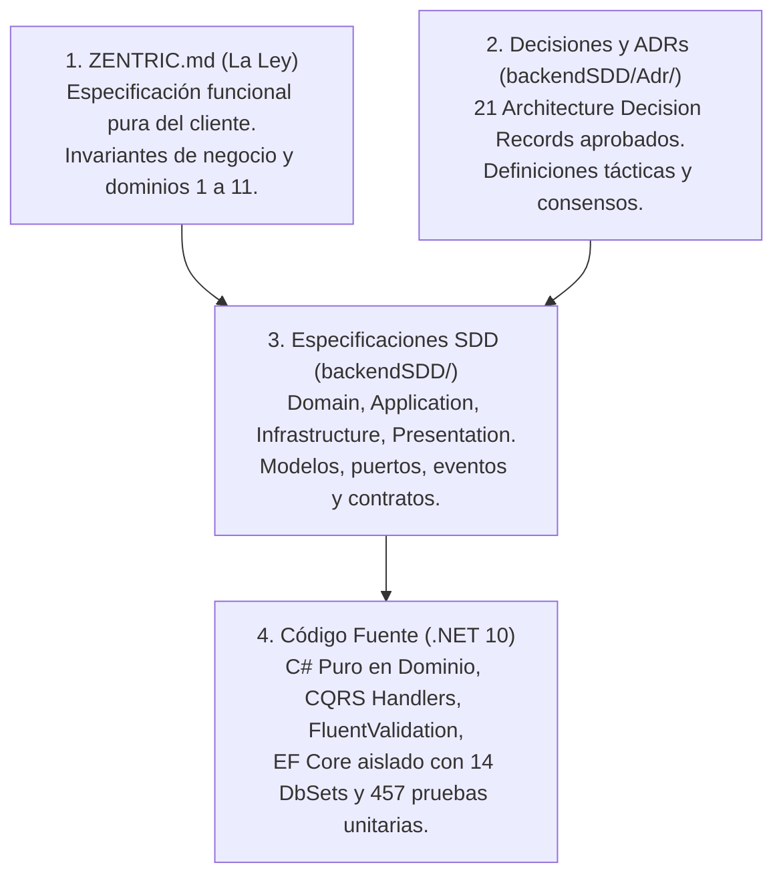
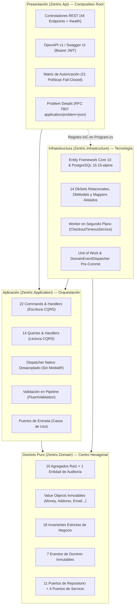
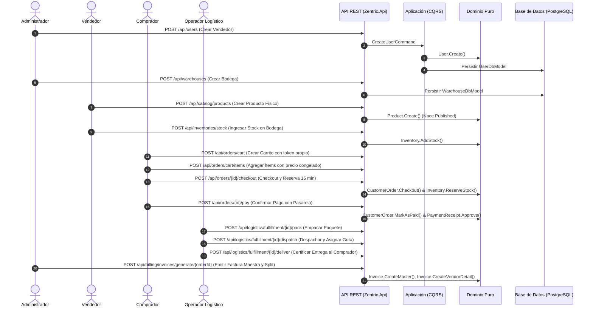

# Zentric Marketplace — Backend Core & Domain API

[](https://dotnet.microsoft.com/)
[](https://learn.microsoft.com/dotnet/csharp/)
[](https://www.postgresql.org/)
[](https://www.docker.com/)
[-brightgreen?style=for-the-badge&logo=xunit)](https://xunit.net/)
[](./backendSDD/02-software-architecture.md)
[](./.agents/skills/generic-sdd-agent/SKILL.md)
[](./LICENSE)

Núcleo de Dominio y API Central para la plataforma de comercio electrónico y marketplace **Zentric**. Diseñada bajo principios rigurosos de ingeniería de software empresarial: **Arquitectura Hexagonal (Puertos y Adaptadores)**, **Domain-Driven Design (DDD)** táctico, segregación de responsabilidades con **CQRS**, y gobernada mediante **Spec-Driven Development (SDD)**.

---

## 📑 Tabla de Contenidos
1. [Inicio Rápido (Quick Start)](#-inicio-rápido-quick-start)
2. [Visión General del Negocio](#-visión-general-del-negocio)
3. [Estructura de Especificación (SDD)](#-estructura-de-especificación-sdd)
4. [Arquitectura del Sistema (Hexagonal + DDD + CQRS)](#-arquitectura-del-sistema)
5. [Modelado Táctico de Dominio y Lenguaje Ubicuo](#-modelado-táctico-de-dominio-y-lenguaje-ubicuo)
6. [Registro de Decisiones Arquitectónicas (ADRs)](#-registro-de-decisiones-arquitectónicas-adrs)
7. [Contrato de API REST y Catálogo de Endpoints](#-contrato-de-api-rest-y-catálogo-de-endpoints)
8. [Flujo Operativo de Negocio](#-flujo-operativo-de-negocio)
9. [Tratamiento Estandarizado de Errores (RFC 7807)](#-tratamiento-estandarizado-de-errores-rfc-7807)
10. [Instalación y Despliegue](#-instalación-y-despliegue)
11. [Pruebas Automatizadas y Calidad](#-pruebas-automatizadas-y-calidad)
12. [Matriz de Trazabilidad Técnica](#-matriz-de-trazabilidad-técnica)

---

## ⚡ Inicio Rápido (Quick Start)

El entorno completo está contenerizado para permitir su ejecución inmediata:

```bash
# 1. Clonar el repositorio
git clone https://github.com/D-MachadoDev/Zentric.git
cd Zentric

# 2. Iniciar PostgreSQL 16.15-alpine y la API en contenedores
docker compose up -d --build

# 3. Acceder a la documentación interactiva OpenAPI en el navegador:
# http://localhost:5076/swagger
```

Para compilar y ejecutar la suite de pruebas automatizadas en local (.NET 10 SDK):
```bash
# Compilar con advertencias como errores
dotnet build backend/Zentric.slnx -warnaserror

# Ejecutar la suite de pruebas unitarias
dotnet test backend/Zentric.slnx --filter "FullyQualifiedName!~E2E" --no-build
```

---

## 🏢 Visión General del Negocio

**Zentric** gestiona la operación integral de un marketplace multi-vendedor con logística distribuida, múltiples centros de almacenamiento y catálogo heterogéneo:

- **Consistencia de Inventario:** Control atómico de existencias por bodega física y variante (SKU), evitando sobreventa y quiebres por stock fantasma.
- **Reserva Preventiva en Checkout:** Retención atómica de stock en bodegas con menor carga operativa al iniciar checkout, con expiración automática de **15 minutos** gestionada por el trabajador `CheckoutTimeoutService` si el pago no se confirma.
- **Logística y Despachos:** Subdivisión de pedidos de compra en órdenes logísticas de despacho individuales por vendedor y bodega de origen.
- **Posventa y Garantías:** Solicitudes de devolución con validación de período de garantía legal, inspección técnica física en bodega y reincorporación controlada al stock usado o reacondicionado.
- **Facturación y Liquidación:** Emisión de Factura Maestra consolidada para el comprador, facturas split de detalle para cada vendedor y desglose interno de comisión de plataforma.

---

## 📖 Estructura de Especificación (SDD)

El desarrollo del proyecto se rige por **Spec-Driven Development (SDD)**, manteniendo sincronización bidireccional estricta entre la especificación técnica en `backendSDD/` y el código fuente en C#:



| Nivel de Verdad | Documento | Propósito Arquitectónico |
| :--- | :--- | :--- |
| **Nivel 1: La Ley** | [`ZENTRIC.md`](./ZENTRIC.md) | Documento funcional original. Intocable en su redacción. Excluye explícitamente elecciones de base de datos, UI y tecnologías de persistencia. |
| **Nivel 2: Addenda del Owner** | Addenda en `ZENTRIC.md` | Resoluciones formales dictadas por el Owner para resolver ambigüedades operativas de la Ley. |
| **Nivel 3: Decisiones de Arquitectura** | [`ADR-0001` a `ADR-0021`](./backendSDD/Adr/) | Registros inmutables de diseño (reserva atómica, VariantId, carritos, JWT, propiedad del recurso, etc.). |
| **Nivel 4: Fuente Única de Verdad (SSoT)** | [`backendSDD/SDD.md`](./backendSDD/SDD.md) y [`backendSDD/`](./backendSDD/) | Catálogo maestro que indexa modelos, invariantes, casos de uso, contratos de persistencia y endpoints. |
| **Nivel 5: Implementación Técnica** | Código Fuente C# | Implementación concreta estructurada en 5 proyectos dentro de la solución `backend/Zentric.slnx`. |

---

## 🏛 Arquitectura del Sistema

La solución implementa una **Arquitectura Hexagonal (Puertos y Adaptadores)** con separación estricta de responsabilidades hacia el centro:



### Reglas Arquitectónicas Inviolables
1. **Aislamiento Total del Dominio:** `Zentric.Domain` no contiene dependencias de paquetes NuGet externos, frameworks web ni librerías de persistencia.
2. **Aislamiento Estricto de Persistencia:** En `Zentric.Infrastructure`, EF Core utiliza modelos dedicados (`*DbModel`) y mapeadores explícitos (`*Mapper`), previniendo anotaciones de tecnología o setters anémicos en las entidades de negocio.
3. **Controladores Delgados (Thin Controllers):** Los controladores reciben las solicitudes HTTP, resuelven la identidad del token, delegan inmediatamente en el dispatcher propio de la capa Application y devuelven respuestas RESTful consistentes.
4. **Validación Automática en Pipeline:** `ValidationBehavior` intercepta cada comando antes de alcanzar el handler, ejecutando las reglas de FluentValidation y retornando fallos tipados estructurados.

---

## 📦 Modelado Táctico de Dominio y Lenguaje Ubicuo

El modelo táctico define **10 Agregados Raíz** de negocio y **1 Entidad de Auditoría Transaccional**, asegurando que el estado interno solo mute mediante métodos expresivos:

| Agregado / Entidad | Bounded Context | Invariante Central de Negocio | Ubicación en Código |
| :--- | :--- | :--- | :--- |
| **`User`** | Usuarios e Identidad | Unicidad estricta de correo y documento. Estados: `Active`, `Blocked`. Contraseña con hash PBKDF2. | [`User.cs`](./backend/Zentric.Domain/Users/User.cs) |
| **`Buyer`** | Compradores | Identidad 1:1 con `User`. Dirección principal inmutable (`Address`) obligatoria. | [`Buyer.cs`](./backend/Zentric.Domain/Buyers/Buyer.cs) |
| **`Product`** | Catálogo | Variantes obligatorias en productos físicos. Nace publicado (`Published`). Solo el vendedor muta el estado. | [`Product.cs`](./backend/Zentric.Domain/Products/Product.cs) |
| **`Inventory`** | Inventarios | Existencias no negativas. Contadores atómicos: `AvailableQuantity`, `ReservedQuantity`, `UsedQuantity`, `DamagedQuantity`. | [`Inventory.cs`](./backend/Zentric.Domain/Inventories/Inventory.cs) |
| **`Warehouse`** | Bodegas | Capacidad volumétrica positiva ($m^3$). Tipos: bodega propia de marketplace o de vendedor. | [`Warehouse.cs`](./backend/Zentric.Domain/Warehouses/Warehouse.cs) |
| **`CustomerOrder`** | Pedidos de Compra | Carrito de compras con precio congelado por línea (`OrderItem`), cálculo aritmético en `Money` y timeout de 15 minutos. | [`CustomerOrder.cs`](./backend/Zentric.Domain/Orders/CustomerOrder.cs) |
| **`FulfillmentOrder`** | Logística y Despachos | Partición de despacho por vendedor. Ciclo: `PendingPack` → `Packed` → `Dispatched` → `Delivered` / `Cancelled`. | [`FulfillmentOrder.cs`](./backend/Zentric.Domain/Logistics/FulfillmentOrder.cs) |
| **`ReturnRequest`** | Devoluciones | Doble aprobación técnica y comercial. Reingreso obligatorio al stock usado en bodega. Prohibido para digitales. | [`ReturnRequest.cs`](./backend/Zentric.Domain/Returns/ReturnRequest.cs) |
| **`Invoice`** | Facturación | Tipos: `Master`, `ZentricDetail` (comisión interna), `VendorDetail` (liquidación de vendedor). Solo el administrador emite. | [`Invoice.cs`](./backend/Zentric.Domain/Billing/Invoice.cs) |
| **`PaymentReceipt`** | Pagos y Recaudo | Registro inmutable de transacciones de recaudo y notas crédito (`RefundCredit`) de reembolso. | [`PaymentReceipt.cs`](./backend/Zentric.Domain/Payments/PaymentReceipt.cs) |
| **`RefundAuditRecord`** | Auditoría de Reembolsos | Registro inmutable de trazabilidad para reembolsos extraordinarios ejecutados por administradores. | [`RefundAuditRecord.cs`](./backend/Zentric.Domain/Returns/Entities/RefundAuditRecord.cs) |

---

## 📑 Registro de Decisiones Arquitectónicas (ADRs)

El historial de decisiones de ingeniería se encuentra documentado bajo formato canónico en [`backendSDD/Adr/`](./backendSDD/Adr/):

| ADR | Título | Resumen de Decisión |
| :---: | :--- | :--- |
| **[ADR-0001](./backendSDD/Adr/0001-reserva-fragmentacion-contingencia.md)** | Reserva, Fraccionamiento y Contingencia | Reserva atómica en checkout; ante quiebre por stock fantasma, cancelación parcial y liberación. |
| **[ADR-0002](./backendSDD/Adr/0002-clave-inventario-variantid.md)** | Clave de Inventario por `VariantId` | El inventario se controla a nivel de SKU (`VariantId`) para existencias independientes. |
| **[ADR-0003](./backendSDD/Adr/0003-variante-obligatoria-productos-fisicos.md)** | Variante Obligatoria en Productos Físicos | Los productos físicos requieren al menos una variante con dimensiones físicas para publicarse. |
| **[ADR-0004](./backendSDD/Adr/0004-estado-cancelacion-despacho.md)** | Cancelación en Despachos Logísticos | Uso del estado `Cancelled` en `FulfillmentOrder` acompañado de motivo explícito. |
| **[ADR-0005](./backendSDD/Adr/0005-modelado-carrito-compras.md)** | Modelado de Carrito en `CustomerOrder` | El carrito se modela como el estado inicial (`Cart`) del agregado `CustomerOrder`. |
| **[ADR-0006](./backendSDD/Adr/0006-resolucion-contradiccion-ley-addendum.md)** | Prevalencia Normativa de Addenda | Aplicación estricta de la regla dictada por el Owner para partición de facturas y despachos. |
| **[ADR-0007](./backendSDD/Adr/0007-dispatcher-propio-sustituye-mediatr.md)** | Dispatcher Propio en Lugar de MediatR | Se reemplazó MediatR por un dispatcher nativo desacoplado para eliminar riesgos de licencia copyleft. |
| **[ADR-0008](./backendSDD/Adr/0008-transportadora-y-tarifa-de-envio.md)** | Política de Transportadora y Envío | Transportadora asignada por bodega y tarifa de transporte por cuenta del comprador. |
| **[ADR-0009](./backendSDD/Adr/0009-autenticacion-jwt-rg01.md)** | Autenticación Simétrica con JWT | Login con correo y contraseña, hash PBKDF2-HMAC-SHA256 en el servidor y token JWT HS256 de 60 min. |
| **[ADR-0010](./backendSDD/Adr/0010-relojo-como-puerto-iclock.md)** | Reloj como Puerto de Dominio (`IClock`) | El tiempo entra al modelo por un puerto inyectable, permitiendo congelar el tiempo en pruebas. |
| **[ADR-0011](./backendSDD/Adr/0011-matriz-autorizacion-por-rol.md)** | Matriz de Autorización por Rol | 21 políticas registradas en un archivo central con `FallbackPolicy` fail-closed. |
| **[ADR-0012](./backendSDD/Adr/0012-contrato-json-de-los-enum-por-nombre.md)** | Enumeraciones por Nombre en JSON | Los `enum` se serializan exclusivamente como texto; los enteros numéricos responden `400 Bad Request`. |
| **[ADR-0013](./backendSDD/Adr/0013-propiedad-del-recurso-por-rol.md)** | Propiedad del Recurso por Rol | El filtro por dueño lo decide el rol; un recurso ajeno responde `404 Not Found` también en escrituras. |
| **[ADR-0014](./backendSDD/Adr/0014-enmiendas-a-la-matriz-de-autorizacion.md)** | Enmiendas a la Matriz de Roles | Quiebre reportable por Operador; facturación y reembolsos solo Administrador; Supervisor solo lectura. |
| **[ADR-0015](./backendSDD/Adr/0015-contrato-de-error-http-problem-json.md)** | Contrato de Error Problem Details | Estandarización de respuestas de error bajo RFC 7807 `application/problem+json`. |
| **[ADR-0016](./backendSDD/Adr/0016-pruebas-e2e-http-con-postgres-efimero.md)** | Pruebas E2E con PostgreSQL Efímero | Ejecución de suite de integración real contra PostgreSQL en Docker mediante Testcontainers. |
| **[ADR-0017](./backendSDD/Adr/0017-listados-de-recurso-propio.md)** | Listados de Recurso Propio | Endpoints de consulta masiva con filtrado forzado en base de datos según el rol del llamante. |
| **[ADR-0018](./backendSDD/Adr/0018-devoluciones-confianza-recepcion-responsabilidad.md)** | Protocolo de Inspección en Devoluciones | Inspección en bodega por Operador Logístico y responsabilidad económica de reembolso. |
| **[ADR-0019](./backendSDD/Adr/0019-auditoria-reembolsos-excepcionales.md)** | Auditoría de Reembolsos de Administrador | Registro inmutable de auditoría para reembolsos extraordinarios ejecutados por administradores. |
| **[ADR-0020](./backendSDD/Adr/0020-precio-congelado-y-credito-parcial-por-linea.md)** | Precio Congelado y Crédito por Línea | Snapshot inmutable del precio unitario al agregar al carrito y reembolsos proporcionales. |
| **[ADR-0021](./backendSDD/Adr/0021-ajuste-de-stock-sin-cuello-de-botella.md)** | Ajuste de Stock sin Cuello de Botella | Evidencia según tipo de bodega (Marketplace vs. Vendedor) sin cuellos de botella administrativos. |
| **[ADR-0022](./backendSDD/Adr/0022-pedido-resuelto-pasa-a-cancelled.md)** | Pedido Resuelto Transiciona a `Cancelled` | El pedido maestro pasa a Cancelled cuando todos sus despachos son cancelados por quiebre de stock. |
| **[ADR-0023](./backendSDD/Adr/0023-split-de-pagos-documentos-no-transferencias.md)** | Split Contable sin Transferencias Bancarias | El split de pagos se satisface con los 3 documentos contables sin dispersión bancaria directa. |
| **[ADR-0024](./backendSDD/Adr/0024-entrega-digital-inmediata-por-linea.md)** | Entrega Digital Inmediata por Línea | El producto digital se entrega inmediatamente tras el pago y se registra individualmente por ítem. |
| **[ADR-0025](./backendSDD/Adr/0025-stock-negativo-update-condicional-atomico.md)** | No-Negatividad de Stock con UPDATE Condicional | Garantía de existencias no negativas mediante sentencia UPDATE atómica a nivel de motor SQL. |

---

## 🔌 Contrato de API REST y Catálogo de Endpoints

La API expone **45 rutas HTTP** (44 acciones REST en 9 controladores más la sonda `/health`), detalladas en [`backendSDD/Presentation/01-endpoints.md`](./backendSDD/Presentation/01-endpoints.md):

- **Autenticación e Identidad (`AuthController`):**
  - `POST /api/auth/login` — Autenticación con correo y contraseña. Emite token Bearer JWT.
  - `GET /api/auth/me` — Consulta de identidad y rol derivada del token validado.
- **Usuarios y Acceso (`UsersController`):**
  - `POST /api/users` — Registro de usuarios (anónimo solo para rol Comprador; resto exige Administrador).
  - `GET /api/users` — Lista de usuarios con filtro opcional por rol.
  - `GET /api/users/{id}` — Ficha técnica de usuario por ID.
  - `POST /api/users/{id}/block` — Bloqueo de acceso de usuario (solo Administrador).
  - `POST /api/users/{id}/activate` — Reactivación de usuario previamente bloqueado (solo Administrador).
- **Bodegas y Almacenamiento (`WarehousesController`):**
  - `POST /api/warehouses` — Alta de bodega con capacidad volumétrica (solo Administrador).
  - `GET /api/warehouses` — Lista de bodegas activas con filtro opcional por vendedor.
  - `GET /api/warehouses/{id}` — Ficha técnica de bodega por ID.
- **Inventarios y Existencias (`InventoriesController`):**
  - `POST /api/inventories/stock` — Ingreso de unidades de stock (nuevas o usadas).
  - `GET /api/inventories` — Lista consolidada de inventario con aislamiento por rol.
  - `GET /api/inventories/{variantId}` — Consulta de stock distribuido por SKU/variante.
  - `POST /api/inventories/{id}/adjust` — Ajuste de existencias por conteo físico (solo Administrador y Supervisor).
- **Catálogo de Productos (`CatalogController`):**
  - `POST /api/catalog/products` — Alta de producto que nace publicado (`Published`).
  - `POST /api/catalog/products/{productId}/publish` — Reactivación de producto suspendido.
  - `POST /api/catalog/products/{productId}/suspend` — Suspensión temporal de producto.
  - `GET /api/catalog/products` — Catálogo público de productos disponibles.
  - `GET /api/catalog/products/paged` — Catálogo paginado con metadatos de navegación.
  - `GET /api/catalog/products/{id}` — Ficha técnica completa de un producto por ID.
- **Carrito y Pedidos (`OrdersController`):**
  - `POST /api/orders/cart` — Inicializa carrito a nombre del comprador del token.
  - `POST /api/orders/cart/items` — Agrega ítems congelando el precio unitario vigente.
  - `POST /api/orders/{orderId}/checkout` — Ejecuta checkout, reserva stock y activa ventana de 15 minutos.
  - `POST /api/orders/{orderId}/pay` — Procesa pago, consolida reserva y genera comprobante.
  - `GET /api/orders` — Lista de pedidos con aislamiento forzado en BD según rol.
  - `GET /api/orders/{id}` — Consulta de pedido (vista restringida para vendedor; completa para comprador y admin).
- **Logística y Despachos (`LogisticsController`):**
  - `POST /api/logistics/fulfillment` — Derivación de orden logística de despacho por vendedor.
  - `POST /api/logistics/fulfillment/{id}/pack` — Empaque de mercancía en bodega (`Packed`).
  - `POST /api/logistics/fulfillment/{id}/dispatch` — Despacho físico y asignación de guía (`Dispatched`).
  - `POST /api/logistics/fulfillment/{id}/deliver` — Certificación de entrega al comprador (solo Operador Logístico).
  - `POST /api/logistics/fulfillment/cancel-ghost-stock` — Cancelación por stock fantasma y devolución automática.
  - `GET /api/logistics/fulfillments` — Lista de despachos con aislamiento por rol.
  - `GET /api/logistics/fulfillment/{id}` — Consulta de despacho y número de guía de transporte.
- **Devoluciones y Garantías (`ReturnsController`):**
  - `POST /api/returns/request` — Radicación de solicitud de devolución por garantía.
  - `POST /api/returns/{id}/inspect` — Registro de dictamen de inspección física en bodega.
  - `POST /api/returns/{id}/approve` — Aprobación comercial y reingreso a stock usado (solo Vendedor).
  - `POST /api/returns/{id}/reject` — Rechazo comercial de la devolución (solo Vendedor).
  - `POST /api/returns/{id}/refund` — Emisión y liquidación del reembolso (solo Administrador).
  - `GET /api/returns` — Lista de devoluciones con aislamiento por rol.
  - `GET /api/returns/{id}` — Expediente completo de devolución por ID.
- **Facturación y Liquidación (`BillingController`):**
  - `POST /api/billing/invoices/generate/{orderId}` — Emisión de Factura Maestra y facturas split (solo Administrador).
  - `POST /api/billing/invoices/annul/{orderId}` — Anulación formal de Factura Maestra (solo Administrador).
  - `GET /api/billing/invoices` — Lista de facturas con aislamiento por rol.
  - `GET /api/billing/invoices/order/{orderId}` — Facturas vinculadas a un pedido pagado.
- **Infraestructura y Monitoreo:**
  - `GET /health` — Sonda de diagnóstico (proceso web + conectividad activa con PostgreSQL).

---

## 🔄 Flujo Operativo de Negocio



---

## 🛡 Tratamiento Estandarizado de Errores (RFC 7807)

La API implementa respuestas estandarizadas bajo **RFC 7807 (Problem Details)** servidas con encabezado `application/problem+json`:

- Respuestas `400 Bad Request` para fallos de validación o violaciones de invariantes de negocio.
- Respuestas `404 Not Found` para identificadores inexistentes **o recursos ajenos al llamante** ([ADR-0013](./backendSDD/Adr/0013-propiedad-del-recurso-por-rol.md)).
- Respuestas `401 Unauthorized` ante tokens ausentes o inválidos.
- Respuestas `403 Forbidden` cuando el rol carece de privilegios para la política del endpoint.
- Respuestas `500 Internal Server Error` controladas por el middleware global sin exponer detalles internos de la infraestructura.

---

## 🚀 Instalación y Despliegue

### Despliegue con Docker Compose (Recomendado)
```bash
docker compose up -d --build
```
- **API REST & Swagger UI:** `http://localhost:5076/swagger`
- **Base de Datos PostgreSQL:** Puerto host `15432` (`localhost:15432`, BD: `ZentricDb`)
- **Frontend Web:** `http://localhost:5180`

Para detener el entorno conservando datos:
```bash
docker compose down
```

Para reiniciar con base de datos limpia (aplica automáticamente las 15 migraciones y el bootstrap):
```bash
docker compose down -v && docker compose up -d
```

### Ejecución Local con .NET 10 SDK
```bash
# 1. Restaurar dependencias
dotnet restore backend/Zentric.slnx

# 2. Compilar con máxima severidad
dotnet build backend/Zentric.slnx -warnaserror

# 3. Ejecutar la API
dotnet run --project backend/Zentric.Api/Zentric.Api.csproj
```

---

## 🧪 Pruebas Automatizadas y Calidad

El proyecto cuenta con **457 pruebas unitarias y de integración arquitectónica** en verde continuo ejecutadas con xUnit:

```bash
dotnet test backend/Zentric.slnx --filter "FullyQualifiedName!~E2E" --no-build
```

```text
Passed!  - Failed: 0, Passed: 457, Skipped: 0, Total: 457, Duration: 5 s - Zentric.Tests.dll (net10.0)
```

### Alcance de las Pruebas:
- **Dominio:** 18 invariantes de negocio, cálculo aritmético de moneda, control atómico de stock, máquinas de estados y guardas de inmutabilidad.
- **Aplicación:** Command Handlers y Query Handlers, validaciones automáticas con FluentValidation y canalización con `ValidationBehavior`.
- **Seguridad:** Matriz de autorización verificada por reflexión (`EndpointAuthorizationMatrixTests`), contrato de enumeraciones en JSON y aislamiento por propiedad de recurso.

---

## 📊 Matriz de Trazabilidad Técnica

| Componente Arquitectónico | Especificación y Requisitos | Ubicación en Código Fuente |
| :--- | :--- | :--- |
| **Metodología SDD** | Jerarquía de verdad formal; memoria viva del sistema. | [`ZENTRIC.md`](./ZENTRIC.md)<br/>[`backendSDD/`](./backendSDD/) |
| **Arquitectura Hexagonal** | Dependencia estricta hacia el centro; dominio sin dependencias. | [`Zentric.Domain/`](./backend/Zentric.Domain/)<br/>[`backendSDD/02-software-architecture.md`](./backendSDD/02-software-architecture.md) |
| **Modelado DDD** | 10 Agregados Raíz + 1 Auditoría con métodos de negocio semánticos. | [`Zentric.Domain/`](./backend/Zentric.Domain/)<br/>[`backendSDD/Domain/`](./backendSDD/Domain/) |
| **Aislamiento de Persistencia** | 14 DbSets, modelos `*DbModel` y `*Mapper` dedicados; Unit of Work. | [`Zentric.Infrastructure/Persistence/`](./backend/Zentric.Infrastructure/Persistence/) |
| **Segregación CQRS** | 22 Comandos y 14 Consultas con pipeline de validación sin MediatR. | [`Zentric.Application/`](./backend/Zentric.Application/) |
| **Manejo de Errores** | Mapeo estructurado a RFC 7807 (Problem Details). | [`ApiControllerBase.cs`](./backend/Zentric.Api/Controllers/ApiControllerBase.cs)<br/>[`backendSDD/Presentation/03-error-handling.md`](./backendSDD/Presentation/03-error-handling.md) |
| **Cobertura de Pruebas** | Suite de 457 pruebas automatizadas cubriendo todas las capas. | [`Zentric.Tests/`](./backend/Zentric.Tests/) |
| **Contenerización** | Despliegue multi-servicio en Docker Compose. | [`docker-compose.yml`](./docker-compose.yml)<br/>[`backend/Dockerfile`](./backend/Dockerfile) |
| **Documentación de API** | OpenAPI v1 con Swagger UI y esquema Bearer JWT. | [`backendSDD/Presentation/01-endpoints.md`](./backendSDD/Presentation/01-endpoints.md) |
| **Decisiones Técnicas** | Registro de 25 ADRs documentados bajo formato MADR. | [`backendSDD/Adr/`](./backendSDD/Adr/) |
