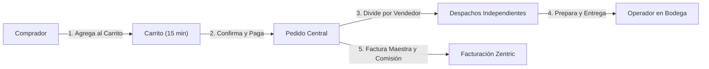

# 01. Panorama General del Sistema

> Documento derivado de la Ley funcional de negocio ([ZENTRIC.md](../ZENTRIC.md)) y sus decisiones de arquitectura asociadas. No introduce reglas nuevas ni asunciones. Su propósito es brindar una visión clara y comprensible del funcionamiento global de Zentric.

---

## 1. Qué es Zentric

Zentric es una plataforma digital centralizada que actúa como **intermediario comercial** entre compradores y vendedores. Administra la operación completa del marketplace: registro de participantes, publicación y catálogo de productos, existencias en bodegas distribuidas, procesamiento de pedidos, facturación con comisión de plataforma, logística de despacho y posventa (devoluciones).

---

## 2. Participantes y Roles del Negocio

Según [ZENTRIC.md](../ZENTRIC.md), cada participante dentro del sistema desempeña **un único rol**.

| Rol | Definición para Negocio / No Técnicos | Responsabilidad Principal |
|---|---|---|
| **Comprador** (`Buyer`) | Cliente que adquiere productos en el marketplace. | Navega el catálogo, compra mediante carrito, paga y solicita devoluciones. |
| **Vendedor** (`Vendor`) | Comercio o fabricante que vende productos en la plataforma. | Publica productos en su catálogo, gestiona sus bodegas y aprueba o rechaza solicitudes de devolución. |
| **Operador Logístico** (`LogisticsOperator`) | Personal encargado del movimiento físico de mercancía en bodega. | Prepara paquetes, realiza despachos, reporta faltantes de stock y confirma entregas. |
| **Administrador** (`Administrator`) | Operador central de Zentric con control global. | Da de alta a vendedores y bodegas iniciales, emite facturas y ejecuta reembolsos económicos. |
| **Supervisor** (`Supervisor`) | Auditor de la plataforma. | Rol de consulta y solo lectura. Monitorea operaciones y cumplimiento sin intervenir en escrituras. |

---

## 3. Glosario de Términos para Personas No Técnicas

Para evitar confusiones y asegurar que el equipo de negocio y el equipo técnico hablen exactamente el mismo idioma:

* **Variante (SKU):** La presentación específica de un producto físico (por ejemplo: una camiseta talla M color azul). El inventario siempre se controla a nivel de variante, no de producto general.
* **Despacho (`FulfillmentOrder`):** La porción de un pedido que corresponde a un único vendedor. Si un comprador compra artículos de dos vendedores distintos en el mismo carrito, el sistema crea un solo pedido maestro pero genera dos despachos separados para que cada vendedor envíe lo suyo.
* **Quiebre de Stock (Stock Fantasma):** Situación en la que el sistema indicaba que había existencias disponibles, pero físicamente en la bodega no se encuentran. Se resuelve cancelando el despacho afectado y reajustando el inventario.
* **Factura Maestra:** El documento comercial que refleja el total pagado por el comprador.
* **Detalle Zentric:** La comisión que cobra la plataforma por intermediar en la venta (control interno).
* **Detalle de Vendedor:** La liquidación que le corresponde recibir al vendedor tras descontar la comisión de Zentric.

---

## 4. Objetivos del Sistema

Definidos en [ZENTRIC.md](../ZENTRIC.md):

| Código | Objetivo |
|---|---|
| OBJ-01 | Administrar la información de todos los usuarios del marketplace |
| OBJ-02 | Gestionar el registro y administración de vendedores |
| OBJ-03 | Administrar compradores registrados |
| OBJ-04 | Controlar la información de las bodegas |
| OBJ-05 | Gestionar el catálogo de productos |
| OBJ-06 | Administrar el inventario distribuido entre bodegas |
| OBJ-07 | Gestionar el carrito de compras con control de tiempo |
| OBJ-08 | Controlar el ciclo completo de los pedidos |
| OBJ-09 | Administrar la facturación y comisiones de las compras |
| OBJ-10 | Gestionar los procesos logísticos de entrega |
| OBJ-11 | Administrar devoluciones y reembolsos |
| OBJ-12 | Consolidar información administrativa para consulta y auditoría |

---

## 5. Alcance

* **Incluido:** Registro y administración de usuarios, registro administrativo de vendedores y bodegas, catálogo de productos y variantes, control de inventario distribuido, reserva y timeout de carritos, procesamiento de pedidos, facturación multi-documento, envíos y logística, circuito de devoluciones y reembolsos, y seguridad mediante roles y permisos.
* **Excluido:** Interfaces gráficas de usuario (UI), aplicaciones móviles, portales web de cara al público y pasarelas de pago bancarias externas reales. **Este backend expone la API REST y gobierna el núcleo de dominio.**

---

## 6. Flujo Operativo del Negocio (Paso a Paso)

1. **Incorporación:** El Administrador registra al vendedor y su primera bodega física.
2. **Catálogo:** El vendedor registra sus productos y variantes.
3. **Inventario:** Se cargan las existencias iniciales en las bodegas correspondientes.
4. **Publicación:** Los productos se activan para ser visibles en el catálogo general.
5. **Compra:** El comprador selecciona productos en su carrito (con reserva temporal de 15 minutos) y confirma la compra.
6. **Transacción y División:** Se valida el pago y el sistema fracciona el pedido maestro en órdenes de despacho independientes por cada vendedor involucrado.
7. **Logística:** Los operadores preparan, empacan y despachan cada paquete.
8. **Cierre o Posventa:** El pedido finaliza con la entrega confirmada. Si surge un reclamo, se inicia el flujo de devolución (aprobación del vendedor e inspección logística).

---

## 7. Módulos del Dominio

El dominio de Zentric está estructurado en módulos cohesivos dentro de un único Bounded Context:

| Módulo | Responsabilidad | Documento de Referencia |
|---|---|---|
| **Identidad (`Identity`)** | Usuarios, credenciales y asignación de rol único. | [backendSDD/Domain/01-models.md](Domain/01-models.md#1-bounded-context-identity-access-usuarios) |
| **Catálogo (`Catalog`)** | Productos, variantes físicas/digitales y visibilidad. | [backendSDD/Domain/01-models.md](Domain/01-models.md#2-bounded-context-catalog-catalogo) |
| **Inventario (`Inventory`)** | Existencias por bodega, stock disponible y reservado. | [backendSDD/Domain/01-models.md](Domain/01-models.md#3-bounded-context-inventory-inventario-y-bodegas) |
| **Pedidos (`Ordering`)** | Carrito temporal, líneas de compra y pedido central. | [backendSDD/Domain/01-models.md](Domain/01-models.md#4-bounded-context-ordering-pedidos---interfaz-del-comprador) |
| **Logística (`Fulfillment`)** | Despachos por vendedor, empaque y entrega. | [backendSDD/Domain/01-models.md](Domain/01-models.md#5-bounded-context-fulfillment-logistics-despachos---interfaz-del-vendedor) |
| **Devoluciones (`Returns`)** | Solicitud, aprobación de vendedor, inspección y reingreso a stock usado. | [backendSDD/Domain/01-models.md](Domain/01-models.md#6-bounded-context-returns-devoluciones) |
| **Facturación (`Billing`)** | Factura maestra, detalle Zentric (comisión) y liquidación de vendedor. | [backendSDD/Domain/01-models.md](Domain/01-models.md#7-bounded-context-billing-facturacion) |
| **Compradores (`Buyers`)** | Direcciones de entrega y perfil del comprador. | [backendSDD/Domain/01-models.md](Domain/01-models.md#8-bounded-context-buyers-compradores) |
| **Pagos (`Payments`)** | Comprobantes de pago y créditos a favor por reembolsos. | [backendSDD/Domain/01-models.md](Domain/01-models.md#9-bounded-context-payments-pagos) |

---

## 8. Reglas Críticas Transversales

Definidas en [ZENTRIC.md](../ZENTRIC.md):

* **RG-01:** Toda operación en el sistema debe ser ejecutada por un usuario autenticado.
* **RG-02:** Cada usuario tiene asignado un único rol.
* **RG-03:** Ningún participante puede administrar información ni ejecutar acciones fuera del alcance de su rol.
* **Invariante de Stock:** El inventario nunca puede ser negativo ni reservarse mercancía marcada como dañada.
* **Inmutabilidad:** Un pedido finalizado o pagado no puede ser alterado en sus líneas originales.
