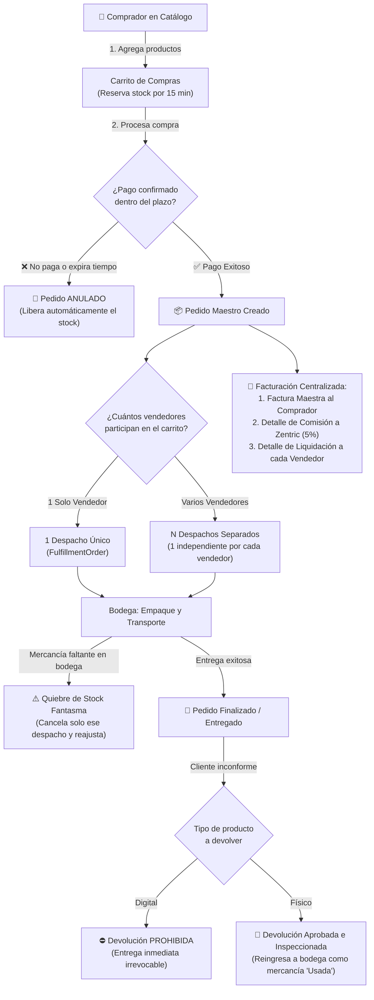

# 01. Panorama General del Sistema

> Documento derivado en un 100% de la Ley funcional de negocio ([ZENTRIC.md](../ZENTRIC.md)) y sus decisiones ratificadas (Addenda). No introduce reglas inventadas ni asunciones. Su propósito es brindar una visión integral, clara y accesible del funcionamiento global de Zentric para perfiles técnicos y de negocio.

---

## 1. Qué es Zentric

Zentric es una plataforma digital centralizada que actúa como **intermediario comercial** entre compradores y vendedores. Administra la operación completa del marketplace: incorporación de vendedores, catálogo unificado, inventario distribuido en múltiples bodegas, carrito con reserva temporal de existencias, división automática de pedidos, facturación con comisiones, logística de despacho y posventa (devoluciones y reembolsos).

### Diagrama del Flujo de Negocio Extremo a Extremo

---

## 2. Participantes y Roles del Negocio

Según [ZENTRIC.md](../ZENTRIC.md), cada participante en el sistema desempeña **un único rol** y únicamente puede operar con la información que le corresponde.

| Rol | Definición en Lenguaje Simple | Responsabilidades Principales |
|---|---|---|
| **Comprador** (`Buyer`) | Cliente final que adquiere productos en el marketplace. | Explora el catálogo, agrega al carrito, paga sus compras y solicita devoluciones si un producto físico llega en mal estado. |
| **Vendedor** (`Vendor`) | Comercio o proveedor dueño de los productos. | Publica productos en el catálogo, gestiona sus bodegas y aprueba o rechaza solicitudes de devolución de sus artículos. |
| **Operador Logístico** (`LogisticsOperator`) | Personal físico en bodega encargado de los paquetes. | Prepara pedidos, realiza empaque, despacha con transportadoras, confirma entregas y reporta quiebres físicos de existencias. |
| **Administrador** (`Administrator`) | Operador central de Zentric con control administrativo. | Incorpora vendedores a la plataforma, da de alta sus bodegas iniciales, emite facturas maestras y autoriza reembolsos de dinero. |
| **Supervisor** (`Supervisor`) | Auditor de control y cumplimiento. | Perfil de solo lectura y monitoreo general. Revisa métricas y operaciones sin intervenir en cambios ni escrituras. |

---

## 3. Flujo Operativo del Negocio (Paso a Paso)

El ciclo de vida de Zentric sigue 8 fases cronológicas estructuradas:

1. **Incorporación:** El Administrador registra al vendedor en la plataforma y da de alta su primera bodega física (el vendedor no puede auto-registrarse de forma anónima).
2. **Catálogo:** El vendedor registra sus productos y define sus variantes *(las distintas presentaciones físicas como talla, color o modelo específico del producto)*.
3. **Inventario:** Se cargan las existencias iniciales vinculadas obligatoriamente a una bodega física y a una variante específica.
4. **Publicación:** Los productos se activan y pasan a ser visibles en el catálogo general para todos los compradores.
5. **Compra y Reserva:** El comprador selecciona productos en su carrito. Al avanzar al pago, el sistema reserva temporalmente las unidades por 15 minutos para que nadie más se las quite mientras paga.
6. **Transacción y División de Pedido:** 
   - Si el comprador no paga dentro de los 15 minutos, el pedido pasa a estado **Anulado** y las existencias reservadas se devuelven de inmediato al inventario disponible.
   - Si el pago es exitoso, el sistema genera el pedido central y lo divide automáticamente en despachos independientes *(un paquete separado por cada vendedor participante en la compra)*.
7. **Logística y Despacho:** Los operadores en bodega empacan y entregan cada paquete a la transportadora. Si ocurre un quiebre de stock fantasma *(cuando el sistema creía que había existencias pero físicamente en la estantería no se encuentran)*, se cancela únicamente el despacho de ese vendedor y se devuelve el dinero de esa porción, sin afectar al resto del pedido.
8. **Cierre o Posventa:** El pedido se marca como finalizado tras la entrega confirmada. Si el comprador solicita una devolución:
   - Para productos digitales: la devolución está **estrictamente prohibida**.
   - Para productos físicos: requiere inspección física del operador logístico y aprobación del vendedor. Si se aprueba, la mercancía reingresa al inventario catalogada como **Usada**.

---

## 4. Objetivos del Sistema

Definidos formalmente en [ZENTRIC.md](../ZENTRIC.md):

| Código | Objetivo Funcional |
|---|---|
| **OBJ-01** | Administrar la información de todos los usuarios del marketplace |
| **OBJ-02** | Gestionar el registro y administración de vendedores |
| **OBJ-03** | Administrar compradores registrados |
| **OBJ-04** | Controlar la información de las bodegas |
| **OBJ-05** | Gestionar el catálogo de productos y variantes |
| **OBJ-06** | Administrar el inventario distribuido entre bodegas |
| **OBJ-07** | Gestionar el carrito de compras con control de tiempo |
| **OBJ-08** | Controlar el ciclo completo de los pedidos |
| **OBJ-09** | Administrar la facturación y comisiones de las compras |
| **OBJ-10** | Gestionar los procesos logísticos de entrega |
| **OBJ-11** | Administrar devoluciones y reembolsos posventa |
| **OBJ-12** | Consolidar información administrativa para consulta y auditoría |

---

## 5. Alcance

* **Procesos Incluidos:** Registro de compradores, administración de usuarios, registro administrativo de vendedores y bodegas, catálogo de productos físicos y digitales, control de inventario distribuido, reserva y caducidad de carritos, procesamiento de pedidos, facturación multi-documento (Factura Maestra, Detalle Zentric y Liquidación de Vendedor), envíos y logística, circuito de devoluciones y reembolsos, y seguridad mediante matriz de roles.
* **Procesos Fuera de Alcance:** Interfaces gráficas de usuario (UI), aplicaciones móviles, portales web de cara al público y pasarelas de pago bancarias externas reales. **Este backend expone la API REST empresarial y gobierna el núcleo de dominio puro.**

---

## 6. Módulos del Dominio

El dominio de Zentric está organizado en módulos de alta cohesión dentro de un único Bounded Context:

| Módulo | Responsabilidad Funcional | Especificación Técnica |
|---|---|---|
| **Identidad (`Identity`)** | Usuarios, credenciales seguras y asignación de rol único. | [Domain/01-models.md](Domain/01-models.md#1-bounded-context-identity-access-usuarios) |
| **Catálogo (`Catalog`)** | Productos físicos y digitales, variantes y estados de visibilidad. | [Domain/01-models.md](Domain/01-models.md#2-bounded-context-catalog-catalogo) |
| **Inventario (`Inventory`)** | Existencias por bodega, stock disponible, reservado y usado. | [Domain/01-models.md](Domain/01-models.md#3-bounded-context-inventory-inventario-y-bodegas) |
| **Pedidos (`Ordering`)** | Carrito temporal (15 min), líneas de compra y pedido maestro. | [Domain/01-models.md](Domain/01-models.md#4-bounded-context-ordering-pedidos---interfaz-del-comprador) |
| **Logística (`Fulfillment`)** | Órdenes de despacho por vendedor, empaque y entrega física. | [Domain/01-models.md](Domain/01-models.md#5-bounded-context-fulfillment-logistics-despachos---interfaz-del-vendedor) |
| **Devoluciones (`Returns`)** | Solicitud, aprobación de vendedor, inspección y retorno a stock usado. | [Domain/01-models.md](Domain/01-models.md#6-bounded-context-returns-devoluciones) |
| **Facturación (`Billing`)** | Factura maestra, comisión de plataforma (5%) y liquidación de vendedor. | [Domain/01-models.md](Domain/01-models.md#7-bounded-context-billing-facturacion) |
| **Compradores (`Buyers`)** | Direcciones de entrega y estado comercial del comprador. | [Domain/01-models.md](Domain/01-models.md#8-bounded-context-buyers-compradores) |
| **Pagos (`Payments`)** | Comprobantes de transacción y créditos a favor por devoluciones. | [Domain/01-models.md](Domain/01-models.md#9-bounded-context-payments-pagos) |

---

## 7. Reglas Generales y Validaciones Críticas

Las reglas maestras de la plataforma establecidas en [ZENTRIC.md](../ZENTRIC.md):

* **Regla General 01 (Autenticación Obligatoria):** Toda operación dentro del sistema debe ser ejecutada por un usuario autenticado con credenciales válidas.
* **Regla General 02 (Rol Único por Usuario):** Cada usuario tiene asignado exactamente un rol en la plataforma.
* **Regla General 03 (Límite Estricto de Responsabilidad):** Ningún participante puede consultar ni administrar información que no pertenezca a las funciones de su propio rol (por ejemplo: un comprador nunca ve carritos ni pedidos de otro comprador).
* **Validación Crítica de Existencias:** No se permite inventario negativo bajo ninguna circunstancia, ni se puede reservar mercancía marcada como "Dañada".
* **Validación Crítica de Inmutabilidad:** Un pedido finalizado o un pedido anulado no puede ser alterado bajo ninguna circunstancia.
* **Validación Crítica de Identidad:** El correo electrónico y el documento de identidad de cada usuario deben ser estrictamente únicos en todo el sistema.
* **Validación Crítica de Devoluciones:** La devolución de productos digitales está totalmente prohibida; los productos físicos devueltos únicamente reingresan a bodega con estado de mercancía "Usada".
