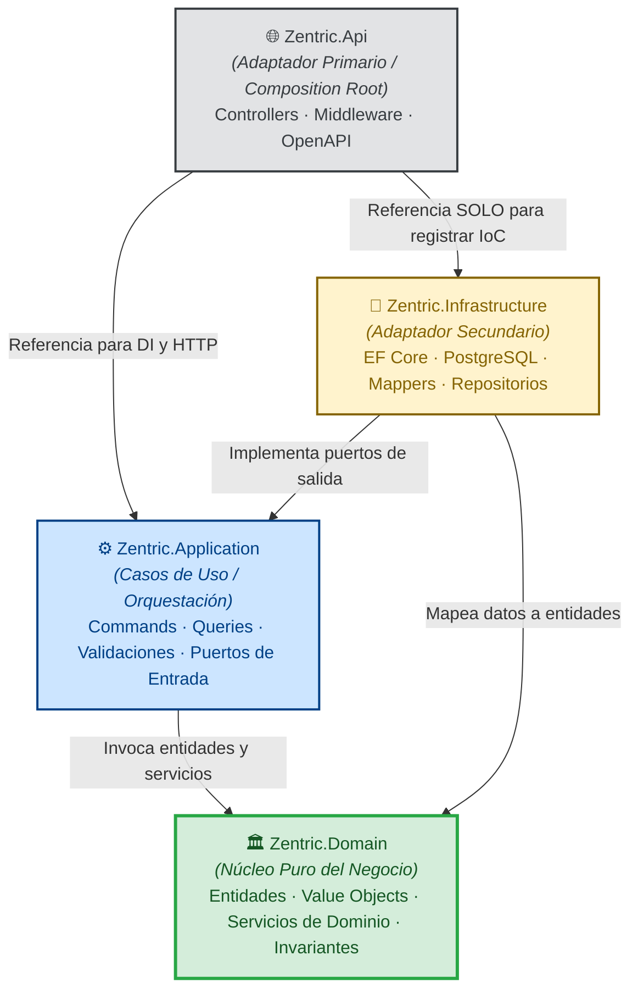
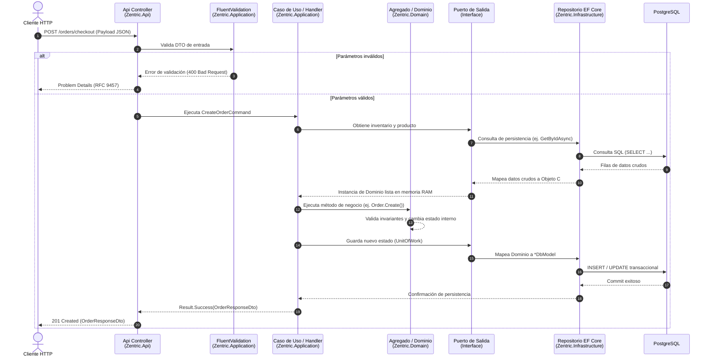

# 02. Arquitectura de Software

> **Documento de Especificación Arquitectónica.** Define el estilo arquitectónico, las capas concéntricas, la regla de dependencia unidireccional y las responsabilidades técnicas del backend de **Zentric**. Sigue el estándar de **Arquitectura Hexagonal (Puertos y Adaptadores)** y **Domain-Driven Design (DDD)**.

---

## 1. Visión General (Overview)

El núcleo del backend de **Zentric** implementa una **Arquitectura Hexagonal (Puertos y Adaptadores)** combinada con principios de **Domain-Driven Design (DDD)**, **CQRS (Segregación de Responsabilidades de Consulta y Comando)** y el **Patrón Result**.

El objetivo primario de esta arquitectura es **aislar el dominio del negocio** (las reglas del marketplace, pedidos, comisiones e inventarios) de cualquier tecnología externa (frameworks web, bases de datos relacionales, protocolos HTTP o servicios en la nube).

### Objetivos Clave:
- **Independencia tecnológica:** El negocio no sabe si corre sobre PostgreSQL, SQL Server o memoria.
- **Mantenibilidad a largo plazo:** El código de negocio cambia únicamente cuando cambian las reglas del negocio, no cuando se actualiza una librería.
- **Testabilidad total:** Toda la lógica central se prueba con pruebas unitarias instantáneas en memoria, sin levantar bases de datos ni contenedores.

---

## 2. Principios Arquitectónicos

1. **Diseño centrado en el Dominio (Domain-First):** El modelado de entidades y procesos de negocio precede a la elección de bases de datos o librerías.
2. **Separación estricta de responsabilidades:** Cada capa cumple un rol delimitado; ningún componente asume funciones de capas externas.
3. **Inversión de Dependencias (DIP):** Las capas de alto nivel (Dominio) no dependen de las capas de bajo nivel (Infraestructura); ambas dependen de abstracciones (Puertos/Interfaces).
4. **Alta cohesión y bajo acoplamiento:** Los módulos agrupan conceptos afines del marketplace y minimizan sus vínculos externos.
5. **Fronteras explícitas:** Prohibido compartir modelos de base de datos con la API o con el Dominio.

---

## 3. Capas y Regla de Dependencia Estricta

El flujo de dependencias es **estrictamente unidireccional hacia el centro (Zentric.Domain)**: 



### Matriz de Dependencias entre Proyectos:

| Proyecto | Dependencias Permitidas | Dependencias Prohibidas |
| :--- | :--- | :--- |
| **`Zentric.Domain`** | **Ninguna (C# Puro)**. No tiene paquetes NuGet externos. | `EF Core`, `ASP.NET Core`, `Newtonsoft`, HTTP, SQL, Infrastructure. |
| **`Zentric.Application`** | Únicamente `Zentric.Domain`. | `Zentric.Infrastructure`, `Zentric.Api`, EF Core, SQL, detalles HTTP. |
| **`Zentric.Infrastructure`** | `Zentric.Application` y `Zentric.Domain`. | `Zentric.Api`. |
| **`Zentric.Api`** | `Zentric.Application` y `Zentric.Infrastructure`. | Reglas de negocio. La referencia a `Infrastructure` es **exclusiva** para registrar la Inyección de Dependencias en `Program.cs`. |

---

## 4. Estructura Física del Proyecto (.NET 10 Solution)

La solución `Zentric.slnx` se divide físicamente en cuatro proyectos correspondientes a las capas arquitectónicas:

```text
backend/
├── Zentric.slnx
│
├── Zentric.Api/                          <-- Presentación / Adaptador Primario
│   ├── Controllers/                      <-- Controladores REST delgados por rol/recurso
│   ├── Middleware/                       <-- GlobalExceptionMiddleware (RFC 9457)
│   ├── Extensions/                       <-- Registro de dependencias de la API
│   └── Program.cs                        <-- Punto de entrada único (Composition Root)
│
├── Zentric.Application/                  <-- Casos de Uso / Orquestación
│   ├── Common/                           <-- Result Pattern, Interfaces base, Pipeline Behaviors
│   ├── <Modulo>/                         <-- Comandos y Consultas CQRS (Buyers, Orders, Products, etc.)
│   │   ├── Commands/                     <-- Mutaciones de estado y validadores FluentValidation
│   │   ├── Queries/                      <-- Consultas de solo lectura y DTOs de respuesta
│   │   └── Ports/                        <-- Puertos de salida y abstracciones de servicios
│   └── DependencyInjection.cs            <-- Registro de servicios de aplicación
│
├── Zentric.Domain/                       <-- Núcleo Puro del Dominio (Sin dependencias externas)
│   ├── Common/                           <-- Entidad base, Value Object base, Eventos base
│   └── <Modulo>/                         <-- Módulos de negocio (Orders, Inventories, Returns, etc.)
│       ├── Aggregates/                   <-- Raíces de Agregado con invariantes encapsuladas
│       ├── ValueObjects/                 <-- Objetos de valor inmutables (Money, Address, Sku)
│       ├── Services/                     <-- Servicios de Dominio (lógica inter-agregados)
│       ├── Events/                       <-- Eventos de Dominio emitidos por el negocio
│       └── Ports/                        <-- Puertos requeridos por el dominio (IClock, IRepository)
│
├── Zentric.Infrastructure/               <-- Adaptadores Secundarios / Persistencia y Tecnología
│   ├── Persistence/
│   │   ├── ZentricDbContext.cs          <-- Contexto EF Core (12 DbSets)
│   │   ├── Models/                       <-- Modelos de persistencia relacional (*DbModel)
│   │   ├── Mappers/                      <-- Mapeadores bidireccionales (DbModel <-> Dominio)
│   │   ├── Repositories/                 <-- Implementaciones concretas de puertos de salida
│   │   └── Migrations/                   <-- Migraciones versionadas para PostgreSQL
│   ├── Services/                         <-- Adaptadores técnicos (Clock, Background Jobs)
│   └── DependencyInjection.cs            <-- Registro de servicios de infraestructura
│
└── Zentric.Tests/                        <-- Suite de Pruebas Automatizadas
    ├── Unit/                             <-- Pruebas de Dominio e invariantes puras
    ├── Application/                      <-- Pruebas de Casos de Uso con mocks de puertos
    └── EndToEnd/                         <-- Pruebas de integración HTTP y base de datos
```

---

## 5. Responsabilidades Detalladas por Capa

### 5.1. Zentric.Api (Presentación y Composition Root)
Es la puerta de entrada a la aplicación. Su rol es transformar el transporte HTTP en intenciones de aplicación:
- **Punto de Entrada (`Program.cs`):** Ensambla todas las capas mediante inyección de dependencias (IoC), configura la seguridad (JWT Bearer con PBKDF2), CORS y Swagger.
- **Controladores Delgados (Thin Controllers):** No contienen lógica de negocio ni cálculos matemáticos. Su única labor es recibir el request HTTP, verificar claims/roles, enviar el comando/consulta a Application y retornar el resultado.
- **Middleware Global de Excepciones:** Atrapa fallos catastróficos no previstos y los transforma en respuestas estándar bajo **RFC 9457 (Problem Details)**, impidiendo fugas de trazas internas.

### 5.2. Zentric.Application (Casos de Uso y Orquestación)
Define qué puede hacer el sistema coordinando los flujos de trabajo:
- **Patrón CQRS:** Separa operaciones de escritura (Commands) de operaciones de lectura (Queries).
- **Validación Defensiva (FluentValidation):** Valida formatos, longitudes, rangos y nulidad de los parámetros antes de que lleguen al dominio.
- **Invocación del Dominio:** Carga los agregados a través de los puertos de salida, ejecuta los métodos de negocio de las entidades o servicios de dominio, y persiste los cambios.
- **Patrón Result:** Retorna estructuras `Result<T>` con errores tipados para fallos predecibles de negocio (p. ej. "Stock insuficiente", "Pedido no encontrado"), evitando el uso de excepciones para el flujo lógico normal.

### 5.3. Zentric.Domain (El Núcleo del Negocio)
Es el activo más valioso del software. Encapsula las reglas puras del marketplace de Zentric:
- **Entidades y Agregados:** Tienen identidad propia (`Guid`) y métodos de negocio expresivos (ej. `ReserveStock()`, `CancelByTimeout()`). **Prohibidos los setters públicos anémicos**.
- **Value Objects:** Inmutables, comparables por valor (ej. `Money`, `Address`, `TaxId`).
- **Servicios de Dominio:** Lógica de negocio que involucra múltiples agregados y no pertenece a uno solo (ej. cálculo de comisión confidencial de Zentric del 5%, validación de expiración de reservas de 15 minutos).
- **Puertos (Interfaces):** Define qué contratos necesita del exterior (ej. `IClock` para abstraer la hora, `IOrderRepository` para persistencia).

### 5.4. Zentric.Infrastructure (Adaptadores de Tecnología)
Implementa los puertos requeridos por el Dominio y la Aplicación:
- **Persistencia Aislada (EF Core & PostgreSQL):** Las tablas de base de datos se mapean a clases independientes `*DbModel` dentro de `Infrastructure/Persistence/Models`. Las entidades de dominio jamás son anotadas con atributos de EF Core.
- **Mappers Bidireccionales:** Convierten de forma determinista entre `*DbModel` y las entidades del Dominio.
- **Servicios Técnicos:** Implementaciones de puertos como `SystemClock` o `ManualClock` para simulación temporal en pruebas.

---

## 6. Flujo de Control y Dependencias (Paso a Paso)

El siguiente diagrama ilustra cómo viaja una petición desde el cliente web hasta la base de datos y de regreso:



---

## 7. Tratamiento de Errores y Excepciones por Capa

| Capa | Mecanismo de Control | Regla Estricta |
| :--- | :--- | :--- |
| **Domain** | Guardas defensivas (`ArgumentException`, `InvalidOperationException`). | Garantiza que nunca existan objetos corruptos en memoria. Prohibido capturar excepciones técnicas (`try-catch`). |
| **Application** | `FluentValidation` y retornos de tipo `Result<T>`. | Retorna fallos de negocio esperados sin lanzar excepciones. No atrapa fallos de infraestructura no controlados. |
| **Infrastructure** | Traducción a `Result.Failure`. | Traduce errores técnicos predecibles a mensajes de negocio. Oculta excepciones de bajo nivel (`NpgsqlException`, `SqlException`). |
| **Api** | Middleware Global de Excepciones y mapeador de `Result<T>`. | Última barrera de defensa. Transforma fallos no controlados en respuestas estándar RFC 9457 (Problem Details). |

---

## 8. Restricciones Arquitectónicas Inviolables (Las 10 Reglas de Oro)

Para garantizar la integridad del sistema a largo plazo, cualquier desarrollador o agente de IA debe cumplir obligatoriamente estas 10 reglas:

1. **La lógica de negocio vive exclusivamente en `Zentric.Domain`:** Queda prohibido escribir reglas de negocio en controladores o repositorios.
2. **Los controladores de API son delgados:** No contienen validaciones de negocio complejas ni cálculos matemáticos; solo traducen HTTP a Casos de Uso.
3. **Los DTOs de HTTP jamás entran al Dominio:** La capa de Aplicación traduce los DTOs a parámetros de métodos de dominio.
4. **Las entidades de persistencia (`*DbModel`) nunca se exponen al exterior:** Jamás se retornan en endpoints de la API ni entran a `Zentric.Domain`.
5. **Comunicación exclusiva a través de Puertos:** Cualquier interacción entre el Dominio y tecnologías externas se realiza mediante interfaces.
6. **Los adaptadores no inventan reglas:** Implementan los contratos de los puertos pero nunca definen invariantes de negocio.
7. **La Infraestructura depende del Dominio, nunca al revés:** `Zentric.Infrastructure` implementa lo que `Zentric.Domain` le exige.
8. **Regla de dependencia unidireccional hacia el centro:** Ningún módulo interior referencia a un módulo exterior.
9. **Entidades libres de frameworks:** Las clases de `Zentric.Domain` son C# puro, sin anotaciones de Entity Framework, ASP.NET o librerías externas.
10. **Testabilidad pura en memoria:** El Dominio y los Casos de Uso deben ser 100% comprobables mediante pruebas unitarias en memoria, sin requerir levantar bases de datos ni servicios externos.
