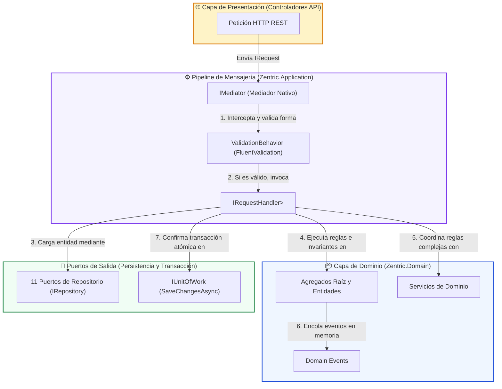
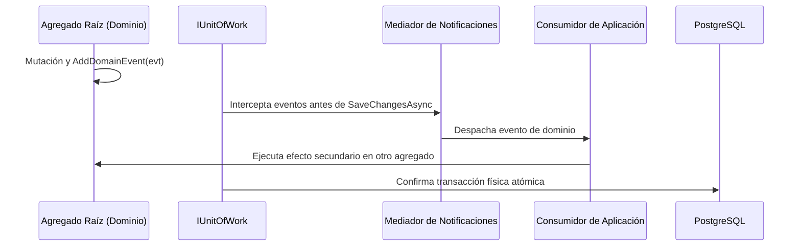

# 01. Casos de Uso, Orquestación y Mensajería (CQRS Pipeline)

> **Especificación Arquitectónica de la Capa de Aplicación.** Define los 22 Comandos, 14 Consultas, el pipeline de mediación nativo, la validación de entrada (`FluentValidation`), los manejadores de eventos y los contratos de orquestación en **Zentric** (`Zentric.Application`). Cumple con la Arquitectura Hexagonal y la regla de dependencia unidireccional hacia `Zentric.Domain`.

---

## 1. Patrón Arquitectónico de Orquestación

### 1.1. Mediador Nativo y Desacoplamiento (CQRS)
* **Mediador Propietario:** Implementado en `Zentric.Application.Common.Messaging`, prescindiendo de dependencias externas para mitigar riesgos de licenciamiento ([ADR-0007](../Adr/0007-dispatcher-propio-sustituye-mediatr.md)).
* **Contratos Centrales:**
  * `IRequest<TResponse>`: Marcador inmutable de comando o consulta.
  * `IRequestHandler<TRequest, TResponse>`: Manejador desacoplado del caso de uso.
  * `IMediator`: Despachador de mensajes y publicador de notificaciones.
* **Pipeline de Validación (`ValidationBehavior`):** Intercepta automáticamente todo comando antes de tocar la capa de Dominio. Si las reglas de formato fallan, aborta la ejecución retornando `Result.Failure(Validation)` con el detalle de errores, sin lanzar excepciones.

---

## 2. Catálogo Maestro de Casos de Uso (22 Commands)

Los comandos representan intenciones de mutación de estado. Retornan un objeto `Result<T>` o `Result` asegurando que los fallos del negocio sean predecibles y tipados:

### 2.1. Subdominio de Usuarios e Identidad (`Users`)
| Comando | Carga Útil (Payload) | Validador Asociado | Comportamiento del Handler y Dominio | Retorno |
| :--- | :--- | :--- | :--- | :--- |
| **`CreateUserCommand`** | `Email`, `Password`, `FullName`, `IdentityDocument`, `Role` | `CreateUserCommandValidator` | Verifica unicidad de correo y documento mediante `IUserRepository`; hashea contraseña con `IPasswordHasher`; persiste nuevo `User`. | `Result<Guid>` |
| **`LoginCommand`** | `Email`, `Password` | `LoginCommandValidator` | Consulta usuario por correo; valida hash en tiempo constante; verifica `CanAuthenticate`; emite credencial de sesión mediante `IAuthTokenService`. | `Result<AuthTokenDto>` |
| **`BlockUserCommand`** | `UserId` | Directo | Consulta usuario; invoca método de negocio `User.Block()`; persiste cambio. Revoca acceso y bloquea compras en checkout. | `Result` |
| **`ActivateUserCommand`** | `UserId` | Directo | Consulta usuario; invoca método de negocio `User.Activate()`; restablece capacidad operativa. | `Result` |

---

### 2.2. Subdominio de Bodegas (`Warehouses`)
| Comando | Carga Útil (Payload) | Validador Asociado | Comportamiento del Handler y Dominio | Retorno |
| :--- | :--- | :--- | :--- | :--- |
| **`CreateWarehouseCommand`** | `Name`, `Location`, `Type`, `VendorId?` | `CreateWarehouseCommandValidator` | Valida que si `Type == Vendor`, `VendorId` sea obligatorio; si es `Marketplace`, `VendorId` sea nulo. Instancia y persiste `Warehouse`. | `Result<Guid>` |

---

### 2.3. Subdominio de Inventario (`Inventories`)
| Comando | Carga Útil (Payload) | Validador Asociado | Comportamiento del Handler y Dominio | Retorno |
| :--- | :--- | :--- | :--- | :--- |
| **`AddStockCommand`** | `VariantId`, `WarehouseId`, `Quantity` | `AddStockCommandValidator` | Consulta o inicializa la posición `(VariantId, WarehouseId)`; invoca `Inventory.AddStock(qty)`; persiste mediante `IInventoryRepository`. | `Result<Guid>` |
| **`AdjustInventoryCommand`** | `InventoryId`, `PhysicalQuantity`, `CountedBy`, `Reason` | Directo | Carga existencias con historial; invoca `Inventory.ApplyPhysicalCount()`; persiste fila y auditoría en la misma transacción mediante `SaveAdjustmentAsync`. | `Result` |

---

### 2.4. Subdominio de Catálogo (`Catalog`)
| Comando | Carga Útil (Payload) | Validador Asociado | Comportamiento del Handler y Dominio | Retorno |
| :--- | :--- | :--- | :--- | :--- |
| **`CreateProductCommand`** | `Name`, `Description`, `Price`, `ProductType`, `VendorId`, `Variants[]` | `CreateProductCommandValidator` | Valida que si `Type == Physical`, posea al menos una variante; crea variantes asociadas; nace directamente en estado `Published`. | `Result<Guid>` |
| **`PublishProductCommand`** | `ProductId`, `VendorId` | `PublishProductCommandValidator` | Valida titularidad del producto; invoca `Product.Publish()`, reactivando la visibilidad comercial. | `Result` |
| **`SuspendProductCommand`** | `ProductId`, `VendorId` | Directo | Valida titularidad del producto; invoca `Product.Suspend()`, pausando la comercialización en el marketplace. | `Result` |

---

### 2.5. Subdominio de Pedidos (`Orders`)
| Comando | Carga Útil (Payload) | Validador Asociado | Comportamiento del Handler y Dominio | Retorno |
| :--- | :--- | :--- | :--- | :--- |
| **`CreateCartCommand`** | `BuyerId` | `CreateCartCommandValidator` | Consulta comprador y su dirección principal obligatoria; inicializa `CustomerOrder` en estado `Cart`. | `Result<Guid>` |
| **`AddOrderItemCommand`** | `OrderId`, `VariantId`, `Quantity`, `BuyerId` | `AddOrderItemCommandValidator` | Valida propiedad del carrito; consulta precio unitario congelado del catálogo (`Product.Price`); invoca `CustomerOrder.AddOrderItem()`. | `Result` |
| **`CheckoutOrderCommand`** | `OrderId`, `BuyerId` | `CheckoutOrderCommandValidator` | Valida vigencia (≤15 min) y estado de vendedores (`CanAuthenticate`); reserva existencias atómicamente con `InventoryReservationService`; genera `FulfillmentOrder` por vendedor; mueve orden a `PendingPayment`. | `Result` |
| **`PayOrderCommand`** | `OrderId`, `BuyerId` | `PayOrderCommandValidator` | Solicita cobro a `IPaymentGatewayService`; emite `PaymentReceipt`; si aprueba, transiciona orden a `Paid`; entrega digitales (`DigitalDeliveryRecord`); emite `OrderPaidDomainEvent`. | `Result` |

---

### 2.6. Subdominio de Logística (`Logistics`)
| Comando | Carga Útil (Payload) | Validador Asociado | Comportamiento del Handler y Dominio | Retorno |
| :--- | :--- | :--- | :--- | :--- |
| **`CreateFulfillmentOrderCommand`** | `CustomerOrderId`, `VendorId`, `Lines[]` | `CreateFulfillmentOrderCommandValidator` | Genera orden de empaque por vendedor agrupando las líneas físicas correspondientes; nace en `PendingPack`. | `Result<Guid>` |
| **`PackFulfillmentCommand`** | `FulfillmentOrderId`, `VendorId` | Directo | Valida titularidad o rol logístico; invoca `FulfillmentOrder.Pack()`; sella el alistamiento en bodega. | `Result` |
| **`DispatchFulfillmentCommand`** | `FulfillmentOrderId`, `TrackingNumber`, `VendorId` | `DispatchFulfillmentCommandValidator` | Asigna número de guía obligatorio; invoca `Dispatch()`; emite `PhysicalProductShippedDomainEvent`; evalúa avance maestro con `OrderFulfillmentProgressSynchronizer`. | `Result` |
| **`DeliverFulfillmentCommand`** | `FulfillmentOrderId` | Directo | **Solo Operador Logístico**: confirma entrega en destino; invoca `Deliver()`; sincroniza pedido maestro a `Delivered` si todos los despachos culminaron. | `Result` |
| **`CancelFulfillmentOrderDueToNoStockCommand`** | `FulfillmentOrderId`, `VendorId` | Directo | Registra quiebre de stock fantasma; transiciona despacho a `Cancelled`; ajusta stock a 0; emite `PartialFulfillmentCancelledDomainEvent`. | `Result` |

---

### 2.7. Subdominio de Posventa y Devoluciones (`Returns`)
| Comando | Carga Útil (Payload) | Validador Asociado | Comportamiento del Handler y Dominio | Retorno |
| :--- | :--- | :--- | :--- | :--- |
| **`RequestReturnCommand`** | `CustomerOrderId`, `VariantId`, `Quantity`, `Reason`, `BuyerId` | `RequestReturnCommandValidator` | Valida que el pedido esté `Delivered` y sea producto físico; asigna bodega de retorno; crea `ReturnRequest` en estado `Requested`. | `Result<Guid>` |
| **`InspectReturnCommand`** | `ReturnRequestId`, `IsGoodCondition`, `InspectorNotes` | Directo | **Solo Operador Logístico**: registra inspección técnica en bodega (`InspectByLogistics`), consignando veredicto de estado. | `Result` |
| **`ApproveReturnCommand`** | `ReturnRequestId`, `VendorId` | `ApproveReturnCommandValidator` | Valida conformidad física (o exención por bodega propia); invoca `ApproveByVendor()`; emite `ReturnApprovedEvent` reponiendo existencias usadas. | `Result` |
| **`RejectReturnCommand`** | `ReturnRequestId`, `VendorId`, `Reason` | Directo | Valida titularidad comercial; invoca `ReturnRequest.Reject()`; sella la devolución como denegada sin reembolso. | `Result` |
| **`RefundReturnCommand`** | `ReturnRequestId` | Directo | Administrador aplica reembolso de líneas aprobadas; invoca `PaymentReceipt.Refund()`, acreditando saldo a favor sin exceder el cobro original; registra `RefundAudit`. | `Result` |

---

### 2.8. Subdominio de Facturación (`Billing`)
| Comando | Carga Útil (Payload) | Validador Asociado | Comportamiento del Handler y Dominio | Retorno |
| :--- | :--- | :--- | :--- | :--- |
| **`GenerateInvoicesCommand`** | `CustomerOrderId` | Directo | Valida que la orden esté pagada (`Paid`); agrupa por vendedor; calcula split ratificado (5% Zentric / 95% Vendedor); emite $N$ facturas `VendorDetail`, 1 `Master` y 1 `ZentricDetail`. | `Result<IReadOnlyList<Guid>>` |
| **`AnnullMasterInvoiceCommand`** | `CustomerOrderId`, `Reason` | Directo | **Solo Administrador**: verifica anulación o rechazo de pago; transiciona Factura Maestra a `Anulled` documentando la causal formal. | `Result` |

---

## 3. Catálogo Maestro de Consultas (14 Queries)

Las consultas son operaciones de lectura pura e idempotente. Aplican **Aislamiento de Recursos por Rol** directamente en la consulta a base de datos (`WHERE`) para no filtrar información entre inquilinos ni permitir la deducción de recursos ajenos:

| Consulta (Query) | Parámetros de Entrada | Modelo de Proyección (DTO) | Restricción de Seguridad y Filtrado |
| :--- | :--- | :--- | :--- |
| **`GetUsersQuery`** | `Role?` | `IReadOnlyList<UserDto>` | Consulta lista de usuarios, con filtro opcional por rol operativo. |
| **`GetWarehousesQuery`** | `VendorId?` | `IReadOnlyList<WarehouseDto>` | Lista bodegas físicas activas, acotando por vendedor si se suministra. |
| **`GetProductsQuery`** | `VendorId?`, `Status?`, `Skip`, `Take` | `PagedResult<ProductDto>` | Consulta paginada del catálogo. Público general ve solo `Published`; vendedor ve todo su inventario. |
| **`GetInventoriesQuery`** | `VendorId?` | `IReadOnlyList<InventoryDto>` | Consulta posiciones de stock. El filtro por vendedor oculta el stock de la competencia en base de datos. |
| **`GetInventoryByVariantQuery`** | `VariantId` | `InventoryDto` | Retorna el balance de existencias (disponibles, reservadas, usadas) de una variante por bodega. |
| **`GetOrdersQuery`** | `BuyerId?`, `VendorId?`, `Status?` | `IReadOnlyList<OrderDto>` | **Aislamiento por Rol:** Comprador ve solo sus pedidos; Vendedor ve solo pedidos con ítems suyos. |
| **`GetOrderByIdQuery`** | `OrderId`, `BuyerId` | `OrderDto` | Consulta detalle para comprador. Devuelve `null` si la orden pertenece a otro cliente. |
| **`GetOrderByIdForSellerQuery`** | `OrderId`, `VendorId` | `SellerOrderViewDto` | Consulta detalle para vendedor. Proyecta **únicamente** las líneas que le pertenecen, ocultando ítems de otros vendedores. |
| **`GetFulfillmentsQuery`** | `VendorId?`, `BuyerId?`, `Status?` | `IReadOnlyList<FulfillmentOrderDto>` | Consulta de cola logística por despachos, filtrada estrictamente por vendedor o comprador. |
| **`GetFulfillmentByIdQuery`** | `FulfillmentOrderId` | `FulfillmentOrderDto` | Retorna el estado del paquete, bodega de origen y número de guía oficial. |
| **`GetReturnsQuery`** | `BuyerId?`, `VendorId?`, `Status?` | `IReadOnlyList<ReturnRequestDto>` | Lista solicitudes de devolución filtradas por titularidad en la consulta SQL. |
| **`GetReturnByIdQuery`** | `ReturnRequestId` | `ReturnRequestDto` | Retorna el estado del reclamo, dictamen técnico y bodega de retorno asignada. |
| **`GetInvoicesQuery`** | `BuyerId?`, `VendorId?` | `IReadOnlyList<InvoiceDto>` | Vendedor ve solo sus Facturas Detalle; comprador ve solo su Factura Maestra. |
| **`GetInvoicesByOrderQuery`** | `OrderId` | `IReadOnlyList<InvoiceDto>` | Retorna los comprobantes tributarios asociados a una orden comercial consolidada. |

---

## 4. Consumidores de Eventos de Dominio en Aplicación

La capa de Aplicación aloja los manejadores que reaccionan ante eventos emitidos por el Dominio para ejecutar efectos secundarios locales dentro de la misma transacción:

1. **`ReturnApprovedEventHandler`:**
   * **Evento Suscrito:** `ReturnApprovedEvent`
   * **Flujo:** Al completarse la aprobación de una devolución física, carga la posición de inventario correspondiente (`VariantId`, `WarehouseId`) e invoca `Inventory.ReturnToUsedStock(quantity)`, reponiendo las existencias bajo la clasificación estricta de producto usado.
2. **`PartialFulfillmentCancelledConsumer`:**
   * **Evento Suscrito:** `PartialFulfillmentCancelledDomainEvent`
   * **Flujo:** Al cancelarse un despacho por stock fantasma, invoca `RefundPolicyService` (regla automática de quiebre de stock), calcula el monto proporcional exacto desde el precio congelado, acredita el saldo en `PaymentReceipt.Refund()` y genera el registro inmutable de auditoría en `RefundAudit`.

---

## 5. Tratamiento Estandarizado de Errores con Result Pattern

En cumplimiento de las directrices arquitectónicas, la capa de Aplicación tiene terminantemente prohibido utilizar excepciones para controlar el flujo funcional ordinario:
* **`Result.Success(TValue)`:** La operación concluyó exitosamente.
* **`Result.Failure(ErrorKind.Validation, message)`:** Fallo originado por formato inválido o precondición de negocio no satisfecha.
* **`Result.Failure(ErrorKind.NotFound, message)`:** El recurso no existe o el llamante no tiene permisos de titularidad sobre él.
* **Propagación a Presentación:** Los controladores HTTP reciben el objeto `Result<T>` y delegan inmediatamente en la fábrica centralizada de respuestas para transformarlo en un `ProblemDetails` estandarizado bajo el estándar **RFC 7807**.
