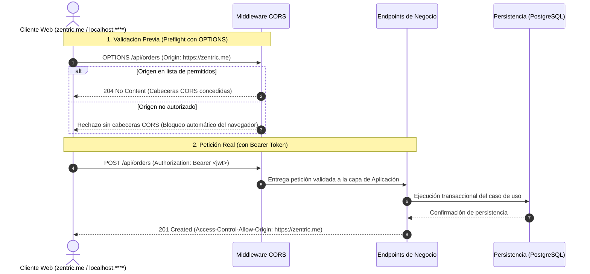

# Política de CORS y Seguridad HTTP — Zentric

> **Especificación Contractual de Integración y Seguridad.** Define los orígenes autorizados para el consumo de la API, las cabeceras y métodos permitidos, la política de transporte de identidad y el tratamiento normativo de respuestas HTTP para clientes web.

---

## 1. Política del Mismo Origen (SOP) y Propósito de CORS

Por diseño de seguridad en navegadores modernos bajo la **Política del Mismo Origen (Same-Origin Policy)**:
- El cliente web frontend se sirve desde el dominio principal: **`https://zentric.me`** (o en desarrollo: `http://localhost:****`).
- La API central backend se expone en un subdominio o puerto diferente: **`https://api.zentric.me`** (o en desarrollo: `http://localhost:****`).

Al constituir orígenes cruzados (*Cross-Origin*), el navegador exige que el backend declare de forma explícita qué orígenes, métodos y cabeceras tienen autorización para comunicarse con él.

---

## 2. Matriz Contractual de Parámetros CORS

La especificación exige la siguiente configuración normativa para la política de CORS:

| Parámetro | Valor Contractual | Justificación Normativa |
| :--- | :--- | :--- |
| **Identificador de Política** | `Frontend` | Nombre lógico del contrato en el contenedor de dependencias. |
| **Orígenes Permitidos** | Lista explícita y configurable (`https://zentric.me`, `http://localhost:****`) | **Prohibido el uso de comodines (`*`)**. Los navegadores rechazan comodines cuando se transmiten cabeceras de autorización. |
| **Cabeceras Permitidas** | `Authorization`, `Content-Type`, `Accept` | Habilita el transporte seguro de tokens JWT y cargas JSON. |
| **Métodos Permitidos** | `GET`, `POST`, `PUT`, `PATCH`, `DELETE`, `OPTIONS` | Soporta el ciclo completo de operaciones CRUD y preflight. |
| **Credenciales (Cookies)** | Deshabilitadas (`AllowCredentials: false`) | Zentric utiliza autenticación desacoplada basada en Bearer token; no se comparten cookies entre dominios. |

> **Regla de Inyección Externa:** Los orígenes permitidos deben obtenerse de la configuración del entorno (`Cors:AllowedOrigins`), quedando terminantemente prohibido quemar puertos o URLs fijas dentro de la lógica del sistema.

---

## 3. Flujo Normativo de Validación y Preflight

El navegador y el backend deben cumplir la siguiente secuencia de validación previa (*Preflight*) y ejecución de peticiones:



---

## 4. Política de Identidad y Seguridad de Tokens

### 4.1. Canal Exclusivo de Identidad
- Toda identidad autenticada debe viajar obligatoriamente en la cabecera estándar HTTP:
  ```http
  Authorization: Bearer <jwt_token>
  ```
- **Prohibición de cabeceras arbitrarias:** Queda estrictamente prohibido el uso de cabeceras de identidad paralelas (ej. `X-Buyer-Id`, retirada en [ADR-0009](Adr/0009-autenticacion-jwt-rg01.md)).

### 4.2. Validación Criptográfica de Recursos
- El backend nunca confía en parámetros de URL (como `?buyerId=...` o `?sellerId=...`) para determinar la propiedad de un recurso.
- La identidad, el identificador de usuario (`sub`) y los privilegios (`role`) se extraen directamente de la firma criptográfica del token JWT validado por el servidor.
- Las consultas a la base de datos se filtran automáticamente por el usuario autenticado, impidiendo accesos no autorizados a datos de terceros.

---

## 5. Códigos de Respuesta Específicos de Seguridad y CORS

Este documento regula exclusivamente los códigos HTTP vinculados al transporte de seguridad y la negociación de orígenes:

| Código HTTP | Condición de Seguridad | Acción Contractual del Cliente Web (`zentric.me`) |
| :---: | :--- | :--- |
| **`204 No Content`** | Preflight (`OPTIONS`) exitoso: origen, método y cabeceras autorizados. | Continuar silenciosamente y emitir la petición real con el Bearer token. |
| **`401 Unauthorized`** | Falta de autenticación: token JWT ausente, firma inválida o sesión expirada. | Purgar credenciales locales (`sessionStorage`) y redirigir inmediatamente a **Login**. |
| **`403 Forbidden`** | Falta de autorización: origen rechazado por CORS, o token válido con rol insuficiente. | Notificar alerta de *"Acceso denegado"* en pantalla (**sin** cerrar la sesión activa). |

> **Delimitación Arquitectónica:** El tratamiento del resto de códigos HTTP de negocio (`200 OK`, `201 Created`, `400 Bad Request`, `404 Not Found`, `409 Conflict`, `500 Internal Error`) y el esquema de RFC 9457 corresponden a los adaptadores REST y se especifican en [Adapters/Global-exception-handler.md](Adapters/Global-exception-handler.md) y [Presentation/01-endpoints.md](Presentation/01-endpoints.md).

---

## 6. Transporte Seguro (TLS/HTTPS) y Proxy Inverso

1. **Cifrado Obligatorio en Producción:** Toda comunicación entre el cliente web (`https://zentric.me`) y la API (`https://api.zentric.me`) debe realizarse obligatoriamente mediante **HTTPS / TLS 1.3**.
2. **Redirección Automática:** Cualquier intento de conexión por HTTP inseguro debe redirigirse automáticamente a HTTPS, impidiendo la transmisión accidental de Bearer Tokens en texto plano por la red.
3. **Preservación de Esquema en Proxy Inverso:** En despliegues bajo balanceadores de carga o proxies inversos (ej. Nginx, Cloudflare), la API debe procesar las cabeceras estándar `X-Forwarded-Proto` y `X-Forwarded-For` para reconocer con precisión el esquema y origen de la solicitud original.

---

## 7. Reglas de Oro de Seguridad

1. **Cero Comodines:** Los orígenes de producción y pruebas se declaran siempre de forma explícita.
2. **Independencia de Entornos:** La configuración de orígenes se administra vía variables de entorno sin recompilación.
3. **Cifrado en Tránsito:** Queda prohibido transmitir Bearer tokens sobre canales HTTP sin cifrar en entornos productivos.
4. **Formato Estándar de Error:** Todo rechazo de nivel `4xx` o `5xx` debe adherirse a **RFC 9457 (Problem Details)** en formato JSON.
