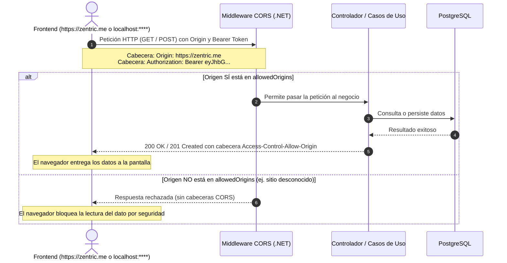

# Política de CORS y Seguridad HTTP — Zentric

> **Documento de Especificación de Seguridad e Integración.** Define cómo el cliente web (Frontend en `https://zentric.me` o entornos locales `http://localhost:****`) se comunica con la API central de **Zentric** (.NET 10), qué orígenes tienen permiso de conexión (CORS), cómo se implementa en código C# y cómo viaja la identidad del usuario mediante tokens.

---

## 1. ¿Qué es CORS y qué problema resuelve?

Por defecto, los navegadores aplican la **Política del Mismo Origen (Same-Origin Policy)**:
- El frontend vive en el dominio principal: **`https://zentric.me`** (o en desarrollo: `http://localhost:****`).
- La API backend vive en un subdominio o puerto diferente: **`https://api.zentric.me`** (o en desarrollo: `http://localhost:****`).

El navegador detecta que son **orígenes distintos** y bloquea la comunicación a menos que el backend declare explícitamente qué orígenes tienen autorización.

**CORS (Cross-Origin Resource Sharing)** es simplemente la lista de permisos del backend que le indica al navegador: *"Sí, acepto peticiones GET, POST, PUT, DELETE que vengan de `https://zentric.me` o de los puertos locales de desarrollo autorizados"*.

---

## 2. Cómo se ve realmente en Código C# (.NET 10)

En el backend de Zentric, esto está implementado directamente en [Program.cs](file:///C:/Users/da-V7/Desktop/Proyectos/Zentric/backend/Zentric.Api/Program.cs):

```csharp
// 1. Cargar la lista de orígenes desde appsettings o variables de entorno (NUNCA quemados en código)
var configuredOrigins = builder.Configuration.GetSection("Cors:AllowedOrigins").Value;
var allowedOrigins = string.IsNullOrWhiteSpace(configuredOrigins)
    ? new[] { "https://zentric.me", "http://localhost:5173" }
    : configuredOrigins.Split(',', StringSplitOptions.RemoveEmptyEntries | StringSplitOptions.TrimEntries);

// 2. Registrar la política "Frontend" con los orígenes permitidos
builder.Services.AddCors(options =>
{
    options.AddPolicy("Frontend", policy =>
    {
        policy.WithOrigins(allowedOrigins) // Solo los dominios/puertos en la lista
              .AllowAnyHeader()           // Permite 'Authorization', 'Content-Type', etc.
              .AllowAnyMethod();          // Permite GET, POST, PUT, DELETE, OPTIONS
    });
});

// 3. Activar el middleware antes de la autenticación
app.UseCors("Frontend");
```

### Configuración en `appsettings.json` o Variables de Entorno:
```json
{
  "Cors": {
    "AllowedOrigins": "https://zentric.me,http://localhost:5173,http://localhost:3000"
  }
}
```
*(De esta forma, en producción se usa `https://zentric.me`, en pruebas o desarrollo se usan los puertos dinámicos `http://localhost:****`, sin modificar ni una sola línea de C#).*

### Matriz de Parámetros Configurados:

| Parámetro | Valor Configurado | Justificación Técnica |
| :--- | :--- | :--- |
| **Nombre de la Política** | `Frontend` | Nombre lógico registrado en el contenedor de dependencias (IoC). |
| **Orígenes Permitidos** | Lista explícita y configurable (`https://zentric.me`, `localhost:****`) | **Prohibido comodín (`*`)**. Los navegadores rechazan comodines cuando se envían tokens de autorización. |
| **Cabeceras Permitidas** | `Authorization`, `Content-Type`, `Accept` | Permite el envío del token JWT y el formato de datos JSON estándar. |
| **Métodos Permitidos** | `GET`, `POST`, `PUT`, `PATCH`, `DELETE`, `OPTIONS` | Soporta todas las operaciones de consulta, mutación y preflight. |
| **Credenciales (Cookies)** | Deshabilitadas (`AllowCredentials: false`) | Zentric no utiliza cookies de sesión; la identidad viaja desacoplada en el Bearer token. |

---

## 3. Anatomía Visual de los Headers (El "Sobre" de la Petición HTTP)

Las cabeceras (**Headers**) son como los sellos y etiquetas que van pegados **por fuera de un sobre de correo**:

```text
┌────────────────────────────────────────────────────────────────────────┐
│  SOBRE HTTP (Headers enviados por el Navegador desde https://zentric.me)│
├────────────────────────────────────────────────────────────────────────┤
│  POST /api/orders HTTP/1.1                                            │
│  Host: api.zentric.me                                                 │
│  Origin: https://zentric.me           <-- "¿De qué web vengo?"         │
│  Authorization: Bearer eyJhbGciOi...  <-- "Mi llave / Token JWT"       │
│  Content-Type: application/json       <-- "Formato del contenido"      │
├────────────────────────────────────────────────────────────────────────┤
│  CUERPO DE LA CARTA (Body JSON):                                       │
│  { "buyerId": "...", "items": [{ "sku": "CAM-01", "quantity": 2 }] }   │
└────────────────────────────────────────────────────────────────────────┘
```

Y la **Respuesta del Servidor (.NET)** regresa con sus propios sellos de aprobación:

```text
┌────────────────────────────────────────────────────────────────────────┐
│  SOBRE DE RESPUESTA (Headers devueltos por .NET al Navegador)          │
├────────────────────────────────────────────────────────────────────────┤
│  HTTP/1.1 201 Created                                                  │
│  Access-Control-Allow-Origin: https://zentric.me  <-- Sello de permiso │
│  Content-Type: application/json                                        │
├────────────────────────────────────────────────────────────────────────┤
│  CUERPO DE LA RESPUESTA (Body JSON):                                   │
│  { "orderId": "1a2b3c4d", "status": "Pending" }                       │
└────────────────────────────────────────────────────────────────────────┘
```

> **Regla del Navegador:** Si la respuesta de .NET **NO** trae la cabecera `Access-Control-Allow-Origin: https://zentric.me`, el navegador rompe la carta y no deja que tu pantalla de React lea los datos devueltos.

---

## 4. Flujo en la Práctica: ¿Cómo valida el Backend y el Navegador?

Cuando el usuario interactúa con la aplicación (por ejemplo, consulta un producto o envía su Bearer token), ocurre la siguiente validación:



---

## 5. Política de Identidad y Seguridad de Tokens

### 5.1. Canal Único de Identidad
- La identidad del usuario viaja **exclusivamente** mediante el estándar HTTP:
  ```http
  Authorization: Bearer <jwt_token>
  ```
- **Prohibición de cabeceras arbitrarias:** Se eliminó cualquier cabecera personalizada como `X-Buyer-Id` (ver [ADR-0009](Adr/0009-autenticacion-jwt-rg01.md)). El backend extrae la identidad directamente de los claims criptográficos del JWT (`sub`, `role`), garantizando que nadie pueda suplantar a otro usuario cambiando un parámetro de la URL.

---

## 6. Tratamiento de Respuestas para el Frontend

| Código HTTP | Causa | Acción en el Frontend (`zentric.me`) |
| :---: | :--- | :--- |
| **`200 / 201`** | Petición exitosa con origen y token válidos. | Renderizar los datos en pantalla. |
| **`401 Unauthorized`** | Token ausente, inválido o expirado. | Limpiar la sesión y redirigir al formulario de **Login**. |
| **`403 Forbidden`** | Token válido, pero el rol del usuario no tiene permisos para esa acción. | Mostrar mensaje de alerta de acceso denegado (**no** cerrar la sesión). |

---

## 7. Reglas de Oro

1. **Cero comodines (`*`):** Siempre declarar los orígenes de forma explícita mediante la lista `Cors:AllowedOrigins`.
2. **Puertos y Dominios Dinámicos:** Los puertos locales (`****`) y los dominios de producción (`zentric.me`) se controlan mediante configuración externa, jamás hardcodeados en C#.
3. **Manejo de Errores Estándar:** Todos los errores de negocio devuelven formato **RFC 9457 (Problem Details)** en formato JSON.
