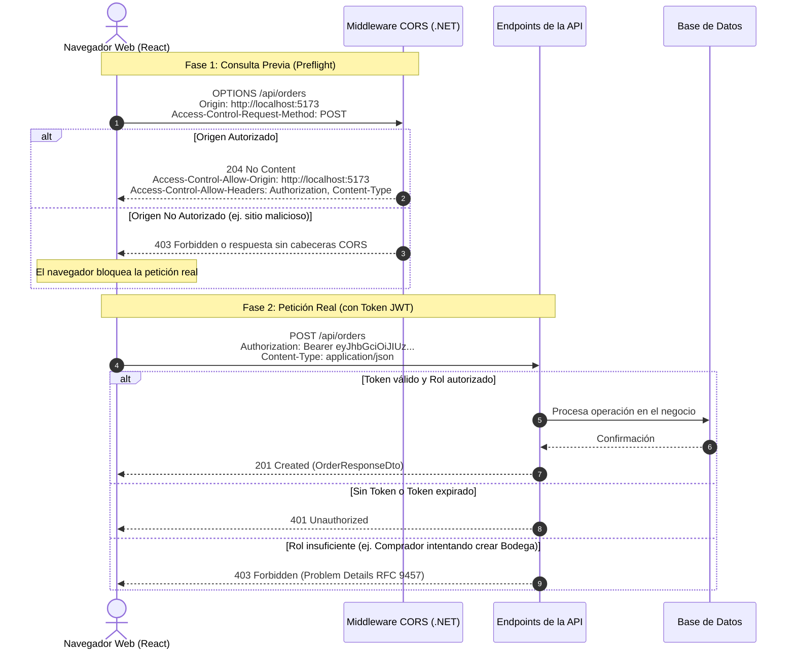

# Política de CORS y Seguridad HTTP — Zentric

> **Documento de Especificación de Seguridad e Integración.** Define cómo el cliente web (Frontend en React / Vite) se comunica de forma segura con la API central de **Zentric** (.NET 10), qué orígenes tienen permiso de conexión (CORS), cómo viaja la identidad del usuario y cómo responder ante fallos de autorización.

---

## 1. ¿Qué es CORS y qué problema resuelve?

Por defecto, los navegadores modernos aplican una regla estricta llamada **SOP (Same-Origin Policy o Política del Mismo Origen)**:
- Si el frontend está servido en `http://localhost:5173` (puerto de React con Vite).
- Y el backend está servido en `http://localhost:5076` (puerto de la API de .NET).

El navegador considera que son **orígenes distintos** y bloquea automáticamente cualquier llamada HTTP, mostrando un error en la consola:
> *"Access to fetch at 'http://localhost:5076' from origin 'http://localhost:5173' has been blocked by CORS policy"*

**CORS (Cross-Origin Resource Sharing)** es el mecanismo mediante el cual el backend de Zentric le concede un permiso explícito y controlado al navegador para aceptar peticiones provenientes del frontend autorizado.

---

## 2. Flujo de Comunicación: Preflight y Petición Real

Antes de enviar una petición que modifique datos (como `POST`, `PUT` o `DELETE`) o que lleve cabeceras de autorización (`Authorization: Bearer`), el navegador realiza automáticamente una consulta previa llamada **Preflight (vuelo previo)** usando el método `OPTIONS`:



---

## 3. Política de CORS Configurada en Zentric

La política se aplica a nivel de middleware en `Zentric.Api/Program.cs`:

| Parámetro | Valor Configurado | Justificación Técnica |
| :--- | :--- | :--- |
| **Nombre de la Política** | `Frontend` | Identificador único registrado en el contenedor de dependencias (IoC). |
| **Orígenes Permitidos** | Lista explícita y configurable (ej. `http://localhost:5173`, `http://localhost:3000`) | **Prohibido usar comodines (`*`)**. El uso de comodines es inseguro y los navegadores lo rechazan cuando se transmiten credenciales o cabeceras de autorización. |
| **Cabeceras Permitidas** | `Authorization`, `Content-Type`, `Accept` | Permite el envío del token JWT y el formato de datos JSON estándar. |
| **Métodos Permitidos** | `GET`, `POST`, `PUT`, `PATCH`, `DELETE`, `OPTIONS` | Soporta todas las operaciones CRUD y el preflight automático. |
| **Credenciales (Cookies)** | Deshabilitadas (`AllowCredentials: false`) | Zentric no utiliza cookies de sesión. La identidad viaja de forma desacoplada en la cabecera `Authorization: Bearer`. |

> **Nota:** La lista de orígenes se inyecta desde la configuración (`appsettings.json` o variables de entorno), permitiendo cambiar de entorno local a desarrollo o producción sin recompilar el código.

---

## 4. Política de Identidad y Seguridad de Tokens

### 4.1. Canal Único de Identidad
- La identidad del usuario viaja **exclusivamente** mediante el estándar HTTP:
  ```http
  Authorization: Bearer <jwt_token>
  ```
- **Prohibido el uso de cabeceras de identidad arbitrarias:** Quedó estrictamente eliminada cualquier cabecera personalizada como `X-Buyer-Id` o `X-User-Id` (ver [ADR-0009](Adr/0009-autenticacion-jwt-rg01.md)), ya que cualquier cliente podría alterarlas y suplantar la identidad de otro usuario.

### 4.2. Aislamiento y Propiedad de Recursos (Anti-Suplantación)
- El backend **nunca** confía en parámetros de URL como `?buyerId=123` o `?sellerId=456` para decidir a quién le pertenece un pedido o inventario.
- La identidad y los roles del llamante se extraen directamente del contenido criptográfico del token (`claims` como `sub` y `role`) validado en el servidor.
- Si un usuario intenta consultar o modificar un recurso que pertenece a otro usuario, la API responde con un error idéntico a si el recurso no existiera (`404 Not Found` o `403 Forbidden`), impidiendo que atacantes descubran la existencia de datos ajenos mediante prueba y error.

---

## 5. Tratamiento de Códigos de Seguridad para el Cliente Web

El frontend debe reaccionar de forma diferenciada según el código HTTP recibido:

| Código HTTP | Significado | Acción Obligatoria en el Frontend (React) |
| :---: | :--- | :--- |
| **`401 Unauthorized`** | **Falta de autenticación:** No se envió el token, el formato es inválido o el token expiró. | Limpiar el token del almacenamiento local (`sessionStorage` o memoria) y redirigir inmediatamente a la pantalla de **Inicio de Sesión (Login)**. |
| **`403 Forbidden`** | **Falta de permisos:** El usuario está correctamente autenticado, pero su rol no tiene privilegios para este recurso (ej. un Vendedor intentando acceder a la configuración global de Zentric). | **NO cerrar la sesión**. Mostrar una alerta o pantalla de *"Acceso denegado: no tienes permisos para esta sección"* y permitir que el usuario continúe en su módulo correspondiente. |

---

## 6. Reglas de Oro para Desarrolladores de Frontend

1. **Gestión de Sesión:** Almacenar el token en memoria o almacenamiento de sesión temporal; nunca en almacenamiento permanente accesible por scripts externos inseguros.
2. **Prevención de Bucles Infinitos:** Si una petición devuelve `401 Unauthorized`, no reintentar automáticamente en bucle infinito; esto saturaría el servidor con llamadas fallidas.
3. **Manejo de Errores Estandarizado:** Toda respuesta de error con código `4xx` o `5xx` devuelve un cuerpo bajo el estándar **RFC 9457 (Problem Details)** en formato JSON, con campos como `title`, `status` y `detail` para mostrar mensajes legibles al usuario final.
