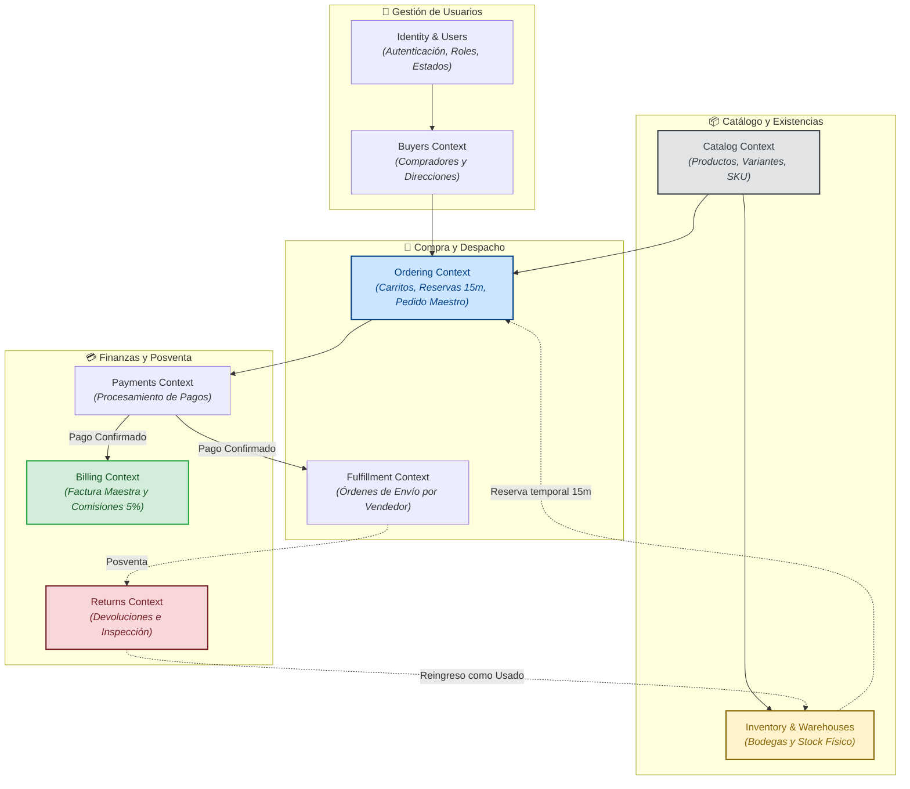

# 01. Panorama General del Dominio (Domain Overview) — Zentric

> **Documento de Visión y Arquitectura de Dominio.** Define los límites de contexto (*Bounded Contexts*), las raíces de agregado (*Aggregate Roots*), el mapa de relaciones del negocio y la estructura de especificaciones que gobiernan el núcleo de **Zentric** (`Zentric.Domain`).

---

## 1. Visión y Principios del Dominio

El Dominio es el núcleo puro de **Zentric**. Está modelado en C# (.NET 10) bajo los principios tácticos de **Domain-Driven Design (DDD)** y **Arquitectura Hexagonal**:

1. **Aislamiento Absoluto de Tecnología:** `Zentric.Domain` no contiene paquetes NuGet externos, no sabe qué es Entity Framework Core, no conoce ASP.NET y no contiene sentencias SQL.
2. **Modelos Ricos contra Modelos Anémicos:** Quedan terminantemente prohibidos los *setters* públicos abiertos (`public set`). Todo cambio de estado ocurre exclusivamente mediante **métodos de negocio expresivos** (ej. `ReserveStock()`, `CancelByTimeout()`, `ApproveReturn()`) que validan las invariantes antes de mutar el estado.
3. **Inmutabilidad de Conceptos:** Los conceptos que no poseen identidad única se modelan como **Value Objects** estrictamente inmutables (ej. `Money`, `Address`, `Sku`).
4. **Límites Transaccionales Estrictos:** Cada Raíz de Agregado (*Aggregate Root*) mantiene la consistencia inmediata dentro de sus propios límites. La coordinación entre agregados se realiza mediante **Servicios de Dominio** o **Eventos de Dominio**.

---

## 2. Mapa de Subdominios (Bounded Contexts)

El marketplace de Zentric se organiza en **9 Subdominios** claramente delimitados que interactúan a lo largo del ciclo comercial:

---

## 3. Matriz de Subdominios y Raíces de Agregado

| Subdominio | Responsabilidad de Negocio | Raíces de Agregado y Entidades | Reglas Sagradas del Dominio |
| :--- | :--- | :--- | :--- |
| **Identity & Users** | Administra las credenciales, estados comerciales y roles del sistema. | `User`, `Role`, `UserStatus` | Unicidad de documento de identidad; un único rol activo por cuenta; el bloqueo de un vendedor impide compras de sus productos en el checkout. |
| **Buyers** | Gestiona el perfil del comprador y sus puntos de entrega. | `Buyer`, `DeliveryAddress` | Todo comprador debe poseer al menos una dirección principal válida para envíos físicos. |
| **Catalog** | Gestiona el catálogo de productos físicos y digitales del marketplace. | `Product`, `ProductVariant` | Todo producto físico requiere al menos una variante con SKU único; publicación condicionada a datos completos. |
| **Inventory** | Controla las existencias físicas distribuidas en múltiples bodegas. | `Warehouse`, `WarehouseStock`, `StockReservation` | Control estricto por variante y bodega; existencia física no admite números negativos; las bodegas pueden ser del Marketplace o del Vendedor. |
| **Ordering** | Convierte la intención de compra del cliente en un pedido formal. | `Cart`, `CustomerOrder`, `OrderLine` | Bloqueo de existencias con expiración automática a los 15 minutos; soporte de múltiples vendedores en un solo carrito. |
| **Fulfillment** | Desglosa el pedido maestro en órdenes de despacho individuales por vendedor. | `VendorFulfillmentOrder`, `ShipmentItem` | Fragmentación automática en el checkout; cada vendedor despacha de forma independiente; quiebres de inventario solo cancelan la entrega afectada. |
| **Payments** | Registra la confirmación y conciliación de la transacción financiera. | `PaymentTransaction`, `PaymentReceipt` | Simulación de pasarela externa sin custodia directa de fondos bancarios; pasarela define el paso a "Pagado" o "Anulado". |
| **Billing** | Emite la facturación legal y liquida las comisiones de la plataforma. | `MasterInvoice`, `VendorSettlement` | El comprador recibe una única Factura Maestra; la comisión del 5% de Zentric es estrictamente confidencial y solo visible para administración. |
| **Returns** | Gestiona la posventa, inspecciones físicas y saldos a favor. | `ReturnRequest`, `InspectionResult` | Prohibida la devolución de productos digitales; los productos físicos devueltos aprobados reingresan a inventario como "Usado". |

---

## 4. Índice de Especificaciones del Subárbol `Domain/`

Para auditar e implementar cada aspecto del Dominio, este subárbol se organiza en los siguientes documentos especializados:

| Documento | Alcance y Contenido Técnico |
| :--- | :--- |
| **[01-models.md](01-models.md)** | Especificación detallada de clases, agregados, entidades y métodos de negocio de cada módulo. |
| **[02-aggregates-and-entities.md](02-aggregates-and-entities.md)** | Responsabilidades, límites de consistencia transaccional e invariantes internas de cada agregado. |
| **[02-value-objects.md](02-value-objects.md)** | Catálogo de Value Objects (`Money`, `Address`, `Sku`, etc.), inmutabilidad y políticas de moneda. |
| **[03-domain-services.md](03-domain-services.md)** | Servicios de dominio encargados de coordinar operaciones que involucran múltiples agregados. |
| **[04-domain-events.md](04-domain-events.md)** | Catálogo de eventos de dominio emitidos ante cambios de estado clave (ej. `ReturnApprovedEvent`). |
| **[04-invariants-and-rules.md](04-invariants-and-rules.md)** | Listado formal y numerado de las invariantes estrictas del negocio derivadas de `ZENTRIC.md`. |
| **[05-ports.md](05-ports.md)** | Definición de puertos de salida (interfaces) que el Dominio exige a la capa de Infraestructura. |
| **[06-business-rules.md](06-business-rules.md)** | Reglas transversales del marketplace organizadas por familias temáticas (Catálogo, Inventario, Pedidos, etc.). |
| **[07-lifecycle.md](07-lifecycle.md)** | Máquinas de estado y transiciones de ciclo de vida (pedidos, reservas temporales, devoluciones). |
| **[services/](services/)** | Especificaciones individuales y profundas para servicios complejos (inventario, pedidos, devoluciones). |

---

## 5. Reglas de Oro Inviolables del Dominio

1. **Cero Dependencias Externas:** Ninguna clase dentro de `Zentric.Domain` puede importar librerías de infraestructura, frameworks web o paquetes de persistencia.
2. **Comportamiento sobre Datos (Anti-Anémico):** El estado interno de las entidades solo cambia a través de métodos que validen sus propias invariantes.
3. **Consistencia Transaccional:** Una transacción modifica únicamente **una Raíz de Agregado** a la vez. Las operaciones inter-agregados se sincronizan mediante servicios de dominio o eventos.
4. **Lenguaje Ubicuo Estricto:** Toda clase, método y parámetro debe utilizar exactamente los términos acordados en el modelo del marketplace (ej. `Buyer`, `Seller`, `Warehouse`, `CustomerOrder`), quedando prohibido inventar sinónimos.
