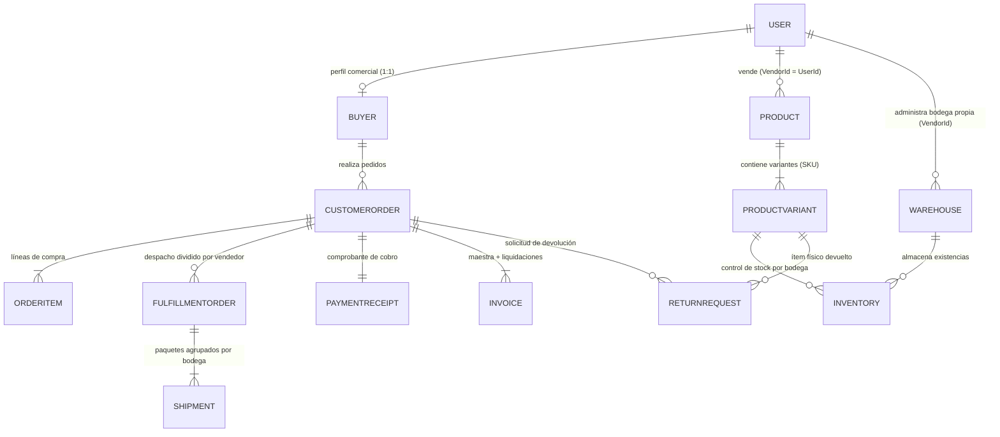

# 01. Modelos de Dominio (Aggregate Roots y Entidades) — Zentric

> **Especificación Táctica de Modelos.** Define las Raíces de Agregado (*Aggregate Roots*), Entidades hijas y relaciones estructurales de **Zentric** (`Zentric.Domain`), organizadas por *Bounded Contexts*. Garantiza la pureza de la lógica de negocio y la encapsulación estricta de invariantes.

---

## 1. Diagrama Entidad-Relación del Dominio (ERD)

---

## 2. Modelos por Bounded Context

### 2.1. Bounded Context: Identity & Access (Identidad)

#### Aggregate Root: `User`
Representa a cualquier participante autenticado en el sistema. Es el núcleo de identidad único para los 5 roles del marketplace.
- **Propiedades Clave:**
  - `Id` (`Guid`): Identificador único del usuario.
  - `IdentityDocument` (`string`): Documento de identidad obligatorio y no vacío.
  - `FullName` (`FullName` - Value Object): Nombre y apellido del usuario.
  - `Email` (`Email` - Value Object): Correo electrónico único en el sistema.
  - `PasswordHash` (`string`): Clave cifrada con PBKDF2.
  - `Role` (`UserRole`): Rol único asignado (`Buyer`, `Seller`, `Administrator`, `Supervisor`, `LogisticsOperator`).
  - `Status` (`UserStatus`): Estado operativo (`Active`, `Blocked`).
  - `StockFantasmaRate` (`decimal`): Métrica histórica de quiebres de inventario (0.0 a 1.0) aplicable a vendedores.
- **Invariantes del Modelo:**
  - Correo electrónico y documento de identidad únicos en toda la plataforma.
  - Cada cuenta posee **exactamente un rol activo** a la vez.
  - El bloqueo de un usuario (`Status = Blocked`) inhabilita su autenticación inmediatamente.
- **Métodos de Negocio:**
  - `Block()` / `Activate()`: Modificación del estado operativo.
  - `UpdateRole(newRole)`: Cambio de privilegios administrativos.
  - `UpdateFullName()`, `UpdateEmail()`, `UpdatePasswordHash()`.
  - `Delete()` / `Restore()`: Manejo de borrado lógico (*soft delete*).

---

### 2.2. Bounded Context: Buyers (Compradores)

#### Aggregate Root: `Buyer`
Extiende el perfil comercial del usuario con rol `Buyer`. Mantiene una relación 1 a 1 estricta con `User.Id`.
- **Propiedades Clave:**
  - `UserId` (`Guid`): Identificador coincidente con su cuenta en `User`.
  - `MainAddress` (`Address` - Value Object): Dirección principal obligatoria para entregas físicas.
  - `AdditionalAddresses` (`IReadOnlyCollection<Address>`): Direcciones secundarias de envío.
  - `IsActiveForCommerce` (`bool`): Indicador de habilitación comercial para transaccionar.
- **Invariantes del Modelo:**
  - Todo comprador debe registrar obligatoriamente una dirección principal válida al ser creado.
  - Un comprador no puede acceder ni consultar información de otros compradores.
- **Métodos de Negocio:**
  - `Create(userId, mainAddress)`: Fábrica que garantiza la dirección obligatoria.
  - `UpdateMainAddress(newAddress)`: Reemplazo de dirección principal.
  - `AddAdditionalAddress(address)` / `RemoveAdditionalAddress(address)`.

---

### 2.3. Modelado de Vendedores (Sellers / Vendors)

En el diseño táctico actual de Zentric, el Vendedor no requiere una clase separada redundante:
- Se representa mediante un **`User` con `Role == UserRole.Seller`**.
- Su identificador (`User.Id`) opera en todo el sistema como **`VendorId`**.
- **Regla de Gobernanza:** Los vendedores no pueden auto-registrarse; su alta la ejecuta exclusivamente el Administrador, vinculándole obligatoriamente su primera bodega de almacenamiento.
- **Regla de Bloqueo:** Cuando un vendedor pasa a `Blocked`, sus productos no se despublican en la base de datos, pero el servicio de Checkout rechaza cualquier compra que contenga artículos de su catálogo.

---

### 2.4. Bounded Context: Catalog (Catálogo de Productos)

#### Aggregate Root: `Product`
Representa un artículo ofrecido por un Vendedor en el marketplace.
- **Propiedades Clave:**
  - `Id` (`Guid`): Identificador único del producto.
  - `VendorId` (`Guid`): Identificador del vendedor propietario.
  - `Name` (`string`), `Description` (`string`).
  - `Price` (`Money` - Value Object): Precio base de comercialización.
  - `Type` (`ProductType`): Tipo de producto (`Physical` o `Digital`).
  - `Status` (`ProductStatus`): Estado comercial (`Published`, `Suspended`, `Discontinued`).
- **Entidad Hija: `ProductVariant`**
  - Representa la combinación específica vendible (ej. Talla, Color). Su `VariantId` actúa como la clave de SKU para control de inventario.
- **Invariantes del Modelo:**
  - **Variante obligatoria para productos físicos:** Todo producto de tipo `Physical` exige al menos una variante activa para poder venderse.
  - Los productos de tipo `Digital` no requieren variantes ni gestión de bodegas físicas.
  - Al crearse, el producto nace en estado `Published` de forma automática.
- **Métodos de Negocio:**
  - `Publish()` / `Suspend()`: Control de visibilidad comercial en el catálogo.
  - `UpdatePrice(newPrice)`: Actualización del precio monetario.
  - `AddVariant(name, sku, attributes)` / `RemoveVariant(variantId)`.
  - `Delete()`: Pasa a `Discontinued` y marca borrado lógico.

---

### 2.5. Bounded Context: Inventory & Warehouses (Existencias y Bodegas)

#### Aggregate Root: `Warehouse`
Espacio físico donde se almacenan las variantes de productos.
- **Propiedades Clave:**
  - `Id` (`Guid`): Identificador de la bodega.
  - `Name` (`string`), `Location` (`string`), `Capacity` (`int`).
  - `Type` (`WarehouseType`): Clasificación obligatoria (`Marketplace` o `Vendor`).
  - `VendorId` (`Guid?`): Obligatorio si el tipo es `Vendor`; debe ser `null` si es `Marketplace`.
  - `IsActive` (`bool`).

#### Aggregate Root: `Inventory` *(Hereda de `Entity`)*
Control transaccional del stock de una variante específica en una bodega determinada.
- **Propiedades Clave:**
  - `Id` (`Guid`): Identificador de la posición de inventario.
  - `VariantId` (`Guid`): Clave del SKU.
  - `WarehouseId` (`Guid`): Bodega de almacenamiento.
  - `AvailableQuantity` (`int`): Existencias libres para la venta (Invariante: **nunca negativo**).
  - `ReservedQuantity` (`int`): Existencias bloqueadas temporalmente en carritos de compra.
  - `DamagedQuantity` (`int`): Unidades averiadas no aptas para venta.
  - `UsedQuantity` (`int`): Unidades reingresadas por devoluciones físicas aprobadas.
  - `AdjustmentHistory` (`IReadOnlyCollection<StockAdjustmentRecord>`): Auditoría inmutable de conteos físicos.
- **Invariantes del Modelo:**
  - Clave unívoca de posición: la combinación `(VariantId, WarehouseId)`.
  - `AvailableQuantity >= 0` bajo cualquier circunstancia.
  - No se permite borrado lógico (`MarkAsDeleted`) si aún existen existencias físicas en la bodega.
- **Métodos de Negocio y Eventos:**
  - `ReserveStock(quantity)`: Traslada unidades de disponible a reservado.
  - `DispatchStock(quantity)`: Descuenta unidades reservadas al completarse el envío.
  - `ReturnToUsedStock(quantity)`: Incorpora stock devuelto a la cuenta de usados.
  - `ApplyPhysicalCount(countedQuantity, countedBy, reason)`: Ajuste por auditoría física; emite `StockAdjustedDomainEvent`.

---

### 2.6. Bounded Context: Ordering (Pedidos del Cliente)

#### Aggregate Root: `CustomerOrder` *(Hereda de `Entity`)*
Contrato comercial formal que agrupa las compras del cliente, permitiendo múltiples vendedores en un único pedido.
- **Propiedades Clave:**
  - `Id` (`Guid`): Identificador del pedido maestro.
  - `BuyerId` (`Guid`): Identificador del comprador.
  - `Status` (`OrderStatus`): Máquina de estados (`Cart`, `PendingPayment`, `Paid`, `Dispatched`, `Delivered`, `Cancelled`).
  - `TotalAmount` (`Money` - Value Object): Total acumulado calculado de las líneas.
  - `Items` (`IReadOnlyCollection<OrderItem>`): Líneas de compra del pedido.
  - `CancellationReason` (`string?`): Motivo registrado si el pedido termina en `Cancelled`.
- **Entidad Hija: `OrderItem`**
  - Contiene `VariantId`, `VendorId` (instantánea histórica del vendedor al momento de la compra), `Quantity` y `UnitPrice`.
- **Invariantes del Modelo:**
  - Un pedido en estado `Delivered` o `Cancelled` es inmutable; queda prohibida cualquier alteración posterior.
  - La transición desde `Cart` a `PendingPayment` activa una **reserva de 15 minutos**; si no se registra el pago en ese plazo, el pedido pasa a `Cancelled`.
- **Métodos de Negocio y Eventos:**
  - `AddItem(variantId, vendorId, quantity, unitPrice)` / `RemoveItem(variantId)`.
  - `Checkout()`: Formaliza la orden; emite `OrderCreatedDomainEvent`.
  - `MarkAsPaid()`: Confirma recepción del dinero; emite `OrderPaidDomainEvent`.
  - `CancelDueToTimeout()`: Anulación automática por expiración de los 15 minutos.

---

### 2.7. Bounded Context: Fulfillment & Logistics (Despachos)

#### Aggregate Root: `FulfillmentOrder` *(Hereda de `Entity`)*
Orden de despacho derivada del pedido maestro, creada de forma individual para **un único vendedor**.
- **Propiedades Clave:**
  - `Id` (`Guid`): Identificador del despacho.
  - `CustomerOrderId` (`Guid`): Referencia al pedido maestro.
  - `VendorId` (`Guid`): Vendedor responsable del despacho.
  - `Status` (`FulfillmentStatus`): Estados (`PendingPackaging`, `Packed`, `Dispatched`, `Delivered`, `Cancelled`).
  - `CancellationReason` (`string?`): Obligatorio en cancelaciones (ej. "Stock Fantasma").
  - `Shipments` (`IReadOnlyCollection<Shipment>`): Guías de envío agrupadas por bodega de origen.
- **Invariantes del Modelo:**
  - Cada vendedor despacha exclusivamente sus productos de forma autónoma.
  - Si un vendedor sufre un quiebre de inventario ("Stock Fantasma"), **solo se cancela su orden de despacho**, procediendo a la devolución parcial sin afectar las órdenes de los demás vendedores.
- **Métodos de Negocio y Eventos:**
  - `AddShipment(warehouseId, trackingNumber)`.
  - `Pack()` / `Dispatch()`: Emite `PhysicalProductShippedDomainEvent` por cada guía despachada.
  - `CancelDueNoStock()`: Cancelación unilateral por quiebre; emite `PartialFulfillmentCancelledDomainEvent`.

---

### 2.8. Bounded Context: Returns (Devoluciones)

#### Aggregate Root: `ReturnRequest` *(Hereda de `Entity`)*
Gestiona el proceso de posventa y garantías sobre productos entregados.
- **Propiedades Clave:**
  - `Id` (`Guid`): Identificador de la solicitud.
  - `CustomerOrderId` (`Guid`), `VariantId` (`Guid`), `WarehouseId` (`Guid`).
  - `Quantity` (`int`), `Status` (`ReturnStatus`).
  - `IsGoodCondition` (`bool`): Dictamen técnico de la inspección física en bodega.
  - `VendorApproved` (`bool`): Autorización comercial del vendedor.
- **Invariantes del Modelo:**
  - **Prohibición Absoluta:** Los productos digitales (`ProductType.Digital`) no admiten solicitudes de devolución bajo ninguna circunstancia.
  - Para que una devolución física sea aceptada, requiere la doble aprobación: inspección positiva del Operador Logístico (`IsGoodCondition = true`) Y aprobación del Vendedor (`VendorApproved = true`).
  - Toda devolución física aprobada reingresa el producto al inventario con la clasificación de **Stock Usado**.
- **Métodos de Negocio y Eventos:**
  - `Inspect(isGoodCondition)`: Registro del peritaje por el operador de bodega.
  - `ApproveByVendor()`: Aprobación comercial; al cumplirse ambas condiciones emite `ReturnApprovedEvent`.

---

### 2.9. Bounded Context: Billing (Facturación)

#### Aggregate Root: `Invoice`
Registro financiero y legal de la transacción de compra.
- **Propiedades Clave:**
  - `Id` (`Guid`): Identificador fiscal.
  - `CustomerOrderId` (`Guid`): Pedido asociado.
  - `VendorId` (`Guid?`): `null` en Factura Maestra; poblado en la Factura de Vendedor.
  - `Type` (`InvoiceType`): Clasificación (`Master`, `PlatformDetail`, `VendorDetail`).
  - `Status` (`InvoiceStatus`): Estado (`Issued`, `Anulled`).
  - `TotalAmount` (`Money` - Value Object): Importe liquidado.
- **Invariantes del Modelo:**
  - El comprador recibe una única **Factura Maestra** por el valor total de su compra.
  - Zentric genera un **Detalle Zentric** confidencial con el 5% de comisión de intermediación de la plataforma.
  - Cada vendedor recibe una **Factura de Vendedor** correspondiente al 95% neto de sus productos vendidos.

---

### 2.10. Bounded Context: Payments (Pagos)

#### Aggregate Root: `PaymentReceipt`
Comprobante inmutable del resultado de la transacción procesada con la pasarela.
- **Propiedades Clave:**
  - `Id` (`Guid`), `OrderId` (`Guid`).
  - `Amount` (`Money`): Total cobrado.
  - `Status` (`PaymentStatus`): Estados (`Pending`, `Approved`, `Declined`, `Refunded`).
  - `TransactionId` (`string`): Código de autorización externo.
  - `RefundedAmount` (`Money`): Saldo total acumulado reintegrado por devoluciones parciales.
- **Invariantes del Modelo:**
  - No almacena números de tarjeta ni datos bancarios (sin custodia directa de fondos).
  - Los reembolsos por devoluciones o quiebres parciales acumulan en `RefundedAmount`; el estado solo transiciona a `Refunded` cuando el monto acumulado iguala el 100% de `Amount`.
- **Métodos de Negocio:**
  - `Approve(transactionId)` / `Decline()`.
  - `Refund(refundAmount)`: Aplica reembolsos parciales controlados validando que no excedan el saldo pendiente.

---

## 3. Reglas de Oro del Modelado de Dominio

1. **Encapsulamiento Duro:** Prohibido el uso de *setters* públicos; las propiedades se modifican exclusivamente mediante métodos de negocio que validen sus invariantes.
2. **Entidades con Eventos:** Solo las raíces que requieren coordinación asíncrona (`CustomerOrder`, `FulfillmentOrder`, `ReturnRequest`, `Inventory`) heredan de `Entity` y despachan eventos de dominio.
3. **Consistencia Transaccional:** Cada operación de escritura debe modificar una única raíz de agregado. Las operaciones complejas entre agregados se orquestan mediante servicios de aplicación o eventos.
