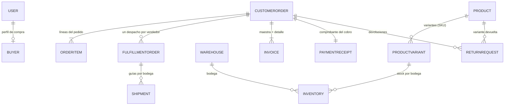

# 01. Modelos de Dominio (Aggregate Roots y Entidades)

Este documento define los **Aggregate Roots (AR)** y las **Entidades** principales del sistema Zentric, agrupados por *Bounded Contexts*, garantizando la pureza del modelo sin dependencias de infraestructura.

> Nota: las anotaciones `(UserId)`, `(ProductId)`… son conceptuales — en el código son `Guid` (sin IDs fuertemente tipados). Solo `CustomerOrder`, `FulfillmentOrder` y `ReturnRequest` heredan de `Entity` (la base que permite emitir eventos de dominio); el resto son clases planas.

## Mapa del modelo

## 1. Bounded Context: Identity & Access (Usuarios)

### Aggregate Root: `User`
Representa a cualquier individuo con acceso a la plataforma (Comprador, Vendedor, Op. Logístico, Admin, Supervisor).
- **Propiedades:** `Id` (UserId), `IdentityDocument` (string, obligatorio — Q-07), `FullName` (VO `FullName`), `Email` (VO `Email`), `PasswordHash` (string), `Role` (UserRole), `Status` (UserStatus), `CreatedAt`, `UpdatedAt`, `DeletedAt` (soft delete → `IsDeleted`), `CanAuthenticate`.
- **Reglas de Negocio:** 
  - El correo y documento de identidad deben ser únicos en todo el sistema.
  - Un usuario solo puede tener un único rol asignado.
- **Comportamientos (Métodos):** `Block()`, `Activate()`, `UpdateRole()`, `UpdateFullName()`, `UpdateEmail()`, `UpdatePasswordHash()`, `Delete()`, `Restore()`, `DeleteByAdmin()`.
  - **Cascada de suspensión al bloquear — RETIRADA, no es un pendiente.** La cadena de estados que este documento describía el 2026-10-03 la retiró el Owner el **2026-10-04** (ver [INV-05](06-business-rules.md) y la [enmienda de ADR-0019](../Adr/0019-cierre-de-decisiones-capa-domain.md#enmiendas)): bloquear **no** cascadea nada, los productos siguen `Published` y quien impide la venta es la política de autorización en el checkout. En consecuencia `User` **no** hereda `Entity` y no emite eventos **a propósito**, y el bloqueo es únicamente `Status = Blocked`. **INV-05 implementado 2026-10-07:** `POST /api/users/{id}/block` y `POST /api/users/{id}/activate` (política `UserAdministration`, solo Administrador; dictamen Q-26) + guard en `CheckoutOrderCommandHandler`. *(Verificado 2026-10-07: casos de uso y pruebas BDD existen.)*
  - Fuente de verdad: `Zentric.Domain/Users/User.cs`.

## 2. Bounded Context: Catalog (Catálogo)

### Aggregate Root: `Product`
Representa un bien ofrecido por un Vendedor.
- **Propiedades:** `Id` (ProductId), `VendorId` (UserId), `Name` (string), `Description` (string), `Price` (Money), `Type` (ProductType - Físico o Digital), `Status` (ProductStatus), timestamps + soft delete.
- **Entidades Hijas: `ProductVariant`** — combinación vendible del producto (ej. Talla/Color). Su `Id` **es** el `VariantId` y actúa como SKU para el inventario ([ADR-0002](../Adr/0002-clave-inventario-variantid.md)). Se compone de atributos: `VariantAttribute` (nombre + valor). El SKU es único dentro del producto.
- **Reglas de Negocio:**
  - Al crearse, su estado es `Published` automáticamente (sin flujo de aprobación).
  - **Variante obligatoria solo para físicos ([CAT-03](06-business-rules.md)):** un producto `Physical`
    exige al menos una variante (ver [backendSDD/Domain/06-business-rules.md](06-business-rules.md) [CAT-03](06-business-rules.md) y
    [backendSDD/Adr/0003-variante-obligatoria-productos-fisicos.md](../Adr/0003-variante-obligatoria-productos-fisicos.md)). Un producto
    `Digital` ([CAT-02](06-business-rules.md): sin logística ni inventario) puede nacer sin variantes.
- **Comportamientos:** `Update()`, `UpdatePrice()`, `UpdateType()`, `Publish()` (reactiva desde `Suspended`; publicar uno ya publicado responde 400), `Suspend()`, `Delete()` (pasa a `Discontinued` + soft delete), `Restore()`, `AddVariant()`, `RemoveVariant()`. **[IMPLEMENTADO 2026-10-07 — Q-25 cerrada]:** `POST /api/catalog/products/{productId}/suspend` (política `ProductManagement`, solo Vendedor) lleva el producto a `Suspended`; `POST /api/catalog/products/{productId}/publish` reactiva desde `Suspended` a `Published`. La Ley (ZENTRIC.md Dominio 5) lista los tres estados y ahora ambos caminos existen.

## 3. Bounded Context: Inventory (Inventario y Bodegas)

### Aggregate Root: `Warehouse`
Espacio físico donde se almacenan los productos.
- **Propiedades:** `Id` (WarehouseId), `Name` (string), `Location` (**string**, no VO), `Capacity` (int), `Type` (WarehouseType), `VendorId` (Guid? — `null` si es bodega del Marketplace), `IsActive`, timestamps + soft delete.
- **Reglas de Negocio:** Distingue entre bodegas propias del marketplace y de los vendedores.

### Aggregate Root: `Inventory`
El control transaccional del stock de una variante específica (SKU) en una bodega específica.
- **Propiedades:** `Id`, `VariantId` (VariantId), `WarehouseId` (WarehouseId), `AvailableQuantity` (int), `ReservedQuantity` (int), `DamagedQuantity` (int), `UsedQuantity` (int), timestamps + soft delete (`MarkAsDeleted` rechaza si queda stock físico).
- **Clave de stock:** la pareja `(VariantId, WarehouseId)`, según [ADR-0002](../Adr/0002-clave-inventario-variantid.md).
- **Reglas de Negocio:** `AvailableQuantity` nunca puede ser negativo bajo ninguna circunstancia (invariante crítica).
- **Comportamientos:** `AddStock()`, `ReserveStock()`, `DispatchStock()`, `MarkAsDamaged()`, `ReturnToAvailable()`, `ReturnToUsedStock()`, `ReconcileGhostStock()`, `ReceiveReturnedStock()`, `MarkAsDeleted()`, `ApplyPhysicalCount(countedQuantity, countedBy, reason)`. **IMPLEMENTADO 2026-10-08 (ADR-0021):** `POST /api/inventories/{id}/adjust` (política `InventoryAdjust`, solo Administrador y Supervisor), idempotente 5 min, solo reduce disponible.

## 4. Bounded Context: Ordering (Pedidos - Interfaz del Comprador)

### Aggregate Root: `CustomerOrder` (Order)
Representa el compromiso comercial formal y el ciclo de negocio central del sistema.
- **Propiedades:** `Id` (OrderId), `BuyerId` (UserId), `Items` (`IReadOnlyCollection<OrderItem>`), `TotalAmount` (Money, **calculado**: suma de los `TotalPrice`; carrito vacío = 0 en `DefaultCurrency = "COP"`), `Status` (OrderStatus), `CreatedAt`, `UpdatedAt`. Hereda `Entity` (emite eventos).
- **Entidades Hijas:**
  - `OrderItem`: `CustomerOrderId`, `VariantId` (SKU), **`VendorId`** (instantánea histórica del vendedor al comprar — dictamen Q-18, 2026-09-27), `Quantity`, `UnitPrice` (Money), `TotalPrice` (calculado).
- **Ciclo de Estados del Pedido (OrderStatus):** 
  - `Cart` (Carrito): Selección provisional.
  - `PendingPayment` (Pendiente de Pago): Espera de confirmación financiera.
  - `Paid` (Pagado): Inicio de alistamiento.
  - `Dispatched` (Despachado): Salida física de la bodega.
  - `Delivered` (Entregado / Finalizado): Conclusión de la entrega.
  - `Cancelled` (Anulado): por expiración del plazo de reserva sin pago (incluidos cobros rechazados) — adición ADD-004 de la Ley.
- **Reglas de Negocio:** 
  - Un pedido en estado `Delivered` **o `Cancelled`** no podrá ser modificado bajo ninguna circunstancia (`EnsureNotDelivered()`).
  - Los ítems solo se añaden o quitan en `Cart`; `Checkout()` exige carrito no vacío y menos de 15 minutos desde `CreatedAt` (PED-01).
- **Comportamientos:** `AddItem()`, `RemoveItem()`, `Checkout()` (emite `OrderCreatedDomainEvent`), `MarkAsPaid()` (emite `OrderPaidDomainEvent`), `Dispatch()`, `Deliver()`, `CancelDueToTimeout()`.

## 5. Bounded Context: Fulfillment & Logistics (Despachos - Interfaz del Vendedor)

### Aggregate Root: `FulfillmentOrder`
Orden de trabajo derivada de un `CustomerOrder`, pero específica para **un solo Vendor**.
- **Propiedades:** `Id` (FulfillmentOrderId), `CustomerOrderId` (OrderId), `VendorId` (UserId), `Status` (FulfillmentStatus), `CancellationReason` (string?, solo con `Cancelled`), `Shipments` (List<Shipment>), `CreatedAt`, `UpdatedAt`. Hereda `Entity`.
- **Entidades Hijas:**
  - `Shipment`: Guía de despacho individual. Agrupa productos que salen de *una misma bodega*.
- **Reglas de Negocio:** 
  - Un `FulfillmentOrder` puede tener múltiples `Shipments` si el inventario del vendedor estaba fragmentado en varias bodegas.
  - El Vendor puede cancelarlo unilateralmente si detecta quiebre de stock (Stock Fantasma).
- **Comportamientos:** `AddShipment(warehouseId, trackingNumber)`, `Pack()`, `Dispatch()` (emite `PhysicalProductShippedDomainEvent` por guía), `Deliver()`, `CancelDueToNoStock()` (motivo `Stock Fantasma`; emite `PartialFulfillmentCancelledDomainEvent`).

## 6. Bounded Context: Returns (Devoluciones)

### Aggregate Root: `ReturnRequest`
- **Responsabilidad:** Gestionar la devolución de productos.
- **Propiedades (por constructor):** `CustomerOrderId`, `VariantId`, `WarehouseId`, `Quantity`, `ProductType`; gestiona además su `Status` (`ReturnStatus`). Hereda `Entity` (emite `ReturnApprovedEvent`).
- **Reglas de Negocio Duras:** 
  - **PROHIBIDO** devolver productos digitales — guard real: `ReturnRequest` lanza `"Digital products cannot be returned."` en su constructor.
  - El producto físico requiere inspección del Operador Logístico (buen estado) y aprobación del Vendedor.
  - Si cumple ambas condiciones, el producto regresa al inventario como **stock usado** (`ReturnToUsedStock` vía `ReturnApprovedEventHandler`).

## 7. Bounded Context: Billing (Facturación)

### Aggregate Root: `Invoice`
- **Responsabilidad:** Registro financiero de la transacción.
- **Propiedades:** `Id`, `CustomerOrderId`, `VendorId` (Guid?, solo en `VendorDetail`), `Type` (InvoiceType), `TotalAmount` (Money), `IssuedAt`.
- **Fábricas:** `CreateMaster()`, `CreateVendorDetail()`, `CreateZentricDetail()`.
- **Reglas de Negocio:**
  - Existe una Factura Maestra para el Comprador.
  - Zentric mantiene los detalles internos del split.
  - Existe una Factura específica separada para el Vendedor (`VendorDetail`).
  - El reparto 5 %/95 % (Q-15), los tres tipos de documento y quién emite (solo el Administrador) están en [06-business-rules.md §6 FAC-01](06-business-rules.md).

## 8. Bounded Context: Buyers (Compradores)

### Aggregate Root: `Buyer`
- **Responsabilidad:** Perfil de compra. Su `UserId` es **exactamente** el `Id` del `User` (vínculo 1 a 1, sin mezclar datos).
- **Propiedades:** `UserId`, `MainAddress` (VO `Address`, obligatoria — ZENTRIC.md Dominio 2), `AdditionalAddresses` (lista solo lectura), `IsActiveForCommerce`, timestamps.
- **Comportamientos:** `Create()` (fábrica desde componentes de dirección), `AdditionalAddress()`, `RemoveAdditionalAddress()`, `UpdateMainAddress()`.

## 9. Bounded Context: Payments (Pagos)

### Aggregate Root: `PaymentReceipt`
- **Responsabilidad:** Comprobante del resultado de un cobro (invariante 9 de `04-invariants-and-rules.md`): **no** guarda tarjetas ni billeteras, solo el resultado del cobro.
- **Propiedades:** `Id`, `OrderId`, `Amount` (Money), `Status` (PaymentStatus), `TransactionId`, `RefundedAmount` (Money), `CreatedAt`, `RefundedAt`.
- **Comportamientos:** `Create()` (estático, importe positivo), `Approve()` (idempotente), `Decline()`, `Refund()` (crédito a favor — ADDENDUM del Owner 2026-09-27, **reformado por [ADR-0020](../Adr/0020-precio-congelado-y-credito-parcial-por-linea.md) el 2026-10-04**: acumula créditos en `RefundedAmount`, no admite un segundo reembolso silencioso, rechaza lo que exceda el saldo pendiente y solo pasa a `Refunded` cuando el acumulado iguala `Amount`).
