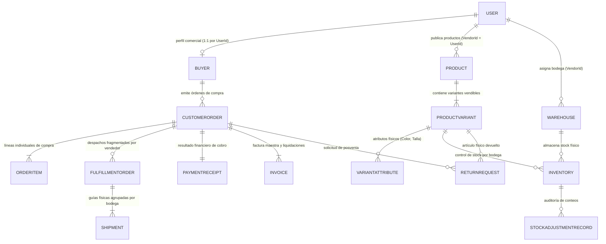

# 01. Modelos de Dominio (Aggregate Roots y Entidades Hijas) 

> **Especificación Táctica de Modelos.** Define exhaustivamente las Raíces de Agregado (*Aggregate Roots*), Entidades Hijas y Value Objects de **Zentric** (`Zentric.Domain`), organizados por *Bounded Contexts*. Todas las clases operan con encapsulamiento estricto, métodos de negocio ricos y cero dependencias de infraestructura.

---

## 1. Diagrama Entidad-Relación Completo del Dominio (ERD)

---

## 2. Modelos Detallados por Bounded Context

### 2.1. Bounded Context: Identity & Access (Autenticación y Credenciales)

Espacio de nombres: `Zentric.Domain.Users`  
Responsabilidad: Administrar las credenciales de acceso, unicidad de documentos y estados de cuenta para los 5 roles del sistema.

#### Aggregate Root: `User`

| Propiedad | Tipo | Modificador | Descripción e Invariante |
| :--- | :--- | :--- | :--- |
| `Id` | `Guid` | `{ get; init; }` | Identificador único global de la cuenta. |
| `IdentityDocument` | `string` | `{ get; private set; }` | Documento de identidad oficial obligatorio y no vacío (único en plataforma). |
| `FullName` | `FullName` (VO) | `{ get; private set; }` | Nombre y apellido estructurado. |
| `Email` | `Email` (VO) | `{ get; private set; }` | Correo electrónico institucional o personal (único en plataforma). |
| `PasswordHash` | `string` | `{ get; private set; }` | Contraseña cifrada bajo PBKDF2; prohibido texto plano. |
| `Role` | `UserRole` (Enum) | `{ get; private set; }` | Rol único asignado: `Buyer`, `Seller`, `Administrator`, `Supervisor`, `LogisticsOperator`. |
| `Status` | `UserStatus` (Enum) | `{ get; private set; }` | Estado operativo: `Active` o `Blocked`. |
| `StockFantasmaRate`| `decimal` | `{ get; private set; }` | Tasa histórica de quiebres de inventario (0.0 a 1.0) evaluada en vendedores. |
| `CanAuthenticate` | `bool` | `{ get; }` | Expresión booleana: `Status == Active && !IsDeleted`. |

| Método de Negocio | Parámetros | Comportamiento e Invariantes |
| :--- | :--- | :--- |
| `Block()` | Ninguno | Pasa el estado a `Blocked`; inhabilita inmediatamente la autenticación. |
| `Activate()` | Ninguno | Restaura el estado a `Active`. |
| `UpdateRole()` | `UserRole newRole` | Actualiza privilegios administrativos garantizando unicidad de rol. |
| `Delete()` / `Restore()` | Ninguno | Aplica o revierte borrado lógico (*Soft Delete*) mediante `DeletedAt`. |

---

### 2.2. Bounded Context: Buyers (Compradores y Despacho)

Espacio de nombres: `Zentric.Domain.Buyers`  
Responsabilidad: Gestionar el perfil comercial de los compradores y sus direcciones físicas de entrega.

#### Aggregate Root: `Buyer`

| Propiedad | Tipo | Modificador | Descripción e Invariante |
| :--- | :--- | :--- | :--- |
| `UserId` | `Guid` | `{ get; init; }` | Clave foránea y primaria coincidente con `User.Id` (relación 1:1 estricta). |
| `MainAddress` | `Address` (VO) | `{ get; private set; }` | Dirección principal obligatoria para envíos físicos. |
| `AdditionalAddresses` | `IReadOnlyCollection<Address>` | `{ get; }` | Direcciones secundarias optativas del comprador. |
| `IsActiveForCommerce` | `bool` | `{ get; private set; }` | Habilitación comercial para transaccionar en el marketplace. |

| Método de Negocio | Parámetros | Comportamiento e Invariantes |
| :--- | :--- | :--- |
| `Create()` (Fábrica) | `Guid userId, Address mainAddress` | Exige obligatoriamente una dirección principal válida para nacer. |
| `UpdateMainAddress()`| `Address newAddress` | Reemplaza la dirección de entrega primaria. |
| `AddAdditionalAddress()` | `Address address` | Añade una ubicación de despacho alternativa a la colección inmutable. |
| `RemoveAdditionalAddress()` | `Address address` | Remueve una ubicación alternativa existente. |

---

### 2.3. Modelado de Vendedores (Sellers / Vendors)

Responsabilidad: Representar a los comerciantes autorizados para comercializar productos.
- **Implementación Táctica:** Se modela directamente como un **`User` con `Role == UserRole.Seller`**.
- **`VendorId`:** En todos los agregados de catálogo (`Product`), bodegas (`Warehouse`), pedidos (`CustomerOrder`) y liquidaciones (`Invoice`), el campo `VendorId` apunta al `User.Id` del vendedor.
- **Invariante de Incorporación:** Los vendedores no pueden auto-registrarse; su alta la ejecuta el Administrador, asignándole su primera bodega.
- **Invariante de Bloqueo:** Si `User.Status == Blocked`, el Checkout rechaza transacciones con sus productos.

---

### 2.4. Bounded Context: Catalog (Catálogo de Productos)

Espacio de nombres: `Zentric.Domain.Products`  
Responsabilidad: Administrar los bienes comercializables ofrecidos por los vendedores.

#### Aggregate Root: `Product`

| Propiedad | Tipo | Modificador | Descripción e Invariante |
| :--- | :--- | :--- | :--- |
| `Id` | `Guid` | `{ get; init; }` | Identificador único del producto. |
| `VendorId` | `Guid` | `{ get; private set; }` | Identificador obligatorio del vendedor propietario. |
| `Name` / `Description`| `string` | `{ get; private set; }` | Información descriptiva comercial. |
| `Price` | `Money` (VO) | `{ get; private set; }` | Precio base monetario con código de divisa (`COP`, `USD`). |
| `Type` | `ProductType` (Enum) | `{ get; private set; }` | Clasificación: `Physical` (requiere bodega) o `Digital` (sin inventario). |
| `Status` | `ProductStatus` (Enum)| `{ get; private set; }` | Ciclo comercial: `Published`, `Suspended`, `Discontinued`. |
| `Variants` | `IReadOnlyCollection<ProductVariant>` | `{ get; }` | Variantes vendibles asociadas al producto. |

#### Entidades Hijas de Catálogo:

##### 1. `ProductVariant`
Representa la combinación vendible específica (SKU).
- **Propiedades:** `Id` (`Guid` - clave de SKU en inventario), `ProductId` (`Guid`), `Sku` (`Sku` - VO), `PriceOverride` (`Money?`), `Attributes` (`IReadOnlyCollection<VariantAttribute>`).
- **Invariante:** Los productos físicos exigen al menos una variante activa (`HasVariant = true`) para poder comercializarse.

##### 2. `VariantAttribute`
Propiedades físicas específicas de la variante.
- **Propiedades:** `Name` (`string`, ej. "Talla"), `Value` (`string`, ej. "M").

| Método de Negocio | Parámetros | Comportamiento e Invariantes |
| :--- | :--- | :--- |
| `Publish()` / `Suspend()` | Ninguno | Transiciona entre `Suspended` y `Published`; publicar uno ya publicado arroja error. |
| `UpdatePrice()` | `Money newPrice` | Actualiza el valor base validando que sea mayor a cero. |
| `AddVariant()` | `Sku sku, List<VariantAttribute> attrs` | Añade una variante asegurando que el SKU sea único en el producto. |
| `Delete()` | Ninguno | Pasa a `Discontinued` y marca borrado lógico (*soft delete*). |

---

### 2.5. Bounded Context: Inventory & Warehouses (Existencias y Bodegas)

Espacio de nombres: `Zentric.Domain.Warehouses` y `Zentric.Domain.Inventories`  
Responsabilidad: Administrar los espacios físicos de acopio y el control transaccional de existencias por SKU.

#### Aggregate Root: `Warehouse`

| Propiedad | Tipo | Modificador | Descripción e Invariante |
| :--- | :--- | :--- | :--- |
| `Id` | `Guid` | `{ get; init; }` | Identificador de la bodega física. |
| `Name` / `Location` | `string` | `{ get; private set; }` | Nombre y ubicación geográfica de la instalación. |
| `Capacity` | `int` | `{ get; private set; }` | Capacidad máxima de almacenamiento en unidades. |
| `Type` | `WarehouseType` (Enum) | `{ get; init; }` | `Marketplace` (central Zentric) o `Vendor` (bodega de vendedor). |
| `VendorId` | `Guid?` | `{ get; init; }` | Obligatorio si el tipo es `Vendor`; debe ser `null` si es `Marketplace`. |

#### Aggregate Root: `Inventory` *(Hereda de `Entity`)*

| Propiedad | Tipo | Modificador | Descripción e Invariante |
| :--- | :--- | :--- | :--- |
| `Id` | `Guid` | `{ get; init; }` | Identificador de la posición de stock. |
| `VariantId` | `Guid` | `{ get; private set; }` | Clave foránea del SKU de producto. |
| `WarehouseId` | `Guid` | `{ get; private set; }` | Clave foránea de la bodega física donde reside. |
| `AvailableQuantity`| `int` | `{ get; private set; }` | **Invariante Crítica:** Existencia libre para la venta (NUNCA negativa). |
| `ReservedQuantity` | `int` | `{ get; private set; }` | Unidades bloqueadas en pedidos pendientes (reserva de 15 min). |
| `DamagedQuantity`  | `int` | `{ get; private set; }` | Unidades físicas averiadas fuera de circulación comercial. |
| `UsedQuantity`     | `int` | `{ get; private set; }` | Unidades reingresadas por devoluciones aprobadas. |
| `Adjustments`      | `IReadOnlyCollection<StockAdjustmentRecord>` | `{ get; }` | Historial inmutable de conteos físicos y auditorías. |

#### Value Object Interno: `StockAdjustmentRecord`
Representa el registro inmutable de una discrepancia física detectada en bodega.
- **Estructura:** `record StockAdjustmentRecord(int SystemQuantity, int PhysicalQuantity, Guid CountedBy, string Reason, DateTime CountedAt)`.

| Método de Negocio | Parámetros | Comportamiento e Invariantes |
| :--- | :--- | :--- |
| `ReserveStock()` | `int quantity` | Mueve unidades de `AvailableQuantity` a `ReservedQuantity`; valida disponibilidad. |
| `DispatchStock()` | `int quantity` | Descuenta permanentemente unidades de `ReservedQuantity` al despachar. |
| `ReturnToUsedStock()` | `int quantity` | Aumenta `UsedQuantity` a partir de devoluciones físicas aprobadas. |
| `ApplyPhysicalCount()` | `int countedQty, Guid user, string reason` | Ajusta `AvailableQuantity` y emite `StockAdjustedDomainEvent`. |

---

### 2.6. Bounded Context: Ordering (Pedidos del Cliente)

Espacio de nombres: `Zentric.Domain.Orders`  
Responsabilidad: Orquestar el ciclo comercial desde el carrito de compras hasta la entrega final del pedido.

#### Aggregate Root: `CustomerOrder` *(Hereda de `Entity`)*

| Propiedad | Tipo | Modificador | Descripción e Invariante |
| :--- | :--- | :--- | :--- |
| `Id` | `Guid` | `{ get; init; }` | Identificador del pedido central de compra. |
| `BuyerId` | `Guid` | `{ get; private set; }` | Identificador del comprador que realiza la orden. |
| `Status` | `OrderStatus` (Enum) | `{ get; private set; }` | `Cart`, `PendingPayment`, `Paid`, `Dispatched`, `Delivered`, `Cancelled`. |
| `TotalAmount` | `Money` (VO) | `{ get; private set; }` | Suma monetaria calculada de todas las líneas de pedido. |
| `Items` | `IReadOnlyCollection<OrderItem>` | `{ get; }` | Colección inmutable de líneas de compra. |
| `CancellationReason`| `string?` | `{ get; private set; }` | Motivo de cancelación registrado en estado `Cancelled`. |

#### Entidad Hija: `OrderItem`
Representa una línea específica de compra dentro del pedido maestro.

| Propiedad | Tipo | Modificador | Descripción e Invariante |
| :--- | :--- | :--- | :--- |
| `Id` | `Guid` | `{ get; init; }` | Identificador único de la línea de pedido. |
| `CustomerOrderId`| `Guid` | `{ get; private set; }` | Vínculo hacia la raíz de agregado `CustomerOrder`. |
| `VariantId` | `Guid` | `{ get; private set; }` | SKU del producto adquirido. |
| `VendorId` | `Guid` | `{ get; private set; }` | Instantánea histórica inmutable del vendedor al momento de la compra. |
| `Quantity` | `int` | `{ get; private set; }` | Cantidad de unidades adquiridas (debe ser mayor a 0). |
| `UnitPrice` | `Money` (VO) | `{ get; private set; }` | Precio unitario congelado al comprar. |
| `TotalPrice` | `Money` (VO) | `{ get; }` | Cálculo matemático: `UnitPrice * Quantity`. |

| Método de Negocio | Parámetros | Comportamiento e Invariantes |
| :--- | :--- | :--- |
| `AddItem()` / `RemoveItem()` | `VariantId, VendorId, Qty, Price` | Solo permitido en estado `Cart`; recalcula `TotalAmount`. |
| `Checkout()` | Ninguno | Pasa a `PendingPayment`, bloquea stock 15 min y emite `OrderCreatedDomainEvent`. |
| `MarkAsPaid()` | Ninguno | Transiciona a `Paid` y emite `OrderPaidDomainEvent`. |
| `CancelDueToTimeout()` | Ninguno | Anula el pedido por vencimiento de 15 min sin pago; libera reservas. |

---

### 2.7. Bounded Context: Fulfillment & Logistics (Despachos)

Espacio de nombres: `Zentric.Domain.Logistics`  
Responsabilidad: Desglosar el pedido maestro en órdenes de despacho individuales por vendedor y organizar paquetes físicos.

#### Aggregate Root: `FulfillmentOrder` *(Hereda de `Entity`)*

| Propiedad | Tipo | Modificador | Descripción e Invariante |
| :--- | :--- | :--- | :--- |
| `Id` | `Guid` | `{ get; init; }` | Identificador de la orden de despacho del vendedor. |
| `CustomerOrderId`| `Guid` | `{ get; private set; }` | Vínculo hacia el pedido maestro. |
| `VendorId` | `Guid` | `{ get; private set; }` | Vendedor específico responsable de este despacho. |
| `Status` | `FulfillmentStatus` (Enum)| `{ get; private set; }` | `PendingPackaging`, `Packed`, `Dispatched`, `Delivered`, `Cancelled`. |
| `CancellationReason`| `string?` | `{ get; private set; }` | Razón obligatoria si se cancela por quiebre de stock. |
| `Shipments` | `IReadOnlyCollection<Shipment>` | `{ get; }` | Guías físicas generadas para los paquetes. |

#### Entidad Hija: `Shipment`
Representa una guía de despacho física que agrupa productos que salen de una misma bodega específica.

| Propiedad | Tipo | Modificador | Descripción e Invariante |
| :--- | :--- | :--- | :--- |
| `Id` | `Guid` | `{ get; init; }` | Identificador único de la guía de envío. |
| `FulfillmentOrderId` | `Guid` | `{ get; private set; }` | Vínculo hacia la orden de despacho raíz. |
| `WarehouseId` | `Guid` | `{ get; private set; }` | Bodega física desde donde sale el paquete. |
| `TrackingNumber` | `string` | `{ get; private set; }` | Número de seguimiento de la transportadora logística. |

| Método de Negocio | Parámetros | Comportamiento e Invariantes |
| :--- | :--- | :--- |
| `AddShipment()` | `WarehouseId, TrackingNumber` | Asocia una guía de envío física agrupada por bodega. |
| `Pack()` / `Dispatch()` | Ninguno | Pasa a `Dispatched` y emite `PhysicalProductShippedDomainEvent`. |
| `CancelDueNoStock()` | Ninguno | Cancelación parcial por "Stock Fantasma"; emite `PartialFulfillmentCancelledDomainEvent`. |

---

### 2.8. Bounded Context: Returns (Devoluciones y Posventa)

Espacio de nombres: `Zentric.Domain.Returns`  
Responsabilidad: Gestionar el peritaje técnico y la resolución comercial de solicitudes de garantía y posventa.

#### Aggregate Root: `ReturnRequest` *(Hereda de `Entity`)*

| Propiedad | Tipo | Modificador | Descripción e Invariante |
| :--- | :--- | :--- | :--- |
| `Id` | `Guid` | `{ get; init; }` | Identificador de la solicitud de devolución. |
| `CustomerOrderId`| `Guid` | `{ get; private set; }` | Pedido formal de procedencia. |
| `VariantId` | `Guid` | `{ get; private set; }` | SKU del artículo que se devuelve. |
| `WarehouseId` | `Guid` | `{ get; private set; }` | Bodega donde se recibe físicamente para inspección. |
| `Quantity` | `int` | `{ get; private set; }` | Unidades devueltas (mayor a cero). |
| `Status` | `ReturnStatus` (Enum) | `{ get; private set; }` | `Requested`, `Inspected`, `Approved`, `Rejected`. |
| `IsGoodCondition`| `bool` | `{ get; private set; }` | Dictamen técnico de inspección física por el operador logístico. |
| `VendorApproved` | `bool` | `{ get; private set; }` | Visto bueno comercial emitido por el vendedor propietario. |

| Método de Negocio | Parámetros | Comportamiento e Invariantes |
| :--- | :--- | :--- |
| Constructor | `OrderId, VariantId, WarehouseId, Qty, Type` | **Invariante Absoluta:** Si `Type == Digital`, lanza excepción `"Digital products cannot be returned"`. |
| `Inspect()` | `bool isGoodCondition` | Registra el peritaje físico realizado por el Operador Logístico. |
| `ApproveByVendor()` | Ninguno | Aprobación comercial del vendedor; si `IsGoodCondition == true`, pasa a `Approved` y emite `ReturnApprovedEvent`. |

---

### 2.9. Bounded Context: Billing (Facturación y Split)

Espacio de nombres: `Zentric.Domain.Billing`  
Responsabilidad: Generar los comprobantes contables y gestionar la retención confidencial de la comisión de la plataforma.

#### Aggregate Root: `Invoice`

| Propiedad | Tipo | Modificador | Descripción e Invariante |
| :--- | :--- | :--- | :--- |
| `Id` | `Guid` | `{ get; init; }` | Identificador fiscal de la factura. |
| `CustomerOrderId`| `Guid` | `{ get; private set; }` | Pedido de compra asociado. |
| `VendorId` | `Guid?` | `{ get; private set; }` | Identificador del vendedor (`null` en Factura Maestra y Detalle Zentric). |
| `Type` | `InvoiceType` (Enum) | `{ get; private set; }` | `Master` (Comprador), `PlatformDetail` (Zentric), `VendorDetail` (Vendedor). |
| `Status` | `InvoiceStatus` (Enum)| `{ get; private set; }` | `Issued`, `Anulled`. |
| `TotalAmount` | `Money` (VO) | `{ get; private set; }` | Monto liquidado de la factura. |

| Fábrica / Método | Parámetros | Comportamiento e Invariantes |
| :--- | :--- | :--- |
| `CreateMaster()` | `OrderId, TotalAmount` | Emite la factura completa entregada al Comprador. |
| `CreateZentricDetail()` | `OrderId, FeeAmount` | Liquida el 5% confidencial retenido por la plataforma Zentric. |
| `CreateVendorDetail()` | `OrderId, VendorId, VendorAmount` | Emite la liquidación neta individual (95%) correspondiente al Vendedor. |

---

### 2.10. Bounded Context: Payments (Pagos)

Espacio de nombres: `Zentric.Domain.Payments`  
Responsabilidad: Registrar el resultado de transacciones financieras procesadas con pasarelas externas.

#### Aggregate Root: `PaymentReceipt`

| Propiedad | Tipo | Modificador | Descripción e Invariante |
| :--- | :--- | :--- | :--- |
| `Id` | `Guid` | `{ get; init; }` | Identificador único del recibo de pago. |
| `OrderId` | `Guid` | `{ get; private set; }` | Pedido formal respaldado. |
| `Amount` | `Money` (VO) | `{ get; private set; }` | Monto bruto capturado. |
| `Status` | `PaymentStatus` (Enum)| `{ get; private set; }` | `Pending`, `Approved`, `Declined`, `Refunded`. |
| `TransactionId` | `string` | `{ get; private set; }` | Código de autorización provisto por la pasarela externa. |
| `RefundedAmount` | `Money` (VO) | `{ get; private set; }` | Monto acumulado de devoluciones o quiebres parciales. |

| Método de Negocio | Parámetros | Comportamiento e Invariantes |
| :--- | :--- | :--- |
| `Approve()` | `string transactionId` | Registra el cobro exitoso e idempotente con la pasarela. |
| `Decline()` | Ninguno | Marca la transacción como rechazada; habilita la anulación del pedido. |
| `Refund()` | `Money refundAmount` | Acumula en `RefundedAmount`; solo pasa a `Refunded` si el acumulado iguala el total. |
