# 02. Límites de Agregados y Entidades (Aggregates & Transactional Boundaries)

> **Especificación Táctica de Agregados.** Establece los límites de consistencia transaccional, la jerarquía de identidades (globales y locales), las invariantes de ciclo de vida y las reglas de interacción entre agregados en **Zentric** (`Zentric.Domain`), conforme a Domain-Driven Design (DDD) y Arquitectura Hexagonal.

---

## 1. Principios de Diseño de Agregados en Zentric

El diseño de agregados en Zentric sigue cinco reglas arquitectónicas inviolables:

1. **Límites Transaccionales Duros (1 Agregado = 1 Transacción):** Una transacción de base de datos modifica el estado de exactamente una (1) raíz de agregado. Queda prohibido mutar múltiples agregados en una misma transacción directa de persistencia.
2. **Agregados de Alcance Reducido:** Se evita el antipatrón de agregados colosales. Cada agregado agrupa únicamente las entidades hijas y Value Objects indispensables para defender sus invariantes inmediatas.
3. **Referencias Exclusivas por Identidad (`Guid`):** Los agregados se conectan entre sí únicamente almacenando identificadores foráneos (`Guid`), nunca mediante referencias directas a instancias de objetos en memoria ni claves de navegación bidireccionales de ORM.
4. **Encapsulamiento y Raíz como Guardián:** Solo la Raíz del Agregado (*Aggregate Root*) posee identidad global accesible desde el exterior. Las entidades hijas tienen identidad local y solo son mutables a través de los métodos de negocio de la raíz.
5. **Consistencia Eventual entre Agregados:** La sincronización entre distintos agregados se ejecuta a través de **Servicios de Dominio** u orquestación guiada por **Eventos de Dominio**, garantizando desacoplamiento temporal y transaccional.

---

## 2. Mapa Arquitectónico de Límites Transaccionales

Cada cuadro con borde reforzado delimita un límite transaccional atómico. Fuera de dicho cuadro, la comunicación ocurre exclusivamente por IDs o eventos:

```mermaid
flowchart TB
    subgraph AG_USER["🛡️ Agregado: User (Identity)"]
        AR_USER["User (Root)<br/><i>Id, Email, Document, Role, Status</i>"]
    end

    subgraph AG_BUYER["🛡️ Agregado: Buyer (Buyers)"]
        AR_BUYER["Buyer (Root)<br/><i>UserId, Commercial Status</i>"]
        VO_ADDR["Address (VO)<br/><i>Main & Additional Addresses</i>"]
        AR_BUYER --- VO_ADDR
    end

    subgraph AG_CATALOG["🛡️ Agregado: Product (Catalog)"]
        AR_PROD["Product (Root)<br/><i>Id, VendorId, Price, Status, Type</i>"]
        E_VAR["ProductVariant (Entidad Hija)<br/><i>Id (SKU), PriceOverride</i>"]
        VO_ATTR["VariantAttribute (VO)<br/><i>Name, Value</i>"]
        AR_PROD -->|1:N| E_VAR
        E_VAR --- VO_ATTR
    end

    subgraph AG_WAREHOUSE["🛡️ Agregado: Warehouse (Inventory)"]
        AR_WH["Warehouse (Root)<br/><i>Id, Name, Type, VendorId?</i>"]
    end

    subgraph AG_INVENTORY["🛡️ Agregado: Inventory (Inventory)"]
        AR_INV["Inventory (Root)<br/><i>Id, VariantId, WarehouseId, Quantities</i>"]
        VO_ADJ["StockAdjustmentRecord (VO Histórico)<br/><i>SystemQty, PhysicalQty, CountedBy</i>"]
        AR_INV -->|1:N| VO_ADJ
    end

    subgraph AG_ORDER["🛡️ Agregado: CustomerOrder (Ordering)"]
        AR_ORD["CustomerOrder (Root)<br/><i>Id, BuyerId, Status, TotalAmount</i>"]
        E_ITEM["OrderItem (Entidad Hija)<br/><i>Id, VariantId, VendorId, Qty, Price</i>"]
        E_DIG["DigitalDeliveryRecord (Entidad Hija)<br/><i>Id, ProductId, VariantSku, DeliveredAt</i>"]
        AR_ORD -->|1:N| E_ITEM
        AR_ORD -->|0:N| E_DIG
    end

    subgraph AG_FULFILLMENT["🛡️ Agregado: FulfillmentOrder (Fulfillment)"]
        AR_FUL["FulfillmentOrder (Root)<br/><i>Id, CustomerOrderId, VendorId, Status</i>"]
        E_SHIP["Shipment (Entidad Hija)<br/><i>Id, WarehouseId, TrackingNumber</i>"]
        AR_FUL -->|1:N| E_SHIP
    end

    subgraph AG_RETURNS["🛡️ Agregado: ReturnRequest (Returns)"]
        AR_RET["ReturnRequest (Root)<br/><i>Id, CustomerOrderId, VariantId, Status</i>"]
    end

    subgraph AG_AUDIT["🛡️ Agregado: RefundAudit (Returns)"]
        AR_AUD["RefundAudit (Root de Auditoría)<br/><i>Id, ReturnRequestId, Outcome, RuleApplied</i>"]
    end

    subgraph AG_PAYMENTS["🛡️ Agregado: PaymentReceipt (Payments)"]
        AR_PAY["PaymentReceipt (Root)<br/><i>Id, OrderId, Amount, Status, RefundedAmount</i>"]
    end

    subgraph AG_BILLING["🛡️ Agregado: Invoice (Billing)"]
        AR_INV_BILL["Invoice (Root)<br/><i>Id, CustomerOrderId, VendorId?, Type, TotalAmount</i>"]
    end

    AR_USER -.->|UserId| AR_BUYER
    AR_USER -.->|VendorId| AR_PROD
    AR_USER -.->|VendorId| AR_WH
    AR_PROD -.->|VariantId| AR_INV
    AR_WH -.->|WarehouseId| AR_INV
    AR_BUYER -.->|BuyerId| AR_ORD
    AR_PROD -.->|VariantId| E_ITEM
    AR_ORD -.->|CustomerOrderId| AR_FUL
    AR_ORD -.->|OrderId| AR_PAY
    AR_ORD -.->|CustomerOrderId| AR_INV_BILL
    AR_ORD -.->|CustomerOrderId| AR_RET
    AR_RET -.->|ReturnRequestId| AR_AUD

    style AG_USER fill:#f9f9f9,stroke:#333,stroke-width:2px
    style AG_BUYER fill:#f0f7ff,stroke:#0056b3,stroke-width:2px
    style AG_CATALOG fill:#fff8f0,stroke:#d97706,stroke-width:2px
    style AG_WAREHOUSE fill:#f5f3ff,stroke:#7c3aed,stroke-width:2px
    style AG_INVENTORY fill:#fffbeb,stroke:#b45309,stroke-width:2px
    style AG_ORDER fill:#ecfdf5,stroke:#059669,stroke-width:2px
    style AG_FULFILLMENT fill:#fdf2f8,stroke:#db2777,stroke-width:2px
    style AG_RETURNS fill:#fef2f2,stroke:#dc2626,stroke-width:2px
    style AG_AUDIT fill:#fff1f2,stroke:#be123c,stroke-width:2px
    style AG_PAYMENTS fill:#f0fdf4,stroke:#16a34a,stroke-width:2px
    style AG_BILLING fill:#faf5ff,stroke:#9333ea,stroke-width:2px
```

---

## 3. Matriz Maestra de Agregados y Entidades

| Subdominio | Raíz de Agregado (*Aggregate Root*) | Entidades Hijas (Identidad Local) | Value Objects Encapsulados | Límite Transaccional y Consistencia Inmediata |
| :--- | :--- | :--- | :--- | :--- |
| **Identity** | `User` | *Ninguna* | `Email`, `FullName` | Autenticación, rol único, estado de cuenta y bloqueo administrativo. |
| **Buyers** | `Buyer` | *Ninguna* | `Address` (Principal y Adicionales) | Perfil comercial y libreta de direcciones de entrega del comprador. |
| **Catalog** | `Product` | `ProductVariant` | `Money`, `Sku`, `VariantAttribute` | Definición de producto, catálogo de SKUs y coherencia comercial de variantes. |
| **Inventory** | `Warehouse` | *Ninguna* | *Ninguno* | Capacidad, clasificación (Marketplace/Vendor) y ubicación de la bodega física. |
| **Inventory** | `Inventory` | *Ninguna* | `StockAdjustmentRecord` | Existencias transaccionales por SKU en bodega física específica (físico, reservado, dañado, usado). |
| **Ordering** | `CustomerOrder` | `OrderItem`, `DigitalDeliveryRecord` | `Money` | Contrato comercial, cálculo de total, expiración de reserva (15 min) y entrega digital. |
| **Fulfillment** | `FulfillmentOrder` | `Shipment` | *Ninguno* | Despacho individual por vendedor, empaque, guías físicas y quiebres de inventario. |
| **Returns** | `ReturnRequest` | *Ninguna* | *Ninguno* | Solicitud de posventa, estado de inspección y visto bueno del vendedor. |
| **Returns** | `RefundAudit` | *Ninguna* | *Ninguno* | Trazabilidad inmutable de decisiones y reglas de reembolso financieras. |
| **Payments** | `PaymentReceipt` | *Ninguna* | `Money`, `RefundCredit` | Resultado financiero de cobro con pasarela, tracking de conciliación y crédito reembolsado. |
| **Billing** | `Invoice` | *Ninguna* | `Money` | Factura maestra del comprador, retención confidencial de Zentric (5%) y liquidación de vendedores. |

---

## 4. Especificación Detallada de Agregados y Límites de Consistencia

### 4.1. Agregado: `User` (Subdominio Identity)
- **Tipo:** Raíz de Agregado (*Aggregate Root*).
- **Identidad Global:** `Id` (`Guid`).
- **Límite Transaccional:** Administra de forma atómica las credenciales de acceso, unicidad de documento de identidad y correo electrónico, estado de bloqueo y rol asignado.
- **Entidades Hijas:** Ninguna.
- **Value Objects:**
  - `Email`: Inmutable, valida formato RFC y normaliza a minúsculas.
  - `FullName`: Inmutable, valida longitud y no nulidad de nombres.
- **Invariantes Inmediatas Custodiadas:**
  - Un usuario posee exactamente un rol activo a la vez (`UserRole`).
  - No se permite autenticación si `Status == Blocked` o si la cuenta está borrada lógicamente (`IsDeleted`).
  - El bloqueo de un usuario no altera en cascada sus entidades dependientes de forma síncrona; su estado es consultado por los servicios de negocio correspondientes (ej. en el Checkout).
- **Referencias Externas Almacenadas:** Ninguna.

---

### 4.2. Agregado: `Buyer` (Subdominio Buyers)
- **Tipo:** Raíz de Agregado (*Aggregate Root*).
- **Identidad Global:** `UserId` (`Guid`), correspondiente al identificador del usuario con rol `Buyer`.
- **Límite Transaccional:** Controla la disponibilidad comercial del comprador y su catálogo personal de direcciones de envío.
- **Entidades Hijas:** Ninguna.
- **Value Objects:**
  - `Address`: Inmutable; encapsula calle, ciudad, departamento/estado, código postal y país.
- **Invariantes Inmediatas Custodiadas:**
  - Todo comprador requiere una dirección principal (`MainAddress`) obligatoria para nacer.
  - La colección de direcciones adicionales no admite duplicados idénticos.
  - Solo un comprador activo para comercio (`IsActiveForCommerce == true`) puede generar órdenes de compra.
- **Referencias Externas Almacenadas:** `UserId` (hacia `User`).

---

### 4.3. Agregado: `Product` (Subdominio Catalog)
- **Tipo:** Raíz de Agregado (*Aggregate Root*).
- **Identidad Global:** `Id` (`Guid`).
- **Límite Transaccional:** Gobierna la descripción del bien, su precio base, su ciclo comercial y la integridad de todas sus variantes físicas.
- **Entidades Hijas:**
  - `ProductVariant`: Posee identidad local mediante `Id` (`Guid`). Representa la unidad física transaccionable en inventario.
- **Value Objects:**
  - `Money`: Moneda y monto con validación estricta contra importes negativos.
  - `Sku`: Código alfanumérico estandarizado de la variante.
  - `VariantAttribute`: Par clave/valor descriptivo inmutable (ej. "Talla: XL", "Color: Azul").
- **Invariantes Inmediatas Custodiadas:**
  - Todo producto pertenece obligatoriamente a un vendedor (`VendorId != Guid.Empty`).
  - Un producto físico (`ProductType.Physical`) requiere al menos una variante activa para poder publicarse comercialmente (`Status = Published`).
  - No pueden coexistir dos variantes con el mismo SKU dentro del mismo producto.
  - El precio base (`Price`) debe ser estrictamente mayor a cero.
  - Toda mutación de variantes se realiza a través de los métodos `AddVariant()` y `RemoveVariant()` del agregado raíz.
- **Referencias Externas Almacenadas:** `VendorId` (hacia `User`).

---

### 4.4. Agregado: `Warehouse` (Subdominio Inventory)
- **Tipo:** Raíz de Agregado (*Aggregate Root*).
- **Identidad Global:** `Id` (`Guid`).
- **Límite Transaccional:** Mantiene la definición operativa, capacidad física y tipología de una instalación de acopio.
- **Entidades Hijas:** Ninguna.
- **Invariantes Inmediatas Custodiadas:**
  - La bodega debe clasificarse rígidamente en `WarehouseType.Marketplace` o `WarehouseType.Vendor`.
  - Si el tipo es `Vendor`, el campo `VendorId` es estrictamente obligatorio.
  - Si el tipo es `Marketplace`, el campo `VendorId` debe ser `null` (propiedad compartida de la plataforma).
  - La capacidad física (`Capacity`) debe ser un entero positivo.
- **Referencias Externas Almacenadas:** `VendorId?` (hacia `User`).

---

### 4.5. Agregado: `Inventory` (Subdominio Inventory)
- **Tipo:** Raíz de Agregado (*Aggregate Root*).
- **Identidad Global:** `Id` (`Guid`).
- **Límite Transaccional:** Asegura la atomicidad matemática del stock disponible, reservado, averiado y usado para una variante específica dentro de una bodega física específica.
- **Entidades Hijas:** Ninguna.
- **Value Objects:**
  - `StockAdjustmentRecord`: Registro inmutable de auditoría para conteos físicos (almacena cantidad del sistema, cantidad física contada, usuario responsable, motivo y estampa de tiempo).
- **Invariantes Inmediatas Custodiadas:**
  - **Invariante Crítica de Disponibilidad:** `AvailableQuantity >= 0` en todo momento. Quedan estrictamente prohibidas las existencias negativas.
  - `ReservedQuantity >= 0`, `DamagedQuantity >= 0`, `UsedQuantity >= 0`.
  - La reserva de unidades reduce `AvailableQuantity` e incrementa `ReservedQuantity` en la misma magnitud dentro de la misma operación.
  - El despacho descuenta permanentemente de `ReservedQuantity`.
  - Los ajustes físicos mediante `ApplyPhysicalCount()` no pueden alterar existencias sin dejar un `StockAdjustmentRecord` inmutable en el historial y emitir el evento `StockAdjustedDomainEvent`.
- **Referencias Externas Almacenadas:** `VariantId` (hacia `ProductVariant`), `WarehouseId` (hacia `Warehouse`).

---

### 4.6. Agregado: `CustomerOrder` (Subdominio Ordering)
- **Tipo:** Raíz de Agregado (*Aggregate Root*).
- **Identidad Global:** `Id` (`Guid`).
- **Límite Transaccional:** Controla el ciclo de vida de la orden comercial del comprador, el congelamiento de precios por línea, el cómputo de importes totales y la expiración temporal de reservas.
- **Entidades Hijas:**
  - `OrderItem`: Identidad local `Id` (`Guid`). Representa la línea contractual de compra.
  - `DigitalDeliveryRecord`: Identidad local `Id` (`Guid`). Representa el registro de licenciamiento/acceso digital completado tras el pago.
- **Value Objects:**
  - `Money`: Montos monetarios por línea y total acumulado.
- **Invariantes Inmediatas Custodiadas:**
  - En estado `Cart`, se permite añadir o remover ítems; cada mutación recalcula atómicamente el `TotalAmount`.
  - Todo `OrderItem` congela el precio unitario (`UnitPrice`) y el vendedor de origen (`VendorId`) al momento de inserción.
  - La transición a `PendingPayment` (`Checkout()`) sella la lista de ítems (inmodificables en adelante) y activa el temporizador de 15 minutos para pago.
  - Si el pago no se confirma en 15 minutos, se ejecuta `CancelDueToTimeout()`, cambiando el estado a `Cancelled` con causa `CartExpired` y liberando reservas.
  - Una orden en estado `Paid` no puede ser cancelada tempranamente por el comprador de forma unilateral.
  - Los productos de tipo digital generan un `DigitalDeliveryRecord` subordinado tan pronto se aprueba el pago.
- **Referencias Externas Almacenadas:** `BuyerId` (hacia `Buyer`), `VariantId` y `VendorId` en cada `OrderItem`.

---

### 4.7. Agregado: `FulfillmentOrder` (Subdominio Fulfillment)
- **Tipo:** Raíz de Agregado (*Aggregate Root*).
- **Identidad Global:** `Id` (`Guid`).
- **Límite Transaccional:** Representa la porción del pedido maestro que debe surtir y empaquetar un (1) vendedor específico.
- **Entidades Hijas:**
  - `Shipment`: Identidad local `Id` (`Guid`). Representa la guía de transporte asignada a un paquete que sale de una bodega física específica.
- **Invariantes Inmediatas Custodiadas:**
  - Todo `FulfillmentOrder` pertenece a un único vendedor (`VendorId`) y proviene de una orden maestra (`CustomerOrderId`).
  - Si un vendedor despacha artículos desde distintas bodegas, la raíz genera múltiples entidades hijas `Shipment` agrupadas por `WarehouseId`.
  - Si ocurre un quiebre de stock al momento del empaque, se invoca `CancelDueNoStock()`. Esto solo anula este paquete (`PartialFulfillmentCancelledDomainEvent`), sin cancelar las entregas de otros vendedores del mismo pedido maestro.
- **Referencias Externas Almacenadas:** `CustomerOrderId` (hacia `CustomerOrder`), `VendorId` (hacia `User`), `WarehouseId` en cada `Shipment`.

---

### 4.8. Agregado: `ReturnRequest` (Subdominio Returns)
- **Tipo:** Raíz de Agregado (*Aggregate Root*).
- **Identidad Global:** `Id` (`Guid`).
- **Límite Transaccional:** Conduce el flujo de inspección técnica y consentimiento comercial para la devolución de un ítem físico.
- **Entidades Hijas:** Ninguna.
- **Invariantes Inmediatas Custodiadas:**
  - **Invariante Absoluta:** Los productos de tipo digital tienen estrictamente prohibida la devolución; el constructor rechaza la creación si el producto es digital.
  - La solicitud requiere peritaje técnico del Operador Logístico (`Inspect(isGoodCondition)`).
  - La aprobación final requiere doble verificación: dictamen físico favorable del operador (`IsGoodCondition == true`) y visto bueno del vendedor (`VendorApproved == true`).
  - Al aprobarse la devolución (`Approved`), se emite `ReturnApprovedEvent` para retornar el artículo a inventario clasificado como mercancía usada (`UsedQuantity`).
- **Referencias Externas Almacenadas:** `CustomerOrderId` (hacia `CustomerOrder`), `VariantId` (hacia `ProductVariant`), `WarehouseId` (hacia `Warehouse`).

---

### 4.9. Agregado: `RefundAudit` (Subdominio Returns)
- **Tipo:** Raíz de Agregado de Auditoría (*Audit Aggregate Root*).
- **Identidad Global:** `Id` (`Guid`).
- **Límite Transaccional:** Registra de manera inmutable e infalsificable cada intento, regla aplicada, decisor y resultado de una operación de reembolso.
- **Entidades Hijas:** Ninguna.
- **Invariantes Inmediatas Custodiadas:**
  - Es estrictamente de solo lectura una vez instanciado (sin métodos mutadores de estado).
  - Registra si la decisión fue automática (regla del sistema) o manual (excepción autorizada por Administrador).
  - Almacena el resultado (`RefundAuditOutcome`), monto intentado, divisa y regla aplicada.
- **Referencias Externas Almacenadas:** `ReturnRequestId` (hacia `ReturnRequest`), `CustomerOrderId` (hacia `CustomerOrder`), `PaymentReceiptId` (hacia `PaymentReceipt`), `ActorId?` (hacia `User`).

---

### 4.10. Agregado: `PaymentReceipt` (Subdominio Payments)
- **Tipo:** Raíz de Agregado (*Aggregate Root*).
- **Identidad Global:** `Id` (`Guid`).
- **Límite Transaccional:** Respaldo contable y financiero de la captura de fondos realizada por la pasarela de pagos para una orden comercial.
- **Entidades Hijas:** Ninguna.
- **Value Objects:**
  - `Money`: Monto capturado y saldo reembolsado acumulado.
  - `RefundCredit`: Estructura de crédito individual aplicada a una línea de pedido específica.
- **Invariantes Inmediatas Custodiadas:**
  - El monto capturado (`Amount`) debe ser idéntico al total liquidado en la orden al momento del checkout.
  - El acumulado reembolsado (`RefundedAmount`) nunca puede superar el monto bruto capturado (`Amount`).
  - Solo cuando `RefundedAmount == Amount` la transacción pasa formalmente al estado `Refunded`; los reembolsos inferiores mantienen el estado original con saldo disminuido.
- **Referencias Externas Almacenadas:** `OrderId` (hacia `CustomerOrder`).

---

### 4.11. Agregado: `Invoice` (Subdominio Billing)
- **Tipo:** Raíz de Agregado (*Aggregate Root*).
- **Identidad Global:** `Id` (`Guid`).
- **Límite Transaccional:** Emisión inmutable de comprobantes fiscales y liquidación del split de comisiones entre Zentric y los vendedores.
- **Entidades Hijas:** Ninguna.
- **Value Objects:**
  - `Money`: Importe liquidado con código de divisa.
- **Invariantes Inmediatas Custodiadas:**
  - Para cada pedido pagado se emite exactamente una (1) Factura Maestra (`InvoiceType.Master`) visible para el Comprador con el total de la compra.
  - La comisión del 5% retenida por Zentric se documenta en una liquidación interna (`InvoiceType.PlatformDetail`) estrictamente confidencial para la Administración.
  - Cada vendedor participante recibe una liquidación neta individual (`InvoiceType.VendorDetail`, 95% del valor de sus productos) con su `VendorId` explícito.
- **Referencias Externas Almacenadas:** `CustomerOrderId` (hacia `CustomerOrder`), `VendorId?` (hacia `User`).

---

## 5. Colaboración e Interacción entre Agregados (Cross-Aggregate Rules)

Para preservar los límites transaccionales duros sin incurrir en acoplamiento síncrono, la coordinación entre agregados se rige por la siguiente matriz de colaboración:

| Flujo de Negocio | Agregado Origen | Mecanismo de Coordinación | Agregado Destino | Efecto en el Agregado Destino |
| :--- | :--- | :--- | :--- | :--- |
| **Checkout de Carrito** | `CustomerOrder` | `InventoryReservationService` *(Domain Service)* | `Inventory` | Bloquea existencias: mueve unidades de `AvailableQuantity` a `ReservedQuantity`. |
| **Expiración de Carrito (15 min)** | `CustomerOrder` | `CartExpiredDomainEvent` *(Domain Event)* | `Inventory` | Libera reservas: devuelve unidades de `ReservedQuantity` a `AvailableQuantity`. |
| **Pago Aprobado** | `CustomerOrder` | `OrderPaidDomainEvent` *(Domain Event)* | `FulfillmentOrder` | Fragmenta el pedido maestro y crea las órdenes de despacho por vendedor. |
| **Pago Aprobado** | `CustomerOrder` | `OrderPaidDomainEvent` *(Domain Event)* | `Invoice` | Genera la Factura Maestra y las liquidaciones del split (5% Zentric / 95% Vendedores). |
| **Despacho Físico** | `FulfillmentOrder` | `PhysicalProductShippedDomainEvent` *(Domain Event)* | `CustomerOrder` | Actualiza el avance de entrega global a través de `OrderFulfillmentProgressSynchronizer`. |
| **Quiebre de Stock (Stock Fantasma)** | `FulfillmentOrder` | `PartialFulfillmentCancelledDomainEvent` *(Domain Event)* | `ReturnRequest` / `Inventory` | Inicia solicitud de devolución automática y ajusta existencias averiadas/fantasma en bodega. |
| **Devolución Aprobada** | `ReturnRequest` | `ReturnApprovedEvent` *(Domain Event)* | `Inventory` | Reingresa la mercancía a bodega dentro del contador `UsedQuantity`. |
| **Reembolso Financiero** | `ReturnRequest` | `RefundPolicyService` *(Domain Service)* | `PaymentReceipt` / `RefundAudit` | Aplica reembolso proporcional sobre el comprobante y registra la auditoría inmutable. |
