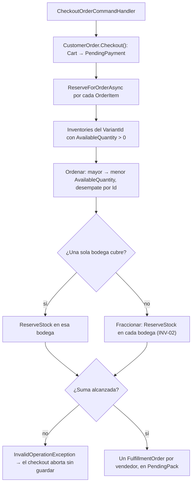

# 03. Domain Services (Servicios de Dominio)

Los Servicios de Dominio se utilizan cuando una operación de negocio requiere orquestar o aplicar reglas que involucran a múltiples *Aggregate Roots*, y cuya lógica no pertenece de forma natural a ninguno de los agregados individuales.

## 1. `InventoryReservationService`

- **Propósito:** reservar el stock físico de un pedido (`Zentric.Domain/Inventories/Services/InventoryReservationService.cs`). Lo invoca el **checkout** (`CheckoutOrderCommandHandler`), no el carrito.
- **Firma:** `ReserveForOrderAsync(CustomerOrder order) → Task`. Recorre los `Items` del pedido y **omite las líneas de producto `Digital`** (CAT-02: no pasan por almacén); por cada línea física consulta los `Inventory` (clave `(VariantId, WarehouseId)`, ADR-0002) con `AvailableQuantity > 0`.
- **Algoritmo (V-02, dictamen del Owner 2026-09-30):** ordena las bodegas de **mayor a menor `AvailableQuantity`** con desempate estable por `Id`, **sin preferencia por tipo de bodega** (`Inventory` no transporta `WarehouseType`). Como la mayor bodega se sirve primero, si alguna sola bodega cubre la cantidad la reserva **no** se divide (INV-02); si ninguna cubre, **fracciona** entre las necesarias (ADR-0001). Sin cercanía geográfica: el sistema no modela ubicación (ADR-0008).
- **Escritura (ADR-0025):** por cada bodega seleccionada llama a `IInventoryRepository.TryReserveStockAsync(id, n)` — un `UPDATE` condicional atómico que solo descuenta si la fila todavía tiene `n` unidades (cero filas = rechazo, se pasa a la siguiente bodega). Tras el éxito aplica `Inventory.ReserveStock(n)` en la copia en memoria como defensa en profundidad, no como garantía.
- **Fallo y compensación (ADR-0001):** si el total no alcanza, o si la base rechaza todas las bodegas, libera las reservas ya aplicadas con `ReleaseReservedStockAsync` (el `UPDATE` inverso condicional) y después lanza `InvalidOperationException` ("Not enough stock available for variant …"). Así el fallo no deja parciales confirmados — que antes lograba el `SaveChanges` diferido y ahora garantiza la compensación explícita.
- **Detalle:** [services/inventory-reservation-service.md](services/inventory-reservation-service.md); cubierto por `InventoryReservationServiceTests`.

## 2. Fragmentación del pedido (no hay `OrderSplitterService`)

- **Dónde ocurre:** en el **checkout** (`CheckoutOrderCommandHandler`): agrupa los `Items` por `VendorId` y crea **un `FulfillmentOrder` por vendedor** (`new FulfillmentOrder(order.Id, vendorId)`), todos naciendo en `PendingPack`.
- **Guías:** cada guía (`Shipment`) se añade después con `AddShipment(warehouseId, trackingNumber)` — una por bodega cuando la reserva se fraccionó (INV-02).
- Detalle y criterio: [services/order-splitter-service.md](services/order-splitter-service.md).

## 3. `ReturnsApprovalService`

- **Realidad:** `Zentric.Domain/Returns/Services/ReturnsApprovalService.cs` tiene **un solo método**: `ApproveReturn(ReturnRequest, bool isSameWarehouseAndVendor)` → delega en el agregado (`ReturnRequest.ApproveByVendor`). No hay orquestador de fases ni notificaciones.
- **Aprobación dual (vive en el agregado `ReturnRequest`):** `InspectByLogistics(buenEstado)` registra la inspección del Operador; `ApproveByVendor(...)` exige buen estado **salvo** que el retorno sea a la misma bodega y el mismo vendedor (`isSameWarehouseAndVendor`), donde la inspección no bloquea. `Reject()` y `MarkAsRefunded()` completan el ciclo.
- **Efectos:** `ApproveByVendor` emite `ReturnApprovedEvent` → `ReturnApprovedEventHandler` → `Inventory.ReturnToUsedStock` (stock usado). El **reembolso** no cuelga del evento: lo ejecuta el Administrador con `RefundReturnCommand` (`PaymentReceipt.Refund` + `ReturnRequest.MarkAsRefunded`).
- Detalle: [services/returns-approval-service.md](services/returns-approval-service.md).

## 4. `CheckoutTimeoutService` (servicio de fondo, en Infrastructure)

- **Propósito:** liberar el inventario reservado si un proceso de compra se abandona.
- **Dónde vive:** `Zentric.Infrastructure/BackgroundServices/CheckoutTimeoutService.cs` — `BackgroundService` que sondea en bucle (no hay Cron externo).
- **Flujo:** umbral `IClock.UtcNow - 15 min` (T-004: el reloj es inyectable) → pedidos `Cart` o `PendingPayment` con `UpdatedAt` anterior → por ítem `Inventory.ReturnToAvailable(cantidad)` → `CustomerOrder.CancelDueToTimeout()` → guarda. Sin motivo de cancelación en el pedido.
- Detalle y verificación determinista: [services/checkout-timeout-service.md](services/checkout-timeout-service.md).
