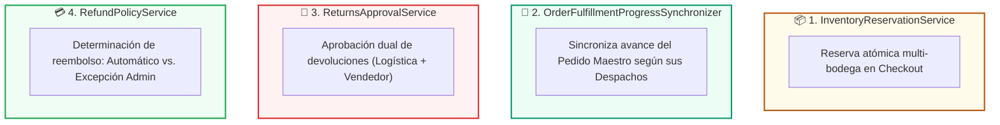

# 03. Servicios de Dominio (Domain Services) — Zentric

> **Especificación Táctica de Orquestación Pura.** Define los Servicios de Dominio de **Zentric** (`Zentric.Domain`). Un Servicio de Dominio encapsula lógica de negocio pura, cálculos complejos o coordinación entre múltiples Agregados Raíz que no pertenecen de forma natural a una sola entidad.

---

## 1. Principios de los Servicios de Dominio en Zentric

1. **Apatridia (Stateless):** Los servicios de dominio no almacenan estado mutable en sus instancias; operan sobre los agregados que reciben por parámetro.
2. **Dominio Puro sin Tecnología:** Residen en `Zentric.Domain`. No conocen Entity Framework Core, HTTP ni librerías de infraestructura externa.
3. **No Sustituyen a las Entidades:** Las entidades siguen siendo las guardianas de su propio estado e invariantes. El servicio de dominio decide **cuándo y cómo coordinar**, pero la mutación la ejecuta cada Agregado Raíz mediante sus métodos de negocio.
4. **Coordinación Transaccional Acotada:** Cuando coordinan múltiples agregados, lo hacen garantizando compensaciones defensivas o mediante eventos para respetar los límites de consistencia.

---

## 2. Matriz Maestra de Servicios de Dominio

| Servicio de Dominio | Subdominio | Agregados Coordinados | Responsabilidad Principal |
| :--- | :--- | :--- | :--- |
| **`InventoryReservationService`** | `Inventory` | `CustomerOrder`, `Inventory` | Bloqueo de stock físico durante el checkout; optimización de bodegas y fraccionamiento atómico. |
| **`OrderFulfillmentProgressSynchronizer`** | `Ordering` | `CustomerOrder`, `FulfillmentOrder` | Sincronización del estado global del pedido maestro a partir del estado de sus despachos fragmentados. |
| **`ReturnsApprovalService`** | `Returns` | `ReturnRequest`, `Warehouse` | Evaluación de condiciones para la aprobación comercial de devoluciones con peritaje logístico. |
| **`RefundPolicyService`** | `Returns` / `Payments` | `CustomerOrder`, `PaymentReceipt`, `ReturnRequest` | Dictamen de procedencia de reembolso (automático por quiebre vs. excepción manual por administrador). |

---

## 3. Especificación Detallada por Servicio

### 3.1. `InventoryReservationService` (Subdominio Inventory)
- **Espacio de Nombres:** `Zentric.Domain.Inventories.Services`
- **Propósito:** Orquestar la reserva transaccional de existencias físicas para cada línea de compra (`OrderItem`) al momento del checkout.
- **Firma:** `Task ReserveForOrderAsync(CustomerOrder order)`
- **Algoritmo de Selección de Bodegas:**
  1. **Filtrado:** Recorre las líneas del pedido y omite los productos de tipo `Digital` (no consumen almacenamiento).
  2. **Priorización por Capacidad:** Para cada variante física, consulta las bodegas con `AvailableQuantity > 0` y las ordena de **mayor a menor disponibilidad**, con desempate determinista por `WarehouseId`.
  3. **No Fraccionamiento Preferente:** Si la bodega con mayor stock cubre la totalidad requerida, la reserva se toma íntegramente de esa única bodega.
  4. **Fraccionamiento Atómico (INV-02):** Si ninguna bodega individual cubre la cantidad, se fracciona secuencialmente entre las bodegas necesarias hasta satisfacer la demanda.
- **Compensación Defensiva:** Si la suma total disponible en la red no satisface el pedido, el servicio revierte inmediatamente cualquier reserva parcial previa y aborta la operación, garantizando que el pedido no quede en un estado semicomprometido.

---

### 3.2. `OrderFulfillmentProgressSynchronizer` (Subdominio Ordering)
- **Espacio de Nombres:** `Zentric.Domain.Orders.Services`
- **Propósito:** Garantizar la regla **PED-05**: el pedido maestro refleja el mínimo común denominador del progreso de sus despachos asociados.
- **Firma:** `void Synchronize(CustomerOrder order, IEnumerable<FulfillmentStatus> fulfillmentStatuses)`
- **Reglas de Transición:**
  1. **Aislamiento de Quiebres (EXC-01):** Los despachos cancelados por falta física de existencias (`FulfillmentStatus.Cancelled`) son excluidos de la lista de despachos activos. No bloquean el avance de los paquetes exitosos.
  2. **Transición a Despachado (`Dispatched`):** Si el pedido maestro está en `Paid` y **todos** los despachos activos han alcanzado o superado `FulfillmentStatus.Dispatched`, se invoca `order.Dispatch()`.
  3. **Transición a Entregado (`Delivered`):** Si el pedido maestro está en `Dispatched` y **todos** los despachos activos están en `FulfillmentStatus.Delivered`, se invoca `order.Deliver()`.
  4. Si todos los despachos fueron cancelados por quiebre (cero paquetes activos), el pedido maestro permanece sin entregas físicas y sus importes se saldan financieramente.

---

### 3.3. `ReturnsApprovalService` (Subdominio Returns)
- **Espacio de Nombres:** `Zentric.Domain.Returns.Services`
- **Propósito:** Determinar la validez de la aprobación comercial de una devolución física.
- **Firma:** `void ApproveReturn(ReturnRequest request, bool isSameWarehouseAndVendor)`
- **Reglas e Invariantes:**
  - **Flujo General:** La aprobación definitiva requiere el visto bueno del vendedor (`VendorApproved == true`) y que el dictamen técnico del Operador Logístico certifique buen estado físico (`IsGoodCondition == true`).
  - **Excepción de Mismo Vendedor y Bodega:** Si la devolución ocurre en la misma bodega física de origen del propio vendedor (`isSameWarehouseAndVendor == true`), la inspección logística no bloquea la decisión y el vendedor puede autorizar directamente el reingreso.
  - Al aprobarse, la entidad emite `ReturnApprovedEvent`, habilitando el reingreso de la unidad a bodega bajo el contador de mercancía usada (`UsedQuantity`).

---

### 3.4. `RefundPolicyService` (Subdominio Returns / Payments)
- **Espacio de Nombres:** `Zentric.Domain.Returns.Services`
- **Propósito:** Evaluar y clasificar las solicitudes de reembolso financiero entre resoluciones automáticas del sistema y excepciones que exigen autorización manual de la Administración.
- **Firma:** `Task<RefundDecision> EvaluatePolicyAsync(RefundContext context)`
- **Reglas de Clasificación:**
  1. **Reembolso Automático (`RefundDecision.Auto`):**
     - Procedencia: Quiebre de existencias al empacar (`stock_breakage` disparado por `PartialFulfillmentCancelledDomainEvent`).
     - Al ser una falla imputable al vendedor ("Stock Fantasma"), el sistema no requiere autorización humana y procesa el reembolso directo sobre el comprobante de pago.
  2. **Reembolso por Excepción (`RefundDecision.Exception`):**
     - Procedencia: Cualquier disputa posventa ordinaria o devolución comercial (`vendor_approved_return`).
     - Exige dictamen explícito de un usuario con rol `Administrator` para liberar fondos de la plataforma (principio de segregación de poderes).
  3. **Validación Monetaria:** Verifica que el importe a reembolsar se calcule a partir del precio unitario congelado en la línea de compra (`OrderItem.UnitPrice`) y que el saldo remanente en `PaymentReceipt` sea suficiente.
