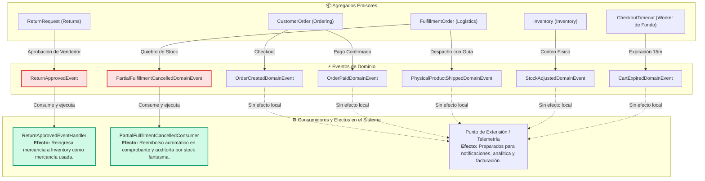

# 04. Eventos de Dominio (Domain Events) — Zentric

> **Especificación Táctica de Comunicación Desacoplada.** Define los Eventos de Dominio que notifican cambios de estado críticos entre distintos *Bounded Contexts* en **Zentric** (`Zentric.Domain`), garantizando la colaboración entre agregados sin romper sus límites transaccionales duros.

---

## 1. Rol de los Eventos de Dominio en Zentric

En Zentric, los Eventos de Dominio cumplen dos funciones fundamentales bajo Domain-Driven Design (DDD):

1. **Efectos Secundarios de Consistencia Cruzada:** Cuando una mutación en un agregado requiere alterar otro agregado (ej. una devolución aprobada debe reingresar existencias a bodega), la comunicación ocurre mediante un evento de dominio, no mediante llamadas directas acopladas entre entidades.
2. **Puntos de Extensión Desacoplados:** Notifican hechos consumados del negocio para permitir que futuros módulos (notificaciones por correo, webhooks a transportadoras o analítica) se suscriban sin alterar el código del núcleo de dominio.

### Ciclo de Despacho Transaccional
- **Registro en Memoria:** El Agregado Raíz genera el evento inmutable y lo encola en su colección interna (`AddDomainEvent`).
- **Despacho Pre-Commit:** Al persistir los cambios mediante la Unidad de Trabajo (`IUnitOfWork`), el despachador de eventos publica las notificaciones a través de mediador antes de confirmar la transacción de base de datos (`SaveChangesAsync`). Si un consumidor falla, la transacción completa se revierte protegiendo la consistencia global.

---

## 2. Mapa Arquitectónico de Eventos y Consumidores

---

## 3. Matriz Maestra de Eventos de Dominio

En `Zentric.Domain` existen **7 eventos de dominio inmutables**. Se clasifican según tengan un consumidor activo de efecto secundario en el core o funcionen como eventos de proyección y extensión:

| Evento de Dominio | Subdominio Emisor | Disparador de Negocio | Payload Inmutable | Consumidor en Aplicación | Efecto de Negocio en el Sistema |
| :--- | :--- | :--- | :--- | :--- | :--- |
| **`ReturnApprovedEvent`** | `Returns` | `ReturnRequest.ApproveByVendor()` | `ReturnRequestId`, `VariantId`, `WarehouseId`, `Quantity` | **`ReturnApprovedEventHandler`** | Reingresa las unidades físicas devueltas a la bodega dentro del contador de mercancía usada (`UsedQuantity`). |
| **`PartialFulfillmentCancelledDomainEvent`** | `Logistics` | `FulfillmentOrder.CancelDueNoStock()` | `FulfillmentOrderId`, `Reason` | **`PartialFulfillmentCancelledConsumer`** | Ejecuta el reembolso automático proporcional por quiebre de stock fantasma y registra la auditoría inmutable (`RefundAudit`). |
| **`OrderCreatedDomainEvent`** | `Ordering` | `CustomerOrder.Checkout()` | `OrderId`, `TotalAmount`, `Lines` | *Punto de Extensión* | Sella la intención de compra y reserva; proyecta la orden lista para integración de notificaciones al comprador. |
| **`OrderPaidDomainEvent`** | `Ordering` | `CustomerOrder.MarkAsPaid()` | `OrderId` | *Punto de Extensión* | Certifica la captura del dinero; preparado para disparar la emisión de la factura maestra y el split de comisiones. |
| **`PhysicalProductShippedDomainEvent`** | `Logistics` | `FulfillmentOrder.Dispatch()` | `ShipmentId`, `FulfillmentOrderId` | *Punto de Extensión* | Certifica la entrega del paquete a la transportadora; preparado para enviar número de rastreo al comprador. |
| **`StockAdjustedDomainEvent`** | `Inventory` | `Inventory.ApplyPhysicalCount()` | `InventoryId`, `SystemQty`, `PhysicalQty`, `CountedBy`, `Reason` | *Punto de Extensión* | Registra la discrepancia de conteo físico; preparado para reportes de mermas y auditoría de operadores. |
| **`CartExpiredDomainEvent`** | `Inventory` | Expiración de 15 minutos sin pago | `OrderId`, `ExpiredAt` | *Punto de Extensión* | Notifica la liberación automática de reservas de inventario; preparado para campañas de recuperación de carritos. |

---

## 4. Especificación Detallada de Consumidores Activos

### 4.1. `ReturnApprovedEventHandler` (Reingreso de Mercancía)
- **Evento Suscrito:** `ReturnApprovedEvent`
- **Ubicación:** `Zentric.Application.Returns.EventHandlers.ReturnApprovedEventHandler`
- **Flujo de Negocio:**
  1. Recibe la notificación de aprobación dual completada en `ReturnRequest`.
  2. Consulta la posición de inventario correspondiente (`VariantId` y `WarehouseId`).
  3. Invoca el método de dominio `Inventory.ReturnToUsedStock(quantity)`.
  4. La mercancía vuelve a estar disponible para la venta pero categorizada rigurosamente como usada, impidiendo que se venda como producto nuevo.

---

### 4.2. `PartialFulfillmentCancelledConsumer` (Reembolso por Stock Fantasma)
- **Evento Suscrito:** `PartialFulfillmentCancelledDomainEvent`
- **Ubicación:** `Zentric.Application.Returns.EventHandlers.PartialFulfillmentCancelledConsumer`
- **Flujo de Negocio:**
  1. Recibe la notificación de quiebre de inventario físico reportado por el operador logístico al momento de empacar.
  2. Evalúa la política de reembolso mediante `RefundPolicyService`. Al ser quiebre atribuible al vendedor (`stock_breakage`), la política dictamina **resolución automática**.
  3. Calcula el importe proporcional exacto congelado al momento de la compra para las unidades afectadas.
  4. Aplica el reembolso sobre el comprobante financiero (`PaymentReceipt.Refund()`).
  5. Crea y almacena un registro inmutable en `RefundAudit` con resultado `Credited`.

---

## 5. Criterio de Extensibilidad sin Acoplamiento

El hecho de que eventos como `OrderCreatedDomainEvent`, `OrderPaidDomainEvent` o `PhysicalProductShippedDomainEvent` no tengan un consumidor registrado localmente **no significa que estén rotos o incompletos**:
- **Diseño Intencional:** La emisión de eventos pertenece al núcleo de Dominio para declarar hechos que ya sucedieron.
- **Principio Abierto/Cerrado (OCP):** Nuevos requerimientos (ej. enviar un correo al pagar o generar un archivo contable) se integran agregando nuevos manejadores en la capa de Aplicación sin tocar una sola línea de las entidades de Dominio.