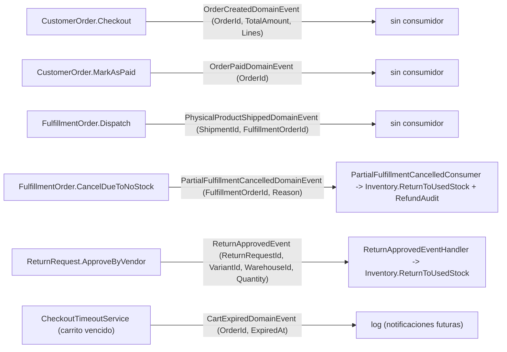

# 04. Domain Events (Eventos de Dominio)

Los eventos de dominio comunican cambios de estado criticos entre Bounded Contexts. Se registran en el agregado (`AddDomainEvent`) y se despachan al persistir (`IUnitOfWork`); cada evento puede tener cero o mas handlers.

> Consumo actual: se emiten **7 eventos** (`OrderCreated`, `OrderPaid`,
> `PhysicalProductShipped`, `PartialFulfillmentCancelled`, `ReturnApproved`, `StockAdjusted`, `CartExpired`); handlers registrados: `ReturnApprovedEventHandler`, `PartialFulfillmentCancelledConsumer` (auto-refund quiebre), y `CartExpiredDomainEvent` se loggea (preparado para notificaciones futuras).
> `CartExpiredDomainEvent` lo publica el **vencimiento del carrito** (`CheckoutTimeoutService`), con el
> `OrderId` y la fecha de expiracion, para que el modulo de notificaciones lo escuche cuando exista
> (decision del Owner 2026-10-03). **IMPLEMENTADO 2026-10-07:** `CheckoutTimeoutService` emite `CartExpiredDomainEvent` con `OrderId` y `ExpiredAt` al expirar cada carrito. Donde una entrada describe un "proposito" sin consumidor, tratala como
> intencion de diseno: el efecto real ocurre en el flujo de comando correspondiente.



## 1. Eventos de Pedidos (Ordering)

| Evento | Disparador | Payload | Consumidor |
|---|---|---|---|
| `OrderCreatedDomainEvent` | `CustomerOrder.Checkout()` | `OrderId`, `TotalAmount`, `Lines` | Sin consumidor (preparado para notificaciones) |
| `OrderPaidDomainEvent` | `CustomerOrder.MarkAsPaid()` | `OrderId` | Sin consumidor (preparado para facturacion) |

## 2. Eventos de Logistica (Logistics)

| Evento | Disparador | Payload | Consumidor |
|---|---|---|---|
| `PhysicalProductShippedDomainEvent` | `FulfillmentOrder.Dispatch()` | `ShipmentId`, `FulfillmentOrderId` | Sin consumidor (preparado para tracking) |
| `PartialFulfillmentCancelledDomainEvent` | `FulfillmentOrder.CancelDueToNoStock()` | `FulfillmentOrderId`, `Reason` | **`PartialFulfillmentCancelledConsumer`** (auto-refund + `RefundAudit`) |
| `StockAdjustedDomainEvent` | `Inventory.ApplyPhysicalCount()` | `InventoryId`, `SystemQty`, `PhysicalQty`, `CountedBy`, `Reason` | Sin consumidor (auditoria) |

## 3. Eventos de Devoluciones (Returns)

| Evento | Disparador | Payload | Consumidor |
|---|---|---|---|
| `ReturnApprovedEvent` | `ReturnRequest.ApproveByVendor()` | `ReturnRequestId`, `VariantId`, `WarehouseId`, `Quantity` | **`ReturnApprovedEventHandler`** -> `Inventory.ReturnToUsedStock` (ADD-002 / H-14 cumplido) |

## 4. Eventos de Carrito (Cart)

| Evento | Disparador | Payload | Consumidor |
|---|---|---|---|
| `CartExpiredDomainEvent` | `CheckoutTimeoutService` (expiracion 15 min) | `OrderId`, `ExpiredAt` | Log (preparado para notificaciones futuras) |

## 5. Registro de handlers en el Composition Root

```csharp
// Program.cs
builder.Services.AddScoped<INotificationHandler<DomainEventNotification<ReturnApprovedEvent>>, ReturnApprovedEventHandler>();
builder.Services.AddScoped<INotificationHandler<DomainEventNotification<PartialFulfillmentCancelledDomainEvent>>, PartialFulfillmentCancelledConsumer>();
```

> **Nota:** Los eventos sin consumidor (`OrderCreated`, `OrderPaid`, `PhysicalProductShipped`, `CartExpired`) estan preparados para integraciones futuras (notificaciones, analitica, webhooks). La arquitectura soporta agregarlos sin tocar el dominio: basta registrar un handler nuevo en el Composition Root.