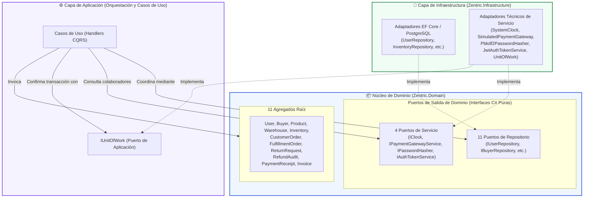

# 05. Puertos (Ports)

> **Especificación Arquitectónica de Puertos de Salida.** Siguiendo la **Arquitectura Hexagonal (Puertos y Adaptadores)** y el **Principio de Inversión de Dependencias (DIP)**, este documento define los contratos formales que el núcleo de negocio (`Zentric.Domain` y `Zentric.Application`) requiere para interactuar con el exterior (persistencia, tiempo, pasarelas y seguridad), sin acoplarse a tecnologías concretas.

---

## 1. Topología Hexagonal de Puertos y Adaptadores

---

## 2. Puertos de Repositorio (Persistencia por Agregado Raíz)

Bajo las reglas de Domain-Driven Design, **cada Agregado Raíz cuenta con un único repositorio dedicado**. Se especifican los **11 puertos de repositorio** que gobiernan la persistencia del sistema:

| Puerto de Salida | Agregado Raíz Asociado | Operaciones Normativas del Contrato | Criterio de Seguridad, Filtrado o Concurrencia |
| :--- | :--- | :--- | :--- |
| **`IUserRepository`** | `User` | `GetByIdAsync`, `GetByEmailAsync`, `GetAllAsync(role?)`, `IsEmailUniqueAsync`, `IsIdentityDocumentUniqueAsync`, `AddAsync`, `UpdateAsync` | Garantiza unicidad funcional de credenciales (`Email`, documento) y filtra usuarios por rol operativo. |
| **`IBuyerRepository`** | `Buyer` | `GetByIdAsync`, `AddAsync`, `UpdateAsync` | Encapsula la gestión de direcciones de entrega y perfil del comprador en su propio ámbito. |
| **`IProductRepository`** | `Product` | `GetByIdAsync`, `GetByVariantIdAsync`, `GetAllAsync(vendorId?, status?)`, `GetPagedAsync(vendorId, status, skip, take)`, `AddAsync`, `UpdateAsync` | Soporta paginación atómica y filtrado de catálogo: `Published` para público general o catálogo completo para el vendedor dueño. |
| **`IWarehouseRepository`** | `Warehouse` | `GetByIdAsync`, `GetAllAsync(vendorId?)`, `AddAsync`, `UpdateAsync` | Lista y administra bodegas físicas, permitiendo filtrado por vendedor propietario. |
| **`IInventoryRepository`** | `Inventory` | `GetByIdAsync`, `GetByVariantAndWarehouseAsync`, `GetByVariantIdAsync`, `GetTotalAvailableStockAsync`, `GetListAsync(vendorId?)`, `AddAsync`, `UpdateAsync`, `LoadWithHistoryAsync`, `SaveAdjustmentAsync`, `TryReserveStockAsync(id, qty)`, `ReleaseReservedStockAsync(id, qty)` | **Concurrencia Atómica:** `TryReserveStockAsync` y `ReleaseReservedStockAsync` ejecutan `UPDATE` condicional atómico sin bloqueos de tabla. Carga auditoría con `LoadWithHistoryAsync`. |
| **`ICustomerOrderRepository`** | `CustomerOrder` | `GetByIdAsync`, `GetByIdForBuyerAsync`, `GetByIdForVendorAsync`, `GetListAsync(buyerId?, vendorId?, status?)`, `GetExpiredOrdersAsync(threshold)`, `AddAsync`, `UpdateAsync` | **Aislamiento de Propiedad:** Las consultas por rol devuelven `null` ante órdenes ajenas, impidiendo deducir si un pedido existe. Filtra carritos vencidos para liberación. |
| **`IFulfillmentOrderRepository`** | `FulfillmentOrder` | `GetByIdAsync`, `GetByCustomerOrderIdAsync`, `GetListAsync(vendorId?, buyerId?, status?)`, `AddAsync`, `UpdateAsync` | Consulta despachos por orden maestra para sincronizar el estado común y filtra la cola logística por vendedor. |
| **`IReturnRequestRepository`** | `ReturnRequest` | `GetByIdAsync`, `GetByOrderIdAsync`, `GetListAsync(buyerId?, vendorId?, status?)`, `AddAsync`, `UpdateAsync` | Resuelve solicitudes de devolución filtrando por comprador o vendedor en la consulta SQL para evitar fugas entre cuentas. |
| **`IRefundAuditRepository`** | `RefundAudit` | `GetByIdAsync`, `GetByReturnRequestIdAsync`, `GetByOrderIdAsync`, `AddAsync` | Persistencia inmutable de auditorías financieras generadas por devoluciones o resoluciones automáticas de stock fantasma. |
| **`IPaymentReceiptRepository`** | `PaymentReceipt` | `GetByIdAsync`, `GetByOrderIdAsync`, `AddAsync`, `UpdateAsync` | Registra comprobantes financieros inmutables y mantiene la acumulación de créditos parciales reembolsados. |
| **`IInvoiceRepository`** | `Invoice` | `GetByIdAsync`, `GetByOrderIdAsync`, `GetListAsync(buyerId?, vendorId?)`, `AddAsync`, `AddRangeAsync`, `UpdateAsync` | Emite y consulta el split de facturación (Factura Maestra para comprador y Facturas Detalle por vendedor). |

---

## 3. Puertos de Servicio y Colaboradores Externos

Abstraen capacidades auxiliares y de infraestructura técnica indispensables para el Dominio, manteniendo la neutralidad tecnológica del núcleo:

### 3.1. `IClock` (Abstracción Temporal UTC)
- **Ubicación:** `Zentric.Domain.Common.Ports.IClock`
- **Contrato:** `DateTimeOffset UtcNow { get; }`
- **Responsabilidad:** Proporciona el instante temporal exacto en formato UTC. Permite que las reglas dependientes del tiempo (expiración de reservas de 15 minutos, vigencia de tokens, marcas de auditoría) sean verificadas de forma determinista en pruebas unitarias simulando el paso del reloj sin esperas reales.
- **Adaptador en Infraestructura:** `SystemClock` (consume `DateTimeOffset.UtcNow`).

---

### 3.2. `IPaymentGatewayService` (Pasarela de Pagos Externa)
- **Ubicación:** `Zentric.Domain.Payments.Ports.IPaymentGatewayService`
- **Contrato:** `Task<PaymentResult> ChargeAsync(Guid orderId, Money amount, CancellationToken cancellationToken = default);`
- **Responsabilidad:** Solicita el débito de un monto económico imputado a una orden comercial. El resultado del negocio (`PaymentResult`) encapsula aprobación o rechazo (`Approved = true/false`, `TransactionId`, `DeclineReason`) como un flujo funcional ordinario, reservando excepciones para caídas técnicas de red.
- **Adaptador en Infraestructura:** `SimulatedPaymentGateway` (emula autorizaciones y rechazos de pasarelas de pago).

---

### 3.3. `IPasswordHasher` (Criptografía de Credenciales)
- **Ubicación:** `Zentric.Domain.Users.Ports.IPasswordHasher`
- **Contrato:** 
  - `string Hash(string password);`
  - `bool Verify(string password, string storedHash);`
- **Responsabilidad:** Deriva hashes seguros de contraseñas y realiza comprobaciones en tiempo constante contra ataques de temporización. El dominio desconoce el algoritmo criptográfico, permitiendo reemplazar la implementación en el adaptador sin alterar las entidades.
- **Adaptador en Infraestructura:** `Pbkdf2PasswordHasher` (implementa derivación segura de claves PBKDF2-HMAC-SHA256 con 600,000 iteraciones).

---

### 3.4. `IAuthTokenService` (Emisión de Credenciales de Sesión)
- **Ubicación:** `Zentric.Domain.Users.Ports.IAuthTokenService`
- **Contrato:** `AuthToken Issue(Guid userId, string email, string fullName, UserRole role);`
- **Responsabilidad:** Emite la credencial de autenticación que representa al usuario autenticado y su rol operativo en el sistema. El Dominio desconoce el estándar de transporte o codificación del token.
- **Adaptador en Infraestructura:** `JwtAuthTokenService` (emite tokens compactos JWT firmados digitalmente con expiración programada).

---

## 4. Puertos de Orquestación y Transaccionalidad (Capa de Aplicación)

### 4.1. `IUnitOfWork` (Unidad de Trabajo y Confirmación Atómica)
- **Ubicación:** `Zentric.Application.Common.Ports.IUnitOfWork`
- **Contrato:** `Task<int> SaveChangesAsync(CancellationToken cancellationToken = default);`
- **Responsabilidad:** Coordina la persistencia atómica de los cambios acumulados en una transacción de base de datos.
- **Comportamiento en Pipeline:**
  1. Los casos de uso invocan métodos de agregados y repositorios.
  2. Al concluir la orquestación, se invoca `IUnitOfWork.SaveChangesAsync()`.
  3. El adaptador en Infraestructura intercepta los eventos de dominio encolados en las entidades modificadas (`Entity.DomainEvents`).
  4. Despacha los eventos mediante mediador interno antes de confirmar la transacción física en PostgreSQL.
  5. Si cualquier manejador falla, la transacción de base de datos realiza *rollback*, garantizando consistencia absoluta.
- **Adaptador en Infraestructura:** `UnitOfWork` (envuelve el ciclo de vida del `DbContext` de EF Core).

---

## 5. Principios de Diseño y Salvaguardas en los Puertos

1. **Aislamiento Estricto de Datos por Rol (Row-Level Security):**
   Los métodos de lectura por rol (`GetByIdForBuyerAsync`, `GetByIdForVendorAsync`, y `GetListAsync`) aplican las cláusulas de pertenencia directamente en la consulta a base de datos (`WHERE`). Devolver `null` en lugar de una excepción ante recursos no propios previene ataques de enumeración y garantiza que un cliente no pueda inferir la existencia de pedidos ajenos.
2. **Concurrencia Atómica sin Bloqueos Pesados:**
   El puerto `IInventoryRepository` descarta el uso de tokens de concurrencia optimista lentos o bloqueos pesados de tabla. Las operaciones de reserva y compensación (`TryReserveStockAsync` / `ReleaseReservedStockAsync`) imponen sentencias de actualización condicional atómica a nivel de fila (`UPDATE ... WHERE AvailableQuantity >= n`), protegiendo la invariante de no-negatividad contra hilos concurrentes.
3. **Neutralidad de Framework:**
   Ningún puerto de dominio contiene referencias a tipos de Entity Framework Core (`IQueryable`, `DbSet`), librerías web (`HttpContext`), o protocolos de serialización. Todos los contratos operan exclusivamente con Agregados Raíz, Value Objects, enumeraciones de dominio y tipos primitivos inmutables de C#.
