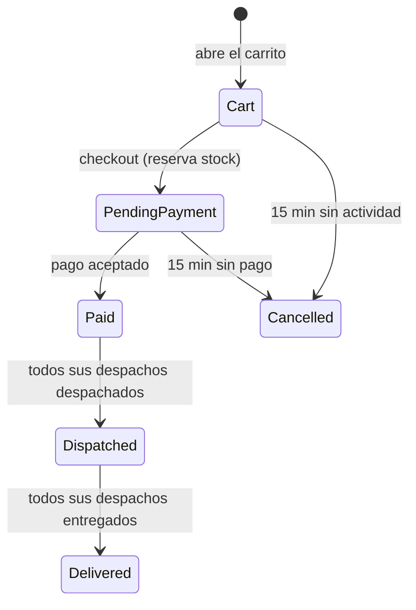
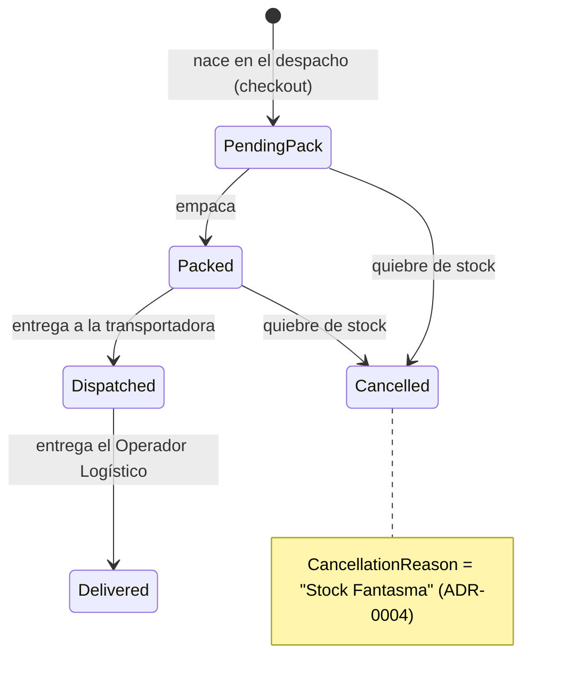
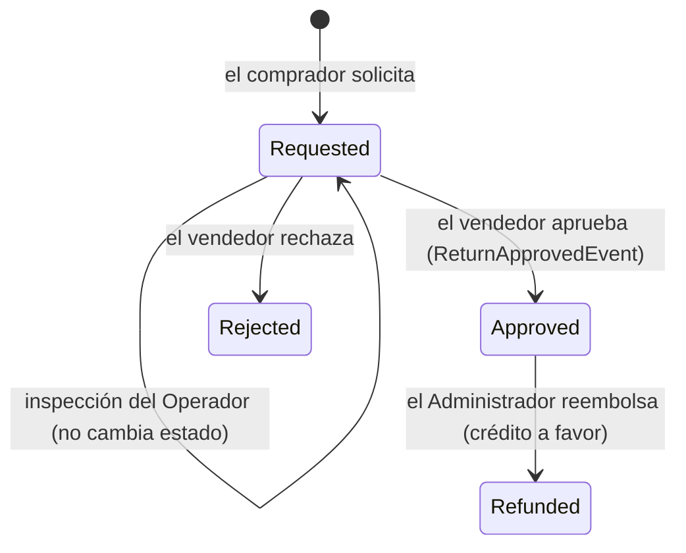
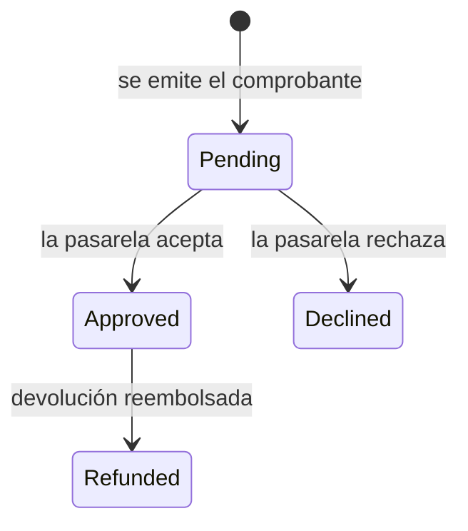

# 07. Ciclo de Vida Crítico (Máquinas de Estado)

Estas son las transiciones que el sistema **debe** poder hacer. Los nombres son los del código:
si este documento y `Zentric.Domain` discrepan, **es este documento el que está mal** (a menos que
la Ley diga otra cosa, en cuyo caso manda `ZENTRIC.md` y se repara el código).

Los valores de cada enum se detallan por debajo; las decisiones con **por qué** están en los ADR que se citan.

---

## 1. Ciclo de Vida: Pedido (`CustomerOrder`)

Enum: `Zentric.Domain/Orders/Enums/OrderStatus.cs` → `Cart`, `PendingPayment`, `Paid`,
`Dispatched`, `Delivered`, `Cancelled`.

Solo `Cart` y `PendingPayment` terminan en `Cancelled` (`CancelDueToTimeout`): `Paid`, `Dispatched` y `Delivered` no admiten cancelación.

| Desde | Hasta | Qué lo dispara | Notas |
|---|---|---|---|
| **[DECIDIDO 2026-10-03; sin código]** El pedido maestro refleja el **mínimo común** de sus despachos: `Dispatched` cuando todos están `Dispatched`, `Delivered` cuando todos están `Delivered`. Si uno solo falta, el pedido entero no está entregado. | | | |
| `Cart` | `PendingPayment` | Se envía el pago (el checkout reserva el stock) | En `Cart` no hay stock reservado: la reserva ocurre al hacer checkout. Un carrito con más de 15 minutos desde su creación no se puede procesar — `Checkout()` lo rechaza (PED-01). |
| `Cart` | `Cancelled` | 15 minutos sin actividad | Ejecuta `CheckoutTimeoutService`. |
| `PendingPayment` | `Paid` | La pasarela acepta el cobro | El cobro se emite **antes** de marcar el pedido, para que quede constancia del intento aunque la pasarela rechace. |
| `PendingPayment` | `Cancelled` | 15 minutos sin pago | El cobro rechazado **no** anula el pedido: el comprobante queda `Declined` y el pedido sigue `PendingPayment` hasta que lo expira `CheckoutTimeoutService` (el barrido vence `Cart` y `PendingPayment`). |
| `Paid` | `Dispatched` | El último despacho pendiente pasa a `Dispatched` | **Implementado 2026-10-04** — `OrderFulfillmentProgressSynchronizer`, invocado desde `DispatchFulfillmentCommandHandler` en la misma transacción que el cambio del despacho (§2). |
| `Dispatched` | `Delivered` | El último despacho pendiente pasa a `Delivered` | **Implementado 2026-10-04** — mismo servicio, invocado desde `DeliverFulfillmentCommandHandler`. El cierre lo confirma el Operador Logístico en cada despacho (§2). |

> Estados reales del maestro: `Dispatched` y `Delivered` (el enum no tiene estado parcial ni `Completed`). Ver
> [ADR-0006](../Adr/0006-resolucion-contradiccion-ley-addendum.md).

---

## 2. Ciclo de Vida: Despacho (`FulfillmentOrder`)

Enum: `Zentric.Domain/Logistics/Enums/FulfillmentStatus.cs` → `PendingPack`, `Packed`,
`Dispatched`, `Delivered`, `Cancelled`.

Cada pedido genera **un despacho por vendedor**: el pedido puede ser multi-vendedor y cada vendedor
empaca y envía lo suyo.

| Desde | Hasta | Quién puede | Qué lo dispara |
|---|---|---|---|
| — | `PendingPack` | Vendedor (lo suyo) y Operador | Se crea al crear el despacho. **Nace siempre en este estado.** |
| `PendingPack` | `Packed` | Vendedor y Operador | La bodega termina el alistamiento. |
| `Packed` | `Dispatched` | Vendedor y Operador | Se entrega a la transportadora. Dispara el evento `PhysicalProductShipped`. |
| `Dispatched` | `Delivered` | **Solo el Operador Logístico** | Confirma la entrega al Comprador. El Vendedor **no** puede cerrar la entrega (dictamen de 2026-10-01: la confirmación es un acto físico en bodega). |
| Cualquiera salvo `Dispatched`/`Delivered` | `Cancelled` | Vendedor y Operador | Cancelación por quiebre de stock. **No se puede cancelar un despacho ya enviado ni entregado:** se ha comprometido con la transportadora. |

### Cancelación con motivo: la regla de `ADR-0004`

- **Un único estado `Cancelled`**, no un estado por motivo (`CancelledByStockBreak` y similares
  **no existen**).
- El motivo vive en la propiedad **`CancellationReason`** (`string`), que solo tiene sentido cuando
  el estado es `Cancelled`.
- Hoy el único motivo que se escribe es `"Stock Fantasma"`: el sistema cree que hay existencias y
  en bodega no están.
- Cancelar dispara `PartialFulfillmentCancelledDomainEvent`, que **no tiene consumidor**. El reembolso no es automático: la cancelación abre la devolución obligatoria (`CancelFulfillmentOrderDueToNoStockCommand` crea una `ReturnRequest`) y el Administrador emite el crédito de las líneas no entregadas ([EXC-02](06-business-rules.md), [ADR-0018](../Adr/0018-devoluciones-confianza-recepcion-responsabilidad.md)).

**Por qué así:** meter el motivo en el enum infla la máquina de estados y mezcla la transición
lógica con el dato. Si mañana hay otro motivo de cancelación, se añade un valor al string y no se
toca el enum. Ver [ADR-0004](../Adr/0004-estado-cancelacion-despacho.md).

### Reglas de inmutabilidad

- A un despacho `Cancelled` **no se le añaden envíos**.
- Ninguna transición es reversible: `Delivered` es un estado terminal.
- `AddShipment` sobre un `Cancelled` lanza excepción; `Pack` fuera de `PendingPack` lanza
  excepción; `Dispatch` sin haber empaquetado lanza excepción.

## 3. Ciclo de Vida: Devolución (`ReturnRequest`)

Enum: `Zentric.Domain/Returns/Enums/ReturnStatus.cs` → `Requested`, `Approved`, `Rejected`, `Refunded` («Solicitada, Aprobada, Rechazada, Reembolsada» del ADDENDUM Dominio 10).

| Desde       | Hasta                              | Quién              | Regla                                                                                                                                                                                                           |
| ----------- | ---------------------------------- | ------------------ | --------------------------------------------------------------------------------------------------------------------------------------------------------------------------------------------------------------- |
| —           | `Requested`                        | Comprador          | `RequestReturnCommand` abre la solicitud; los productos digitales no se pueden devolver.                                                                                                                        |
| `Requested` | (inspección, sin cambio de estado) | Operador Logístico | `InspectByLogistics(buenEstado)` registra el veredicto.                                                                                                                                                         |
| `Requested` | `Approved`                         | Vendedor           | `ApproveByVendor` exige buen estado salvo retorno a la misma bodega y vendedor ([ADR-0018](../Adr/0018-devoluciones-confianza-recepcion-responsabilidad.md)); emite `ReturnApprovedEvent` y repone stock usado. |
| `Requested` | `Rejected`                         | Vendedor           | `Reject()`. Sin eventos.                                                                                                                                                                                        |
| `Approved`  | `Refunded`                         | Administrador      | `RefundReturnCommand` acredita el comprobante (crédito a favor) y marca `MarkAsRefunded()`. El pedido no se revierte (ADDENDUM 2026-09-27).                                                                     |

## 4. Ciclo de Vida: Comprobante de pago (`PaymentReceipt`)

Enum: `Zentric.Domain/Payments/Enums/PaymentStatus.cs` → `Pending`, `Approved`, `Declined`, `Refunded`.

- El cobro se emite **antes** de marcar el pedido, para que quede constancia del intento aunque la pasarela rechace (invariante 9).
- `Approve`/`Decline` son idempotentes y excluyentes: un comprobante `Approved` no se puede rechazar. `Refund` solo acepta `Approved` y también es idempotente.
- `Refunded` es el crédito a favor (ADDENDUM 2026-09-27).

---

> **Fuente de verdad:** los nombres y los valores son los de `Zentric.Domain`. Este documento los describe, no los decide. Si discrepan, **algo está roto y hay que reparar** — no escribir una excepción para que la doc tenga razón. Que la regla de negocio venga de la Ley o de un dictamen
> del Owner sí se decide aquí, con su ADR.

