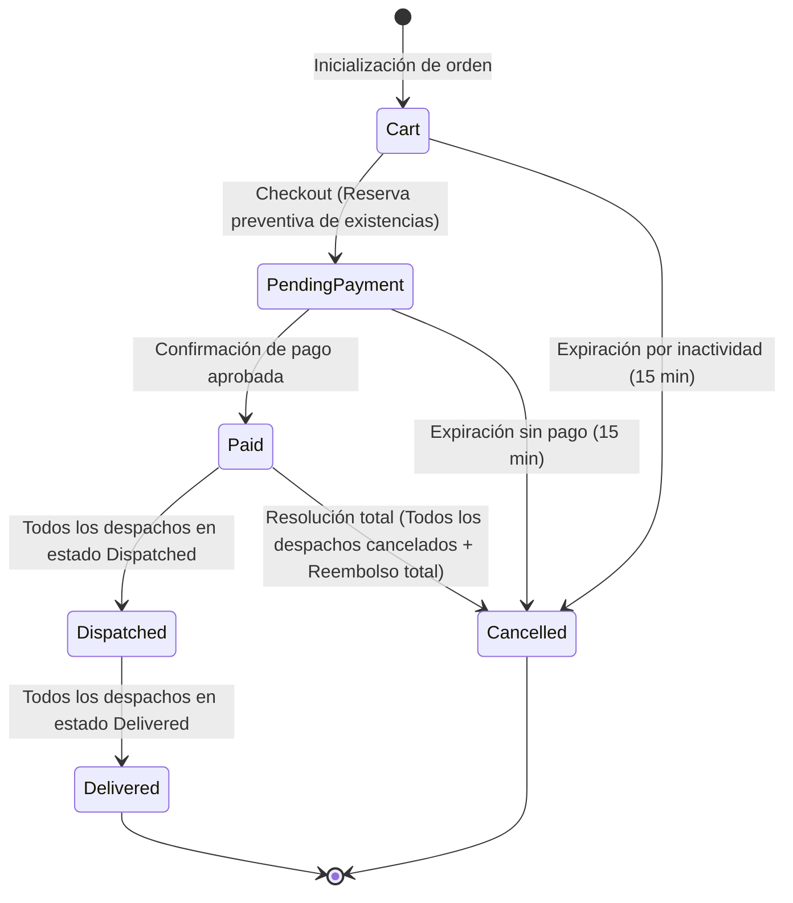
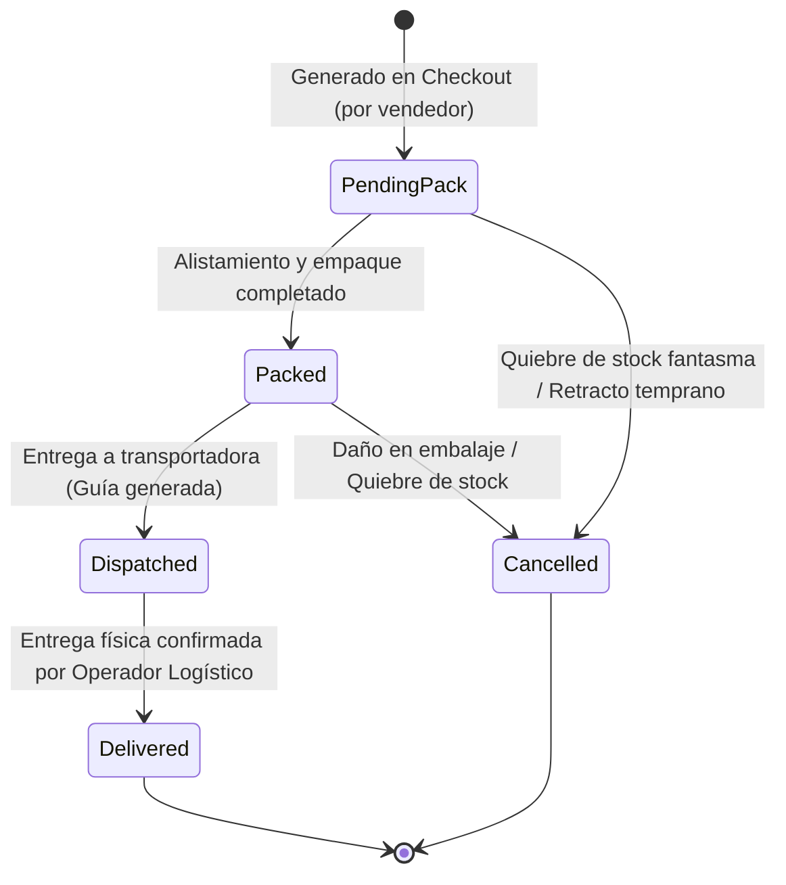
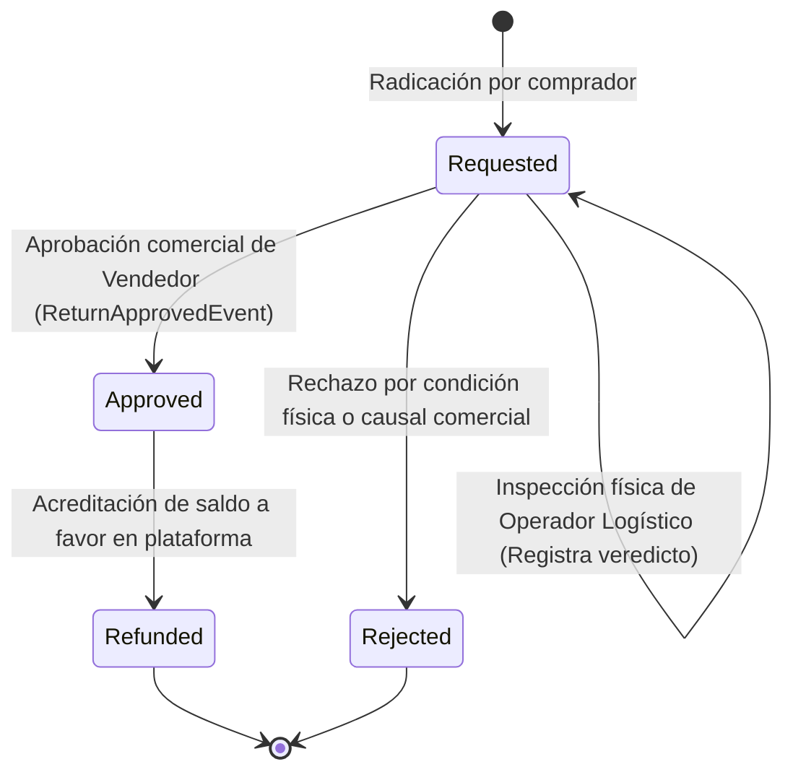
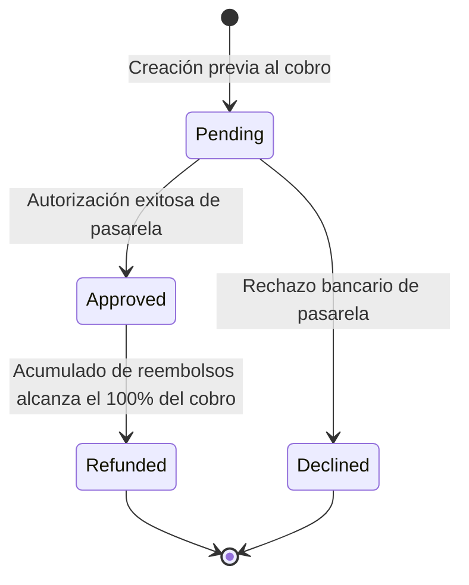
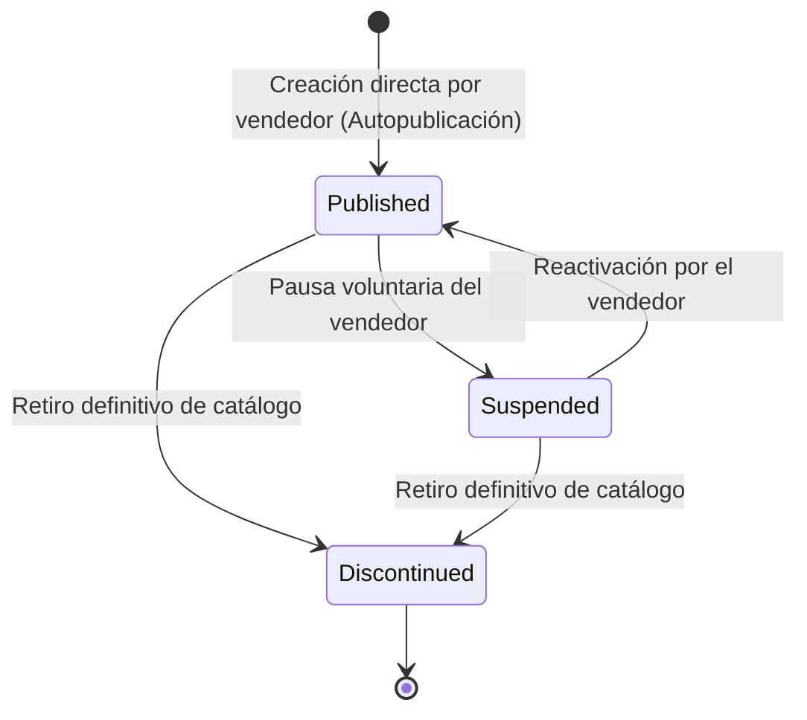
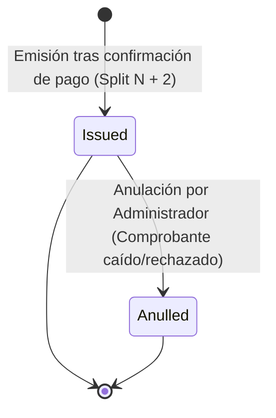

# 07. Ciclo de Vida Crítico (Máquinas de Estado)

> **Especificación Normativa de Máquinas de Estado del Dominio.** Define todas las transiciones válidas, actores autorizados, condiciones precondicionales y efectos secundarios que rigen el ciclo de vida de los 6 agregados transaccionales de **Zentric** (`Zentric.Domain`). Toda transición no declarada en este documento es ilegal y debe ser rechazada con una excepción o fallo de dominio.

---

## 1. Ciclo de Vida del Pedido Comercial (`CustomerOrder`)

El agregado `CustomerOrder` gobierna la intención de compra, retención de inventario y consolidación comercial global del comprador.

### 1.1. Estados Válidos (`OrderStatus`)
* **`Cart`:** Carrito abierto en edición; no retiene existencias en inventario.
* **`PendingPayment`:** Checkout completado; existencias reservadas temporalmente durante un máximo de 15 minutos en espera del pago.
* **`Paid`:** Pago confirmado por la pasarela; las líneas quedan congeladas y se habilitan los despachos logísticos.
* **`Dispatched`:** Salida física de bodega confirmada para la totalidad de los despachos logísticos asociados.
* **`Delivered`:** Entrega efectiva confirmada para la totalidad de los paquetes entregables.
* **`Cancelled`:** Anulación terminal provocada por expiración del tiempo de pago (15 min) o resolución total por quiebre de stock fantasma.

### 1.2. Diagrama de Transición de Estados

### 1.3. Matriz Normativa de Transiciones
| Estado Origen | Estado Destino | Actor / Disparador | Precondición y Regla de Negocio | Efecto Secundario en el Sistema |
| :--- | :--- | :--- | :--- | :--- |
| — | **`Cart`** | Comprador | Creación de carrito con comprador válido y dirección principal. | Emite orden en memoria lista para agregar ítems. |
| **`Cart`** | **`PendingPayment`** | Comprador | Contiene al menos un ítem; vendedor activo (`CanAuthenticate`). | Reserva existencias mediante `InventoryReservationService`; genera las órdenes de despacho `FulfillmentOrder` por vendedor; emite `OrderCreatedDomainEvent`. |
| **`Cart`** | **`Cancelled`** | Worker de Fondo | 15 minutos transcurridos sin avanzar a checkout. | Anula el intento de orden sin impacto en existencias físicas. |
| **`PendingPayment`** | **`Paid`** | Pasarela de Pagos / Comprador | Comprobante de pago en estado aprobado (`PaymentStatus.Approved`). | Entrega instantánea de líneas digitales (`DigitalDeliveryRecord`); emite `OrderPaidDomainEvent`; habilita empaque logístico. |
| **`PendingPayment`** | **`Cancelled`** | Worker de Fondo | 15 minutos transcurridos sin captura de pago aprobada. | Invoca `Inventory.ReturnToAvailable()`, restituyendo todas las reservas de stock; emite `CartExpiredDomainEvent`. |
| **`Paid`** | **`Dispatched`** | Operador Logístico / Vendedor | El synchronizer detecta que el 100% de los despachos no cancelados alcanzaron `Dispatched`. | Actualiza el estado maestro; sincroniza la orden para seguimiento del comprador. |
| **`Paid`** | **`Cancelled`** | Sistema (Resolución Total) | La totalidad de los despachos fueron cancelados por quiebre de stock y el saldo económico a favor fue acreditado en su totalidad. | Sella la orden como terminada sin entrega física; el comprador conserva su saldo a favor total. |
| **`Dispatched`** | **`Delivered`** | Operador Logístico | El synchronizer detecta que el 100% de los despachos no cancelados alcanzaron `Delivered`. | Sella el pedido como finalizado satisfactoriamente; abre la ventana de posventa para devoluciones de ítems físicos. |

---

## 2. Ciclo de Vida del Despacho Logístico (`FulfillmentOrder`)

El agregado `FulfillmentOrder` gestiona el empaque, guía de envío y entrega física de los productos correspondientes a un vendedor específico dentro de una orden.

### 2.1. Estados Válidos (`FulfillmentStatus`)
* **`PendingPack`:** Despacho creado; esperando alistamiento y empaque físico en bodega.
* **`Packed`:** Mercancía embalada y etiquetada en bodega; lista para retiro de transportadora.
* **`Dispatched`:** Paquete entregado a la transportadora con número de guía oficial asignado.
* **`Delivered`:** Paquete entregado físicamente al comprador en destino.
* **`Cancelled`:** Despacho cancelado unilateralmente por falta de existencias físicas en bodega (stock fantasma) o retracto temprano del vendedor.

### 2.2. Diagrama de Transición de Estados

### 2.3. Matriz Normativa de Transiciones
| Estado Origen | Estado Destino | Actor Autorizado | Precondición y Regla de Negocio | Efecto Secundario en el Sistema |
| :--- | :--- | :--- | :--- | :--- |
| — | **`PendingPack`** | Sistema | Generado automáticamente al ejecutar checkout, agrupando ítems físicos por vendedor. | Asocia bodega de origen y líneas correspondientes. |
| **`PendingPack`** | **`Packed`** | Vendedor u Operador Logístico | Todas las unidades físicas de la orden se encuentran verificadas y embaladas. | Sella la orden como lista para despacho. |
| **`Packed`** | **`Dispatched`** | Vendedor u Operador Logístico | Número de guía oficial asignado (`TrackingNumber` no nulo). | Emite `PhysicalProductShippedDomainEvent`; evalúa avance del pedido maestro mediante `OrderFulfillmentProgressSynchronizer`. |
| **`Dispatched`** | **`Delivered`** | **Solo Operador Logístico** | Confirmación física de recepción en destino. El vendedor tiene prohibido auto-confirmar la entrega. | Sella el despacho; evalúa cierre final del pedido maestro a `Delivered`. |
| **`PendingPack`** / **`Packed`** | **`Cancelled`** | Vendedor u Operador Logístico | Detección de daño o inexistencia física de stock antes del despacho; motivo registrado como `"Stock Fantasma"`. | Emite `PartialFulfillmentCancelledDomainEvent`; dispara reembolso proporcional automático mediante `PartialFulfillmentCancelledConsumer` y registra auditoría inmutable (`RefundAudit`). |

---

## 3. Ciclo de Vida de la Solicitud de Devolución (`ReturnRequest`)

El agregado `ReturnRequest` gobierna el reclamo de posventa para la restitución de productos físicos y emisión de saldo a favor.

### 3.1. Estados Válidos (`ReturnStatus`)
* **`Requested`:** Devolución radicada por el comprador; pendiente de inspección física y evaluación comercial.
* **`Approved`:** Devolución aprobada con doble conformidad (inspección física y aprobación del vendedor); existencias reintegradas a bodega como producto usado.
* **`Rejected`:** Devolución denegada por inconformidad física (daño imputable al cliente) o rechazo del vendedor.
* **`Refunded`:** Saldo económico a favor acreditado exitosamente al comprador.

### 3.2. Diagrama de Transición de Estados

### 3.3. Matriz Normativa de Transiciones
| Estado Origen | Estado Destino | Actor Autorizado | Precondición y Regla de Negocio | Efecto Secundario en el Sistema |
| :--- | :--- | :--- | :--- | :--- |
| — | **`Requested`** | Comprador | Pedido entregado (`Delivered`); producto de tipo físico (`Physical != Digital`). | Genera solicitud asignando bodega de recepción autorizada. |
| **`Requested`** | **`Requested`** | Operador Logístico | Inspección presencial en bodega (`InspectByLogistics`). No muta el estado principal. | Registra dictamen técnico (`IsPhysicallyInspected = true`, `IsGoodCondition = true/false`). |
| **`Requested`** | **`Approved`** | Vendedor | Inspección física aprobada (o exención automática por bodega propia del vendedor). | Emite `ReturnApprovedEvent`; `ReturnApprovedEventHandler` reingresa el stock a la bodega como mercancía usada (`UsedQuantity`). |
| **`Requested`** | **`Rejected`** | Vendedor u Operador Logístico | Producto en mal estado físico por mal uso o reclamo improcedente. | Cierra la solicitud sin devolución de fondos ni reposición de inventario. |
| **`Approved`** | **`Refunded`** | Administrador / Sistema | Devolución en estado `Approved`; saldo acumulado no excede el monto cobrado original. | Invoca `PaymentReceipt.Refund()`; acredita saldo a favor del comprador; genera registro inmutable en `RefundAudit`. |

---

## 4. Ciclo de Vida del Comprobante Financiero (`PaymentReceipt`)

El agregado `PaymentReceipt` certifica las capturas de dinero procesadas a través de la pasarela de pagos y el balance de reembolsos acumulados.

### 4.1. Estados Válidos (`PaymentStatus`)
* **`Pending`:** Solicitud de débito iniciada ante la pasarela; pendiente de respuesta.
* **`Approved`:** Transacción bancaria aprobada exitosamente por la pasarela de pagos.
* **`Declined`:** Intento de cobro rechazado por fondos insuficientes, sospecha de fraude o error bancario.
* **`Refunded`:** Reembolso total completado; la suma de créditos acumulados iguala el 100% del importe cobrado.

### 4.2. Diagrama de Transición de Estados

### 4.3. Reglas de Inmutabilidad y Concurrencia
* **Registro Previo:** El comprobante se crea antes de invocar la pasarela para asegurar trazabilidad incluso si la conexión cae.
* **Exclusión Mutua:** Un comprobante `Approved` jamás puede pasar a `Declined`, y un `Declined` es un estado terminal que no admite cobro posterior.
* **Reembolsos Parciales:** Un comprobante `Approved` puede acumular múltiples reembolsos parciales (`RefundedAmount`). Solo transiciona formalmente a `Refunded` cuando `RefundedAmount == Amount`.

---

## 5. Ciclo de Vida del Catálogo de Productos (`Product`)

El agregado `Product` controla la disponibilidad comercial de un artículo en el catálogo público.

### 5.1. Estados Válidos (`ProductStatus`)
* **`Published`:** Producto activo y visible en el catálogo público del marketplace; elegible para compra.
* **`Suspended`:** Producto pausado voluntariamente por el vendedor o retenido por la plataforma; no visible en búsquedas públicas y no elegible para compra.
* **`Discontinued`:** Producto retirado definitivamente del catálogo; inmutable y no reactivable.

### 5.2. Diagrama de Transición de Estados

### 5.3. Reglas de Transición
* **Autopublicación:** Los productos nacen siempre en estado `Published`.
* **Suspensión Autónoma:** El vendedor puede alternar libremente entre `Published` y `Suspended` según su conveniencia operativa.
* **Retiro Terminal:** El estado `Discontinued` es irreversible; los productos descontinuados conservan su historial para no romper la integridad referencial de pedidos antiguos.

---

## 6. Ciclo de Vida de la Facturación (`Invoice`)

El agregado `Invoice` documenta la validez tributaria y el split de comisiones generado tras la compra.

### 6.1. Estados Válidos (`InvoiceStatus`)
* **`Issued`:** Documento tributario emitido válidamente tras la confirmación del pago de la orden.
* **`Anulled`:** Documento anulado formalmente por el Administrador ante revocación bancaria o caída integral de la transacción.

### 6.2. Diagrama de Transición de Estados

### 6.3. Reglas de Blindaje Fiscal
* **Emisión Condicional:** Solo se emiten facturas para pedidos en estado `Paid`, `Dispatched` o `Delivered`.
* **Anulación Causal Estricta:** Una factura en estado `Issued` solo puede ser anulada (`Anulled`) si existe causal probada en el comprobante de pago (`PaymentStatus.Declined` o cancelado). Queda prohibida la anulación arbitraria sin soporte transaccional.
