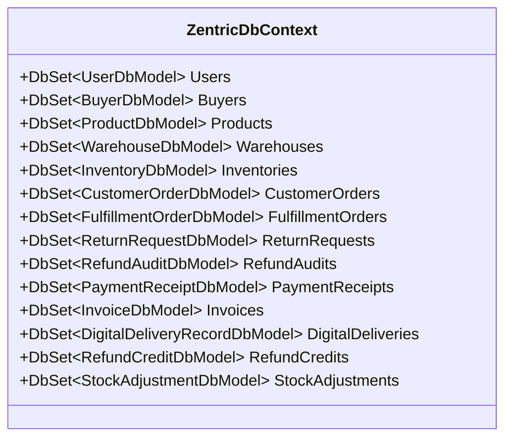

# 01. Acceso a Datos, Mapeo Relacional y Persistencia (EF Core)

> **Especificación Arquitectónica de Persistencia Secundaria.** Define la estrategia de acceso a datos, aislamiento de entidades de dominio, modelos relacionales de infraestructura (`DbModel`), mapeadores bidireccionales, unidad de trabajo transaccional y catálogo de migraciones en **Zentric** (`Zentric.Infrastructure`). Cumple con la Regla 2.4 de AGENTS.md (Anti-Amnesia de Entidades).

---

## 1. Stack Tecnológico de Persistencia

* **Motor de Base de Datos:** PostgreSQL 16 (contenedorizado y configurable por cadena de conexión).
* **ORM:** Entity Framework Core 10 (`Npgsql.EntityFrameworkCore.PostgreSQL`).
* **Contexto Central:** `ZentricDbContext` ubicado en `Zentric.Infrastructure.Persistence`.
* **Aislamiento Antidominio:** Ninguna entidad de `Zentric.Domain` contiene atributos o anotaciones de Entity Framework Core. La persistencia opera exclusivamente sobre modelos de infraestructura dedicados (`*DbModel`) mediante mapeadores bidireccionales explícitos (`*Mapper`).

---

## 2. Auditoría Completa de DbSets en `ZentricDbContext` (Anti-Amnesia)

En estricto cumplimiento de la Regla 2.4 de AGENTS.md, `ZentricDbContext` integra el **100% de los 11 Agregados Raíz** del sistema más las 3 entidades hijas relacionales:

### Catálogo de Entidades y Modelos Relacionales
| Agregado Raíz / Entidad | DbSet en `ZentricDbContext` | Modelo de Persistencia (`DbModel`) | Tabla PostgreSQL | Relaciones y Objetos de Valor Mapeados |
| :--- | :--- | :--- | :--- | :--- |
| **`User`** | `Users` | `UserDbModel` | `Users` | Mapea credenciales, enum `UserRole`, `StockFantasmaRate`, índices únicos en `Email` e `IdentityDocument`. |
| **`Buyer`** | `Buyers` | `BuyerDbModel` | `Buyers` | Mapea `MainAddress` en columnas planas dedicadas (`Street`, `City`, `State`, `ZipCode`, `Country`). |
| **`Product`** | `Products` | `ProductDbModel` | `Products` | Relación 1:N con variantes vendibles (`ProductVariantDbModel`), atributos de variante y enum `ProductStatus`. |
| **`Warehouse`** | `Warehouses` | `WarehouseDbModel` | `Warehouses` | Mapea tipo de bodega (`Marketplace` vs `Vendor`) y propietario opcional `VendorId`. |
| **`Inventory`** | `Inventories` | `InventoryDbModel` | `Inventories` | Clave lógica compuesta `(VariantId, WarehouseId)`; contadores de stock (`Available`, `Reserved`, `Used`, `Damaged`). |
| **`StockAdjustmentRecord`** | `StockAdjustments` | `StockAdjustmentDbModel` | `StockAdjustments` | Historial inmutable de conteos físicos y mermas asociado a cada fila de inventario. |
| **`CustomerOrder`** | `CustomerOrders` | `CustomerOrderDbModel` | `CustomerOrders` | Relación 1:N con líneas de pedido (`OrderItemDbModel`) y registros de entrega digital (`DigitalDeliveryRecordDbModel`). |
| **`FulfillmentOrder`** | `FulfillmentOrders` | `FulfillmentOrderDbModel` | `FulfillmentOrders` | Agrupa despachos logísticos por vendedor; relación 1:N con guías de envío (`ShipmentDbModel`). |
| **`ReturnRequest`** | `ReturnRequests` | `ReturnRequestDbModel` | `ReturnRequests` | Solicitudes de devolución física; guarda veredicto de inspección física y aprobación comercial. |
| **`RefundAudit`** | `RefundAudits` | `RefundAuditDbModel` | `RefundAudits` | Registro inmutable de auditoría económica por devoluciones y quiebres de stock fantasma. |
| **`PaymentReceipt`** | `PaymentReceipts` | `PaymentReceiptDbModel` | `PaymentReceipts` | Comprobantes de captura y cobro; relación 1:N con créditos acumulados (`RefundCreditDbModel`). |
| **`Invoice`** | `Invoices` | `InvoiceDbModel` | `Invoices` | Documentos de facturación con desglose de split (Maestra, Detalle Zentric y Detalle Vendedor). |

---

## 3. Adaptadores de Salida (Los 11 Repositorios Concretos)

La capa de Infraestructura implementa exactamente los **11 puertos de repositorio** declarados por el Dominio:

1. **`UserRepository`** (`IUserRepository`): Persiste usuarios y resuelve unicidad con consultas optimizadas.
2. **`BuyerRepository`** (`IBuyerRepository`): Administra el perfil y dirección principal del comprador.
3. **`ProductRepository`** (`IProductRepository`): Soporta paginación atómica y filtrado de catálogo.
4. **`WarehouseRepository`** (`IWarehouseRepository`): Persistencia y filtrado de bodegas físicas.
5. **`InventoryRepository`** (`IInventoryRepository`): Implementa concurrencia atómica (`TryReserveStockAsync` / `ReleaseReservedStockAsync`) mediante `UPDATE ... WHERE AvailableQuantity >= n` a nivel de PostgreSQL, y persiste ajustes con `SaveAdjustmentAsync`.
6. **`CustomerOrderRepository`** (`ICustomerOrderRepository`): Implementa aislamiento por rol devolviendo `null` ante órdenes ajenas y consulta pedidos expirados.
7. **`FulfillmentOrderRepository`** (`IFulfillmentOrderRepository`): Consulta la cola de despachos por orden y vendedor.
8. **`ReturnRequestRepository`** (`IReturnRequestRepository`): Filtra solicitudes de posventa por titularidad en la consulta SQL.
9. **`RefundAuditRepository`** (`IRefundAuditRepository`): Almacenamiento inmutable y consulta de auditorías financieras.
10. **`PaymentReceiptRepository`** (`IPaymentReceiptRepository`): Gestiona comprobantes financieros y acumulación de créditos.
11. **`InvoiceRepository`** (`IInvoiceRepository`): Persistencia masiva y consulta del split de facturación.

---

## 4. Capa de Mapeo Bidireccional (Anti-Contaminación)

Para preservar la pureza del núcleo de Dominio, cada Agregado Raíz posee un mapeador estático dedicado que traduce entre el modelo inmutable de C# y el modelo mutable de EF Core:

| Entidad de Dominio (`Zentric.Domain`) | Mapeador Concreto | Modelo de Persistencia (`Zentric.Infrastructure`) |
| :--- | :--- | :--- |
| `User` | `UserDbModelMapper` | `UserDbModel` |
| `Buyer` | `BuyerMapper` | `BuyerDbModel` |
| `Product` | `ProductMapper` | `ProductDbModel` |
| `Warehouse` | `WarehouseMapper` | `WarehouseDbModel` |
| `Inventory` | `InventoryMapper` | `InventoryDbModel` |
| `CustomerOrder` | `CustomerOrderMapper` | `CustomerOrderDbModel` |
| `FulfillmentOrder` | `FulfillmentOrderMapper` | `FulfillmentOrderDbModel` |
| `ReturnRequest` | `ReturnRequestMapper` | `ReturnRequestDbModel` |
| `RefundAudit` | `RefundAuditMapper` | `RefundAuditDbModel` |
| `PaymentReceipt` | `PaymentReceiptMapper` | `PaymentReceiptDbModel` |
| `Invoice` | `InvoiceMapper` | `InvoiceDbModel` |

---

## 5. Transaccionalidad y Despacho de Eventos (`UnitOfWork`)

* **`UnitOfWork`:** Implementa `IUnitOfWork`. Encapsula el ciclo de vida del `ZentricDbContext` garantizando que todas las mutaciones realizadas en un caso de uso se confirmen en una única transacción física en PostgreSQL (`SaveChangesAsync`).
* **Interceptación y Despacho Pre-Commit:**
  1. `UnitOfWork` escanea el `ChangeTracker` de EF Core extrayendo todos los eventos encolados en las entidades modificadas (`Entity.DomainEvents`).
  2. Publica cada evento mediante `IDomainEventDispatcher` / `IMediator` hacia los consumidores de Aplicación (`ReturnApprovedEventHandler`, `PartialFulfillmentCancelledConsumer`).
  3. Si un consumidor falla, la transacción física no se confirma y realiza *rollback*, garantizando consistencia absoluta.
  4. Limpia la colección interna de eventos encolados en las entidades tras el commit exitoso.

---

## 6. Catálogo Oficial de Migraciones en Base de Datos

Las migraciones de Entity Framework Core se generan con `Zentric.Api` como proyecto de inicio y se aplican automáticamente al arrancar la aplicación en entorno de desarrollo (`MigrateAsync`). El catálogo histórico cuenta con **15 migraciones acumuladas**:

1. `20260918192602_InitialCreate`: Esquema relacional inicial.
2. `20260918193539_CompleteSchema`: Tablas de todos los agregados base.
3. `20260920003544_AddBackgroundServicesAndUpdates`: Índices de rendimiento y compatibilidad.
4. `20260927024942_AddVendorIdToOrderItem`: Incorporación de `VendorId` en líneas de orden para partición de despachos.
5. `20260927050316_AddVendorIdToInvoice`: Desglose de facturas individuales por vendedor.
6. `20260927150213_AddPaymentReceipts`: Tabla y modelos de comprobantes de pago inmutables.
7. `20260927151056_SplitBuyerAddressIntoColumns`: Mapeo de dirección principal del comprador en columnas dedicadas.
8. `20261005171704_AddRefundCredits`: Soporte para créditos acumulados en comprobantes de pago.
9. `20261005211513_FixRefundCreditRelationship`: Ajuste de integridad referencial en reembolsos de comprobantes.
10. `20261006193610_AddStockAdjustments`: Tabla `StockAdjustments` para historial y auditoría de conteos físicos.
11. `20261007055032_AddDigitalDelivery_CAT02`: Soporte relacional para entregas instantáneas de productos digitales.
12. `20261007063011_AddInvoiceStatusAnulled_FAC02`: Estado de anulación para Facturas Maestras ante cobros caídos.
13. `20261007142148_AddRefundAudit_ADR0020`: Tabla de auditorías inmutables de reembolsos económicos.
14. `20261007143621_AddUniqueIndexesToUsers`: Índices únicos en base de datos sobre `Email` y documento de identidad.
15. `20261007211031_AddStockFantasmaRateToUser`: Persistencia de tasa de incidencias de inventario en vendedores.
