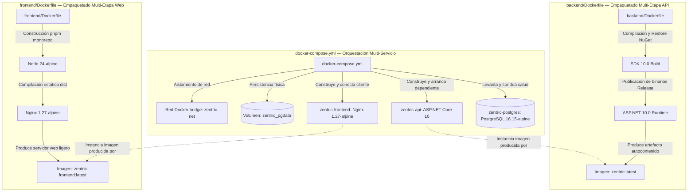

# Infraestructura — Contenedores y Despliegue

> Especificación técnica canónica para el empaquetado, topología de contenedores, ciclo de vida del esquema de base de datos y orquestación operativa del sistema Zentric.

---

## 1. Propósito y Separación de Responsabilidades

El empaquetado y la ejecución del sistema se articulan mediante dos niveles complementarios e independientes para evitar el acoplamiento entre la receta de construcción y la topología de despliegue:



---

## 2. Definición de Imágenes y Construcción Multi-Etapa

### 2.1 Backend API (`backend/Dockerfile`)
- **Propósito:** Producir una imagen autocontenida y de huella reducida para el host web ejecutable (`Zentric.Api`).
- **Contexto de construcción:** Raíz del repositorio (`context: .`), permitiendo resolver rutas relativas hacia la solución `backend/Zentric.slnx` y los proyectos dependientes.
- **Etapas de construcción:**
  1. **Etapa de Compilación (`build`):**
     - Imagen base: SDK oficial de .NET (`mcr.microsoft.com/dotnet/sdk:10.0`).
     - Optimización de caché de capas: Copia primero los archivos de proyecto (`.csproj`) y el manifiesto de solución (`Zentric.slnx`) para ejecutar la restauración de paquetes (`dotnet restore`).
     - Compilación: Copia el código fuente completo del backend y ejecuta la publicación en modo optimizado (`Release`) hacia un directorio de artefactos binarios.
  2. **Etapa de Ejecución (`final`):**
     - Imagen base: Runtime optimizado (`mcr.microsoft.com/dotnet/aspnet:10.0`).
     - Utilidades añadidas: Instalación mínima de la herramienta de sondeo HTTP (`curl`) para la ejecución del chequeo de salud local sin reiniciar el proceso de ejecución de .NET.
     - Exposición de puertos: Puerto `8080` en red interna.
     - Principio de mínimo privilegio: Ejecución bajo el usuario no root del sistema (`app`).
     - Punto de entrada: Invocación del ensamblado compilado de la API (`Zentric.Api.dll`).

### 2.2 Frontend Web (`frontend/Dockerfile`)
- **Propósito:** Producir un servidor de distribución estática web de alto rendimiento para el cliente visual.
- **Contexto de construcción:** Directorio `./frontend`.
- **Etapas de construcción:**
  1. **Etapa de Compilación (`build`):**
     - Imagen base: `node:24-alpine` con gestor de paquetes `pnpm` activado mediante `corepack`.
     - Optimización de dependencias: Copia de manifiestos y congelamiento estricto del archivo de bloqueo (`--frozen-lockfile`).
     - Compilación: Generación de los paquetes estáticos de la aplicación mediante la tarea de empaquetado del monorepo.
  2. **Etapa de Ejecución (`final`):**
     - Imagen base: `nginx:1.27-alpine`.
     - Configuración personalizada de enrutamiento SPA y cabeceras.
     - Inyección en tiempo de arranque de la dirección base del backend (`ZENTRIC_API_BASE_URL`) en el archivo estático de configuración del cliente, evitando reconstruir la imagen para entornos distintos.
     - Exposición de puertos: Puerto `80` en red interna.
     - Principio de mínimo privilegio: Ejecución bajo usuario dedicado sin privilegios de superusuario (`zentric`).

---

## 3. Topología de Servicios y Orquestación (`docker-compose.yml`)

El orquestador define la relación funcional entre tres servicios interconectados a través de una red puente privada (`zentric-net`):

| Servicio | Contenedor | Imagen Base | Puerto Expuesto en Host | Puerto Interno | Dependencia y Condición |
|---|---|---|---|---|---|
| `db` | `zentric-postgres` | `postgres:16.15-alpine` | `15432` *(configurable vía `POSTGRES_PORT`)* | `5432` | Ninguna *(servicio base)* |
| `api` | `zentric-api` | `zentric:latest` *(build local)* | `5076` | `8080` | `db` con condición `service_healthy` |
| `frontend` | `zentric-frontend` | `zentric-frontend:latest` *(build local)* | `5180` *(configurable vía `FRONTEND_PORT`)* | `80` | `api` *(inicia tras levantarse la API)* |

### 3.1 Servicio de Base de Datos (`db`)
- **Fijación de versión:** Uso estricto de la etiqueta inmutable `postgres:16.15-alpine` para garantizar reproducibilidad absoluta entre entornos y evitar divergencias no planificadas de motor.
- **Persistencia de datos:** Volumen nominal externo `zentric_pgdata` montado en `/var/lib/postgresql/data`.
- **Sondeo de salud (`healthcheck`):** Comando nativo `pg_isready -U postgres -d ZentricDb` con intervalo de 10 segundos, tiempo límite de 5 segundos, hasta 5 reintentos y periodo de gracia inicial de 20 segundos.
- **Aislamiento de puertos:** Se asigna por defecto el puerto host `15432` hacia el puerto contenedor `5432`, evitando deliberadamente colisiones con instalaciones locales de PostgreSQL que suelan ocupar el puerto estándar del sistema anfitrión.

### 3.2 Servicio de la API Central (`api`)
- **Condición de arranque:** Requiere que el servicio `db` alcance explícitamente el estado `service_healthy` antes de inicializar la API, previniendo fallos prematuros de conexión o excepciones en el arranque.
- **Configuración de entorno:**
  - `ASPNETCORE_ENVIRONMENT`: Definido en `Development` para habilitar la interfaz interactiva OpenAPI/Swagger y la migración automática de esquema.
  - `ASPNETCORE_URLS`: Configurado en `http://+:8080`.
  - `ConnectionStrings__DefaultConnection`: Cadena de conexión hacia el host de servicio `db` en su puerto interno `5432`.
  - `Jwt__Issuer` y `Jwt__Audience`: Identificadores canónicos de emisor y audiencia para la validación de tokens de seguridad.
  - `Jwt__SigningKey`: Clave criptográfica para la firma simétrica de credenciales. La aplicación valida obligatoriamente su presencia en el arranque y detiene la ejecución si se encuentra vacía o ausente.
  - `Cors__AllowedOrigins`: Lista explícita y delimitada por comas de orígenes permitidos para consumo web (ej. `http://localhost:15434`, `http://localhost:15435`), prohibiendo el uso de comodines abiertos para salvaguardar la seguridad de los tokens de autenticación.
  - `Bootstrap__AdministratorEmail` y `Bootstrap__AdministratorPassword`: Credenciales parametrizadas para la inicialización controlada del primer administrador del sistema.
- **Sondeo de salud (`healthcheck`):** Sondeo del endpoint HTTP `/health` mediante `curl` cada 15 segundos con tiempo de espera de 10 segundos y tolerancia de 5 reintentos.

### 3.3 Servicio de Interfaz de Usuario (`frontend`)
- **Configuración de entorno:** Parámetro `ZENTRIC_API_BASE_URL` inyectado para la resolución de peticiones HTTP hacia el host o proxy de la API.
- **Sondeo de salud (`healthcheck`):** Sondeo local mediante `wget` contra el puerto interno `80` cada 30 segundos.

---

## 4. Ciclo de Vida del Esquema y Migraciones Automáticas

### 4.1 Aplicación de Esquema en Desarrollo
- **Mecanismo:** Durante el arranque del host web en entorno `Development`, la API resuelve una instancia de contexto de datos e invoca la aplicación asíncrona de migraciones sobre el motor PostgreSQL.
- **Catálogo de migraciones:** Se aplican secuencialmente las **15 migraciones canónicas** del proyecto registradas en `__EFMigrationsHistory`:
  1. `InitialCreate`: Creación de esquemas relacionales base.
  2. `AddInventories`: Estructuras de existencias y control de bodegas.
  3. `AddInvoices`: Registro tributario y facturación electrónica.
  4. `AddReturnRequests`: Gestión de devoluciones y estados de solicitud.
  5. `AddReturnsApproval`: Flujos de aprobación y rechazo de devoluciones.
  6. `AddOrders`: Pedidos de compra y líneas transaccionales.
  7. `AddOrderCustomerDetails`: Metadatos y detalles de comprador.
  8. `AddPaymentReceipts`: Comprobantes y transacciones de recaudo.
  9. `SplitBuyerAddressIntoColumns`: Descomposición relacional de direcciones de envío.
  10. `AddRefundCredits`: Saldos a favor y notas crédito de reembolso.
  11. `AddFulfillmentOrders`: Órdenes logísticas y asignación de bodegas.
  12. `AddTrackingNumberToFulfillmentOrder`: Códigos de trazabilidad en despachos.
  13. `AddConcurrencyTokens`: Control de concurrencia optimista y sellos de versión.
  14. `AddBuyerOrderIndex`: Índices relacionales de consulta por comprador.
  15. `AddDeliveryAddressSnapshotToFulfillmentOrder`: Registro inmutable de dirección de entrega en orden logística.
- **Comportamiento ante reinicio limpio (`docker compose down -v`):** La eliminación del volumen persistente borra completamente los datos físicos. Al ejecutar `docker compose up -d`, la base de datos se inicializa vacía, el sondeo de salud confirma la disponibilidad del motor, la API arranca y reconstruye de manera automática el 100% de las tablas e índices antes de abrir la recepción de solicitudes HTTP.

### 4.2 Restricción en Entorno Productivo
- En entornos que no sean de desarrollo (`Production` o `Staging`), la aplicación automática de migraciones al arranque se encuentra **estrictamente deshabilitada**.
- La evolución del esquema en producción debe ejecutarse mediante canalizaciones controladas de despliegue (scripts de migración idempotentes generados por herramientas de persistencia o trabajos aislados de CI/CD), garantizando trazabilidad, respaldo previo y ventanas controladas de mantenimiento.

---

## 5. Bootstrap de Inicialización del Primer Administrador

### 5.1 Regla de Negocio e Invariante de Autenticación
- **Restricción de registro:** El registro público y anónimo en el sistema está restringido únicamente a usuarios con rol Comprador (`Buyer`).
- **Problema de inicio en frío:** Ningún rol de gestión (como Administrador, Operador Logístico o Vendedor) puede auto-registrarse públicamente.
- **Solución arquitectónica (`AdministratorBootstrapper`):**
  - Se suscribe al evento de inicialización completa del host de la API.
  - Verifica si existe al menos un usuario registrado en la base de datos con el rol de Administrador (`Administrator`).
  - Si ya existe un Administrador, el componente finaliza inmediatamente de forma idempotente sin alterar ningún registro.
  - Si no existe ningún Administrador en el sistema y se han suministrado las variables de entorno de correo y contraseña:
    1. Se crea la entidad de usuario con el rol de Administrador.
    2. La contraseña en texto claro se transforma utilizando el componente de derivación de claves del sistema (PBKDF2 con salt criptográfico).
    3. Se persiste la entidad a través de la unidad de trabajo.
    4. Se emite un aviso de seguridad en los registros de auditoría solicitando cambiar la credencial y retirar las variables del archivo de entorno.
  - Si no se proporcionan los valores requeridos en la configuración, la creación se omite y se registra una advertencia en el sistema.

---

## 6. Sonda de Salud del Sistema (`GET /health`)

### 6.1 Especificación del Contrato de Salud
- **Ruta:** `/health`
- **Método HTTP:** `GET`
- **Políticas de autorización:** Acceso público anónimo (`[AllowAnonymous]`).
- **Verificación en profundidad:** No se limita a confirmar que el proceso web responda en memoria; evalúa activamente la conectividad física con la base de datos PostgreSQL mediante una prueba de enlace.
- **Códigos de Estado y Cargas de Respuesta:**
  - **Estado Operativo (200 OK):**
    ```json
    {
      "status": "healthy",
      "database": "up",
      "timestamp": "2026-10-12T23:00:00.0000000+00:00"
    }
    ```
  - **Estado Degradado (200 OK):**
    ```json
    {
      "status": "degraded",
      "database": "down",
      "timestamp": "2026-10-12T23:00:00.0000000+00:00"
    }
    ```
  - **Fallo Crítico de Infraestructura (503 Service Unavailable):**
    ```json
    {
      "status": "unhealthy",
      "database": "down",
      "error": "Mensaje técnico descriptivo de la falla de infraestructura"
    }
    ```

---

## 7. Comandos y Operaciones de Referencia

| Operación | Comando | Resultado Esperado |
|---|---|---|
| Compilar imagen individual de la API | `docker build -t zentric:latest -f backend/Dockerfile .` | Genera la imagen empaquetada de la API localmente sin ejecutar contenedores. |
| Levantar entorno completo en segundo plano | `docker compose up -d` | Inicia PostgreSQL, espera el estado saludable, arranca la API aplicando migraciones y el frontend. |
| Inspeccionar registros de la API en tiempo real | `docker compose logs -f api` | Flujo de trazas y bitácoras de arranque, migraciones y solicitudes procesadas. |
| Detener entorno preservando datos | `docker compose down` | Apaga los contenedores conservando intacto el volumen físico de PostgreSQL. |
| Reiniciar entorno con base de datos limpia | `docker compose down -v` seguido de `docker compose up -d` | Destruye volúmenes y recrea el esquema relacional completo (15 migraciones) y el bootstrap del administrador inicial. |
| Reconstruir imágenes tras cambios de código | `docker compose up -d --build` | Fuerza la recompilación de imágenes Docker evitando el uso de capas obsoletas de caché. |
