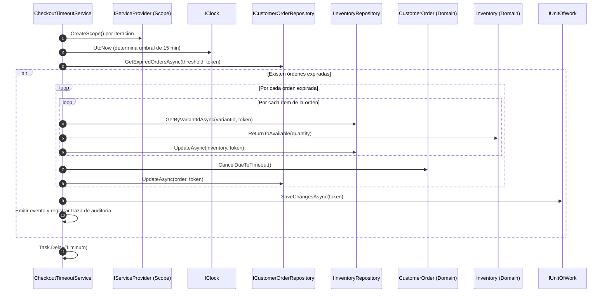

# Infraestructura — Servicios en Segundo Plano

> Especificación técnica canónica para los procesos asíncronos en segundo plano, tareas periódicas y trabajadores autónomos (*background workers*) del sistema Zentric.

---

## 1. Justificación y Propósito de Negocio

En el ciclo comercial del marketplace, cuando un comprador inicia un proceso de compra o mantiene artículos dentro de una orden en estado borrador o pendiente de pago, el sistema reserva existencias físicas en las bodegas correspondientes para garantizar la disponibilidad durante la transacción.

Si el comprador abandona el proceso de compra, o si la pasarela de recaudo no confirma el pago dentro de una ventana de tiempo razonable, esas unidades físicas quedarían bloqueadas indefinidamente (*stock congelado*), impidiendo que otros compradores puedan adquirirlas y distorsionando la capacidad operativa de los vendedores.

Para salvaguardar la disponibilidad del catálogo y garantizar la **Regla de Expiración de Órdenes y Liberación de Stock por Tiempo Límite de Checkout**, la infraestructura ejecuta un trabajador en segundo plano periódico que barre las órdenes vencidas y restituye automáticamente el inventario reservado sin degradar la latencia ni bloquear las solicitudes HTTP de los usuarios.

---

## 2. Definición del Trabajador: `CheckoutTimeoutService`

### 2.1 Identidad y Registro Arquitectónico
- **Clase técnica:** `CheckoutTimeoutService`
- **Ubicación:** `Zentric.Infrastructure.BackgroundServices`
- **Framework base:** `Microsoft.Extensions.Hosting.BackgroundService`
- **Registro en Contenedor IoC:** Registrado en el punto de ensamblado (`Program.cs`) mediante la extensión de servicios en segundo plano del host:
  - Tipo de ciclo de vida del servicio hospedado: Administrado por el host de ASP.NET Core (`IHostedService`).

---

## 3. Lógica Operativa y Orquestación Transaccional

En cada iteración del bucle continuo de ejecución, el servicio lleva a cabo la siguiente secuencia de orquestación:

### 3.1 Parámetros y Umbrales Temporales
- **Frecuencia de muestreo:** El bucle ejecuta una ronda de verificación cada **1 minuto** (`TimeSpan.FromMinutes(1)`).
- **Ventana de tolerancia de checkout:** El umbral de expiración se fija en **15 minutos** de inactividad.
- **Abstracción temporal determinista:** El cálculo del instante de expiración no invoca directamente el reloj del sistema operativo (`DateTime.UtcNow`), sino que consulta el puerto del dominio `IClock` (`_clock.UtcNow.AddMinutes(-15)`). Esto permite congelar o adelantar el tiempo de forma determinista durante las pruebas unitarias y de integración sin depender de pausas reales.

### 3.2 Criterio de Selección de Órdenes Vencidas
El repositorio `ICustomerOrderRepository` filtra las órdenes que cumplen concurrentemente con las siguientes condiciones:
1. Pertenecer a estados previos a la confirmación de pago: `Cart` (carrito activo) o `PendingPayment` (checkout iniciado con recaudo pendiente).
2. Tener una marca temporal de última actualización menor o igual al umbral calculado (inactivas por más de 15 minutos).

### 3.3 Reglas de Mutación de Dominio e Invariantes
Para cada orden vencida recuperada:
1. **Restitución física de existencias:** Por cada línea de producto (`OrderItem`) contenida en el pedido:
   - Se recupera el agregado de inventario correspondiente a la variante física (`IInventoryRepository.GetByVariantIdAsync`).
   - Se verifica que la cantidad reservada (`ReservedQuantity`) sea suficiente.
   - Se invoca el método del dominio `inventory.ReturnToAvailable(quantity)`, el cual decrementa el stock reservado e incrementa el stock disponible respetando las invariantes de existencias no negativas.
   - Se marca la actualización en el repositorio de inventarios.
2. **Cancelación formal del pedido:**
   - Se invoca el método de negocio de la entidad raíz `order.CancelDueToTimeout()`.
   - La orden realiza una transición estricta de estado hacia `Cancelled` con causa de cancelación por expiración de tiempo.
   - Se marca la actualización en el repositorio de órdenes.
3. **Persistencia atómica:**
   - La unidad de trabajo (`IUnitOfWork.SaveChangesAsync`) confirma todos los cambios de inventario y estado de pedidos dentro de una única transacción en PostgreSQL, garantizando que nunca se libere stock sin registrar la cancelación del pedido asociado.
4. **Notificación de evento:**
   - Se genera la instancia del evento de dominio inmutable `CartExpiredDomainEvent` registrando el identificador del pedido y el instante exacto de la cancelación para su registro en los diarios de auditoría y análisis operativo.

---

## 4. Resiliencia, Concurrencia y Ciclo de Vida

### 4.1 Aislamiento de Ámbito (*Scope Isolation*)
- **Problema de concurrencia:** El trabajador `CheckoutTimeoutService` es un servicio de larga duración administrado como singleton por el host, mientras que los repositorios de persistencia (`ZentricDbContext`, `ICustomerOrderRepository`, `IInventoryRepository`) y `IUnitOfWork` poseen un ciclo de vida por ámbito (`Scoped`). Resolver dependencias con ciclo de vida acotado dentro de un singleton directo provocaría colisiones de hilos y retención indebida de entidades en el rastreador de cambios (*memory leaks*).
- **Mecanismo de resolución:** En cada ejecución periódica, el trabajador crea explícitamente un nuevo ámbito de inyección (`using var scope = _serviceProvider.CreateScope()`), resuelve instancias frescas de los repositorios y libera el contexto al finalizar la ronda de persistencia.

### 4.2 Tolerancia a Fallos y Registro Estructurado
- Toda la ejecución interna de la iteración se encuentra resguardada en un bloque de control de excepciones que atrapa anomalías transitorias de conectividad, bloqueos de base de datos o fallos de red.
- Las incidencias se registran mediante el registrador estructurado del sistema (`ILogger<CheckoutTimeoutService>`) con nivel de error, impidiendo que una falla puntual en la base de datos interrumpa la ejecución del proceso anfitrión de la API.

### 4.3 Detención Ordenada (*Graceful Shutdown*)
- El bucle monitorea continuamente la señal de cancelación del token de detención del host (`stoppingToken.IsCancellationRequested`).
- Si el contenedor Docker o el servidor web recibe una señal de apagado (`SIGTERM` / `SIGINT`), el trabajador aborta la pausa actual o espera a que concluya la transacción en curso antes de liberar los recursos y terminar limpiamente.

---

## 5. Matriz de Cobertura y Verificación

| Componente | Verificación | Evidencia Técnica |
|---|---|---|
| Lógica de expiración y cancelación | Pruebas de dominio unitarias | `CustomerOrderTests` valida la transición de estado ante `CancelDueToTimeout()`. |
| Restitución de cantidades reservadas | Pruebas de dominio de inventario | `InventoryTests` confirma que `ReturnToAvailable()` incrementa el stock vendible sin generar inconsistencias. |
| Inyección de tiempo determinista | Pruebas con reloj simulado | Integración de `IClock` desacoplando el cálculo de la hora del sistema operativo. |
| Ejecución en segundo plano | Suite integral de la solución | Compilación con advertencias como error (`-warnaserror`) y 457 pruebas unitarias en verde. |
