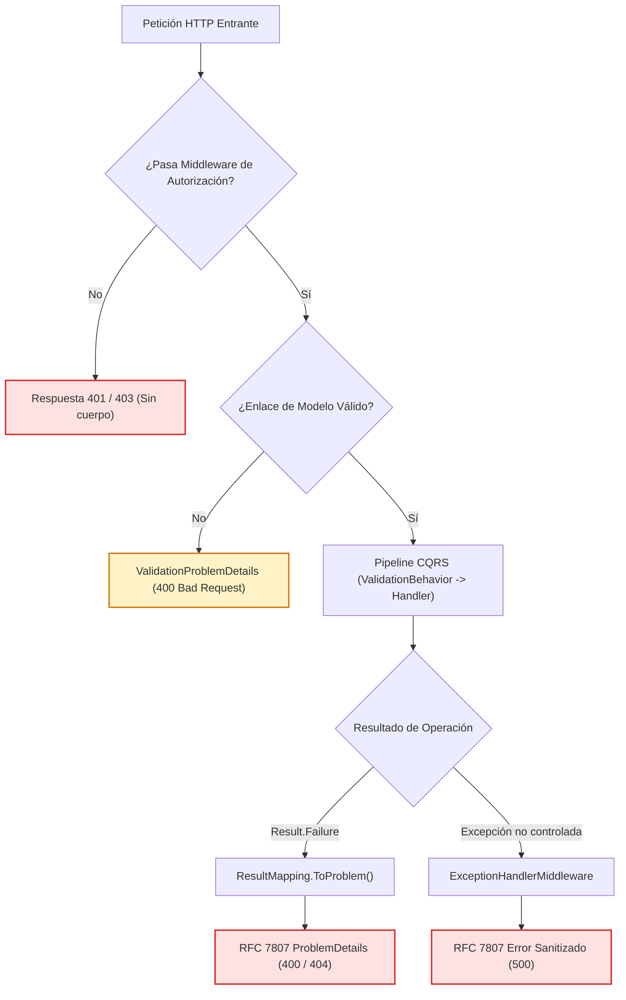

# 03. Manejo Global de Errores y Problem Details (RFC 7807)

> **Especificación Contractual de Respuestas de Error.** Define el estándar universal para la transformación de fallos de dominio, validaciones de entrada y excepciones catastróficas en respuestas HTTP normalizadas bajo el estándar **RFC 7807** (`application/problem+json`), garantizando consistencia y cero fugas de información sensible hacia el cliente web.

---

## 1. Principio de Centralización de Respuestas de Error

El código de estado HTTP lo decide el **tipo de fallo** (`ErrorKind`), nunca el criterio discrecional del controlador ni el texto del mensaje de error:
* **Fábrica Centralizada:** Toda traducción ocurre en un único punto arquitectónico: `ResultMapping.ToProblem()`.
* **Prohibición de Códigos Manuales:** Ningún controlador tiene permitido instanciar manualmente objetos `BadRequest`, `NotFound` o códigos HTTP arbitrarios. Existe una prueba de arquitectura automatizada que falla si algún endpoint viola este estándar.

---

## 2. Matriz Maestra de Traducción de Errores

| Tipo de Fallo en Dominio / Aplicación | Código HTTP | Formato de Respuesta | Condición de Disparo |
| :--- | :--- | :--- | :--- |
| **`ErrorKind.NotFound`** | `404 Not Found` | `application/problem+json` | El recurso solicitado no existe **o no pertenece al usuario autenticado** (ambos escenarios comparten exactamente el mismo mensaje para evitar enumeración). |
| **`ErrorKind.Validation`** | `400 Bad Request` | `application/problem+json` | Invariante de negocio violada en el Dominio o precondición de entrada rechazada por `FluentValidation`. |
| **Excepción No Controlada** | `500 Internal Server Error` | `application/problem+json` | Caída de infraestructura o falla técnica inesperada. La traza técnica se oculta al cliente. |
| **Sin Token de Autenticación** | `401 Unauthorized` | Vacío (Sin cuerpo) | Petición a endpoint protegido sin cabecera `Authorization: Bearer`. Emitido directamente por el middleware de seguridad. |
| **Token Válido sin Rol Autorizado** | `403 Forbidden` | Vacío (Sin cuerpo) | El usuario autenticado no posee la política de rol requerida (`AuthorizationPolicies`). Emitido por el middleware de seguridad. |

---

## 3. Los Tres Caminos de Error en el Pipeline



1. **Fallo de Negocio o Validación de Aplicación:**
   Mapeado por `ResultMapping.ToProblem()`. Retorna `400 Bad Request` o `404 Not Found` según el `ErrorKind` reportado por el `Result.Failure`.
2. **Fallo de Enlace de Parámetros HTTP (Binding):**
   Procesado por la fábrica de modelos inválidos de ASP.NET Core, produciendo un `ValidationProblemDetails` estandarizado.
3. **Falta de Identidad o Permisos:**
   Procesado por el middleware de seguridad antes de invocar los controladores. Responde `401` o `403` deliberadamente sin cuerpo para no revelar la estructura de roles del sistema.

---

## 4. Estructura Normativa del Cuerpo ProblemDetails (RFC 7807)

Toda respuesta con cuerpo de error adopta estrictamente la estructura estandarizada de **RFC 7807**:

```json
{
  "type": "https://tools.ietf.org/html/rfc7807",
  "title": "Bad Request",
  "status": 400,
  "detail": "Descripción comprensible de la invariante violada o del error de validación."
}
```

---

## 5. Reglas Inviolables de Tratamiento de Errores

1. **Un Error Desconocido Responde 500, Jamás 400:** Capturar fallos técnicos no identificados y devolver `400` enmascara errores reales del servidor e impide el diagnóstico correcto por parte de los clientes web.
2. **Prohibición Absoluta de Filtración Técnica:** Queda terminantemente prohibido incluir cadenas de conexión, trazas de pila (stack traces), nombres de tablas o errores de PostgreSQL en las respuestas hacia el cliente. El `500` informa que la operación no pudo procesarse, registrando el detalle en telemetría interna.
3. **Unificación de Mensajes en Recursos Inexistentes y Ajenos:** Si un recurso no existe o si pertenece a otro comprador/vendedor, la API responde exactamente el mismo código `404 Not Found` con idéntico mensaje en el campo `detail`. Diferenciarlos permitiría a atacantes enumerar recursos de terceros mediante fuerza bruta de identificadores GUID.
4. **Idempotencia de Cabeceras:** Si la cabecera HTTP ya fue despachada por el socket de red, el middleware registra el incidente en telemetría sin intentar reescribir la respuesta, previniendo excepciones por flujos de red corruptos.
