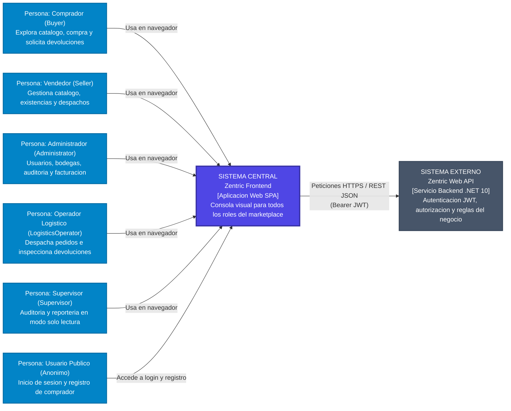

# C4 - Nivel 1: Contexto del Frontend

## 1. Propósito y Alcance del Sistema

Zentric Frontend es la aplicación web cliente con la que los distintos actores del marketplace interactúan con el ecosistema. Su responsabilidad primordial es proporcionar una interfaz visual intuitiva, segura y reactiva que traduzca las intenciones del usuario en operaciones sobre la API de Zentric.

El frontend opera bajo el principio de **cliente ligero (SPA)**:
- **No persiste datos directamente:** No posee conexión con bases de datos ni almacena estado durable fuera de la sesión activa.
- **No procesa transacciones críticas:** No calcula totales financieros, no decrementa inventario ni valida reglas de negocio por su cuenta; delega el 100% de la lógica de negocio y validación transaccional en el backend.
- **Orquesta la experiencia:** Gestiona la navegación, presenta estados de carga y error, captura entradas de formularios y muestra datos adaptados a los permisos del usuario autenticado.

> [!IMPORTANT]
> **Frontera de Confianza:** El navegador del usuario es un entorno inseguro. El frontend no contiene secretos comerciales, credenciales maestras ni claves privadas. Cualquier validación en la interfaz existe únicamente para optimizar la experiencia de usuario (feedback inmediato), mientras que la autoridad real y definitiva reside siempre en el backend.

---

## 2. Diagrama de Contexto del Sistema

---

## 3. Actores y Perfiles de Acceso

El sistema reconoce exactamente **cinco roles autenticados**, correspondientes al enum `UserRole` del backend, más los usuarios anónimos:

| Rol | Clasificación | Responsabilidades Principales en la UI |
|---|---|---|
| **Administrator** | Autenticado | Gestión integral de usuarios, asignación de bodegas, resolución de reembolsos, auditoría operativa y generación de facturación maestra. |
| **Seller** | Autenticado | Creación y mantenimiento de catálogo de productos, visualización de existencias de inventario, despacho de órdenes y aprobación de devoluciones. |
| **Buyer** | Autenticado | Exploración de catálogo público, administración de carrito de compras, ejecución de checkout y solicitud de devoluciones. |
| **LogisticsOperator** | Autenticado | Ejecución física de despachos desde bodega, inspección técnica de devoluciones recibidas y reporte de quiebres de stock. |
| **Supervisor** | Autenticado | Perfil de auditoría con acceso de **solo lectura** (ZENTRIC.md Dominio 1). La interfaz inhabilita formularios de creación o edición. |
| **Usuario Público** | Anónimo | Acceso exclusivo a la pantalla de inicio de sesión (`POST /api/auth/login`) y al registro público de nuevos compradores (`POST /api/users`). |

---

## 4. Fronteras de Seguridad y Límites de Confianza

1. **Gestión de Sesión Volátil (ADR-0009):** El token JWT se mantiene **únicamente en memoria** durante la vida de la pestaña del navegador. No se almacena en `localStorage` ni `sessionStorage` para prevenir vulnerabilidades de Cross-Site Scripting (XSS). No existen mecanismos de refresh token automático ni cookies de sesión; si el usuario recarga la página (`F5`) o transcurren 60 minutos, la sesión finaliza y debe reautenticarse.
2. **Autorización y Guardas:** Las rutas de la interfaz cuentan con guardas en el cliente (`beforeLoad`) para redirigir al usuario según su rol y evitar navegación a vistas restringidas. Sin embargo, la seguridad efectiva es garantizada por las **20 políticas de autorización** del backend (`AuthorizationPolicies.cs`). Una alteración del código en el navegador jamás permite ejecutar acciones no permitidas en el servidor.
3. **Comunicación Perimetral:** El frontend se conecta con la API a través de peticiones HTTP con cabecera `Authorization: Bearer <token>`. Toda respuesta de error recibida sigue el estándar RFC 7807 (`ProblemDetails`), permitiendo una traducción unificada de errores hacia el usuario.

---

## 5. Trazabilidad y Documentos Relacionados

- **Nivel 2 (Contenedores):** [C4-2-Contenedores.md](C4-2-Contenedores.md) — Unidades de despliegue y servidores (Nginx, SPA, API, PostgreSQL).
- **Nivel 3 (Componentes):** [C4-3-Componentes.md](C4-3-Componentes.md) — Arquitectura interna del cliente y módulos por rol.
- **Arquitectura General del Frontend:** [Frontend-Architecture.md](Frontend-Architecture.md) — Capas hexagonales en el cliente.
- **Reglas del Negocio (La Ley):** [ZENTRIC.md](../ZENTRIC.md) — Especificación canónica del negocio.
