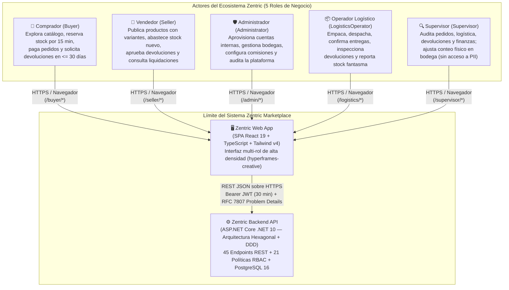

# Arquitectura C4 — Nivel 1: Diagrama de Contexto del Sistema (Frontend SDD)

> **Propósito:** Definir los límites del sistema **Zentric Marketplace Platform**, los 5 actores humanos diferenciados por rol (`UserRole` en `backend/Zentric.Domain/Users/UserRole.cs:3-10`) y las integraciones de frontera entre el cliente web (`Zentric Web App`) y el núcleo transaccional (`Zentric Backend API`).

---

## 1. Diagrama de Contexto del Sistema (C4 Nivel 1)

---

## 2. Catálogo Normativo de Actores y Alcance Operativo

Cada actor humano se autentica contra `POST /api/auth/login` (`AuthController.cs:34`) y recibe un token JWT con expiración estricta de **30 minutos** ([ADR-0009](../backendSDD/ADR/ADR-0009-authentication-jwt-session-expiry.md)) que determina su Shell y alcance operativo:

| Actor (`UserRole`) | Etiqueta en UI (`domainLabels.ts`) | Responsabilidades Principales en el Sistema | Restricciones de Frontera y Seguridad (`AuthorizationPolicies.cs`) |
|---|---|---|---|
| **`Buyer`** | `"Comprador"` | Exploración de catálogo público, gestión de libreta de direcciones (`BuyersController.cs`), adición de ítems al carrito con reserva atómica de 15 minutos, pago e inicio de devoluciones dentro de los 30 días posteriores a la entrega. | Sin acceso a existencias por bodega (`/api/inventories`), configuración de bodegas, comisiones ni cuentas de terceros. |
| **`Seller`** | `"Vendedor"` | Alta de productos con variantes y atributos dinámicos (`CatalogController.cs`), abastecimiento de stock nuevo por bodega (`POST /api/inventories/stock`), aprobación de devoluciones inspeccionadas y consulta de sus facturas y comisiones netas. | Solo puede abastecer stock nuevo (`availableQuantity`); el stock usado (`usedQuantity`) se incrementa exclusivamente mediante eventos de devolución aprobada. |
| **`Administrator`** | `"Administrador"` | Gobernanza integral: alta de usuarios internos (`POST /api/users`, [ADR-0022](../backendSDD/ADR/ADR-0022-public-registration-and-admin-provisioning.md)), creación/activación de bodegas (`Marketplace` y `Vendor`), configuración de comisiones (`GlobalDefault`, `CategorySpecific`, `VendorSpecific`), ajustes de inventario y supervisión global. | Único rol autorizado para consultar y administrar datos personales sensibles (PII) en `/api/users` (política `UserAdministration`, `AuthorizationPolicies.cs:115`). |
| **`LogisticsOperator`** | `"Operador Logístico"` | Operación física de bodega: empaque (`pack`), despacho con guía (`dispatch`) y entrega (`deliver`) de paquetes particionados (`OrderFulfillment`), inspección física de devoluciones (`inspect`) y cancelación por stock fantasma (`cancel-ghost-stock`). | Sin acceso a facturación, comisiones ni datos personales de cuentas de usuario. |
| **`Supervisor`** | `"Supervisor"` | Auditoría transversal de pedidos, logística, devoluciones y liquidaciones financieras, más facultad explícita de **ajuste de inventario por conteo físico** (`POST /api/inventories/{id}/adjust`, [ADR-0021](../backendSDD/ADR/ADR-0021-inventory-physical-count-and-ghost-stock-cancellation.md)). | Rol de solo lectura en operaciones comerciales y financieras; **bloqueado** en `/api/users` para proteger la privacidad de documentos de identidad y correos electrónicos. |

---

## 3. Contratos e Invariantes de Frontera (Web App ↔ Backend API)

1. **Comunicación Exclusiva vía API REST Tipada:**
   - El frontend no mantiene conexión directa con PostgreSQL ni ejecuta lógica de dominio reservada al servidor (cálculo de comisiones jerárquicas, particionamiento de `OrderFulfillment` por bodega o expiración de reservas de inventario).
2. **Protocolo de Sesión Volátil sin Refresh Token ([ADR-0009](../backendSDD/ADR/ADR-0009-authentication-jwt-session-expiry.md)):**
   - Todas las llamadas protegidas incluyen la cabecera `Authorization: Bearer <accessToken>`. Ante la expiración del token a los 30 minutos (`401 Unauthorized`), el frontend limpia su estado en memoria y exige re-autenticación explícita.
3. **Semántica de Errores RFC 7807 (`application/problem+json`):**
   - Toda violación de regla de negocio o validación de entrada en el backend se transmite al frontend mediante un objeto `ApiProblemDetails` con mensajes en español listos para su presentación contextual en la interfaz.
