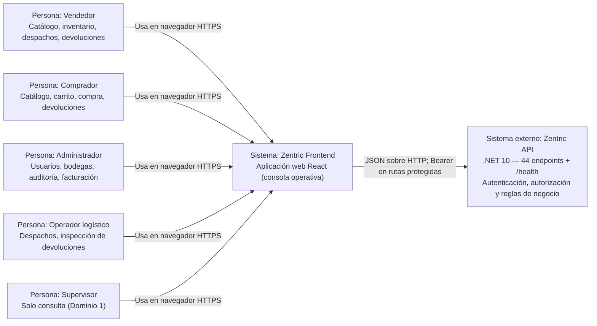

# C4 - Nivel 1: Contexto del frontend

## Propósito y alcance

Zentric Frontend es la aplicación web con la que los actores del marketplace operan
las capacidades expuestas por el backend: los Vendedores gestionan catálogo,
inventario y despachos; los Compradores compran; el Administrador audita y factura;
el Operador logístico despacha e inspecciona; el Supervisor consulta. La interfaz
presenta las funciones permitidas para cada rol, recoge datos de entrada y muestra
resultados, errores y estados de las operaciones. **No calcula ni persiste stock,
totales ni reglas de negocio por cuenta propia y no se conecta directamente a las
bases de datos.**

Este nivel muestra quién usa el frontend y con qué sistemas externos se comunica.
Los límites internos de despliegue están en [C4-2-Contenedores.md](C4-2-Contenedores.md).

> **Decisiones de diseño de este documento:** dirección **Q3-A** (dark
> developer/builder), stack **Q4/Q5**, monorepo **Q10**. Ver
> [`Frontend-SDD.md` §1.2](Frontend-SDD.md#12-decisiones-de-diseño-confirmadas-en-el-grill-q1q20).

## Diagrama de contexto

## Actores

La interfaz diferencia **cinco perfiles autenticados**, exactamente los del enum
`UserRole` del backend (Lenguaje Ubicuo estricto, sin sinónimos):

| Rol | Capacidad en la UI |
| --- | --- |
| `Administrator` | Usuarios, bodegas, facturación, reembolsos, auditoría |
| `Seller` | Catálogo, inventario, despachos, aprobación de devoluciones |
| `Buyer` | Catálogo, carrito, checkout, solicitar devolución |
| `Supervisor` | **Solo lectura** (ZENTRIC.md Dominio 1): sin acciones de escritura |
| `LogisticsOperator` | Despachos, inspección de devoluciones, quiebre de stock |

Los usuarios no autenticados acceden a inicio de sesión y al auto-registro
(`POST /api/users` sólo para `Buyer`).

Las personas representan capacidades de uso, no tipos de componente de React. La
navegación concreta se resuelve a partir del rol recibido en el JWT.

## Relaciones y límites de confianza

- El navegador descarga la aplicación y ejecuta sus componentes React localmente.
- El frontend usa la API configurada mediante `VITE_API_BASE_URL`; en el entorno
  local el valor es `http://localhost:5076` (el `8080` es el puerto interno del
  contenedor, no el del host).
- Las peticiones autenticadas incluyen el access token como
  `Authorization: Bearer <token>` en **sólo en memoria**. **No hay refresh ni
  cookie** (`ADR-0009:62`): a los 60 min o al recargar, re-login (**Q15-B**).
  La cabecera `X-Buyer-Id` **ya no existe** (`ADR-0009`) y no autentica a nadie.
- El backend es autoridad para validar identidad, permisos y reglas de negocio
  (**20 políticas** en `AuthorizationPolicies.cs`). Las guardas del frontend
  mejoran la navegación, pero **no reemplazan** la autorización del servidor.
- El frontend **no conoce** credenciales de base de datos ni secretos de firma
  JWT. La comunicación del navegador con el backend está sujeta a CORS (política
  `Frontend`, verificada).
- Las bases de datos y su persistencia pertenecen al backend; no son dependencias
  directas del navegador.

## Flujos representativos

1. Un usuario abre el frontend, inicia sesión (`POST /api/auth/login`) y recibe
   un access token que se guarda **sólo en memoria**.
2. El frontend selecciona la página inicial correspondiente al rol.
3. Una pantalla solicita los datos a los servicios de aplicación, que usan el
   adaptador HTTP (TanStack Query, **Q9**) para comunicarse con la API.
4. La interfaz representa los estados de carga, éxito, vacío o error. Para
   operaciones sensibles (pagar, anular, cancelar) solicita confirmación y muestra
   el resultado.
5. Si una petición protegida recibe `401` (token caducado a los 60 min o sesión
   vacía tras recargar), la sesión se limpia y el usuario vuelve al inicio de
   sesión. **No hay refresh** que lo evite. Un `403` **no** cambia el rol ni
   fingir autorización: conserva la sesión y avisa.

## Referencias

- [Arquitectura frontend](Frontend-Architecture.md)
- [Adaptadores frontend](Frontend-Adapters.md)
- [Flujos de usuario](Frontend-User-Flows.md)
- [Módulos por rol](Frontend-Role-Modules.md)
- [C4 nivel 2: contenedores](C4-2-Contenedores.md)
