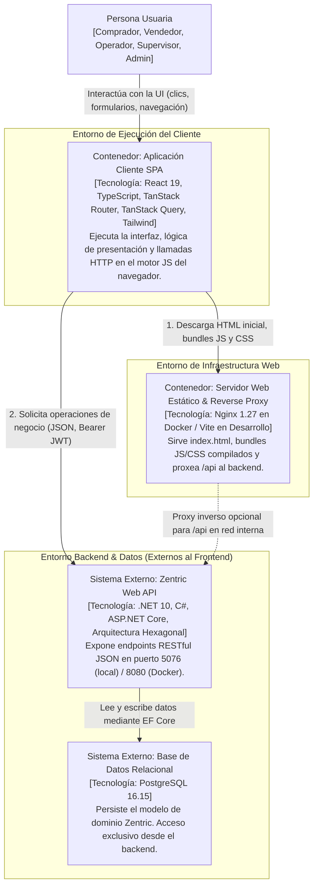

# C4 - Nivel 2: Contenedores del Frontend

## 1. Alcance y Propósito del Nivel 2

En el modelo C4 (Simon Brown), un **Contenedor** no equivale estrictamente a un contenedor Docker. Un contenedor es una **unidad ejecutable o de almacenamiento de datos desplegable de forma independiente**. Representa el subsistema de alto nivel donde reside y se ejecuta el código o los datos.

Este documento descompone el frontend de Zentric en sus unidades de ejecución y despliegue, delimitando con precisión:
1. Qué se ejecuta en el navegador del cliente.
2. Qué se ejecuta en el servidor de estáticos y proxy perimetral.
3. Cómo se comunica el cliente con la API backend (.NET 10) y la base de datos (PostgreSQL 16).
4. La gestión de entorno, ciclo de vida de compilación y políticas de seguridad (sesión volátil en memoria y CORS).

---

## 2. Diagrama de Contenedores



---

## 3. Catálogo de Contenedores

| Contenedor | Tipo | Responsabilidad Principal | Tecnologías Clave | Entorno de Ejecución |
|---|---|---|---|---|
| **Aplicación Cliente SPA** | Single Page Application (SPA) | Renderizado declarativo de UI, navegación type-safe, gestión de caché y estado remoto, captura de formularios y adaptación de errores RFC 7807. | React 19, TypeScript, TanStack Router, TanStack Query, Tailwind CSS. | Motor JavaScript del navegador (V8, WebKit, Gecko). |
| **Servidor Web Estático & Proxy** | Web Server / Reverse Proxy | Servir activos estáticos cacheados de forma inmutable, fallback de enrutamiento SPA (`try_files`) e inyección de variables de entorno en runtime. | Nginx 1.27-alpine (Producción) / Vite 6 (Desarrollo local). | Contenedor Docker Linux (puerto 80) / Proceso Node.js (puerto 5173). |
| **Zentric Web API** | API RESTful (Servicio de Negocio) | Autenticación (JWT), autorización por roles, orquestación de casos de uso CQRS, validación de invariantes de negocio y transaccionalidad. | .NET 10, C#, ASP.NET Core, MediatR. | Proceso .NET en host (puerto 5076) o contenedor Docker (puerto 8080). |
| **Base de Datos Zentric** | Almacén Relacional | Persistencia durable de entidades de dominio (Buyers, Products, Inventories, Orders, etc.). | PostgreSQL 16.15. | Contenedor Docker Linux (puerto 5432). |

---

## 4. Configuración, Entornos y Despliegue

### 4.1 Principio "Build Once, Deploy Anywhere"
Para evitar reconstruir la imagen Docker de producción cuando cambia la URL del backend entre entornos (Dev, Testing, Staging, Producción), se desacopla la configuración del bundle compilado:
1. **Compilación (Build Time):** Vite compila el código TypeScript a JavaScript estático en `apps/frontend/dist/`.
2. **Arranque del Contenedor (Runtime):** El script de inicio de Nginx (`Dockerfile`) genera un archivo ligero `env-config.js` en la raíz pública con la variable `window.__ZENTRIC_API_BASE_URL__ = "${ZENTRIC_API_BASE_URL}"`.
3. **Caché Diferenciada en Nginx:**
   - Bundles estáticos (`.js`, `.css`, imágenes): `Cache-Control: public, max-age=31536000, immutable` (aprovechan el fingerprinting/hash de Vite).
   - Configuración en runtime (`env-config.js`): `Cache-Control: no-store, no-cache, must-revalidate` (nunca se almacena en caché).
   - Documento raíz (`index.html`): `Cache-Control: no-cache` (asegura que el cliente siempre descargue la última versión de la aplicación).

### 4.2 Enrutamiento SPA y Fallback
Al ser una aplicación de una sola página gestionada en el cliente por **TanStack Router**, las rutas como `/admin/buyers` o `/seller/products` no existen como archivos físicos en el servidor.
- **Nginx (`nginx.conf`):** Implementa la directiva `try_files $uri $uri/ /index.html;`. Cualquier solicitud de ruta devuelve el `index.html` con código 200, permitiendo que el router de React tome el control en el cliente.
- **Vite (Desarrollo):** El servidor de desarrollo maneja internamente el fallback al `index.html` mediante su middleware de desarrollo.

### 4.3 Estrategia de Comunicación API y CORS
El cliente frontend admite dos modalidades operativas según el entorno de despliegue:
1. **Proxy Inverso en Red Docker (Por defecto en Compose):**
   - El cliente realiza llamadas relativas a `/api/...`.
   - Nginx intercepta `/api/` y redirige el tráfico internamente a `http://api:8080` dentro de la red puente `zentric-net`.
   - **Beneficio:** Elimina la necesidad de CORS y simplifica la exposición bajo un único puerto perimetral (puerto 5180).
2. **Llamadas Directas Cross-Origin (Desarrollo o CDN separada):**
   - El cliente utiliza la URL completa inyectada (ej. `http://localhost:5076`).
   - El backend .NET 10 tiene configurada la política CORS `Frontend`, permitiendo los orígenes `http://localhost:5173` y `http://localhost:5180`.

---

## 5. Fronteras de Seguridad y Ciclo de Vida de Sesión

### 5.1 Gestión de Tokens en Memoria Estricta (ADR-0009)
De acuerdo con las decisiones de seguridad del sistema:
- **Almacenamiento del Token:** El JWT emitido por la API se almacena **exclusivamente en la memoria volátil de la aplicación** (estado en React Context).
- **Prohibición de Almacenamiento Persistente:** Está **estrictamente prohibido** almacenar el Access Token en `localStorage` o `sessionStorage`, mitigando vectores de robo de credenciales mediante ataques Cross-Site Scripting (XSS).
- **Sin Refresh Tokens ni Cookies de Sesión:** Siguiendo la arquitectura del backend, la sesión tiene una vida útil fija de 60 minutos. Al recargar la página (`F5`), cerrar la pestaña o expirar el tiempo de validez, la sesión se destruye automáticamente y el usuario debe reautenticarse.

### 5.2 Manejo de Errores Estandarizado (RFC 7807 Problem Details)
Todas las respuestas de fallo emitidas por la API siguen el estándar RFC 7807:
```json
{
  "type": "https://tools.ietf.org/html/rfc7231#section-6.5.1",
  "title": "Bad Request",
  "status": 400,
  "detail": "El precio unitario no puede ser negativo."
}
```
El adaptador HTTP del cliente intercepta estas respuestas y las traduce a tipos de error homogéneos del dominio frontend antes de exponerlos a los hooks y componentes de la UI.

---

## 6. Comandos de Verificación del Contenedor Frontend

Desde la raíz del frontend (`frontend/`):

```powershell
# Instalación reproducible con lockfile estricto
pnpm install --frozen-lockfile

# Verificación de tipos TypeScript en todo el monorepo
pnpm typecheck

# Compilación de producción (bundle Vite + assets)
pnpm build

# Ejecución de la suite de pruebas unitarias y de integración
pnpm test
```

---

## 7. Trazabilidad y Referencias Arquitectónicas

- **Especificación de Contexto (Nivel 1):** [C4-1-Contexto.md](C4-1-Contexto.md)
- **Especificación de Componentes (Nivel 3):** [C4-3-Componentes.md](C4-3-Componentes.md)
- **Arquitectura de Capas Frontend:** [Frontend-Architecture.md](Frontend-Architecture.md)
- **Definición de Infraestructura Docker:** `frontend/Dockerfile` y `docker-compose.yml`
- **Configuración de Servidor Web:** `frontend/nginx.conf`
