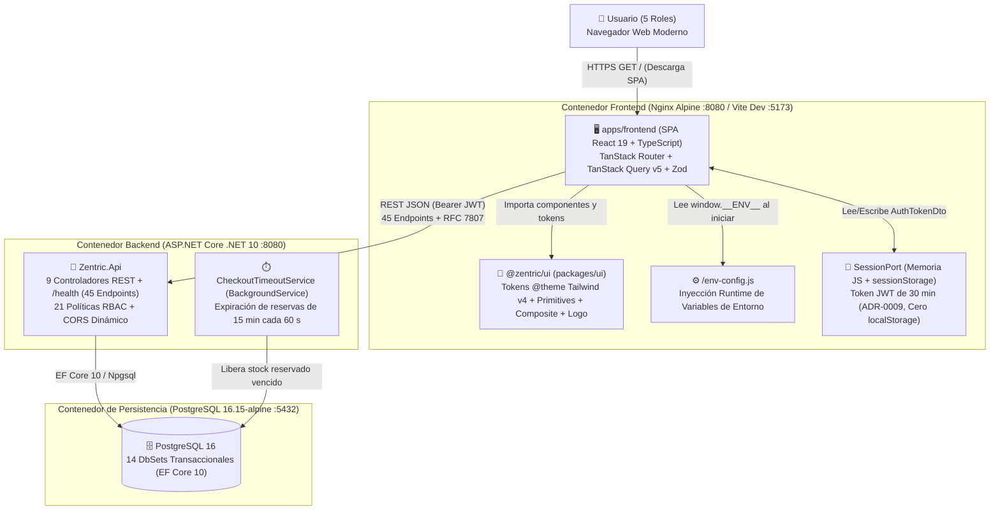

# Arquitectura C4 — Nivel 2: Diagrama de Contenedores y Topología del Monorepo (Frontend SDD)

> **Propósito:** Especificar la arquitectura de contenedores de ejecución, la estructura de paquetes del monorepo frontend (`Turborepo` + `pnpm workspaces`) y el mecanismo de configuración e integración en tiempo de ejecución con el backend `.NET 10` y PostgreSQL 16.

---

## 1. Diagrama de Contenedores (C4 Nivel 2)

---

## 2. Topología de Paquetes del Monorepo (`frontend/`)

El workspace de frontend se organiza bajo `frontend/` utilizando `pnpm-workspace.yaml` y `turbo.json` con separación estricta de responsabilidades entre los agentes de la flota DAG:

| Paquete / Ruta en el Monorepo | Nombre del Paquete | Agentes Propietarios | Responsabilidad Arquitectónica |
|---|---|---|---|
| `frontend/apps/frontend/` | `@zentric/frontend` | Agentes `09`, `10`, `11`, `13` | Aplicación SPA principal: contratos de dominio (`src/domain/`), hooks de TanStack Query y esquemas Zod (`src/application/`), adaptadores HTTP/Sesión/Mocks (`src/adapters/`), enrutamiento y shells (`src/app/`) y vistas de los 5 roles (`src/modules/`). |
| `frontend/packages/ui/` | `@zentric/ui` | Agentes `07`, `08`, `13` | Design System desacoplado bajo la doctrina **`hyperframes-creative`**: tokens semánticos (`src/tokens/`), primitivas atómicas (`src/primitives/`), componentes compuestos de alta densidad (`src/composite/`), diccionario de etiquetas (`src/components/domainLabels.ts`) y marca (`src/logo/`). |
| `frontend/packages/typescript-config/` | `@zentric/typescript-config` | Transversal | Configuraciones estrictas de compilación TypeScript (`strict: true`, `noUncheckedIndexedAccess: true`, `exactOptionalPropertyTypes: false`). |
| `frontend/packages/eslint-config/` | `@zentric/eslint-config` | Transversal | Reglas de análisis estático para React 19, hooks, accesibilidad (`jsx-a11y`) y prohibición de `any` implícito o explícito. |

---

## 3. Especificación de Despliegue, Ruteo SPA y Variables Runtime

### 3.1 Ruteo SPA (`try_files`) y Soporte de Deep Linking
El contenedor de producción sirve los artefactos estáticos compilados (`dist/`) mediante **Nginx Alpine** en el puerto `8080` (no privilegiado):
- Toda ruta de navegación profunda del árbol de TanStack Router (`/login`, `/register`, `/health`, `/buyer/catalog`, `/seller/products`, `/admin/users`, `/logistics/fulfillment`, `/supervisor/orders`) se resuelve mediante la directiva `try_files $uri $uri/ /index.html;`, evitando errores `404 Not Found` al recargar la página (`F5`).

### 3.2 Inyección de Configuración en Tiempo de Ejecución (`env-config.js`)
Para cumplir con el principio **Build Once, Deploy Anywhere**, el contenedor genera `/env-config.js` en el arranque (`docker-entrypoint.sh`) exponiendo `window.__ENV__`, con fallback automático a `import.meta.env` durante el desarrollo local con Vite:

| Variable de Configuración | Valor en Desarrollo Local | Propósito Operativo |
|---|---|---|
| `VITE_API_BASE_URL` | `http://localhost:5000` (o puerto expuesto por `Zentric.Api`) | URL base utilizada por `httpClient.ts` para invocar `/health` y `/api/*`. |
| `VITE_ENABLE_MOCKS` | `'false'` (por defecto contra backend real) / `'true'` (modo aislado) | Conmuta en `apps/frontend/src/adapters/api/index.ts` entre `httpZentricApiAdapter` y `mockZentricApiAdapter`. |
| `VITE_APP_ENV` | `'development' \| 'staging' \| 'production'` | Identificador de entorno visible en el diagnóstico `/health` y telemetría de errores. |

### 3.3 Alineación con la Política CORS del Backend (`Program.cs:218-231`)
En `backend/Zentric.Api/Program.cs:218-231`, la política CORS `"FrontendPolicy"` lee `AllowedOrigins` desde configuración (con fallback a `http://localhost:5173` y `http://localhost:3000`) y habilita `AllowAnyHeader()` y `AllowAnyMethod()`. El contenedor frontend debe ejecutarse en un origen incluido en `AllowedOrigins` para permitir el envío de la cabecera `Authorization: Bearer <token>`.
