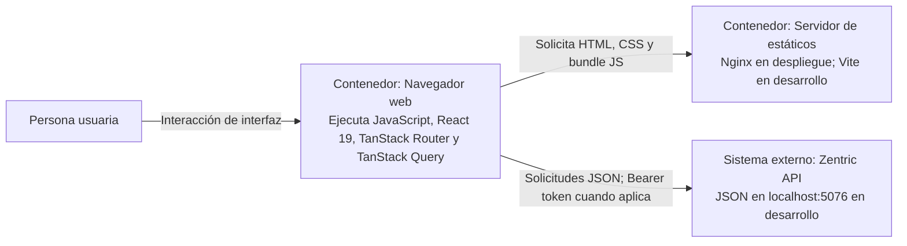

# C4 - Nivel 2: Contenedores del frontend

## Alcance

Este nivel descompone el sistema frontend en unidades ejecutables y desplegables.
En producción, el bundle construido se sirve como archivos estáticos por Nginx y se
ejecuta en el navegador del usuario. En desarrollo, Vite entrega esos archivos y
permite la recarga rápida. El navegador llama directamente a la API; Nginx y Vite
no actúan como proxy de negocio en producción (en desarrollo, `vite.config.ts`
opcionalmente proxea `/api` para evitar depender de CORS).

> **Estructura (Q10):** monorepo **Turborepo + pnpm**. Aquí se describen los
> contenedores *ejecutables*; la separación en paquetes de código es nivel 3.

## Diagrama de contenedores



## Contenedores

| Contenedor | Responsabilidad | Tecnología y ubicación |
|---|---|---|
| Aplicación cliente | Ejecutar la interfaz, rutas type-safe, estado de UI y coordinación de casos de uso. | React 19, TypeScript, **TanStack Router** (Q11), **TanStack Query** (Q9), Tailwind + shadcn/ui (Q5/Q14). JavaScript dentro del navegador. |
| Servidor de archivos estáticos | Publicar `index.html`, CSS, fuentes (Geist, locales) y bundle generado. | Nginx en la etapa runtime de `Dockerfile`; Vite durante desarrollo (`pnpm dev`, puerto 5173). |
| API Zentric | Autenticar, autorizar, validar reglas de negocio y ejecutar operaciones persistentes. | Servicio backend .NET 10 independiente; `http://localhost:5076` en desarrollo. **No pertenece** al despliegue del frontend. |

## Configuración y comunicación

- Vite inyecta `VITE_API_BASE_URL` durante la compilación. Si no está configurada,
  el adaptador HTTP usa `http://localhost:5076`.
- En tiempo de ejecución la URL puede sobreescribirse sin reconstruir la imagen
  mediante `window.__ZENTRIC_API_BASE_URL__`, que Nginx inyecta en la imagen Docker.
- El navegador llama a la API con su propia URL. Por ello la API debe aceptar el
  origen del frontend mediante CORS (política `Frontend`, ya verificada).
- El adaptador HTTP serializa JSON, agrega `Authorization: Bearer` a las rutas
  protegidas, controla timeout/cancelación y traduce los `Problem Details`
  (RFC 7807) a errores tipados del dominio frontend.
- **Sesión (Q15-B):** el access token vive **sólo en memoria**. **No hay refresh
  ni cookie** (`ADR-0009:62`): al recargar o a los 60 min, re-login. Nunca
  `localStorage`.

## Construcción y arranque

La imagen Docker usa una etapa Node para instalar dependencias reproducibles
(`pnpm install --frozen-lockfile`) y ejecutar `pnpm build` (TypeScript + Vite).
La etapa final copia `dist/` a Nginx, que sirve los archivos **sin ejecutar lógica
de aplicación en el servidor**. En desarrollo, `vite.config.ts` activa el plugin de
React y el servidor Vite con HMR.

Comandos de validación:

```powershell
pnpm install
pnpm build        # tsc + vite build
pnpm typecheck
pnpm test         # vitest
```

## Decisiones y límites

- React es una aplicación cliente de página única (SPA): las rutas cambian dentro
  del navegador y **TanStack Router** muestra las páginas sin pedir al servidor un
  HTML diferente por cada ruta (ventana de SEO en `index.html` y meta por ruta).
- No hay una capa servidor-a-servidor para las llamadas API en el frontend actual.
- Cambiar variables `VITE_*` **después** de construir no reconfigura un bundle ya
  generado (salvo el override en runtime vía `window.__ZENTRIC_API_BASE_URL__`).
- El contenedor estático **no** es una frontera de seguridad: autorización y reglas
  de negocio permanecen en el backend.

## Referencias

- `frontend/Dockerfile`
- `frontend/vite.config.ts`
- `frontend/nginx.conf`
- [Arquitectura frontend](Frontend-Architecture.md)
- [Adaptadores frontend](Frontend-Adapters.md)
