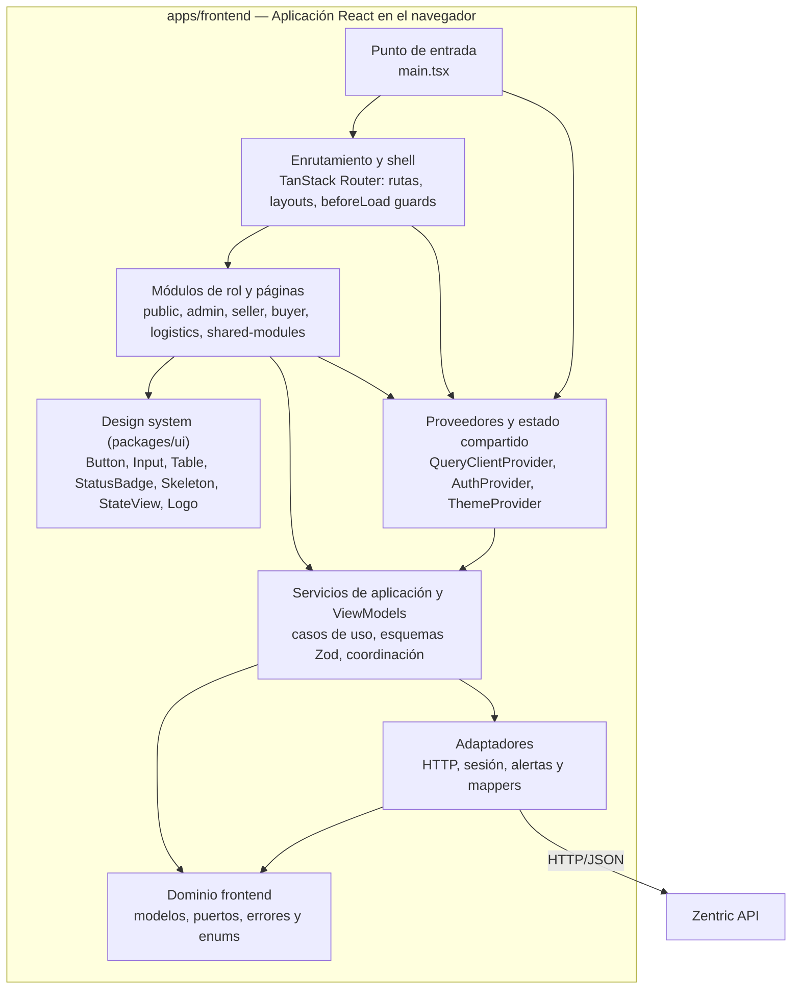

# C4 - Nivel 3: Componentes del frontend

## Alcance

Este nivel describe las piezas principales dentro de la aplicación cliente y sus
dependencias. Las cajas representan responsabilidades del código fuente; no son
procesos independientes. La dirección de dependencias evita que las pantallas
construyan URLs o manipulen tokens directamente.

La separación en **paquetes del monorepo (Q10)** es transversal:

| Paquete | Contenido |
| --- | --- |
| `apps/frontend` | Rutas, módulos por rol, dominio, servicios y adaptadores |
| `packages/ui` | Design system: tokens (Q7/Q8), shadcn/ui adaptado (Q5/Q14), logo (Q6) |
| `packages/config` | Configuración compartida de TypeScript, Tailwind y ESLint |
| `packages/api-client` | Cliente tipado de la API (fase posterior) |

## Diagrama de componentes

## Componentes y responsabilidades

| Componente | Ubicación representativa | Responsabilidad |
|---|---|---|
| Punto de entrada | `apps/frontend/src/main.tsx` | Crea el `QueryClient` una vez y monta el árbol React dentro de `#root`, con los límites globales y proveedores. |
| Enrutamiento y shell | `apps/frontend/src/app/` | Define rutas públicas y protegidas, layouts, navegación por rol y estado de ruta no encontrada. |
| Guards | `apps/frontend/src/app/routes/` (`beforeLoad`) | Comprueban sesión y rol **antes** de resolver la ruta; la API conserva la autorización efectiva. |
| Estado compartido | `apps/frontend/src/app/providers/` | `AuthProvider` publica sesión/login/logout; `QueryClientProvider` centraliza el estado remoto; `ThemeProvider` la apariencia. |
| Módulos de rol | `apps/frontend/src/modules/` | Componen páginas y flujos por rol. Las páginas conectan datos, acciones y componentes de presentación. |
| Componentes comunes | `packages/ui/src/components/` | Controles reutilizables accesibles: campos, botones, tablas, importes, badges, skeletons, estados vacíos y el **logo**. |
| Tokens | `packages/ui/src/tokens/` | `colors.ts` (Q7), `typography.ts` (Q8), `spacing.ts`. Única fuente de verdad visual. |
| Servicios de aplicación | `apps/frontend/src/application/` | Orquestan operaciones del usuario, traducen necesidades de UI a puertos y encapsulan estados de recursos remotos. |
| Esquemas de validación | `apps/frontend/src/application/schemas/` | Un esquema **Zod** por caso de uso (Q13), derivado del contrato del backend. |
| Dominio | `apps/frontend/src/domain/` | Define roles, modelos, errores y puertos sin depender del DOM ni de la implementación HTTP. |
| Adaptadores | `apps/frontend/src/adapters/` | Implementan transporte HTTP, sesión del navegador, alertas y mapeos. **El adaptador HTTP es el único que ejecuta `fetch`.** |

## Colaboración en una consulta

1. TanStack Router selecciona una página del módulo a partir de la URL; el
   `beforeLoad` consulta el rol en el `AuthProvider`.
2. La página usa un hook de TanStack Query (`useQuery`) con una clave tipada.
3. El servicio de aplicación llama al puerto HTTP con una operación tipada y una
   ruta definida por el contrato.
4. El adaptador HTTP incorpora `Authorization`, ejecuta `fetch` y convierte una
   respuesta no exitosa (Problem Details RFC 7807) a un error tipado.
5. TanStack Query guarda el resultado en caché y notifica a los componentes
   suscritos; React vuelve a calcular la UI afectada.
6. La página presenta éxito, vacío, carga o error mediante componentes compartidos
   y conserva las acciones de reintento (`refetch`) que correspondan.

## Colaboración durante autenticación y expiración

- El servicio de autenticación envía credenciales al endpoint público
  (`POST /api/auth/login`).
- La página pide `signIn` al `AuthProvider`; este guarda el **access token en
  memoria** (Q12) y refleja el rol en Context.
- El destino se calcula por rol y TanStack Router cambia la ruta.
- Una respuesta `401` (token caducado o sesión vacía) hace que el adaptador
  **limpie la sesión** y notifique el evento. **No hay refresh** que lo evite
  (`ADR-0009:62`). El proveedor actualiza el estado React y las rutas
  protegidas redirigen a login con aviso de expiración.
- Una respuesta `403` **conserva** la sesión y presenta una alerta; no transforma
  la identidad del usuario.

## Reglas de dependencia

- `domain` no importa React, browser APIs ni detalles HTTP.
- Los módulos pueden depender de servicios, hooks de sesión y `packages/ui`; no
  deben implementar transporte.
- Los componentes genéricos reciben props y callbacks y **no** deben leer
  configuración de API ni token.
- `packages/ui` **no** importa de `apps/frontend`; `packages/config` no importa
  de nadie.
- El acceso a APIs externas está encapsulado en adaptadores y servicios.
- Las páginas deben tratar por separado carga, éxito, vacío y error cuando
  consumen recursos remotos.

## Referencias

- [Arquitectura frontend](Frontend-Architecture.md)
- [Servicios de dominio y aplicación](Frontend-Domain-Services.md)
- [Adaptadores frontend](Frontend-Adapters.md)
- [Flujos por rol](Frontend-Role-Modules.md)
- [Design system](Frontend-Design-System.md)
- [C4 nivel 4: código y React](C4-4-Codigo-React.md)
