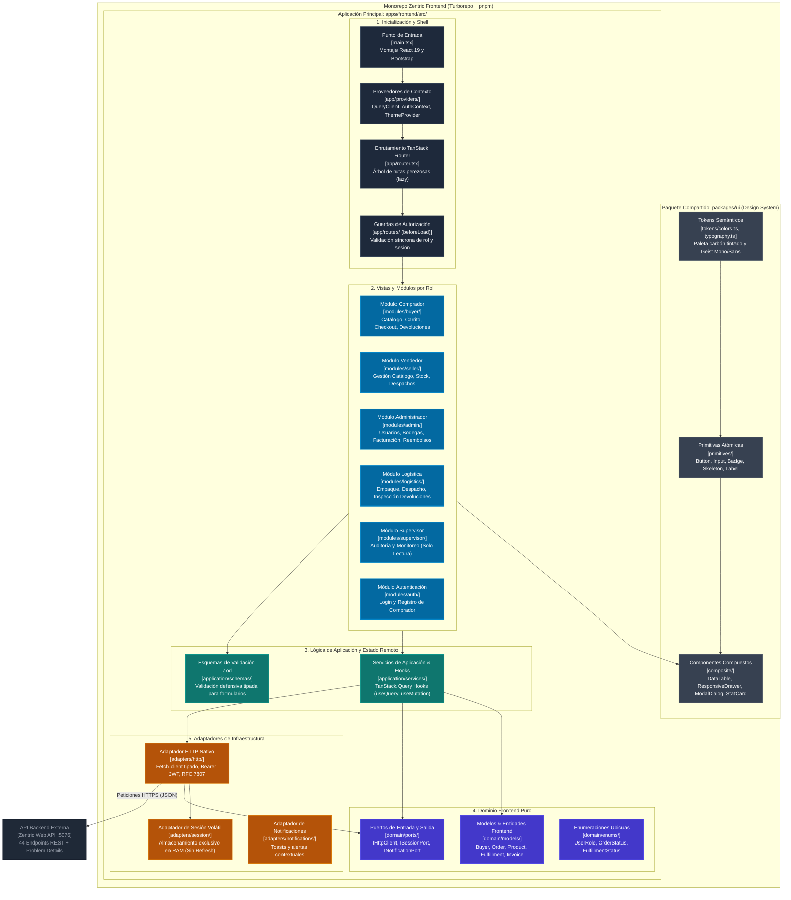
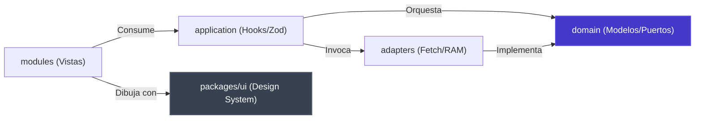
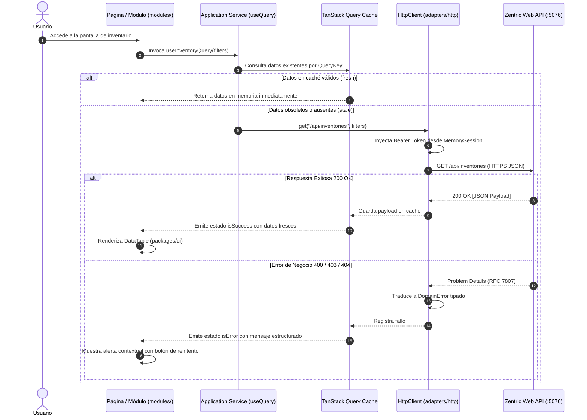
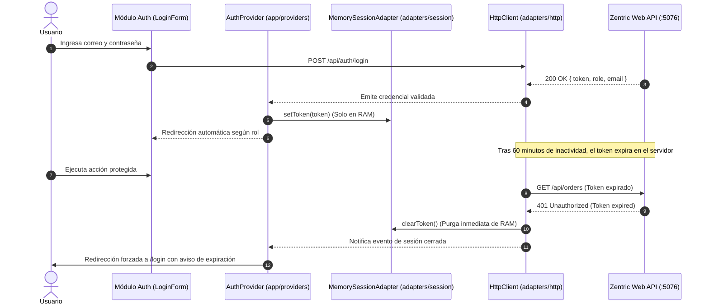

# C4 - Nivel 3: Componentes del Frontend

## 1. Alcance y Propósito del Nivel 3

En el modelo C4 (Simon Brown), el **Nivel 3 (Componentes)** descompone los contenedores en sus bloques funcionales constitutivos de código fuente, delimitando:
1. Las responsabilidades específicas de cada componente dentro de la arquitectura frontend.
2. El grafo estricto y unidireccional de dependencias entre paquetes y capas.
3. El aislamiento de la interfaz respecto a detalles de transporte de red y serialización.
4. Los contratos de colaboración para la gestión de estado de servidor, validación y sesión en memoria.

En Zentric, el frontend está organizado como un **Monorepo gestionado por Turborepo y pnpm** (`frontend/apps/frontend` y `frontend/packages/*`), garantizando desacoplamiento físico entre el **Design System**, la **Lógica de Aplicación**, y las **Vistas de Negocio por Rol**.

---

## 2. Diagrama de Componentes del Sistema

El siguiente diagrama detalla la arquitectura de componentes de la aplicación cliente SPA (`apps/frontend`) y su interacción con el sistema de diseño compartido (`packages/ui`) y la API backend:

---

## 3. Catálogo Detallado de Componentes

### 3.1 Paquete Compartido `packages/ui` (Design System)
Este paquete es completamente agnóstico al negocio y a la red; no conoce endpoints, rutas ni tokens JWT:

| Componente | Directorio | Responsabilidad Técnica | Dependencias Permitidas |
|---|---|---|---|
| **Tokens Semánticos** | `packages/ui/src/tokens/` | Define paletas de neutros tintados (`#0B0F19`, `#111827`, `#1F293D`), acento semántico (`#00D4AA`, `#FFB800`) y fuentes Geist. | Ninguna (CSS nativo `@theme`). |
| **Primitivas Atómicas** | `packages/ui/src/primitives/` | Controles elementales accesibles: `Button`, `Input`, `Badge`, `Skeleton`, `Textarea`, `Checkbox`. Basados en Radix UI. | `tokens/`. |
| **DataTable Compuesta** | `packages/ui/src/composite/DataTable/` | Tabla de alta densidad para inventarios y órdenes con ordenamiento, filtrado, paginación y renderizado en Geist Mono. | `primitives/`, TanStack Table. |
| **ResponsiveDrawer** | `packages/ui/src/composite/Drawer/` | Panel lateral deslizante para edición de recursos y detalles rápidos sin perder el contexto de la tabla. | `primitives/`. |
| **ModalDialog** | `packages/ui/src/composite/Modal/` | Diálogos modales para confirmaciones críticas (cancelación de órdenes, ajustes de inventario). | `primitives/`. |
| **StatCard** | `packages/ui/src/composite/StatCard/` | Tarjeta asimétrica de métricas operativas con bordes de bajo contraste y tipografía 600/700. | `primitives/`. |

---

### 3.2 Aplicación Principal `apps/frontend`

#### Capa 1: Inicialización, Enrutamiento y Shell (`src/app/`)
- **`main.tsx` (Punto de Entrada):** Inicializa la instancia única de `QueryClient` con políticas de stale-time y reintentos, monta el árbol React en `#root` y encapsula la aplicación en `ErrorBoundary`.
- **`router.tsx` (TanStack Router Shell):** Define la jerarquía de rutas basada en código (`createRouter`), asociando layouts principales (`DashboardLayout`, `AuthLayout`, `PublicLayout`) y habilitando carga perezosa (`lazy`).
- **`beforeLoad` Route Guards:** Interceptores de navegación ejecutados síncronamente antes de renderizar una ruta protegida. Verifican la presencia de sesión activa en `ISessionPort` y comprueban que el rol del usuario coincida con las políticas autorizadas para la sección.

#### Capa 2: Módulos Funcionales por Rol (`src/modules/`)
Cada módulo encapsula las pantallas de un actor del marketplace:
- **`modules/buyer/`:** Vistas de catálogo público, ficha de producto, carrito reactivo con precio congelado, asistente de checkout de 15 minutos y seguimiento de pedidos y garantías.
- **`modules/seller/`:** Dashboard de métricas comerciales, administración de productos (publicación/suspensión), monitoreo de existencias por SKU y empaque de órdenes de despacho.
- **`modules/admin/`:** Panel de control de usuarios, apertura de bodegas volumétricas, liquidación de facturas maestras/split y auditoría de reembolsos.
- **`modules/logistics/`:** Cola de despachos en bodega, certificación de entrega con número de guía y protocolo de inspección física para devoluciones.
- **`modules/supervisor/`:** Vistas de solo lectura para fiscalización transversal de inventarios, traza de auditoría y reportes operacionales.

#### Capa 3: Lógica de Aplicación (`src/application/`)
- **`application/services/` (Hooks de Consulta y Mutación):** Encapsulan `useQuery` y `useMutation` de TanStack Query. Orquestan la invalidación de claves de caché ante mutaciones exitosas (ej. tras `payOrder`, invalidar `orders` y `cart`).
- **`application/schemas/` (Validación con Zod):** Esquemas fuertemente tipados que replican los contratos de validación de FluentValidation del backend. Validan formularios antes del envío y generan tipos TypeScript derivados (`z.infer<typeof schema>`).

#### Capa 4: Dominio Frontend Puro (`src/domain/`)
- **Modelos y Value Objects:** Representaciones inmutables de las entidades del marketplace (`Buyer`, `CustomerOrder`, `FulfillmentOrder`, `Invoice`, `Money`).
- **Puertos Abstractos:** Interfaces (`IHttpClient`, `ISessionPort`, `INotificationPort`) que desacoplan las reglas del cliente de las librerías técnicas.
- **Enumeraciones:** Mapeo 1:1 con los enums del backend (`UserRole`, `OrderStatus`, `FulfillmentStatus`, etc.), garantizando cero sinónimos y serialización estricta como texto.

#### Capa 5: Adaptadores de Infraestructura (`src/adapters/`)
- **`adapters/http/HttpClient.ts`:** **Único componente autorizado en todo el proyecto para ejecutar `fetch()`**. Aplica el token Bearer en las cabeceras, intercepta respuestas no exitosas y transforma las cargas RFC 7807 (`application/problem+json`) en instancias de error de dominio tipadas.
- **`adapters/session/MemorySessionAdapter.ts`:** Implementa `ISessionPort` reteniendo el token JWT exclusivamente en la memoria RAM de JavaScript. Ante recarga del navegador o recepción de un HTTP `401 Unauthorized`, purga la sesión inmediatamente sin recurrir a `localStorage`, cumpliendo la política estricta de sesión volátil sin refresh token ([ADR-0009](./backendSDD/Adr/0009-autenticacion-jwt-rg01.md)).

---

## 4. Invariantes y Reglas de Dependencia Hexagonal

Para preservar la mantenibilidad y evitar el acoplamiento cruzado, se establecen las siguientes reglas arquitectónicas inviolables:

1. **Aislamiento de `packages/ui`:** `packages/ui` tiene **estrictamente prohibido** importar cualquier archivo de `apps/frontend`. No contiene lógica de negocio, no conoce endpoints ni accede a tokens.
2. **Dominio Agnóstico:** `domain/` no puede importar React, hooks, APIs del navegador (`window`, `document`) ni librerías de transporte (`fetch`). Es TypeScript puro.
3. **Monopolio de Red:** Queda prohibido el uso de `fetch` o clientes HTTP fuera de `adapters/http/`. Las vistas nunca construyen URLs ni gestionan cabeceras `Authorization`.
4. **Almacenamiento Seguro de Credenciales:** Prohibido el uso de `localStorage` o `sessionStorage` para guardar tokens JWT. La sesión reside en RAM; si el token expira (60 min), el usuario debe reautenticarse.
5. **Manejo Cuádruple de Estado en Vistas:** Toda pantalla o componente que consuma datos asíncronos debe manejar explícitamente los 4 estados de la UI:
   - **Cargando (`isLoading`):** Muestra primitivas `Skeleton` con dimensiones proporcionales.
   - **Vacío (`isEmpty`):** Muestra vista de estado vacío con acción de recuperación.
   - **Error (`isError`):** Muestra Problem Details amigable con opción de reintento (`refetch`).
   - **Éxito (`isSuccess`):** Renderiza la tabla o formulario con datos frescos.

---

## 5. Dinámica de Colaboración entre Componentes

### 5.1 Flujo de Consulta Remota (Query Pipeline)

### 5.2 Flujo de Autenticación y Expiración Ineludible

---

## 6. Integración con la Doctrina Visual Anti-IA Genérica

Los componentes del Nivel 3 reflejan en su implementación las directrices semánticas de diseño:
1. **Neutros Tintados:** Superficies y tarjetas utilizan fondos carbón (`#111827`) con bordes atenuados (`#1F293D`), eliminando fondos negros puros `#000000` o grises desaturados genéricos.
2. **Jerarquía Tipográfica Robusta:** Las cabeceras de módulos y títulos de modales aplican Geist Sans con peso 600 o 700; los identificadores (SKUs, IDs de orden, importes monetarios y estados) se renderizan obligatoriamente con **Geist Mono** para máxima legibilidad tabular.
3. **Color de Acento Unificado:** Las acciones primarias emplean el tono esmeralda/cian suave (`#00D4AA`), reservando el ámbar (`#FFB800`) para estados de advertencia (órdenes pendientes de pago, ventanas de 15 minutos activas). Quedan excluidos los degradados multicolores ("AI gradient text") y los bordes con barras de colores chillones en tarjetas.
