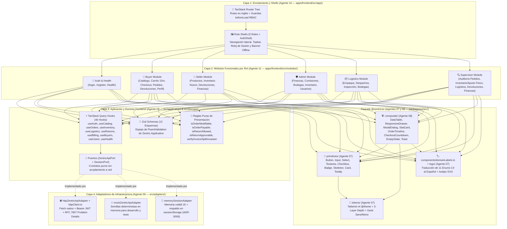

# Arquitectura C4 — Nivel 3: Diagrama de Componentes Internos (Frontend SDD)

> **Propósito:** Descomponer los contenedores `apps/frontend` y `packages/ui` en sus componentes internos bajo el patrón de **Arquitectura Hexagonal Adaptada al Frontend**, delimitando con precisión las fronteras de propiedad entre los agentes `07`, `08`, `09`, `10` y `11` y las reglas compositivas de **`hyperframes-creative`**.

---

## 1. Diagrama de Componentes Internos (C4 Nivel 3)

---

## 2. Catálogo de Componentes de `apps/frontend` y Regla de Dependencia

| Componente Interno | Ubicación Física | Agente Propietario | Dependencias Permitidas | Restricciones Inviolables |
|---|---|---|---|---|
| **Contratos y Reglas de Dominio (`domain/`)** | `apps/frontend/src/domain/` | `09-frontend-application-architect` | Ninguna (TypeScript puro). | Prohibido importar React, TanStack Query, `fetch` o componentes UI. |
| **Hooks CQRS y Esquemas Zod (`application/`)** | `apps/frontend/src/application/` | `09-frontend-application-architect` | `src/domain/**`, `@tanstack/react-query`, `zod`. | Invoca exclusivamente `ZentricApiPort` y `SessionPort`; prohibido llamar a `fetch` directamente. |
| **Adaptadores de Salida (`adapters/`)** | `apps/frontend/src/adapters/` | `09-frontend-application-architect` | `src/domain/**`, API nativa `fetch`, `sessionStorage`. | Único lugar autorizado para construir URLs `/api/*`, inyectar cabeceras `Authorization` y parsear RFC 7807. |
| **Enrutador y Shells (`app/`)** | `apps/frontend/src/app/` | `10-frontend-routing-shell` | `src/application/**`, `src/domain/**`, `@zentric/ui`, `@tanstack/react-router`. | Ejecuta las guardas `beforeLoad` por rol; no contiene formularios de negocio específicos de una vista. |
| **Módulos de Rol (`modules/`)** | `apps/frontend/src/modules/` | `11-frontend-role-modules` | `src/application/**`, `src/domain/**`, `@zentric/ui`. | Prohibido importar `src/adapters/api/httpClient.ts` directamente; toda lectura o mutación pasa por los hooks de `src/application/hooks/`. |

---

## 3. Catálogo de Componentes de `@zentric/ui` y Arquitectura Visual (`hyperframes-creative`)

Para prevenir colisiones de archivos durante la ejecución paralela de la **Oleada 1** y la **Oleada 2**, el paquete `packages/ui/src/` divide físicamente sus directorios:

| Submódulo de `@zentric/ui` | Ubicación Física | Agente Propietario | Reglas de Diseño y Accesibilidad (`hyperframes-creative`) |
|---|---|---|---|
| **Tokens y Tema (`tokens/`)** | `packages/ui/src/tokens/` | `07-frontend-tokens-primitives` (Oleada 1) | Define la arquitectura de profundidad en 3 capas (`#0A0E1A` canvas, `#111827` surface, `#161F30` elevated, `#1F293D` hairline border), acento primario único `#00D4AA`, ámbar `#FFB800` y las 3 voces tipográficas (`Geist Sans` y `Geist Mono` con `tabular-nums`). |
| **Primitivas Atómicas (`primitives/`)** | `packages/ui/src/primitives/` | `07-frontend-tokens-primitives` (Oleada 1) | `Button`, `Input`, `Select`, `Textarea`, `Checkbox`, `Badge`, `Skeleton`, `Card`, `Tooltip`. Todos soportan foco visible (`2px solid #00D4AA`), atributos `aria-invalid` / `aria-describedby` y alturas táctiles mínimas de `36px`/`40px`. |
| **Diccionario y Marca (`domainLabels.ts` + `logo/`)** | `packages/ui/src/components/domainLabels.ts` y `packages/ui/src/logo/` | `07-frontend-tokens-primitives` (Oleada 1) | Traduce al español los **11 enums de dominio de C#** y provee el isotipo vectorial (`ZentricLogo`, `ZentricMark`) con trazo geométrico `#00D4AA`. |
| **Componentes Compuestos (`composite/`)** | `packages/ui/src/composite/` | `08-frontend-composite-ui` (Oleada 2) | `DataTable` (columnas numéricas alineadas a la derecha con `Geist Mono tabular-nums`), `ResponsiveDrawer` (`role="dialog"`, foco atrapado y cierre con `Escape`), `ModalDialog` (`role="alertdialog"`), `StatCard` (variante `hero` y `secondary` para evitar grillas de 4 tarjetas clonadas), `OrderTimeline`, `CheckoutCountdown`, `EmptyState` y `Toast`. |
