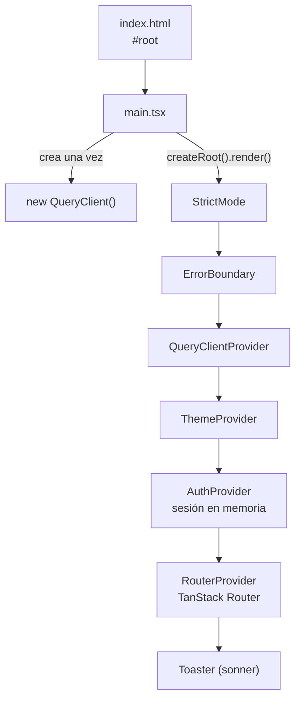
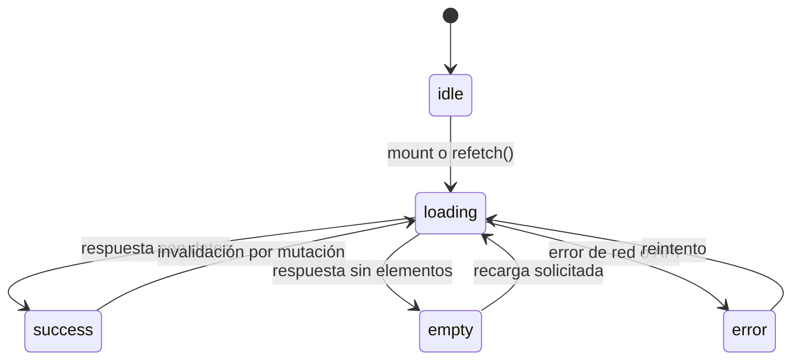
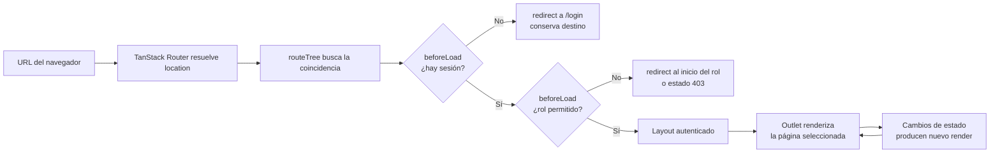
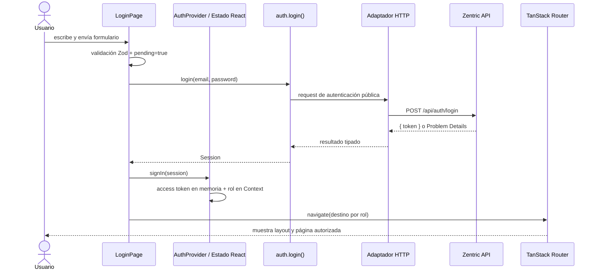

# C4 - Nivel 4: Código y funcionamiento de React

## Alcance y guía de lectura

El nivel 4 baja desde los componentes arquitectónicos hasta archivos, funciones,
hooks y relaciones concretas.

> **Estado honesto (2026-10-09):** el código descrito aquí es la **especificación
> objetivo** derivada de las decisiones Q1–Q14. `apps/frontend/src/` **aún no
> existe**: sólo hay la configuración base heredada de `frontend/`
> (React 18 + react-router-dom 6, sin `src/`), que **no coincide** con el stack
> decidido. Este documento es la guía de implementación de la fase F1/F2; no debe
> leerse como código ya escrito. El estado real está en
> [`Frontend-SDD.md` §4](Frontend-SDD.md#4-fases-y-estado).

En este frontend, **React 19** con TypeScript define el árbol de UI; **TanStack
Router** resuelve la navegación cliente; **TanStack Query** gestiona el estado
remoto; **Vite** compila TSX y publica los recursos. Las rutas hexagonales
(`domain`, `application`, `adapters`, `modules`) son límites del código de la
aplicación, no capas internas propias de React.

## 1. Arranque: desde HTML hasta el árbol React

`apps/frontend/index.html` ofrece el elemento raíz `#root` y carga el módulo de
entrada `src/main.tsx`. El punto de entrada construye el `QueryClient` una sola
vez y luego monta el árbol:



### Qué hace cada paso

1. `new QueryClient(...)` en `main.tsx` configura `staleTime`, `gcTime` y
   `retry` (sin reintento en `4xx`). Se ejecuta fuera de los componentes, así que
   un render no vuelve a crear el cliente.
2. `createRoot(...).render(...)` enlaza React con el nodo DOM administrado por la
   aplicación.
3. `StrictMode` activa comprobaciones adicionales de desarrollo para detectar
   efectos secundarios y patrones inseguros. No es un proveedor de datos.
4. `ErrorBoundary` captura errores de renderizado descendientes y permite una
   recuperación en vez de derribar toda la interfaz.
5. `QueryClientProvider` publica el cliente de datos a toda la aplicación.
6. `AuthProvider` publica la sesión (access token en memoria, rol) mediante
   Context; depende de que esté bajo `QueryClientProvider`.
7. `RouterProvider` construye las ramas públicas, autenticadas y por rol.

El **orden de los providers importa**: `AuthProvider` usa `useQueryClient` para
invalidar caché al cerrar sesión, por tanto necesita estar bajo
`QueryClientProvider`; las rutas que llaman `useAuth()` deben estar bajo
`AuthProvider`; las funciones de navegación requieren el router.

## 2. JSX, componentes y composición

Un componente funcional es una función TypeScript que recibe props, puede leer
contexto/hooks y devuelve JSX. JSX describe elementos; el plugin de React/Vite lo
transforma durante el build en llamadas que React reconcilia con el árbol previo.

La UI se compone en varios niveles:

- El **routeTree** de TanStack Router elige la página según la URL y el estado de acceso.
- Las páginas de `modules/` ensamblan secciones y conectan acciones con servicios.
- `packages/ui` contiene controles reutilizables y piezas de presentación con
  props explícitas (shadcn/ui adaptado, Q14).
- El DOM real se actualiza como resultado del render de React.

Por ejemplo, `Input` recibe `label`, `hint`, `error` y el resto de atributos
nativos. Usa `useId()` para producir un identificador estable por instancia y
conecta el `<label>` al campo mediante `htmlFor`. Vincula mensajes con
`aria-describedby`, indica errores con `aria-invalid` y renderiza el mensaje como
alerta accesible. La validación pertenece al formulario (Zod, Q13), no al control
genérico.

## 3. Estado: local frente a compartido

### Estado local de pantalla

`useState` conserva datos que solo necesita una instancia de componente. En
`LoginPage`, por ejemplo, existen estados independientes para correo, contraseña,
errores de validación y envío pendiente:

```text
email/password     -> valores editables del formulario
errors             -> errores de validación local (Zod)
pending            -> bloquea envíos duplicados y desactiva campos
```

El formulario es controlado y se gestiona con **React Hook Form (Q13)**:
`useForm({ resolver: zodResolver(schema) })` valida contra el esquema Zod del
caso de uso. `handleSubmit` previene el envío HTML por defecto, valida primero,
activa `pending`, llama al servicio y actualiza la pantalla según resultado.

### Estado compartido por Context

`AuthProvider` mantiene `user`, `accessToken` y `expiredNotice` con `useState`.
Publica el valor mediante `AuthContext.Provider`; `useAuth()` consume ese valor
desde páginas, layouts y guards. Context evita pasar la sesión manualmente por
cada nivel de props.

**Context no es almacenamiento persistente:** el access token vive sólo en la
variable de estado (memoria). Al recargar la página **se pierde**: el backend no
tiene refresh (`ADR-0009:62`), así que hay que volver a autenticarse (**Q15-B**).
Al abrir la app, `RestaurarSesionService` llama a `GET /api/auth/me` **sólo si
queda token en memoria**.

### Estado remoto

Los datos de la API no se confunden ni con la sesión ni con el estado transitorio
de un formulario. Las páginas usan **TanStack Query (Q9)**:

```ts
const { data, isPending, isError, refetch } = useQuery({
  queryKey: ['orders'],
  queryFn: () => services.orders.list(),
});
```

TanStack Query encapsula el ciclo de carga/resultado/vacío/error/reintento y
permite que la página traduzca ese estado a skeletons, tablas o alertas.



Las mutaciones invalidan la caché afectada: tras `checkout` se invalida
`['orders', id]`; tras `addStock`, `['inventory', variantId]`.

## 4. Hooks y efectos: responsabilidades

- `useState` modela estado local que participa en el render.
- `useContext` (o `useAuth`, `useQueryClient`) lee servicios y sesión desde los providers.
- `useNavigate`, `useSearch` y `Link` de TanStack Router integran estado de ruta
  con UI **type-safe** sin recarga completa del documento.
- `useQuery` / `useMutation` de TanStack Query gestionan datos remotos y caché.
- `useForm` de React Hook Form gestiona formularios con validación Zod.
- `useEffect` sincroniza React con sistemas externos después del render. En
  `AuthProvider` valida `GET /api/auth/me` al montar si hay token en memoria, y
  limpia la sesión si caducó.
- `useCallback` mantiene funciones de notificación estables; `useMemo` construye
  el objeto de valor del contexto; `useRef` guarda marcas que no necesitan render.
- Todo efecto que instala un listener **debe devolver una limpieza**.

Los hooks sólo pueden invocarse en el nivel superior de componentes funcionales o
hooks propios, no condicionalmente ni dentro de ciclos.

## 5. Renderizado y navegación

El routeTree declara rutas con `createRoute`. Las páginas públicas (`/login`,
registro) pueden mostrarse sin sesión. Las rutas autenticadas se anidan bajo un
layout con `beforeLoad` de guardia; dentro del layout, cada grupo se anida por rol.



El layout permanece como shell común alrededor de la página hija. Su `<Outlet/>`
es el punto donde React Router coloca la pantalla activa.

**La interfaz de rol es control de navegación y experiencia, no una frontera de
seguridad.** Todos los permisos y operaciones se validan también en el backend
(20 políticas).

## 6. Ejemplo completo: inicio de sesión

```text
1. El usuario escribe en los campos controlados de LoginPage (React Hook Form).
2. handleSubmit ejecuta la validación Zod del esquema loginSchema.
3. Si hay errores, se pintan junto al campo y NO se hace HTTP.
4. Si es válido, pending=true desactiva controles y evita reenvío accidental.
5. services.auth.login() ejecuta el caso de uso mediante el adaptador HTTP.
6. El adaptador hace fetch, analiza la respuesta y devuelve la sesión o lanza ApiError.
7. En éxito, signIn() guarda el access token EN MEMORIA y el rol en Context.
8. No hay refresh ni cookie: sólo queda el token en memoria (Q15-B).
9. LoginPage calcula el destino por rol y navega con TanStack Router.
10. El router reevalúa la URL, beforeLoad permite la rama y el layout representa su Outlet.
11. En error, se presenta el Problem Details del servidor; finally restablece pending.
```



Si la API responde con error, la respuesta regresa al componente como `ApiError`;
la página presenta el `detail` del servidor, conserva el correo y restablece
`pending` en `finally`.

## 7. Ejemplo completo: consulta de un listado

La página obtiene los servicios desde `useServices()` y usa `useQuery`. Cada
invocación crea un estado para un recurso con su clave tipada. El JSX evalúa el
estado y selecciona la representación:

- `isPending`: skeleton con semántica de estado;
- `isError`: error visible y acción `refetch`;
- vacío (`data.length === 0`): estado vacío con orientación contextual;
- `success`: tabla o tarjetas derivadas de los datos.

Las listas usan un identificador estable como `key` (nunca el índice si existe
identidad de dominio). Los handlers llaman a `navigate()`; la pantalla **no**
construye URLs API ni llama directamente a `fetch`.

> **Nota de contrato:** cinco listados (`/api/Orders`, `/api/logistics/fulfillments`,
> `/api/returns`, `/api/billing/invoices`, `/api/Inventories`) devuelven la lista
> completa sin paginación (`ADR-0017`); sólo `/api/Catalog/products` pagina. La UI
> debe soportar ambos casos.

## 8. Errores, sesión y límites del navegador

El adaptador HTTP convierte `Problem Details` (RFC 7807) a `ApiError`. Ante un
`401` **no hay reintento** (el backend no expone refresh, `ADR-0009:62`): se
limpia la sesión mediante `SessionPort` y se notifica el evento; el
`AuthProvider` actualiza Context y el router renderiza la redirección con aviso
de expiración. En `403`, se conserva la sesión y se presenta una alerta de
autorización.

Los errores de render y los errores de solicitudes son rutas diferentes:
`ErrorBoundary` atiende fallos de renderizado; los errores de red/API se manejan
en los servicios, TanStack Query y el adaptador de alertas.

## 9. Accesibilidad y estructura de UI

- Los controles reutilizables reciben atributos HTML estándar mediante props tipadas.
- `Input` enlaza etiqueta y control, y relaciona hint/error con `aria-describedby`.
- Estados de carga, menús y errores usan roles y propiedades ARIA cuando corresponde.
- Las listas renderizadas deben tener `key` estable.
- Las acciones son callbacks explícitos del padre, separando presentación y comportamiento.
- Movimiento respeta `prefers-reduced-motion`.

## 10. Build y pruebas relacionadas

- `vite.config.ts` registra `@vitejs/plugin-react` y `@tanstack/router-plugin/vite`
  (code-splitting automático, Q11); el build compila TypeScript y genera el bundle.
- **Vitest** ejecuta pruebas de componentes en `jsdom`; las pruebas viven junto a
  `src/**/*.test.{ts,tsx}`.
- **React Testing Library** verifica comportamiento observable del usuario (texto,
  formularios, accesibilidad, navegación) sin acoplar las pruebas al DOM interno.
- Esquemas Zod compartidos permiten probar validación sin montar la UI.

## Archivos de referencia (objetivo)

- `apps/frontend/src/main.tsx`
- `apps/frontend/src/app/router.tsx`
- `apps/frontend/src/app/providers/AuthProvider.tsx`
- `apps/frontend/src/app/providers/QueryProvider.tsx`
- `apps/frontend/src/modules/auth/LoginPage.tsx`
- `apps/frontend/src/adapters/http/httpAdapter.ts`
- `apps/frontend/src/adapters/session/sessionAdapter.ts`
- `apps/frontend/src/application/schemas/login.ts`
- `packages/ui/src/components/ui/input.tsx`
- `packages/ui/src/tokens/colors.ts`
