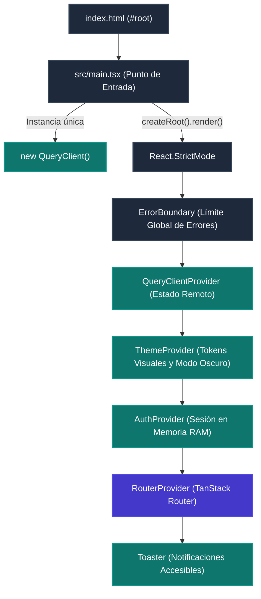
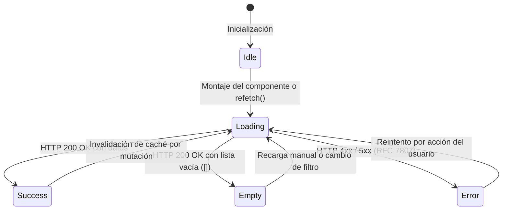
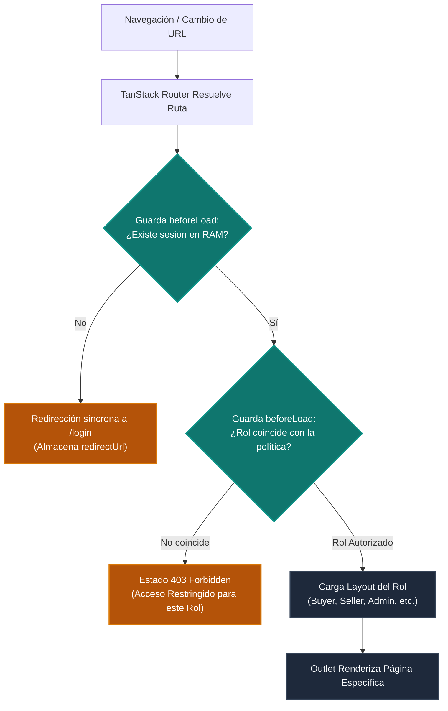

# C4 - Nivel 4: Código y Funcionamiento de React

## 1. Alcance y Guía de Lectura

El **Nivel 4 (Código)** del modelo C4 desciende desde los componentes arquitectónicos del Nivel 3 hacia los archivos, funciones, hooks, interfaces y flujos de ejecución concretos en TypeScript y React 19.

Este documento establece la **especificación técnica de implementación** para la aplicación SPA (`frontend/apps/frontend`) y sus paquetes compartidos (`frontend/packages/*`):
- **React 19 + TypeScript:** Construcción declarativa del árbol de componentes con tipado estricto de props y estado.
- **TanStack Router:** Enrutamiento estático tipado (Type-Safe Routing) con layouts anidados, carga perezosa (`lazy`) y guardas síncronas de autorización (`beforeLoad`).
- **TanStack Query:** Coordinador del estado de servidor, políticas de caducidad (`staleTime`), invalidación de claves de consulta y reintentos automáticos.
- **React Hook Form + Zod:** Gestión controlada de formularios con validación defensiva derivada de los contratos del backend.
- **Doctrina Visual Anti-IA Genérica:** Jerarquía tipográfica con Geist Sans / Geist Mono, neutros tintados carbón (`#0B0F19`, `#111827`, `#1F293D`) y acento semántico esmeralda (`#00D4AA`).

> [!IMPORTANT]
> **Frontera Arquitectónica:** Las capas (`domain`, `application`, `adapters`, `modules`) representan límites físicos de código en el monorepo. Ninguna vista puede invocar peticiones HTTP directamente, saltarse la validación Zod o manipular el token JWT fuera de los adaptadores de infraestructura.

---

## 2. Inicialización y Montaje del Árbol de Proveedores

El archivo `apps/frontend/index.html` suministra el nodo raíz `#root` y carga el punto de entrada `src/main.tsx`. La aplicación configura el cliente de estado remoto y ensambla la jerarquía de contextos de forma determinista:



### Reglas Críticas del Árbol de Montaje:
1. **`QueryClient` Único Fuera del Ciclo de Render:** La instancia de `QueryClient` se crea a nivel de módulo en `main.tsx`. Esto evita que un re-renderizado accidental destruya la memoria caché.
2. **Orden Estricto de Dependencia entre Contextos:**
   - `AuthProvider` reside **dentro** de `QueryClientProvider`, lo que le permite invocar `queryClient.clear()` e invalidar consultas remotas al momento del cierre de sesión.
   - `RouterProvider` reside **dentro** de `AuthProvider`, asegurando que las guardas `beforeLoad` tengan acceso síncrono al estado de autenticación y rol del usuario.
   - `Toaster` se monta en el nivel superior para escuchar eventos globales de notificación sin interferir con las rutas.

---

## 3. Composición de Componentes y Primitivas Accesibles

La interfaz se ensambla mediante una jerarquía estricta de responsabilidades:
- **Páginas (`src/modules/*/pages/`):** Conectan la URL con los hooks de la capa `application` y orquestan las acciones del usuario. No contienen estilos manuales ni construyen tablas desde cero.
- **Componentes Compuestos (`packages/ui/src/composite/`):** Organismos complejos accesibles (`DataTable`, `ResponsiveDrawer`, `ModalDialog`, `StatCard`).
- **Primitivas Atómicas (`packages/ui/src/primitives/`):** Controles base adaptados sobre Radix UI (`Button`, `Input`, `Badge`, `Skeleton`).

### Contrato de Primitivas UI:
Todo control interactivo cumple las siguientes garantías de accesibilidad WAI-ARIA:
1. **Identificadores Estables:** Uso de `useId()` para asociar etiquetas `<label htmlFor={id}>` con sus respectivos campos de entrada `<input id={id}>`.
2. **Descripción de Estados y Errores:** Enlace de textos de ayuda o mensajes de validación mediante `aria-describedby` y señalización semántica de campos inválidos con `aria-invalid={!!error}`.
3. **Respeto a Preferencias del Usuario:** Transiciones atenuadas bajo la media query `prefers-reduced-motion`.

---

## 4. Gestión del Estado: Local, Compartido y Remoto

El frontend separa de forma rigurosa los tres tipos de estado de la aplicación:

| Tipo de Estado | Mecanismo | Ámbito y Ciclo de Vida | Ejemplos en Zentric |
|---|---|---|---|
| **Estado Local** | `useState` / `useReducer` | Transitorio dentro del ciclo de vida del componente en pantalla. | Despliegue de un menú desplegable, pestaña activa, visibilidad de contraseña. |
| **Estado Compartido** | React Context (`useAuth`) | Sesión activa en memoria RAM; se destruye al recargar el navegador. | Token JWT Bearer, rol del usuario autenticado (`UserRole`), correo electrónico. |
| **Estado de Servidor** | TanStack Query (`useQuery`) | Memoria caché compartida, sincronizada y revalidada con el backend. | Catálogo de productos, existencias de bodega, lista de órdenes, facturas. |

### 4.1 Estado Compartido de Autenticación (Sesión en RAM)
Cumpliendo rigurosamente con la política de seguridad y autenticación ([ADR-0009](./backendSDD/Adr/0009-autenticacion-jwt-rg01.md)):
- El token JWT reside **exclusivamente en memoria RAM** dentro del estado del `AuthProvider` y del adaptador `MemorySessionAdapter`.
- Queda **estrictamente prohibido** persistir tokens en `localStorage`, `sessionStorage` o cookies no seguras.
- Si la página se recarga o el token de 60 minutos expira en el servidor, la API devuelve un HTTP `401 Unauthorized`. El cliente reacciona de forma inmediata: purga el token de la memoria RAM, invalida la caché de TanStack Query y redirige al usuario a la vista de login con un aviso explícito de sesión expirada (**sin mecanismo de refresh token**).

### 4.2 Estado de Servidor y Máquina de Estados Cuádruple
Toda consulta remota gestionada con TanStack Query modela explícitamente cuatro estados visuales en la interfaz:



- **`Loading`:** Renderiza esqueletos de carga (`Skeleton`) que replican la estructura y densidad de la tabla o formulario final.
- **`Empty`:** Presenta una ilustración sobria, mensaje explicativo y botón de acción principal para guiar al usuario (ej. "No hay existencias registradas. Ingresar Stock").
- **`Error`:** Presenta un componente de alerta estructurado que renderiza el campo `detail` del Problem Details (RFC 7807) y un botón interactivo para reintentar la operación (`refetch`).
- **`Success`:** Dibuja los datos en la tabla o tarjeta con renderizado de códigos y monedas en Geist Mono.

---

## 5. Validación Defensiva de Formularios (React Hook Form + Zod)

Los formularios implementan validación en dos barreras consecutivas:

1. **Barrera de Interfaz (Zod en Cliente):** 
   - Se define un esquema Zod fuertemente tipado en `src/application/schemas/` que replica con exactitud las reglas de negocio de los validadores FluentValidation del backend (longitudes, formatos de correo, no-negatividad de cantidades, números de documento válidos).
   - `react-hook-form` integra el esquema mediante `@hookform/resolvers/zod`.
   - Si la entrada no es válida, los errores se proyectan inmediatamente bajo cada campo y **el cliente nunca emite la petición HTTP**, ahorrando ancho de banda y latencia.
2. **Barrera de Autoridad (API Backend):**
   - Si la petición supera la validación local, viaja a la API.
   - Si el backend detecta una violación de invariante de negocio (ej. falta de existencias en bodega o precio no coincidente), devuelve un HTTP `400 Bad Request` con cabecera `application/problem+json`. El adaptador HTTP traduce el error y el formulario lo proyecta en el campo correspondiente o en un mensaje de alerta global.

---

## 6. Enrutamiento Tipado y Guardas de Rol (TanStack Router)

El sistema de enrutamiento implementa **Code-Based Routing** fuertemente tipado mediante TanStack Router:



### Principio de Doble Verificación:
Las guardas `beforeLoad` proporcionan una experiencia fluida y evitan renderizar pantallas para las que el usuario carece de permisos. Sin embargo, **la interfaz de usuario no es una frontera de seguridad**: cada endpoint del backend valida de forma independiente e innegociable el token Bearer JWT contra su matriz de 21 políticas de autorización fail-closed ([ADR-0011](./backendSDD/Adr/0011-matriz-autorizacion-por-rol.md)).

---

## 7. Mapeo de Respuestas y Manejo de Errores (RFC 7807)

El cliente estandariza la captura de excepciones y errores de red en la capa de adaptadores:

```typescript
// Contrato de dominio para errores tipados derivados de Problem Details
export interface ApiProblemDetails {
  type: string;
  title: string;
  status: number;
  detail: string;
  instance?: string;
  errors?: Record<string, string[]>;
}
```

- **HTTP 400 Bad Request:** Contiene detalles de validación de campos (`errors`) o violación de invariante de negocio (`detail`). Se proyecta directamente sobre los formularios.
- **HTTP 401 Unauthorized:** Token expirado o ausente. Dispara evento global de sesión caducada, purga inmediata de la memoria RAM y redirección forzada a la pantalla de login.
- **HTTP 403 Forbidden:** El usuario está autenticado pero su rol no posee privilegios para la acción solicitada. Conserva la sesión del usuario y despliega una notificación de acceso denegado.
- **HTTP 404 Not Found:** Recurso inexistente o ajeno al usuario autenticado ([ADR-0013](./backendSDD/Adr/0013-propiedad-del-recurso-por-rol.md)).
- **HTTP 500 Internal Server Error:** Error técnico no controlado en el servidor. Muestra mensaje amigable de contingencia sin exponer detalles de infraestructura.

---

## 8. Integración de la Doctrina Visual Anti-IA Genérica

La construcción del código visual en React y Tailwind CSS v4 cumple las siguientes directrices de diseño:

1. **Tokens Semánticos en CSS `@theme`:** Los estilos no emplean clases arbitrarias ni grises desaturados (`#888888`). Todo fondo utiliza los neutros tintados carbón (`bg-surface-base`, `bg-surface-card`, `border-subtle`).
2. **Tipografía Intencional:** 
   - Texto de navegación, etiquetas y encabezados: **Geist Sans** con pesos 600 o 700 para alto contraste.
   - Datos tabulares, importes monetarios (`Money`), códigos SKU, fechas y números de guía: **Geist Mono** con alineación tabular a la derecha para lectura rápida.
3. **Acciones Semánticas:** 
   - Acento primario único en esmeralda/cian suave (`#00D4AA`) para botones de acción principal (`Confirmar Pago`, `Empacar Orden`, `Guardar Producto`).
   - Acento de advertencia en ámbar (`#FFB800`) para estados transitorios de atención (contador regresivo de checkout de 15 minutos).
4. **Patrones Prohibidos en Código:**
   - ❌ Queda prohibido el uso de degradados multicolores en textos de encabezados (`bg-gradient-to-r text-transparent bg-clip-text`).
   - ❌ Queda prohibido el uso de bordes izquierdos con barras de colores chillones en tarjetas.
   - ❌ Queda prohibido el uso de colores cian-neón o violeta-neón saturados sobre fondos negros puros `#000000`.

---

## 9. Estrategia de Pruebas Automatizadas (DoD Frontend)

Antes de considerar cualquier componente o módulo como terminado, el código debe satisfacer las siguientes compuertas de verificación:

1. **Verificación de Tipos Estricta:**
   ```bash
   pnpm --filter frontend typecheck
   ```
   Cero errores de compilación de TypeScript (`tsc --noEmit`).
2. **Pruebas de Componentes y Lógica con Vitest:**
   ```bash
   pnpm --filter frontend test:run
   ```
   Pruebas de comportamiento centradas en el usuario utilizando **React Testing Library** y **Happy-DOM**. Las pruebas verifican:
   - Renderizado correcto de los 4 estados (carga, vacío, éxito, error).
   - Bloqueo de envíos duplicados mientras `isPending` es verdadero.
   - Mapeo correcto de mensajes de error de Problem Details (RFC 7807).
3. **Cobertura Automatizada de Código:**
   ```bash
   pnpm --filter frontend test:coverage
   ```
   Umbral innegociable de cobertura de líneas y ramas $\ge 90\%$ auditado por `13-frontend-qa-guardian`.
