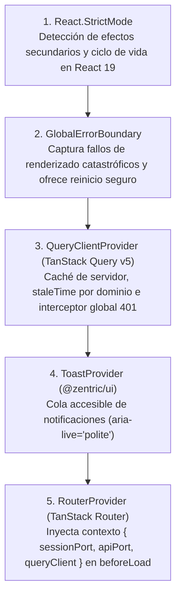

# Arquitectura C4 — Nivel 4: Patrones de Montaje React 19, Árbol de Rutas y Compuertas QA (Frontend SDD)

> **Propósito:** Definir la especificación de nivel de código (C4 Nivel 4) para el ensamblaje de proveedores en React 19 (`main.tsx`), el árbol de rutas tipado en TanStack Router con carga perezosa (`lazy`), la máquina de estados visuales de componentes, las invariantes tipográficas y de tokens de **`hyperframes-creative`**, y las compuertas verificables de calidad del agente `13-frontend-qa-guardian`.

---

## 1. Jerarquía de Montaje de Proveedores (`apps/frontend/src/main.tsx`)

El punto de entrada de la SPA ensambla los proveedores transversales en el siguiente orden determinista de anidamiento (de exterior a interior):

### 1.1 Contrato de Contexto Inyectado al Enrutador (`RouterContext`)
El `RouterProvider` recibe un objeto de contexto inmutable con tres dependencias obligatorias:
- **`sessionPort` (`SessionPort`):** Permite a cada guarda `beforeLoad` consultar síncronamente la sesión activa (`getSession()`) y verificar `expiresAtUtc` sin realizar llamadas de red adicionales.
- **`apiPort` (`ZentricApiPort`):** Permite precargar datos críticos en el `loader` de una ruta cuando sea necesario.
- **`queryClient` (`QueryClient`):** Permite invalidar o hidratar claves de caché (`queryClient.ensureQueryData`) durante las transiciones de ruta.

---

## 2. Especificación del Árbol de Rutas y Guardas `beforeLoad` (`apps/frontend/src/app/router/`)

Todas las rutas se definen con identificadores en inglés, aplicando división de código (`React.lazy` / `createLazyFileRoute`) por módulo de rol para que el bundle inicial de un comprador nunca descargue el código de administración o logística:

| Ruta en TanStack Router | Archivo de Ruta (`src/app/router/routes/`) | Shell Contenedor | Condición de Guarda `beforeLoad` | Redirección en Caso de Fallo |
|---|---|---|---|---|
| `/` | `index.tsx` | Ninguno | Evalúa `sessionPort.getSession()` | Si no hay sesión $\rightarrow$ `/login`; si hay sesión $\rightarrow$ ruta home del `role` |
| `/login` | `login.tsx` | `AuthShell` | Si `sessionPort.getSession() !== null` | Redirige a la ruta home del `role` activo |
| `/register` | `register.tsx` | `AuthShell` | Si `sessionPort.getSession() !== null` | Redirige a la ruta home del `role` activo |
| `/health` | `health.tsx` | `AuthShell` | Público (`AllowAnonymous`) | N/A |
| `/buyer/*` | `buyer/*.tsx` (`6 rutas`) | `BuyerShell` | Exige `role === 'Buyer' \|\| role === 'Administrator'` | Sin sesión $\rightarrow$ `/login`; rol distinto $\rightarrow$ home de su propio rol |
| `/seller/*` | `seller/*.tsx` (`5 rutas`) | `SellerShell` | Exige `role === 'Seller' \|\| role === 'Administrator'` | Sin sesión $\rightarrow$ `/login`; rol distinto $\rightarrow$ home de su propio rol |
| `/admin/*` | `admin/*.tsx` (`4 rutas`) | `AdminShell` | Exige `role === 'Administrator'` | Sin sesión $\rightarrow$ `/login`; rol distinto $\rightarrow$ home de su propio rol |
| `/logistics/*` | `logistics/*.tsx` (`4 rutas`) | `LogisticsShell` | Exige `role === 'LogisticsOperator' \|\| role === 'Administrator'` | Sin sesión $\rightarrow$ `/login`; rol distinto $\rightarrow$ home de su propio rol |
| `/supervisor/*` | `supervisor/*.tsx` (`5 rutas`) | `SupervisorShell` | Exige `role === 'Supervisor' \|\| role === 'Administrator'` | Sin sesión $\rightarrow$ `/login`; rol distinto $\rightarrow$ home de su propio rol |

---

## 3. Reglas de Implementación de Componentes React 19 y Doctrina `hyperframes-creative`

### 3.1 Separación Contenedor / Presentación y Prohibición de `fetch` Directo
1. **Componentes de Vista (`src/modules/<role>/*Page.tsx`):**
   - Orquestan los hooks de `src/application/hooks/*`, las reglas puras de `src/domain/rules/*` y los esquemas de `src/application/validation/*`.
   - Implementan obligatoriamente los 4 estados visuales (`Loading`, `Empty`, `Error`, `Populated`).
2. **Componentes del Design System (`packages/ui/src/primitives/*` y `composite/*`):**
   - Son componentes puros de interfaz; reciben datos y callbacks por props tipadas y nunca importan hooks de TanStack Query ni `SessionPort`.

### 3.2 Invariantes CSS y OpenType Obligatorias (`hyperframes-creative`)
Todo componente numérico, financiero, de inventario o temporal debe aplicar las siguientes reglas de estilo verificables en el DOM:

| Categoría de Dato en Pantalla | Fuente Requerida | Reglas CSS / OpenType Obligatorias | Alineación en Tablas (`DataTable`) |
|---|---|---|---|
| **Importes Monetarios (`GrossAmount`, `CommissionAmount`, `NetVendorAmount`, `Price`)** | `Geist Mono` (`--font-mono`) | `font-variant-numeric: tabular-nums; font-feature-settings: "tnum" 1, "zero" 1;` | Derecha (`text-right`) |
| **Cantidades de Stock (`AvailableQuantity`, `ReservedQuantity`, `UsedQuantity`)** | `Geist Mono` (`--font-mono`) | `font-variant-numeric: tabular-nums;` | Derecha (`text-right`) |
| **Identificadores Técnicos (`SKU`, `TrackingNumber`, `Guid` truncado, `Error.Code`)** | `Geist Mono` (`--font-mono`) | `font-variant-ligatures: none;` | Izquierda (`text-left`) |
| **Reloj de Reserva de 15 Minutos (`CheckoutCountdown`) y Sesión de 30 Minutos** | `Geist Mono` (`--font-mono`) | `font-variant-numeric: tabular-nums; letter-spacing: 0.04em;` | Derecha en Topbar / Banner |
| **Encabezados de Columna (`<th>`) y Kicker Labels de `StatCard`** | `Geist Sans` (`--font-sans`) | `font-size: 0.75rem; font-weight: 600; text-transform: uppercase; letter-spacing: 0.08em; color: #94A3B8;` | Coincidente con la celda (`left` o `right`) |

---

## 4. Especificación de Pruebas y Compuerta de Calidad (`13-frontend-qa-guardian`)

El agente `13-frontend-qa-guardian` ejecuta la verificación automatizada con **Vitest + React Testing Library + Happy-DOM** bajo poder de veto estricto (`QA: PASS` o `QA: FAIL`):

| Categoría de Prueba | Directorio / Alcance | Escenarios Mínimos Obligatorios a Verificar | Umbral de Aprobación |
|---|---|---|---|
| **1. Reglas de Dominio y Diccionario (`domainLabels.ts` + `domain/rules/`)** | `packages/ui/src/__tests__/` y `apps/frontend/src/domain/__tests__/` | Traducción exhaustiva de los **11 enums de C#**; evaluación de bordes en `isOrderModifiable`, `isOrderPayable`, `isReturnAllowed` (día 29, 30 y 31), `isReturnApprovable` e invariante `verifyInvoiceSplitInvariant`. | **100%** de cobertura de líneas y ramas |
| **2. Esquemas Zod y Adaptadores (`application/` + `adapters/`)** | `apps/frontend/src/application/__tests__/` y `src/adapters/__tests__/` | Validación positiva y negativa de los **12 esquemas Zod** (incluyendo bloqueo de roles internos en `RegisterUserSchema` y `WarehouseType: 'Marketplace' \| 'Vendor'`); serialización de errores RFC 7807 y limpieza de `SessionPort` ante `401 Unauthorized`. | $\ge 90\%$ de cobertura de líneas y ramas |
| **3. Primitivas y Compuestos UI (`@zentric/ui`)** | `packages/ui/src/__tests__/` | Navegación por teclado (`Tab`, `Enter`, `Escape`), roles WAI-ARIA (`dialog`, `alertdialog`, `status`), alineación numérica `tabular-nums` en `DataTable` y temporizador `CheckoutCountdown` ($\Delta t > 180\text{s}$, $\le 180\text{s}$ y $\le 0\text{s}$). | $\ge 90\%$ de cobertura de líneas y ramas |
| **4. Guardas de Ruta y Vistas por Rol (`app/` + `modules/`)** | `apps/frontend/src/modules/__tests__/` | Redirección de usuarios no autenticados a `/login`, aislamiento RBAC de las **27 rutas**, bloqueo de `/api/users` para `Supervisor`, uso de `canBeSold` en `BuyerProductDetailPage` y transición completa de los 4 estados (`Loading`, `Empty`, `Error`, `Populated`). | $\ge 90\%$ de cobertura global, `0` errores TypeScript y `0` warnings ESLint |
