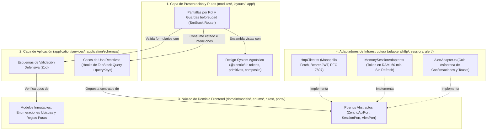

# Arquitectura Hexagonal y Mapa de Modelos del Frontend (Frontend Architecture)

> Especificación arquitectónica del cliente web de **Zentric Marketplace** (`frontend/`).  
> Establece los límites de la Arquitectura Hexagonal en el cliente, el flujo unidireccional de dependencias entre paquetes del monorepo, la matriz anti-amnesia de modelos y DTOs con procedencia exacta del backend C# (`.NET 10`) y los contratos de los puertos de salida (`ZentricApiPort`, `SessionPort`, `AlertPort`).

---

## 1. Principio Rector: Arquitectura Hexagonal en el Cliente

El frontend replica la **regla de dependencia unidireccional hacia el centro** definida en [`backendSDD/02-software-architecture.md`](../backendSDD/02-software-architecture.md). Los detalles tecnológicos (transporte HTTP, almacenamiento volátil en memoria RAM, renderizado de modales) residen en la periferia como adaptadores, mientras que el núcleo de dominio del cliente permanece libre de librerías de interfaz o clientes de red:



---

## 2. Reglas de Dependencia Inviolables por Capa

| Capa / Paquete | Ubicación Física | Dependencias Permitidas | Dependencias Estrictamente Prohibidas |
|---|---|---|---|
| **`packages/config`** | `frontend/packages/config/` | Ninguna (configuración base de TypeScript y ESLint) | Cualquier paquete de aplicación o librería de runtime. |
| **`packages/ui`** | `frontend/packages/ui/src/` | `tokens/`, primitivas accesibles de Radix UI, TanStack Table, Lucide Icons | Importar de `apps/frontend`, conocer endpoints `/api/*`, leer tokens JWT o lógica de dominio. |
| **`domain/`** | `frontend/apps/frontend/src/domain/` | Ninguna dependencia externa (TypeScript puro) | React, TanStack Query, `fetch`, `axios`, `window`, `localStorage`, `sessionStorage`. |
| **`application/`** | `frontend/apps/frontend/src/application/` | `domain/`, TanStack Query, Zod | Invocar `fetch()` directamente, construir URLs `/api/...`, importar vistas de `modules/`. |
| **`adapters/`** | `frontend/apps/frontend/src/adapters/` | `domain/`, `application/` (tipos DTO) | Componentes JSX de React, hojas de estilo o vistas de `modules/`. |
| **`components/` y `layouts/`** | `frontend/apps/frontend/src/components/`, `layouts/` | `packages/ui`, `domain/enums/`, `application/` | Llamadas directas a `fetch()` o manipulación directa del token fuera de `useAuth`. |
| **`modules/`** | `frontend/apps/frontend/src/modules/` | `packages/ui`, `components/`, `application/`, `domain/` | Invocar `fetch()`, instanciar `HttpClient` manualmente o leer `MemorySessionAdapter` sin pasar por `AuthProvider`. |
| **`app/` (Composition Root)** | `frontend/apps/frontend/src/app/` | Todas las capas anteriores (ensambla DI, Router y Providers) | Lógica de negocio incrustada fuera de los casos de uso. |

---

## 3. Topología Física del Monorepo (Turborepo + pnpm)

```text
frontend/
├── apps/
│   └── frontend/                          # Aplicación SPA Cliente (Vite + React 19 + TypeScript)
│       ├── index.html
│       ├── src/
│       │   ├── app/                       # Composition Root (Agente 10)
│       │   │   ├── routes/                # Árbol de rutas tipadas y guardas beforeLoad
│       │   │   └── providers/             # AppQueryClientProvider, AuthProvider, ServiceContainer
│       │   ├── domain/                    # Dominio Puro del Cliente (Agente 09)
│       │   │   ├── models/                # 21 modelos y DTOs inmutables sincronizados con C#
│       │   │   ├── enums/                 # 11 enumeraciones canónicas (serialización por nombre)
│       │   │   ├── rules/                 # Reglas puras de presentación (isOrderModifiable, isReturnAllowed)
│       │   │   └── ports/                 # ZentricApiPort (45 métodos), SessionPort, AlertPort
│       │   ├── application/               # Casos de Uso y Validación en Cliente (Agente 09)
│       │   │   ├── services/              # Hooks de TanStack Query en inglés + fábrica queryKeys.ts
│       │   │   └── schemas/               # Esquemas Zod sincronizados con FluentValidation
│       │   ├── adapters/                  # Adaptadores de Infraestructura (Agente 09)
│       │   │   ├── http/                  # HttpClient.ts (monopolio de red y traductor RFC 7807)
│       │   │   ├── session/               # MemorySessionAdapter.ts (sesión volátil en RAM)
│       │   │   ├── alert/                 # AlertAdapter.ts (cola de diálogos y notificaciones)
│       │   │   └── mocks/                 # Adaptadores deterministas en memoria para pruebas Vitest
│       │   ├── components/                # Puente de Presentación (domainLabels.ts, AlertHost.tsx)
│       │   ├── layouts/                   # RootLayout,AuthLayout, ConsoleLayout, navigation.ts (Agente 10)
│       │   └── modules/                   # Vistas por Rol en Inglés: auth, buyer, seller, admin, logistics, supervisor (Agente 11)
│       ├── package.json
│       └── vite.config.ts
├── packages/
│   ├── ui/                                # Sistema de Diseño Agnóstico
│   │   └── src/
│   │       ├── styles/theme.css           # Directiva @theme de Tailwind CSS v4 (Agente 07)
│   │       ├── tokens/                    # colors.ts, typography.ts, spacing.ts (Agente 07)
│   │       ├── primitives/                # Button, Input, Select, Badge, Skeleton, Card, Dialog (Agente 07)
│   │       ├── composite/                 # DataTable, ResponsiveDrawer, ModalDialog, StatCard, OrderTimeline, StatusBadge, MoneyAmount, StateView (Agente 08)
│   │       └── logo/                      # LogoMark, LogoWordmark, Logo en SVG nativo (Agente 07)
│   └── config/                            # Presets compartidos de TypeScript y ESLint
├── turbo.json
├── pnpm-workspace.yaml
└── package.json
```

---

## 4. Matriz Anti-Amnesia de Modelos y DTOs del Dominio Frontend (`domain/models/`)

En cumplimiento de la regla de trazabilidad SDD, cada interfaz de datos en `apps/frontend/src/domain/models/` se deriva 1:1 de los contratos C# de `Zentric.Application` y `Zentric.Api` sin omitir ni renombrar campos:

| ID Modelo | Interfaz en `domain/models/` | Procedencia Exacta en Backend C# (`archivo:línea`) | Estructura Exacta de Campos (JSON CamelCase) | Endpoints Asociados |
|---|---|---|---|---|
| **`E-FE-001`** | `HealthStatus` | [`Program.cs:281-293`](../backend/Zentric.Api/Program.cs#L281-L293) | `status: 'healthy' \| 'degraded' \| 'unhealthy'`, `database: 'up' \| 'down'`, `timestamp?: string`, `error?: string` | `GET /health` |
| **`E-FE-002`** | `AuthToken` | [`LoginCommand.cs:1277-1283`](../backend/Zentric.Application/Users/Commands/LoginCommand.cs#L1277-L1283) | `token: string`, `expiresAt: string`, `userId: string`, `email: string`, `fullName: string`, `role: UserRole` | `POST /api/auth/login` |
| **`E-FE-003`** | `CurrentUser` | [`AuthController.cs:101`](../backend/Zentric.Api/Controllers/AuthController.cs#L101) | `userId: string`, `email: string`, `fullName: string`, `role: UserRole` | `GET /api/auth/me` |
| **`E-FE-004`** | `User` | [`GetUsersQuery.cs:1308`](../backend/Zentric.Application/Users/Queries/GetUsersQuery.cs#L1308) | `id: string`, `name: string`, `email: string`, `role: UserRole`, `identityDocument: string`, `isActive: boolean`, `createdAt: string` | `GET /api/users`, `GET /api/users/{id}` |
| **`E-FE-005`** | `Warehouse` | [`GetWarehousesQuery.cs:1399`](../backend/Zentric.Application/Warehouses/Queries/GetWarehousesQuery.cs#L1399) | `id: string`, `name: string`, `location: string`, `capacity: number`, `type: WarehouseType`, `vendorId: string \| null`, `isActive: boolean`, `createdAt: string` | `GET /api/warehouses`, `GET /api/warehouses/{id}` |
| **`E-FE-006`** | `Inventory` | [`GetInventoryByVariantQuery.cs:459-466`](../backend/Zentric.Application/Inventories/Queries/GetInventoryByVariantQuery.cs#L459-L466) | `id: string`, `variantId: string`, `warehouseId: string`, `availableQuantity: number`, `reservedQuantity: number`, `usedQuantity: number`, `damagedQuantity: number` | `GET /api/inventories`, `GET /api/inventories/{variantId}` |
| **`E-FE-007`** | `AdjustInventoryResult` | [`AdjustInventoryCommand.cs:33-40`](../backend/Zentric.Application/Inventories/Commands/AdjustInventoryCommand.cs#L33-L40) | `adjustmentId: string`, `inventoryId: string`, `previousAvailableQuantity: number`, `newAvailableQuantity: number`, `adjustedQuantity: number`, `reason: string`, `countedAt: string` | `POST /api/inventories/{id}/adjust` |
| **`E-FE-008`** | `ProductVariant` | [`GetProductsQuery.cs:227`](../backend/Zentric.Application/Catalog/Queries/GetProductsQuery.cs#L227) | `id: string`, `sku: string`, `canBeSold: boolean` | Anidado en `Product` |
| **`E-FE-009`** | `CreatedProduct` | [`CreateProductCommand.cs:32`](../backend/Zentric.Application/Catalog/Commands/CreateProductCommand.cs#L32) | `productId: string`, `variantIds: string[]` | `POST /api/catalog/products` |
| **`E-FE-010`** | `Product` | [`GetProductsQuery.cs:229-239`](../backend/Zentric.Application/Catalog/Queries/GetProductsQuery.cs#L229-L239) | `id: string`, `name: string`, `description: string`, `price: number`, `currency: string`, `vendorId: string`, `type: ProductType`, `status: ProductStatus`, `variants: ProductVariant[]`, `createdAt: string` | `GET /api/catalog/products`, `GET /api/catalog/products/paged`, `GET /api/catalog/products/{id}` |
| **`E-FE-011`** | `PagedResult<T>` | [`PagedResult.cs:330-336`](../backend/Zentric.Application/Common/Models/PagedResult.cs#L330-L336) | `items: T[]`, `page: number`, `size: number`, `totalItems: number`, `totalPages: number` | `GET /api/catalog/products/paged` |
| **`E-FE-012`** | `OrderItem` | [`GetOrderByIdQuery.cs:831`](../backend/Zentric.Application/Orders/Queries/GetOrderByIdQuery.cs#L831) | `id: string`, `variantId: string`, `quantity: number`, `unitPrice: number`, `totalPrice: number` | Anidado en `Order`, `SellerOrderView`, `OrderListItem` |
| **`E-FE-013`** | `Order` | [`GetOrderByIdQuery.cs:833-840`](../backend/Zentric.Application/Orders/Queries/GetOrderByIdQuery.cs#L833-L840) | `id: string`, `buyerId: string`, `status: OrderStatus`, `totalAmount: number`, `currency: string`, `items: OrderItem[]`, `createdAt: string` | `GET /api/orders/{id}` (Comprador, Admin, Operador, Supervisor) |
| **`E-FE-014`** | `SellerOrderView` | [`GetOrderByIdForSellerQuery.cs:812-818`](../backend/Zentric.Application/Orders/Queries/GetOrderByIdForSellerQuery.cs#L812-L818) | `id: string`, `status: OrderStatus`, `currency: string`, `items: OrderItem[]`, `vendorSubtotal: number`, `createdAt: string` | `GET /api/orders/{id}` (Vendedor) |
| **`E-FE-015`** | `OrderListItem` | [`GetOrdersQuery.cs:879-887`](../backend/Zentric.Application/Orders/Queries/GetOrdersQuery.cs#L879-L887) | `id: string`, `status: OrderStatus`, `currency: string`, `totalAmount: number`, `items: OrderItem[]`, `itemCount: number`, `buyerId: string \| null`, `createdAt: string` | `GET /api/orders` |
| **`E-FE-016`** | `Shipment` | [`GetFulfillmentByIdQuery.cs:626`](../backend/Zentric.Application/Logistics/Queries/GetFulfillmentByIdQuery.cs#L626) | `id: string`, `warehouseId: string`, `trackingNumber: string` | Anidado en `FulfillmentOrder` |
| **`E-FE-017`** | `FulfillmentOrder` | [`GetFulfillmentByIdQuery.cs:628-635`](../backend/Zentric.Application/Logistics/Queries/GetFulfillmentByIdQuery.cs#L628-L635) | `id: string`, `customerOrderId: string`, `vendorId: string`, `status: FulfillmentStatus`, `cancellationReason: string \| null`, `shipments: Shipment[]`, `createdAt: string` | `GET /api/logistics/fulfillments`, `GET /api/logistics/fulfillment/{id}` |
| **`E-FE-018`** | `ReturnRequest` | [`GetReturnByIdQuery.cs:1105-1114`](../backend/Zentric.Application/Returns/Queries/GetReturnByIdQuery.cs#L1105-L1114) | `id: string`, `customerOrderId: string`, `variantId: string`, `warehouseId: string`, `quantity: number`, `status: ReturnStatus`, `isGoodCondition: boolean`, `vendorApproved: boolean`, `createdAt: string` | `GET /api/returns`, `GET /api/returns/{id}` |
| **`E-FE-019`** | `Invoice` | [`GetInvoicesByOrderQuery.cs:52-59`](../backend/Zentric.Application/Billing/Queries/GetInvoicesByOrderQuery.cs#L52-L59) | `id: string`, `customerOrderId: string`, `vendorId: string \| null`, `type: InvoiceType`, `totalAmount: number`, `currency: string`, `issuedAt: string` | `GET /api/billing/invoices`, `GET /api/billing/invoices/order/{orderId}` |
| **`E-FE-020`** | `ApiProblemDetails` | [`ProblemDetailsOutputFormatter.cs`](../backend/Zentric.Api/Contracts/ProblemDetailsOutputFormatter.cs) (RFC 7807) | `type?: string`, `title: string`, `status: number`, `detail: string`, `instance?: string`, `traceId?: string`, `errors?: Record<string, string[]>` | Cualquier respuesta de error `4xx` / `5xx` |

---

## 5. Especificación Contractual de los Puertos de Dominio (`domain/ports/`)

### 5.1 Puerto de Red Unificado: `ZentricApiPort` (45 Métodos)
Define las 45 operaciones remotas (44 endpoints de negocio + 1 sonda `/health`). Los objetos de entrada omiten `callerId`, `callerRole` y `buyerId` porque el backend los inyecta forzosamente desde el token JWT verificado ([ADR-0009](../backendSDD/Adr/0009-autenticacion-jwt-rg01.md) y [ADR-0013](../backendSDD/Adr/0013-propiedad-del-recurso-por-rol.md)):

| # | Módulo | Método en `ZentricApiPort` | Contrato de Entrada (Parámetros / Payload) | Tipo de Retorno |
|---|---|---|---|---|
| 1 | Salud | `getHealth()` | Sin parámetros | `Promise<HealthStatus>` |
| 2 | Auth | `login(input)` | `{ email: string, password: string }` | `Promise<AuthToken>` |
| 3 | Auth | `getCurrentUser()` | Sin parámetros (usa cabecera `Bearer`) | `Promise<CurrentUser>` |
| 4 | Usuarios | `createUser(input)` | `{ identityDocument: string, fullName: string, email: string, password: string, role: UserRole }` | `Promise<string>` (`Guid`) |
| 5 | Usuarios | `listUsers(role?)` | `role?: UserRole` | `Promise<User[]>` |
| 6 | Usuarios | `getUserById(id)` | `id: string` | `Promise<User>` |
| 7 | Usuarios | `blockUser(id)` | `id: string` | `Promise<void>` |
| 8 | Usuarios | `activateUser(id)` | `id: string` | `Promise<void>` |
| 9 | Bodegas | `createWarehouse(input)` | `{ name: string, location: string, capacity: number, type: WarehouseType, vendorId?: string \| null }` | `Promise<string>` (`Guid`) |
| 10 | Bodegas | `listWarehouses(vendorId?)` | `vendorId?: string` | `Promise<Warehouse[]>` |
| 11 | Bodegas | `getWarehouseById(id)` | `id: string` | `Promise<Warehouse>` |
| 12 | Inventario | `addStock(input)` | `{ variantId: string, warehouseId: string, quantity: number }` | `Promise<string>` (`Guid`) |
| 13 | Inventario | `listInventories()` | Sin parámetros | `Promise<Inventory[]>` |
| 14 | Inventario | `listInventoryByVariant(variantId)` | `variantId: string` | `Promise<Inventory[]>` |
| 15 | Inventario | `adjustInventory(id, input)` | `id: string`, `{ countedQuantity: number, reason: string }` | `Promise<AdjustInventoryResult>` |
| 16 | Catálogo | `createProduct(input)` | `{ name: string, description: string, priceAmount: number, priceCurrency: string, type: ProductType, variants?: Array<{ sku: string, attributes: Array<{ name: string, value: string }> }> }` | `Promise<CreatedProduct>` |
| 17 | Catálogo | `publishProduct(productId)` | `productId: string` | `Promise<void>` |
| 18 | Catálogo | `suspendProduct(productId)` | `productId: string` | `Promise<void>` |
| 19 | Catálogo | `listProducts(vendorId?)` | `vendorId?: string` | `Promise<Product[]>` |
| 20 | Catálogo | `listProductsPaged(params)` | `{ vendorId?: string, page?: number, size?: number }` | `Promise<PagedResult<Product>>` |
| 21 | Catálogo | `getProductById(id)` | `id: string` | `Promise<Product>` |
| 22 | Pedidos | `createCart()` | Sin parámetros (identidad desde token) | `Promise<string>` (`Guid`) |
| 23 | Pedidos | `addCartItem(input)` | `{ orderId: string, variantId: string, quantity: number }` | `Promise<void>` |
| 24 | Pedidos | `checkoutOrder(orderId)` | `orderId: string` | `Promise<void>` |
| 25 | Pedidos | `payOrder(orderId)` | `orderId: string` | `Promise<void>` |
| 26 | Pedidos | `listOrders(status?)` | `status?: OrderStatus` | `Promise<OrderListItem[]>` |
| 27 | Pedidos | `getOrderById(id)` | `id: string` | `Promise<Order \| SellerOrderView>` |
| 28 | Logística | `createFulfillment(input)` | `{ customerOrderId: string, vendorId: string }` | `Promise<string>` (`Guid`) |
| 29 | Logística | `packFulfillment(id)` | `id: string` | `Promise<void>` |
| 30 | Logística | `dispatchFulfillment(id)` | `id: string` | `Promise<void>` |
| 31 | Logística | `deliverFulfillment(id)` | `id: string` | `Promise<void>` |
| 32 | Logística | `cancelGhostStock(input)` | `{ fulfillmentOrderId: string, variantId: string, warehouseId: string, quantityToCancel: number }` | `Promise<boolean>` |
| 33 | Logística | `listFulfillments(status?)` | `status?: FulfillmentStatus` | `Promise<FulfillmentOrder[]>` |
| 34 | Logística | `getFulfillmentById(id)` | `id: string` | `Promise<FulfillmentOrder>` |
| 35 | Devoluciones | `requestReturn(input)` | `{ customerOrderId: string, variantId: string, warehouseId: string, quantity: number }` | `Promise<string>` (`Guid`) |
| 36 | Devoluciones | `inspectReturn(id, input)` | `id: string`, `{ isGoodCondition: boolean }` | `Promise<void>` |
| 37 | Devoluciones | `approveReturn(id)` | `id: string` (envía `{ returnRequestId: id }` en cuerpo JSON según `ReturnsController.cs:95-97`) | `Promise<void>` |
| 38 | Devoluciones | `rejectReturn(id)` | `id: string` | `Promise<void>` |
| 39 | Devoluciones | `refundReturn(id)` | `id: string` | `Promise<void>` |
| 40 | Devoluciones | `listReturns(status?)` | `status?: ReturnStatus` | `Promise<ReturnRequest[]>` |
| 41 | Devoluciones | `getReturnById(id)` | `id: string` | `Promise<ReturnRequest>` |
| 42 | Facturación | `generateInvoices(orderId)` | `orderId: string` | `Promise<boolean>` |
| 43 | Facturación | `annulInvoices(orderId, input)` | `orderId: string`, `{ reason: string }` | `Promise<void>` |
| 44 | Facturación | `listInvoices()` | Sin parámetros | `Promise<Invoice[]>` |
| 45 | Facturación | `getInvoicesByOrder(orderId)` | `orderId: string` | `Promise<Invoice[]>` |

### 5.2 Puerto de Sesión Volátil: `SessionPort`
Contrato que abstrae el ciclo de vida del token Bearer JWT exclusivamente en memoria RAM ([ADR-0009](../backendSDD/Adr/0009-autenticacion-jwt-rg01.md)):
- `getAccessToken(): string | null` y `setAccessToken(token: string): void`
- `getUser(): CurrentUser | null` y `setUser(user: CurrentUser): void`
- `clear(): void`: Purga instantáneamente la credencial en memoria sin tocar `localStorage` ni `sessionStorage`.

### 5.3 Puerto de Confirmaciones y Notificaciones: `AlertPort`
Contrato que desacopla la confirmación obligatoria de acciones críticas respecto a los componentes React:
- `confirm(options: { title: string; description: string; confirmLabel?: string; variant?: 'default' | 'destructive' }): Promise<boolean>`
- `show(notification: { title: string; description?: string; variant: 'info' | 'success' | 'warning' | 'danger' }): void`

---

## 6. Comportamiento Arquitectónico ante Códigos de Error HTTP (RFC 7807)

| Código HTTP | Diagnóstico Contractual | Reacción Obligatoria de la Arquitectura Cliente |
|---|---|---|
| **`400 Bad Request`** | Error de validación de entrada (`FluentValidation`) o violación de invariante de negocio. | Extrae `detail` y `errors` del Problem Details; los proyecta junto a los campos del formulario **conservando intactos los datos ingresados por el usuario**. |
| **`401 Unauthorized`** | Token ausente, firma inválida o ventana de 60 minutos expirada ([ADR-0009](../backendSDD/Adr/0009-autenticacion-jwt-rg01.md)). | Ejecuta `SessionPort.clear()`, limpia la caché de `QueryClient` y redirige forzosamente a `/login` con aviso de sesión expirada (*Fail-Closed*). |
| **`403 Forbidden`** | Rol autenticado sin permiso en las 21 políticas de autorización ([ADR-0011](../backendSDD/Adr/0011-matriz-autorizacion-por-rol.md)). | **Preserva la sesión activa en memoria** y despliega alerta o vista contextual de acceso restringido (`/_console/forbidden`). |
| **`404 Not Found`** | Recurso inexistente o propiedad de otro usuario ([ADR-0013](../backendSDD/Adr/0013-propiedad-del-recurso-por-rol.md)). | Renderiza `StateView` contextual de recurso no encontrado sin revelar si existe para otro titular. |
| **`500 / 503`** | Fallo técnico no controlado o base de datos no disponible. | Presenta `StateView` de contingencia con botón interactivo de reintento (`refetch`). |
