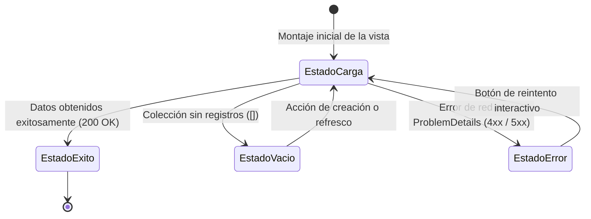

# Frontend-SDD — Documento Maestro y Gobernanza de Arquitectura Frontend

> **Fuente Única de Verdad (SSoT) para el Frontend de Zentric.**  
> El backend se especifica formalmente en [`../backendSDD/`](../backendSDD/) y su lógica de negocio es soberana. La Ley funcional indiscutible del producto reside en [`../ZENTRIC.md`](../ZENTRIC.md).  
> **Jerarquía de verdad inmutable:** Directrices del Owner → [`../AGENTS.md`](../AGENTS.md) → [`../ZENTRIC.md`](../ZENTRIC.md) (Ley) → Especificaciones SDD (`backendSDD/` y `frontendSDD/`) → Código fuente.

---

## 1. Principios Operativos y Reglas Universales de la Interfaz

Las siguientes directrices son de cumplimiento estricto e inviolable para cualquier agente o desarrollador que genere o modifique código en el frontend:

### 1.1 Reglas Derivadas del Contrato REST con la API de Zentric

1. **Inyección Dinámica de Bearer Token:** Todas las peticiones HTTP dirigidas a endpoints protegidos deben adjuntar la cabecera `Authorization: Bearer <token>`. El token se obtiene exclusivamente mediante `POST /api/auth/login` y posee una vigencia de 60 minutos calculada por el servidor (ADR-0009). La cabecera histórica forjable `X-Buyer-Id` ha sido completamente erradicada.
2. **Paginación Uniforme en Consultas Masivas:** Las colecciones voluminosas consumen el contrato estandarizado `PagedResult<T>` (ej. `GET /api/catalog/products/paged`) con parámetros de base cero `page` y tamaño `size` (por defecto 20, con límite superior estricto de 100 elementos).
3. **Manejo Indiferenciado de Recursos Inexistentes o Ajenos (ADR-0013):** Para prevenir la enumeración de identificadores de clientes por atacantes, la API responde con un idéntico `404 Not Found` tanto cuando un recurso no existe como cuando pertenece a otro usuario. La interfaz debe presentar un estado de "recurso no encontrado" sin filtrar si la causa fue inexistencia o falta de propiedad.
4. **Monopolio Absoluto de Red (`HttpClient.ts`):** Queda estrictamente prohibido invocar `fetch()` directamente desde componentes visuales, hooks o servicios de dominio. Toda comunicación transita por el singleton tipado `HttpClient.ts`, responsable de inyectar el Bearer token, traducir errores RFC 7807 y purgar la sesión de memoria ante respuestas `401 Unauthorized`.
5. **Normalización de Errores Problem Details (RFC 7807 / RFC 9457):** Los fallos de validación o violaciones de reglas de negocio se procesan a partir de la estructura estándar Problem Details, priorizando la extracción del campo `detail` para exhibirlo de forma comprensible al usuario final.

### 1.2 Reglas Derivadas de la Ley Funcional (`ZENTRIC.md`)

6. **Aislamiento Estricto entre Compradores:** Un comprador jamás debe visualizar información de pedidos, líneas o importes de otro comprador (Dominio 2).
7. **Prohibición de Devoluciones en Bienes Digitales:** Queda terminantemente prohibido habilitar la opción de solicitar devolución para productos de tipo digital (`ProductType == Digital`, Dominio 10). La interfaz no debe renderizar el botón de devolución en tales artículos.
8. **Reingreso Obligatorio como Mercancía Reacondicionada/Usada:** Tras la aprobación comercial de una devolución física, las unidades reingresadas a bodega deben catalogarse forzosamente con la etiqueta de stock usado o reacondicionado (`isUsed = true`, Dominio 10).
9. **Perfil de Auditoría y Consulta en Modo de Sólo Lectura:** El rol Supervisor de Auditoría (`Supervisor`) opera en modalidad de sólo lectura para seguimiento transversal de la plataforma; la interfaz no debe presentarle botones de acción mutativa (Dominio 1).
10. **Principio del Freno de Mano (Cero Asunciones):** Si se requiere una regla de negocio o interfaz no contemplada en la especificación, el agente debe detenerse y solicitar la definición explícita al Owner antes de codificar (`AGENTS.md` §0.3).

---

## 2. Decisiones de Arquitectura y Diseño Formalizadas

La siguiente matriz documenta las decisiones estructurales acordadas formalmente para el frontend de Zentric:

| Área Arquitectónica | Decisión Formalizada | Justificación Técnica y Fundamento de Negocio |
|---|---|---|
| **Posicionamiento del Sistema** | Consola Operativa y Sistema de Comercio | Herramienta profesional de alta densidad informativa para la gestión de marketplace multi-vendedor. |
| **Alcance Funcional de la Interfaz** | Portal Unificado con Vistas Especializadas por Rol | Una única aplicación web que adapta su interfaz según el rol autenticado: Vendedor, Comprador, Administrador, Operador Logístico y Supervisor. |
| **Dirección Estética Visual** | Doctrina Anti-IA Genérica (Inspiración Developer/Builder) | Fondo carbón azulado profundo (`#0A0E1A`), superficies tintadas (`#111827`), un único acento primario cian (`#00D4AA`) y alertas ámbar (`#FFB800`). Prohibidos gradientes multicolores y bordes chillones. |
| **Pila Tecnológica Base** | Vite + React 19 + TypeScript + Tailwind CSS v4 | Máximo rendimiento en compilación, tipado estricto de contratos y motor de estilos moderno basado en `@theme` en CSS. |
| **Librería de Componentes Primitivos** | shadcn/ui adaptado en `packages/ui` | Componentes atómicos sin dependencias opacas de terceros, bajo control total del repositorio. |
| **Identidad Visual y Logotipo** | Zentric Core (Z con Órbitas de Centro de Gravedad) | Isotipo vectorial en SVG nativo integrado en el encabezado de navegación. |
| **Tipografía Oficial** | Geist Sans (UI) + Geist Mono (Datos Numéricos y Tablas) | Geist Mono para monedas, SKUs, identificadores GUID y cantidades; Geist Sans para títulos y cuerpos de texto legibles. |
| **Gestión de Estado de Servidor** | TanStack Query v5 | Cache asíncrona, invalidación reactiva de consultas y desacoplamiento del ciclo de vida de los componentes. |
| **Estructura del Repositorio** | Monorepo con Turborepo + pnpm | `apps/frontend` (aplicación web) y `packages/ui` (tokens y componentes agnósticos). Prohibidas importaciones cíclicas. |
| **Enrutamiento Type-Safe** | TanStack Router con Guardas `beforeLoad` | Enrutamiento fuertemente tipado en tiempo de compilación con guardas de autorización por rol antes de hidratar los módulos. |
| **Gestión de Sesión ([ADR-0009](../backendSDD/Adr/0009-autenticacion-jwt-rg01.md))** | Sesión Volátil Exclusiva en Memoria RAM sin Token de Refresco | Máxima seguridad contra ataques XSS: el token Bearer nunca toca `localStorage` ni cookies legibles. Al expirar a los 60 min o recargar, se exige reautenticación. |
| **Validación de Formularios** | React Hook Form + Zod derivado de Contratos OpenAPI | Validación estructural inmediata en cliente sincronizada exactamente con los validadores FluentValidation del backend. |
| **Serialización de Enumeraciones ([ADR-0012](../backendSDD/Adr/0012-contrato-json-de-los-enum-por-nombre.md))** | Enumeraciones como Cadenas de Texto Estrictas | Cuerpos JSON de solicitud y respuesta utilizan nombres canónicos en string (ej. `"Seller"`, `"Physical"`, `"Paid"`). Prohibidos valores numéricos enteros. |
| **Aislamiento de Propiedad ([ADR-0013](../backendSDD/Adr/0013-propiedad-del-recurso-por-rol.md))** | Filtro Forzado en Servidor y 404 ante Intrusión | El servidor restringe las consultas a los recursos del llamante. El frontend no intenta filtrar colecciones masivas por su cuenta. |
| **Enmiendas de Roles ([ADR-0014](../backendSDD/Adr/0014-enmiendas-a-la-matriz-de-autorizacion.md))** | Cobertura Plena de 5 Roles de la Ley | Operador Logístico habilitado para reportar faltantes (*stock fantasma*); emisión de facturación asignada al Administrador; inclusión plena del Supervisor. |
| **Listados y Variantes ([ADR-0017](../backendSDD/Adr/0017-listados-de-recurso-propio.md))** | Endpoints de Colección por Rol y `CreatedProductDto` | Consumo directo de `GET /api/orders`, `GET /api/logistics/fulfillments`, `GET /api/returns`, `GET /api/billing/invoices` e `GET /api/inventories`, y retorno de `{ productId, variantIds }` en el alta de productos. |
| **Ajuste de Stock ([ADR-0021](../backendSDD/Adr/0021-ajuste-de-stock-sin-cuello-de-botella.md))** | Ajuste por Conteo Físico sin Contención Global | `POST /api/inventories/{id}/adjust` disponible para Administrador y Supervisor (`InventoryAdjust`). |

---

## 3. Estructura y Mapa de Especificaciones SDD del Frontend

El cuerpo de conocimiento y especificación arquitectónica del frontend de Zentric se organiza en los siguientes documentos especializados (con estado de orquestación unificado en [`../orchestrator-state.json`](../orchestrator-state.json)):

| Documento Canónico | Propósito Arquitectónico y Contenido Esencial |
|---|---|
| [`Frontend-SDD.md`](Frontend-SDD.md) | Documento maestro, principios de gobernanza, decisiones formalizadas y criterios de completitud (DoD). |
| [`Frontend-Architecture.md`](Frontend-Architecture.md) | Estructura del monorepo, capas de Arquitectura Hexagonal, reglas de dependencia estricta y los 45 métodos de `ZentricApiPort`. |
| [`Frontend-Design-System.md`](Frontend-Design-System.md) | Tokens semánticos en Tailwind v4, escala tipográfica, accesibilidad WAI-ARIA y separación `primitives/` vs `composite/`. |
| [`Frontend-Adapters.md`](Frontend-Adapters.md) | Monopolio de red, configuración de `HttpClient.ts`, inventario de los 45 endpoints y gestión de sesión en memoria. |
| [`Frontend-Domain-Services.md`](Frontend-Domain-Services.md) | Hooks de TanStack Query en inglés, factoría `queryKeys`, reglas de presentación y esquemas Zod derivados de contratos OpenAPI. |
| [`Frontend-Role-Modules.md`](Frontend-Role-Modules.md) | Definición exhaustiva de módulos y rutas en inglés para los 5 roles (`/buyer/*`, `/seller/*`, `/admin/*`, `/logistics/*`, `/supervisor/*`) y guardas TanStack Router. |
| [`Frontend-User-Flows.md`](Frontend-User-Flows.md) | Recorridos observables de usuario: checkout atómico de 15 minutos, stock fantasma, ciclo logístico y garantías. |
| [`Contract-alignment.md`](Contract-alignment.md) | Auditoría de congruencia y paridad contractual contra los 45 endpoints y 21 políticas del backend de .NET 10. |
| [`C4-1-Contexto.md`](C4-1-Contexto.md) | Diagrama C4 Nivel 1: Actores del ecosistema, dependencias externas y límites del sistema. |
| [`C4-2-Contenedores.md`](C4-2-Contenedores.md) | Diagrama C4 Nivel 2: Monorepo, SPA, servidor Nginx, API REST y base de datos PostgreSQL. |
| [`C4-3-Componentes.md`](C4-3-Componentes.md) | Diagrama C4 Nivel 3: Paquetes `@zentric/ui`, hooks de aplicación, adaptadores y enrutamiento por rol. |
| [`C4-4-Codigo-React.md`](C4-4-Codigo-React.md) | Diagrama C4 Nivel 4: Árbol de archivos TypeScript, hooks de TanStack Query y componentes React. |
| [`../orchestrator-state.json`](../orchestrator-state.json) | Máquina de estados unificada (DAG) que gobierna las oleadas de ejecución de los 13 agentes especializados. |

---

## 4. Política Estricta de Sesión y Seguridad en Memoria RAM ([ADR-0009](../backendSDD/Adr/0009-autenticacion-jwt-rg01.md))

En estricta congruencia con el backend de Zentric, que no implementa tokens de refresco:

1. **Almacenamiento Exclusivo en Memoria:** El token Bearer JWT reside exclusivamente en una variable privada en memoria RAM gestionada por el singleton `MemorySessionAdapter.ts`.
2. **Prohibición de Web Storage:** Queda terminantemente prohibido escribir tokens de sesión en `localStorage`, `sessionStorage` o cookies accesibles por JavaScript, eliminando vectores de ataque por robo de credenciales mediante XSS.
3. **Comportamiento Fail-Closed ante Expiración (401):** Cuando la API rechaza una petición con código `401 Unauthorized` (por caducidad de la ventana de 60 minutos o alteración criptográfica), el adaptador HTTP purga inmediatamente la memoria y redirige al usuario a `/login` notificando que la sesión ha expirado.
4. **Comportamiento ante Denegación de Permisos (403):** Una respuesta `403 Forbidden` mantiene la sesión activa en memoria y presenta una notificación informativa sobre facultades operativas insuficientes.
5. **Recarga del Navegador:** Al recargar la página (`F5`), el estado en memoria se vacía naturalmente y el usuario debe ingresar nuevamente sus credenciales de acceso.

---

## 5. Estados Obligatorios de Interfaz en Cada Pantalla

Para garantizar una experiencia visual profesional sin pantallas vacías ni bloqueos inesperados, toda vista debe implementar explícitamente cuatro estados funcionales:



- **Estado de Carga (`LoadingState`):** Componentes `Skeleton` que simulan la forma visual de las tarjetas o filas de datos.
- **Estado de Éxito (`SuccessState`):** Datos renderizados con componentes del Design System (`Table`, `Card`, `Badge`).
- **Estado Vacío (`EmptyState`):** Ilustración sobria, mensaje orientativo y botón con la acción principal sugerida.
- **Estado de Error (`ErrorState`):** Alerta visual con el mensaje de negocio devuelto por el servidor y botón de reintento.

---

## 6. Comandos Operativos del Monorepo

```bash
# Instalación limpia de dependencias en el monorepo
pnpm install

# Compilación de todos los paquetes y aplicaciones mediante Turborepo
pnpm build

# Verificación estricta de tipado TypeScript sin emitir código
pnpm typecheck

# Ejecución de la suite completa de pruebas unitarias y de integración
pnpm test

# Análisis estático de código con ESLint
pnpm lint

# Construcción y verificación de la imagen de producción en Docker
docker compose build frontend
```

---

## 7. Criterios de Aceptación y Definición de Terminado (DoD)

- [x] **Gobernanza y Especificaciones SDD:** Los 13 entregables de la Oleada 0 están plenamente alineados y elevados a máxima pureza SDD, sin acrónimos crípticos y con citación rigurosa de los 25 ADRs.
- [x] **Inventario Contractual Completo:** Los 45 endpoints publicados por la API central están completamente mapeados en el adaptador HTTP y los puertos del frontend.
- [x] **Segregación de 5 Roles de la Ley:** Vistas, módulos y guardas de acceso diferenciadas para Comprador, Vendedor, Operador Logístico, Administrador y Supervisor de Auditoría.
- [x] **Seguridad Fail-Closed en Memoria:** Sesión volátil en memoria RAM sin tokens de refresco y purga inmediata ante códigos `401`.
- [x] **Doctrina Visual Anti-IA Genérica:** Tokens semánticos en `@theme` de Tailwind v4, tipografía Geist y neutros tintados de alto contraste.
- [x] **Verificación Integral y Cobertura:** Suites de prueba unitarias, de integración y arquitectónicas preparadas para compuerta de calidad de >= 90%.
