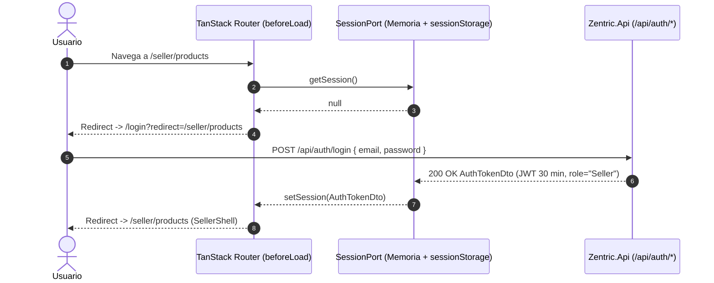
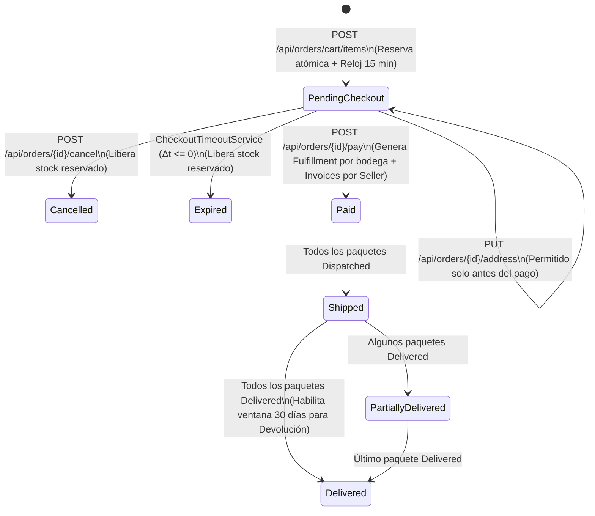
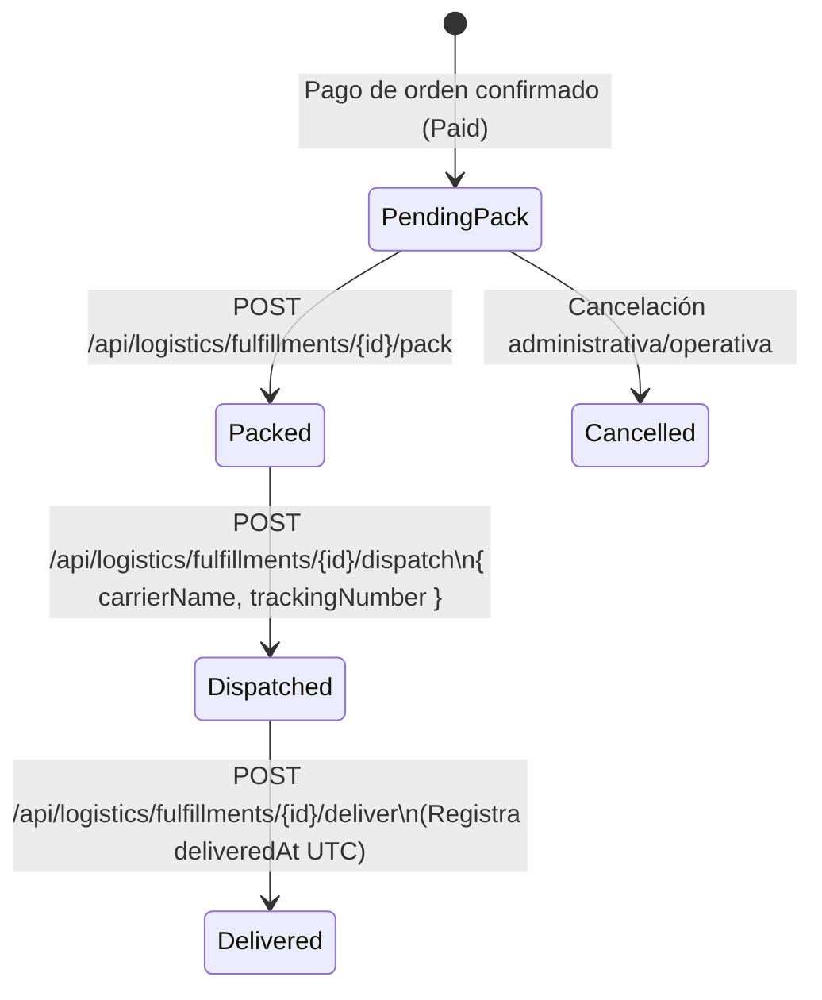
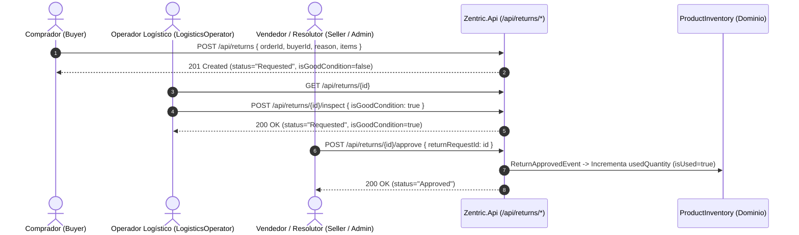

# Flujos de Usuario y Comportamiento Operativo End-to-End (Frontend SDD)

> **Propósito:** Definir la especificación formal de los flujos de usuario end-to-end del frontend de Zentric, modelando las transiciones de estado deterministas, las secuencias de llamadas HTTP verificadas contra los controladores de `Zentric.Api`, las invariantes del reloj de reserva atómica de 15 minutos, la orquestación de stock usado e inspección de devoluciones, y las máquinas de estados visuales (`Loading`, `Empty`, `Error`, `Populated`) bajo la arquitectura de composición **`hyperframes-creative`**.

---

## 1. Flujo 1: Autenticación, Registro y Restauración de Sesión (ADR-0009 y ADR-0022)

### 1.1 Secuencia Operativa y Transición de Estados
1. **Acceso a Ruta Protegida sin Sesión:**
   - **WHEN** un visitante no autenticado intenta acceder a cualquier ruta bajo `/buyer/*`, `/seller/*`, `/admin/*`, `/logistics/*` o `/supervisor/*`, **THE SYSTEM SHALL** interceptar la navegación en el hook `beforeLoad` de TanStack Router, verificar `SessionPort.getSession() === null` y redirigir inmediatamente a `/login?redirect=<ruta_original>`.
2. **Inicio de Sesión (`POST /api/auth/login` — `AuthController.cs:34`):**
   - El formulario en `/login` valida localmente con `LoginSchema` (`email` RFC 5322, `password` no vacío).
   - **WHEN** el backend responde `200 OK` con `AuthTokenDto` (`{ accessToken, expiresAtUtc, userId, email, role }`, `LoginQuery.cs:20-26`), **THE SYSTEM SHALL**:
     1. Almacenar la sesión en `SessionPort` (memoria volátil JS + respaldo en `sessionStorage` para resistir recargas `F5` en la misma pestaña, sin persistir jamás en `localStorage` ni usar cookies o endpoints de refresh token conforme a [ADR-0009](../backendSDD/ADR/ADR-0009-authentication-jwt-session-expiry.md)).
     2. Redirigir a la ruta indicada en `redirect` (si pertenece al rol autenticado) o a la ruta home predeterminada del rol (`/buyer/catalog`, `/seller/products`, `/admin/finance`, `/logistics/fulfillment` o `/supervisor/orders`).
3. **Registro Público Acotado (`POST /api/auth/register` — `AuthController.cs:48`):**
   - El formulario en `/register` ofrece exclusivamente un selector segmentado con dos roles públicos (`Buyer` — `"Comprador"` y `Seller` — `"Vendedor"`).
   - **IF** se intentara enviar un rol interno (`Administrator`, `LogisticsOperator`, `Supervisor`), **THE SYSTEM SHALL** bloquear el envío en el cliente mediante `RegisterUserSchema` (`z.enum(['Buyer', 'Seller'])`) en cumplimiento de [ADR-0022](../backendSDD/ADR/ADR-0022-public-registration-and-admin-provisioning.md).
4. **Expiración de Sesión a los 30 Minutos (`401 Unauthorized`):**
   - **WHEN** una petición autenticada recibe `401 Unauthorized` (por expiración del JWT a los 30 minutos o firma inválida), **THE SYSTEM SHALL** ejecutar `SessionPort.clearSession()`, limpiar la caché privada de TanStack Query (`queryClient.clear()`) y redirigir a `/login` mostrando un banner ámbar (`#FFB800`) con el mensaje `"Tu sesión de 30 minutos ha expirado por seguridad. Inicia sesión nuevamente."`.

---

## 2. Flujo 2: Compra, Reserva Atómica de 15 Minutos y Checkout (Comprador — ADR-0011)

### 2.1 Reglas Operativas del Ciclo de Compra (`OrdersController.cs` y `BuyersController.cs`)
1. **Exploración y Verificación de Disponibilidad (`/buyer/catalog` y `/buyer/products/$productId`):**
   - El comprador consulta `GET /api/catalog/products` (`CatalogController.cs:27`) y `GET /api/catalog/products/{id}` (`CatalogController.cs:36`).
   - La interfaz determina si una variante está disponible para compra leyendo exclusivamente `ProductVariantDto.canBeSold` (`GetProductByIdQuery.cs:19-26`), **nunca** invocando `GET /api/inventories/{variantId}` (restringido por la política `InventoryRead` a roles internos/vendedor).
2. **Reserva Atómica de Stock al Agregar al Carrito (`POST /api/orders/cart/items` — `OrdersController.cs:41`):**
   - **WHEN** el comprador selecciona una variante y cantidad y pulsa `"Agregar al carrito"`, **THE SYSTEM SHALL** enviar `{ buyerId, variantId, quantity, unitPrice }` (`AddItemToCartCommand.cs:20-25`).
   - En el backend, esta operación crea o actualiza el pedido en estado `PendingCheckout`, ejecuta la reserva atómica de inventario (`reservedQuantity`) y fija `checkoutExpiresAt` a **15 minutos en UTC** (`ZENTRIC.md Dominio 8`, [ADR-0011](../backendSDD/ADR/ADR-0011-cart-persistence-and-checkout-clock.md)).
3. **Temporizador de Cuenta Regresiva Determinista (`CheckoutCountdown`):**
   - En `/buyer/cart` y `/buyer/checkout/$orderId`, el componente `CheckoutCountdown` calcula $\Delta t = \text{ Date.parse(checkoutExpiresAt) } - \text{ Date.now() }$ en tipografía `Geist Mono` (`tabular-nums`):
     - $\Delta t > 180\text{ s}$: Superficie `#161F30` con texto `#F1F5F9`.
     - $0 < \Delta t \le 180\text{ s}$: Alerta ámbar `#FFB800` (`"Completa tu pago pronto para conservar la reserva de stock"`).
     - $\Delta t \le 0$: Estado vencido (`#F43F5E`), deshabilitación inmediata del botón `"Confirmar y pagar"` e invalidación automática de `['orders', orderId]`.
4. **Inmutabilidad Post-Pago y Ventana de Cancelación/Modificación:**
   - **WHILE** el pedido está en `PendingCheckout` y $\Delta t > 0$, el comprador puede modificar la dirección (`PUT /api/orders/{id}/address`, `OrdersController.cs:111`) o cancelar la orden (`POST /api/orders/{id}/cancel`, `OrdersController.cs:96`).
   - **WHEN** el comprador ejecuta `POST /api/orders/{id}/pay` (`OrdersController.cs:81`), el estado pasa a `Paid`, el backend genera las órdenes de empaque (`OrderFulfillment` por bodega) y emite las facturas split (`Invoice` por vendedor). A partir de ese instante, la UI oculta cualquier acción de edición de dirección o cancelación (`ZENTRIC.md Dominio 8`).

---

## 3. Flujo 3: Publicación de Catálogo y Abastecimiento de Stock Nuevo (Vendedor)

### 3.1 Secuencia Operativa (`/seller/products/new` y `/seller/inventory`)
1. **Alta de Producto con Variantes y Atributos (`POST /api/catalog/products` — `CatalogController.cs:54`):**
   - El vendedor completa los datos maestros (`name`, `description`, `category`, `brand`, `basePrice`) y añade al menos una variante en el constructor dinámico (`sku`, `price`, `attributes: [{ name, value }]`, `CreateProductCommand.cs:18-22`).
   - **WHEN** el vendedor envía el formulario y el backend responde `201 Created` con el `Guid` del nuevo producto, **THE SYSTEM SHALL** invalidar `['catalog', 'products']` y redirigir a `/seller/inventory` con el producto preseleccionado para su abastecimiento inicial.
2. **Ingreso de Stock Nuevo por Bodega (`POST /api/inventories/stock` — `InventoriesController.cs:62`):**
   - En `/seller/inventory`, el vendedor selecciona la variante (`variantId`), la bodega activa (`warehouseId` obtenido de `GET /api/logistics/warehouses`) y la cantidad entera positiva (`quantity > 0`), enviando `{ variantId, warehouseId, quantity }` (`AddStockCommand.cs:17-23`).
   - **Invariante de Separación Nuevo vs. Usado (`ZENTRIC.md Dominio 6`):** El endpoint `POST /api/inventories/stock` ingresa **exclusivamente stock nuevo** (`availableQuantity`). La columna `usedQuantity` (`isUsed = true`) **no** es editable manualmente por el vendedor al abastecer; solo se incrementa de forma automática en el backend cuando una devolución inspeccionada como apta es aprobada (`POST /api/returns/{id}/approve`).

---

## 4. Flujo 4: Logística Particionada por Bodega — Empaque, Despacho y Entrega (Operador Logístico)

### 4.1 Secuencia Operativa (`/logistics/fulfillment` y `/logistics/shipments`)
1. **Particionamiento Automático post-Pago (`ZENTRIC.md Dominio 9`):**
   - Un pedido `CustomerOrder` con ítems almacenados en $N$ bodegas físicas distintas genera $N$ registros `OrderFulfillment` independientes en estado inicial `PendingPack` (`FulfillmentStatus.cs:5`).
2. **Transiciones Estrictas de `OrderFulfillment` (`LogisticsController.cs:71-141`):**
   - El operador logístico consulta los paquetes de una orden (`GET /api/logistics/orders/{orderId}/fulfillments`) o por ID (`GET /api/logistics/fulfillments/{id}`).
   - La interfaz habilita únicamente el botón correspondiente a la siguiente transición válida de la máquina de estados:
     - **Estado `PendingPack` (`"Pendiente de empaque"`):** Habilita el botón primario `"Confirmar empaque"` (`POST /api/logistics/fulfillments/{id}/pack`, `LogisticsController.cs:96`), transicionando a `Packed`.
     - **Estado `Packed` (`"Empacado"`):** Habilita el formulario inline de despacho con `carrierName` y `trackingNumber` (`DispatchFulfillmentSchema`) que invoca `POST /api/logistics/fulfillments/{id}/dispatch` (`LogisticsController.cs:112`), transicionando a `Dispatched`.
     - **Estado `Dispatched` (`"Despachado"`):** En `/logistics/shipments`, habilita el botón `"Confirmar entrega en destino"` (`POST /api/logistics/fulfillments/{id}/deliver`, `LogisticsController.cs:128`), transicionando a `Delivered` y registrando `deliveredAt` en UTC.

---

## 5. Flujo 5: Devoluciones, Inspección Técnica y Reingreso de Stock Usado (Buyer $\rightarrow$ Logistics $\rightarrow$ Seller)

### 5.1 Secuencia Multi-Rol Determinista (`ReturnsController.cs:29-88`)
1. **Solicitud por el Comprador (`POST /api/returns` — `ReturnsController.cs:54`):**
   - En `/buyer/returns`, el comprador selecciona un pedido en estado `Delivered` cuya fecha de entrega esté dentro de la ventana de **30 días calendario** (`isReturnAllowed(order, nowUtc) === true`, `ZENTRIC.md Dominio 11`).
   - Envía `{ orderId, buyerId, reason, items: [{ variantId, warehouseId, quantity }] }` (`CreateReturnRequestCommand.cs:19-28`).
   - El backend crea el `ReturnRequest` con `status = "Requested"` e `isGoodCondition = false` por defecto (`GetReturnByIdQuery.cs:19-28`).
2. **Inspección Física en Bodega por el Operador Logístico (`POST /api/returns/{id}/inspect` — `ReturnsController.cs:69`):**
   - En `/logistics/returns`, el operador logístico busca la devolución (`GET /api/returns/{id}` o `GET /api/returns/order/{orderId}`).
   - Evalúa físicamente los ítems devueltos y selecciona el dictamen técnico (`isGoodCondition: true` — `"Apto (Reingresa como Usado)"` o `isGoodCondition: false` — `"Dañado / No apto"`), ejecutando `POST /api/returns/{id}/inspect` con `{ isGoodCondition }`.
   - **Nota de Contrato C# (`ReturnStatus.cs:3-9`):** La inspección actualiza la propiedad booleana `ReturnRequestDto.isGoodCondition` en el backend mientras el `status` permanece en `Requested` (a la espera de resolución final de aprobación o rechazo).
3. **Resolución y Aprobación (`POST /api/returns/{id}/approve` — `ReturnsController.cs:84`):**
   - En `/seller/returns` (o por acción del operador/administrador autorizado por la política `ReturnResolve`), si `isGoodCondition === true`, se ejecuta `POST /api/returns/{id}/approve` enviando `{ returnRequestId: id }` (`ReturnsController.cs:95-97`).
   - El backend cambia `status` a `Approved` y emite `ReturnApprovedEvent`, incrementando automáticamente `usedQuantity` (`isUsed = true`) en el `ProductInventory` de la variante y bodega correspondientes (`ZENTRIC.md Dominio 6 y 11`).

---

## 6. Flujo 6: Facturación Split, Comisiones y Auditoría Financiera (Admin, Seller y Supervisor)

### 6.1 Secuencia Operativa (`/admin/finance`, `/seller/finance` y `/supervisor/finance`)
1. **Consulta de Desglose Financiero (`BillingController.cs:34-97`):**
   - Cada vista financiera consulta las facturas emitidas (`GET /api/billing/invoices/order/{orderId}` o `GET /api/billing/invoices/vendor/{vendorId}`) y las comisiones (`GET /api/billing/commissions/{id}`).
   - El backend aplica la precedencia de comisiones (`ZENTRIC.md Dominio 7` y `10`): tarifa específica del vendedor (`VendorSpecific`) $\rightarrow$ tarifa por categoría (`CategorySpecific`) $\rightarrow$ tarifa general (`GlobalDefault` del 5%).
2. **Verificación de Invariante Contable en Cliente:**
   - La interfaz presenta cada `InvoiceDto` en tipografía `Geist Mono` (`tabular-nums`) verificando visualmente que:
     $$\text{GrossAmount} = \text{CommissionAmount} + \text{NetVendorAmount}$$
3. **Configuración de Tasas (`POST /api/billing/commissions` — Exclusivo `Administrator`):**
   - En `/admin/finance`, el panel derecho (`35%` del Split-Frame) expone el formulario validado por `ConfigureCommissionSchema`. En `/supervisor/finance` y `/seller/finance`, dicho formulario no se monta en el DOM (cumpliendo la segregación de permisos `CommissionConfigure`).

---

## 7. Flujo 7: Auditoría de Conteo Físico y Cancelación de Stock Fantasma (Supervisor y Admin)

### 7.1 Secuencia Operativa (`/supervisor/inventory` y `/admin/inventory` — ADR-0021)
1. **Ajuste por Conteo Físico (`POST /api/inventories/{id}/adjust` — `InventoriesController.cs:76`):**
   - Tant el `Administrator` como el `Supervisor` poseen la política `InventoryAdjust` (`AuthorizationPolicies.cs:232`) para auditar y corregir discrepancias de inventario físico en bodega ([ADR-0021](../backendSDD/ADR/ADR-0021-inventory-physical-count-and-ghost-stock-cancellation.md)).
   - El auditor ingresa `countedAvailableQuantity` ($\ge 0$), `countedUsedQuantity` ($\ge 0$) y `reason` obligatoria (`AdjustInventorySchema`), actualizando el registro `ProductInventory` auditado.
2. **Cancelación por Stock Fantasma (`POST /api/inventories/{id}/cancel-ghost-stock` — `InventoriesController.cs:96`):**
   - Exclusivo para `Administrator` y `LogisticsOperator` (política `InventoryCancelGhost`, `AuthorizationPolicies.cs:241`).
   - Cuando durante el alistamiento (`PendingPack`) se detecta inexistencia física irreparable de stock, se envía `{ variantId, warehouseId, missingQuantity, reason }`. El backend retorna `200 OK` con `boolean` (`true` si se procesó la cancelación y liberación/ajuste del paquete afectado).

---

## 8. Máquina de Estados Visuales de las Vistas (`Loading`, `Empty`, `Error`, `Populated`)

Toda vista de los 5 módulos de rol debe implementar determinísticamente los 4 estados visuales respetando la composición **`hyperframes-creative`**:

| Estado Visual | Condición de Activación | Especificación de Renderizado (`hyperframes-creative`) |
|---|---|---|
| **`Loading`** | `query.isPending === true` en la carga inicial | **Hero KPI Strip** superior con 3 bloques `Skeleton` asimétricos + **Split-Frame (`65% / 35%`)** con filas `Skeleton` de ancho variable en la tabla principal. Prohibido el uso de spinners circulares aislados o cuadrículas de 4 tarjetas clonadas. |
| **`Empty`** | `query.isSuccess === true` y colección vacía (`data.length === 0`) | Contenedor en superficie `#111827` con borde `#1F293D`, ícono semántico Lucide a `24px` (`#64748B`), título descriptivo en español (`#F1F5F9`), subtítulo explicativo (`#94A3B8`) y botón de acción primaria (`#00D4AA`) cuando el rol tenga permiso de creación. |
| **`Error`** | `query.isError === true` (fallo de red o `ApiProblemDetails`) | Alerta estructurada con borde `#F43F5E`, título extraído de `problem.title`, detalle en español de `problem.detail`, código `problem.code` en `Geist Mono` (`#94A3B8`) y botón `"Reintentar consulta"` vinculado a `query.refetch()`. |
| **`Populated`** | `query.isSuccess === true` con datos presentes | Composición **Hero KPI Strip** + **Split-Frame (`65% / 35%`)** o **DataTable** de alta densidad con cifras alineadas en `Geist Mono` (`tabular-nums`), insignias `Badge` semánticas traducidas vía `domainLabels.ts` y acciones contextuales en `ResponsiveDrawer`. |
