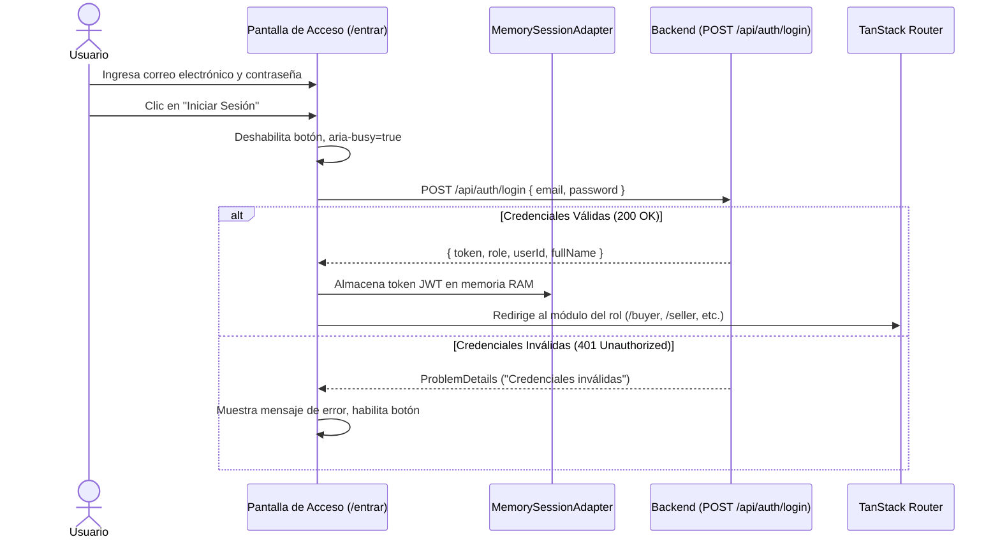
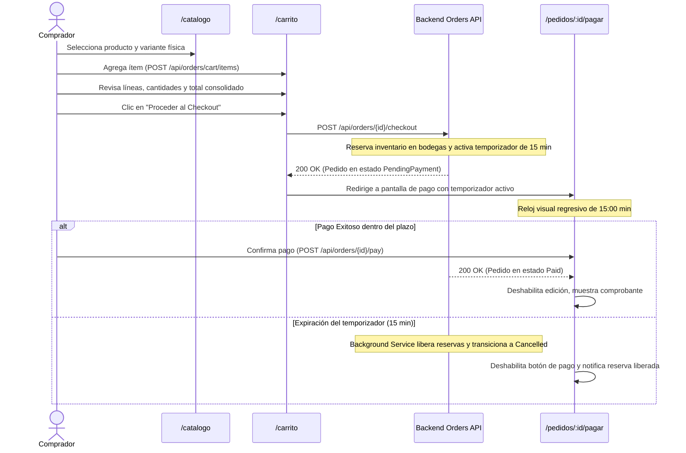
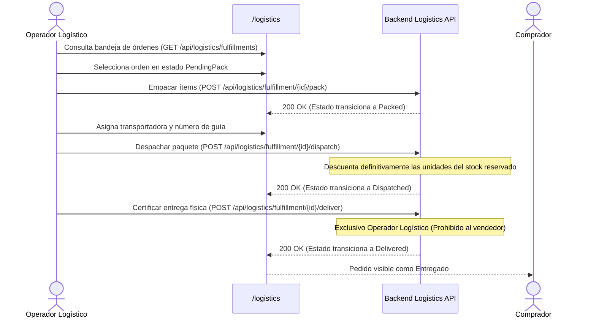
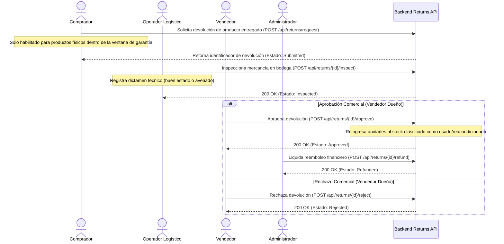

# Frontend-User-Flows — Recorridos de Usuario y Estados de Interfaz

> Recorridos observables y contratos de interacción que el usuario experimenta en la interfaz web de Zentric.  
> Cada flujo define los estados visuales (esqueleto, vacío, error, éxito), las transiciones transaccionales, las confirmaciones obligatorias y las validaciones de negocio en el cliente.  
> **Fuentes canónicas:** [`../ZENTRIC.md`](../ZENTRIC.md), [`Frontend-Role-Modules.md`](Frontend-Role-Modules.md) y [`../backendSDD/Domain/`](../backendSDD/Domain/).

---

## 1. Principios y Reglas Universales de Interfaz

| # | Regla Operativa | Implementación en UI |
|---|---|---|
| **1** | **Cero Pantallas en Blanco** | Durante cualquier carga inicial o resolución de red asíncrona, se presentan componentes `Skeleton` que respetan la geometría del contenido final. Prohibidos los spinners flotantes sobre pantallas vacías. |
| **2** | **Protección contra Doble Envío** | Toda mutación asíncrona (comando) deshabilita inmediatamente su botón de acción y activa el atributo semántico `aria-busy="true"` con un indicador discreto de proceso. |
| **3** | **Normalización de Errores RFC 7807** | Todo error retornado por la API se expone en la interfaz mediante el componente `Alert` o `Toast` con su detalle de negocio específico; queda prohibido silenciar fallos. |
| **4** | **Confirmación Obligatoria (*Double-Check*)** | Toda acción financiera, destructiva o irreversible (pago, cancelación por stock fantasma, anulación fiscal, reembolso) exige un diálogo modal de confirmación con `AlertPort.confirm()`. |
| **5** | **Colecciones Vacías Guiadas** | Una consulta sin resultados no muestra una tabla desierta; presenta un estado vacío explicativo (`EmptyState`) con una acción principal recomendada para salir del estado vacío. |
| **6** | **Tratamiento Contextual de 404** | Un recurso inexistente o no autorizado por propiedad de recurso muestra un estado vacío contextual dentro de la consola, evitando la caída catastrófica de la aplicación. |
| **7** | **Expiración de Sesión (*Fail-Closed*)** | Un código HTTP `401 Unauthorized` purga de inmediato el token JWT de la memoria RAM (`MemorySessionAdapter`) y redirige al usuario a `/entrar` con un aviso informativo de sesión expirada (política sin tokens de refresco, formalizada en ADR-0009). |
| **8** | **Conservación de Sesión ante Denegación (403)** | Un código HTTP `403 Forbidden` mantiene la sesión de usuario activa y presenta un banner o diálogo notificando permisos insuficientes para la acción solicitada. |
| **9** | **Reserva de Entradas ante Conflictos (409 / 400)** | Un fallo de validación del servidor o conflicto de concurrencia mantiene intactos todos los valores ingresados por el usuario en el formulario. |
| **10** | **Trazabilidad de Navegación** | Toda pantalla exhibe su título jerárquico, migas de pan (*breadcrumbs*) legibles y la ruta activa resaltada en la navegación lateral. |

---

## 2. Flujo 1: Acceso, Autenticación y Cierre de Sesión



### Comportamientos y Estados Observables:
- **Carga:** Botón de envío con estado ocupado (`aria-busy="true"`).
- **Error:** Notificación roja contextual sin vaciar los campos de entrada.
- **Éxito:** Redirección inmediata según el rol contenido en el token JWT.
- **Cierre de Sesión:** Opción accesible en la cabecera del usuario que purga la memoria RAM y redirige a `/entrar`.

---

## 3. Flujo 2: Catálogo, Carrito y Checkout Atómico (15 Minutos)

El recorrido transaccional crítico del Comprador implementa la regla de negocio inviolable de **reserva atómica con ventana temporal de 15 minutos**:



### Reglas de Negocio en la Interfaz:
1. **Precio Congelado:** El carrito refleja el precio unitario pactado al momento de añadir el ítem, sin fluctuaciones posteriores.
2. **Temporizador Visible:** La vista de pago muestra un contador regresivo visible sincronizado con la marca temporal devuelta por el backend.
3. **Inmutabilidad Post-Pago:** Un pedido en estado `Paid` bloquea cualquier intento de mutación; se muestra exclusivamente en modo de lectura con sus líneas e importes finales.

---

## 4. Flujo 3: Carga de Catálogo e Inventario por el Vendedor

```text
1. Vendedor accede a /seller/productos/nuevo.
2. Ingresa título, descripción, precio unitario, moneda y tipo de producto (Physical o Digital).
3. Si el tipo es Physical, la interfaz exige obligatoriamente registrar al menos una variante con su código SKU (Regla de negocio formalizada en ADR-0003).
4. Al enviar el formulario, el backend retorna CreatedProductDto conteniendo el productId y la lista de variantIds.
5. La interfaz presenta una tarjeta informativa con el SKU y el variantId generado.
6. El vendedor navega a /seller/inventario.
7. Selecciona la variante física, la bodega de destino y la cantidad mayor que cero (Invariante de existencias no negativas).
8. Clasifica las existencias entre nuevas o reacondicionadas (isUsed = true/false).
9. La tabla de inventarios actualiza y desglosa las cantidades disponibles, reservadas y dañadas.
```

---

## 5. Flujo 4: Preparación, Despacho y Entrega Logística



### Flujo Alternativo: Reporte de Faltante Físico (*Stock Fantasma*)
Si el operador logístico o el vendedor descubren en bodega que el producto físico no existe en estantería a pesar de figurar en el sistema:
1. Pulsa el botón "Reportar Quiebre de Stock".
2. `AlertPort.confirm()` solicita confirmación explicando que se cancelará el despacho y se reembolsará al comprador.
3. Se invoca `POST /api/logistics/fulfillment/cancel-ghost-stock`.
4. El backend cancela la orden logística, libera reservas y genera automáticamente la solicitud de devolución con reembolso para el comprador.

---

## 6. Flujo 5: Gestión Integral de Devoluciones y Garantías



> [!IMPORTANT]
> **Separación de Responsabilidades en Devoluciones:**
> - La inspección técnica en bodega es facultad del **Operador Logístico** (o custodio físico).
> - La aprobación o rechazo comercial es potestad **exclusiva del Vendedor dueño del producto** (formalizado en ADR-0006). El Administrador no puede aprobar devoluciones comerciales.
> - La acreditación económica del reembolso es potestad **exclusiva del Administrador**, garantizando la segregación de funciones sobre el balance financiero de la plataforma.

---

## 7. Flujo 6: Facturación Split y Anulación Fiscal (Administrador)

1. El Administrador ingresa a `/admin/facturas`.
2. Filtra pedidos en estado pagado (`Paid`) que aún no cuentan con comprobantes tributarios.
3. Al pulsar "Generar Facturas", el backend emite atómicamente:
   - **Factura Maestra:** Por el importe total abonado por el comprador.
   - **Detalle Zentric:** Liquidando el porcentaje correspondiente a la comisión de la plataforma.
   - **Facturas de Vendedor:** Liquidando a cada vendedor el importe neto que le corresponde por sus productos.
4. Si ocurre una revocación bancaria o cancelación post-recaudo, el Administrador pulsa "Anular Facturación".
5. Se solicita el motivo de anulación mediante diálogo modal y se ejecuta `POST /api/billing/invoices/annul/{orderId}`, marcando la Factura Maestra como anulada e impidiendo futuras modificaciones.

---

## 8. Matriz de Estados de Interfaz por Pantalla

| Pantalla | Estado de Carga | Estado Vacío | Estado de Error | Estado Exitoso |
|---|---|---|---|---|
| **Panel Ejecutivo** | Cuadrícula de 4 tarjetas en `Skeleton` | Mensaje orientativo de configuración inicial | Banner de reintento con descripción del error | Métricas numéricas en tiempo real |
| **Catálogo de Productos** | Cuadrícula de tarjetas con imagen y precio en esqueleto | "No se encontraron productos publicados" con enlace a limpiar filtros | Alerta con botón de reintento | Cuadrícula responsiva con variantes y paginador |
| **Carrito de Compras** | Lista de ítems en esqueleto con resumen lateral | "Tu carrito está vacío" con botón "Explorar Catálogo" | Notificación flotante de error | Lista de ítems con precio congelado y botón de checkout |
| **Detalle de Pedido** | Esqueleto de cabecera y tabla de líneas de pedido | Estado 404 contextual: "Pedido no localizado" | Notificación con código de seguimiento | Detalle completo con estado, montos e historial |
| **Bandeja de Despachos** | Tabla de despachos con 6 filas en esqueleto | "No hay órdenes pendientes de despacho" | Banner de fallo de conexión con reintento | Tabla interactiva con acciones según el estado de la orden |
| **Expediente de Devolución** | Ficha con secciones técnicas en esqueleto | "No se registran solicitudes de devolución activas" | Notificación contextual RFC 7807 | Expediente con dictámenes de inspección y botones autorizados |

---

## 9. Pruebas de Recorrido Obligatorias (Integration & E2E)

| ID del Test | Recorrido Funcional | Criterio de Aceptación Inviolable |
|---|---|---|
| `TEST-FLOW-01` | Ingreso con credenciales válidas y redirección por rol | Token JWT almacenado en memoria RAM; redirección inmediata a la consola correspondiente. |
| `TEST-FLOW-02` | Rechazo de credenciales inválidas (401) | Muestra mensaje de error; preserva el valor en el campo de correo; no muta el router. |
| `TEST-FLOW-03` | Ciclo completo de checkout con reserva de 15 min | Stock disponible disminuye y reservado aumenta en base de datos; pedido transiciona a `PendingPayment`. |
| `TEST-FLOW-04` | Expiración de ventana de checkout (15 min) | Temporizador llega a cero; botón de pago se deshabilita; el pedido pasa a `Cancelled` y libera reservas. |
| `TEST-FLOW-05` | Alta de producto físico y resolución de variantes | Producto nace publicado; el SKU y los `variantIds` son visibles para su asignación inmediata a inventario. |
| `TEST-FLOW-06` | Certificación de entrega física por operador | El operador logístico certifica la entrega (`Delivered`); el vendedor recibe denegación 403 al intentarlo. |
| `TEST-FLOW-07` | Flujo de stock fantasma y reembolso | La cancelación por quiebre de stock libera reservas y genera automáticamente la solicitud de devolución. |
| `TEST-FLOW-08` | Segregación de funciones en devoluciones | El vendedor aprueba comercialmente; el administrador acredita el reembolso; el comprador verifica el crédito. |
